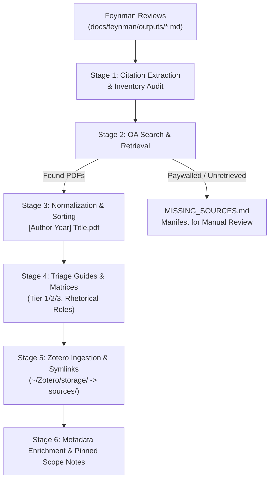

# Feynman-to-Sources Literature Pipeline

An end-to-end operational runbook for transforming raw literature reviews (e.g. Feynman outputs, reading lists, synthesis documents) into a citable, categorized, and Zotero-synchronized research library with project symlinks and tiered reading guides.

---

## Execution Modes: Hybrid Symlinks vs. Direct Zotero

The pipeline natively supports two operational modes based on user preference:

| Mode | Trigger Phrases | Behavior & Artifacts | Best Used For |
|---|---|---|---|
| **Mode 1: Hybrid Symlinks** *(Default)* | *"process into sources"*, *"symlink into repo"* | • PDFs downloaded to staging, ingested to Zotero.<br/>• Local repo files in `sources/<theme>/` are replaced with atomic symlinks to `~/Zotero/storage/<KEY>/`.<br/>• Triage READMEs stored in `sources/<theme>/` and pinned in Zotero. | Coding projects, computational linguistics, or experiments where local Python/bash scripts need to read or evaluate PDFs directly from the repository. |
| **Mode 2: Direct Zotero** | *"directly into Zotero"*, *"no local sources"*, *"skip symlinks"* | • PDFs downloaded directly to a temporary staging folder, ingested into Zotero collections, and staging files are cleaned up immediately.<br/>• **No local PDF files or symlinks are kept in the project repository.**<br/>• Triage guides and synthesis notes are pinned directly into Zotero collections as native rich notes (with optional markdown index in the repo if requested). | Literature reviews, pure reading lists, non-coding research, or users wanting 100% centralized Zotero management without repo clutter. |

---

## Architecture Overview



---

## The 6-Stage Standard Operating Procedure

### Stage 1: Citation Extraction & Inventory Audit
1. **Extract Citations:** Parse the target literature review markdown files (e.g. `docs/feynman/outputs/*.md`).
2. **Deduplicate against Inventory:**
   - Scan existing files in `sources/` and Zotero database (`zotero-cli get recent` or `zotero_search_items`).
   - Match by DOI, arXiv ID, or Normalized `[Author Year] Title`.
3. **Produce Target Acquisition List:** Generate the list of unique papers requiring PDF retrieval.

### Stage 2: Acquisition & `MISSING_SOURCES.md` Generation
1. **Automated Open-Access Retrieval:**
   - Query arXiv, CrossRef, Semantic Scholar, Unpaywall, PubMed Central, and open institutional repositories.
   - For papers with DOIs, resolve open-access PDF endpoints.
2. **Compile Unretrieved Manifest (`MISSING_SOURCES.md`):**
   - For any papers that cannot be automatically retrieved (paywalled publishers, books, missing DOIs), log them in `sources/MISSING_SOURCES.md`.
   - Include: Full citation, DOI link, paywall publisher, target thematic folder, and specific role in the study.
   - Present this to the user for out-of-band manual retrieval.

### Stage 3: Normalization & Thematic Clustering
1. **Standardized Filename Convention:**
   - Always enforce the standard: `[Author et al. Year] Title.pdf`
   - Single author: `[Kann 2019] Title.pdf`
   - Two authors: `[Boroditsky & Schmidt 2000] Title.pdf`
   - Three+ authors: `[Bender et al. 2011] Title.pdf`
2. **Thematic Folders:**
   - Cluster into numbered thematic directories under `sources/` reflecting the study's conceptual boundaries (e.g., `01_Human_Psycholinguistics/`, `02_Gender_in_Embeddings/`, etc.).

### Stage 4: Triage & Reading Guides Generation
1. **Folder-Level Reading Guides (`README.md`):**
   - In each folder, generate a comprehensive `README.md` with:
     - **Scope & Guiding Question:** Core empirical tension.
     - **3-Tier Reading Priority Matrix:**
       - *Tier 1: Definitive Anchors* (must-read methodological/meta baselines).
       - *Tier 2: Specific Modern Mechanisms* (novel architectures, probes, controls).
       - *Tier 3: Foundational & Contextual* (historical background, exploratory).
     - **Mermaid Conceptual Map:** Visualizing causal pathways and replication trajectories.
     - **Rhetorical Citation Matrix:** Table mapping each paper to specific project claims and counter-argument defenses.
2. **Master Summaries (`sources/SUMMARIES.md`):**
   - Maintain detailed per-paper analytical entries (Hypotheses, Datasets/Models, Methodology, Findings, and Direct Project Relevance).

### Stage 5: Zotero MCP Synchronization & Storage Handling
1. **Collection Hierarchy:**
   - Map folders/themes directly into hierarchical Zotero collections: `Projects/<ProjectName>/<Folder_Theme>`.
   - Cross-file papers into relevant `Topics/<TopicName>` collections where multi-membership applies (e.g. `Topics/MechInterp`).
2. **Ingestion Execution:**
   - **Mode 1 (Hybrid Symlinks):**
     ```bash
     python3 .agents/skills/feynman-to-sources/scripts/batch_ingest_symlink.py sources/01_Theme "Projects/MyProject/01_Theme" --tags "project:myproject,domain:theme"
     ```
     Replaces local files with atomic symlinks to `/Users/watcher/Zotero/storage/<KEY>/[Author Year] Title.pdf`.
   - **Mode 2 (Direct Zotero):**
     ```bash
     python3 .agents/skills/feynman-to-sources/scripts/batch_ingest_symlink.py staging_folder "Projects/MyProject/01_Theme" --tags "project:myproject,domain:theme" --no-symlink
     ```
     Stores the PDF in Zotero storage and cleans up the staging file without creating local repo symlinks.
3. **AI Document & Synthesis Handling:**
   - Ingest Feynman reviews and folder guides into `Projects/<ProjectName>/AI_Background_and_Syntheses`.
   - Tag with: `role:background-only`, `#nocite`, `source:ai-generated`.
   - Set metadata `Extra`: `tex.skipbib: true\nkeywords: nocite, ai-generated`.

### Stage 6: Metadata Enrichment & Pinned Scope Notes
1. **Metadata Enrichment:**
   - Strip filename noise from Zotero items and populate clean academic fields:
     ```bash
     python3 .agents/skills/feynman-to-sources/scripts/enrich_zotero_metadata.py --summaries sources/SUMMARIES.md
     ```
   - Writes clean Title, academic Short Title, Date, and structured Creator lists (first and last names).
2. **Pinned Collection Guides:**
   - Run the pinning helper for each subcollection:
     ```bash
     python3 .agents/skills/feynman-to-sources/scripts/pin_collection_guides.py "Projects/MyProject/01_Theme" "01 Theme Title" --note-file sources/01_Theme/README.md
     ```
   - Pins an item titled `📌 00 Scope & Reading Guide: <Theme>` at the top of the collection with a native formatted rich child Note for tablet reading.

---

## Bundled Helper Scripts

All helper scripts reside in `scripts/`:

| Script | Purpose |
|---|---|
| `batch_ingest_symlink.py` | Ingests PDFs into Zotero via `zotero-cli add file` and creates atomic symlinks to canonical storage. |
| `enrich_zotero_metadata.py` | Parses filename patterns and `SUMMARIES.md` to populate Titles, Short Titles, Dates, and Creators in Zotero. |
| `pin_collection_guides.py` | Ingests collection scope markdown and pins rich child notes to the top of Zotero collections. |
