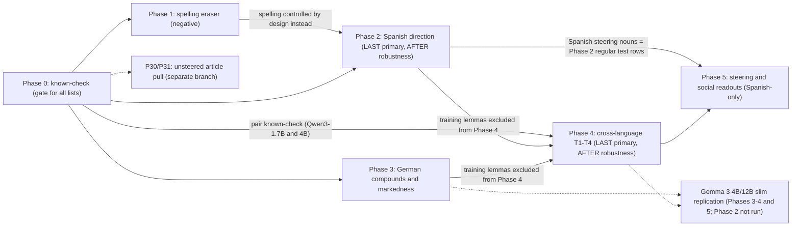

# Grammatical gender in base language models: pre-registered tests of spelling, shared representations, and social gender

*Draft, 2026-10-30. Tentative throughout. Built only from the evidence notes and plan listed in the Sources appendix; no new analyses were run for this draft.*

*Markers used in the text:*
- *[TODO: verify]* = a number or claim that is not in the evidence notes.
- *[unverified]* = a literature entry whose record was not checked (see the refs notes).
- *[not yet checked]* = a source that is not in the reference list at all.

---

## Abstract

We ask whether a base language model's grammatical-gender direction, learned only from inanimate nouns, overlaps with its representation of social gender. The study uses Qwen3 base models from 0.6B to 14B parameters (Qwen3-30B-A3B, a mixture-of-experts model, was run once as exploratory), a slim replication on Gemma 3 4B and 12B pretrained (Phases 3–5; Phase 2 not run), and EuroLLM-1.7B for behavioural checks, across Spanish, German and Russian. Gold genders come from Wiktionary, not from a model. Test nouns are held out from training, and a noun counts as "known" only if the model assigns its dictionary gender in both frames. Most conclusions rest on one model family and on the 8B and 14B confirmatory sizes, so every statement below is tentative. [20][21][22][16]

At the noun's own last token, a Spanish direction trained on stratified nouns reads grammatical gender rather than the *-a/-o* ending in 28 of 35 inner layers on Qwen3-8B and 26 of 39 on Qwen3-14B (the amended primary; §4.2). The effect is not position-robust: at the AFTER position, dense Qwen3 models read gender in at most 3 layers. German compounds whose first constituent and head differ in gender are sorted by the head's gender in every inner layer of Qwen3-1.7B and larger, and in 26 of 27 layers of Qwen3-0.6B; the slim Gemma 3 run gives the same pattern at the last token (33 of 33 inner layers for 4B, 47 of 47 for 12B; result files; §4.3, §4.6). Markedness, that masculine vectors are shorter, is not supported (0 layers) after the bias-free estimator, which removes a noise bias; the plug-in estimator reports feminine-longer in most layers, which is what that bias predicts (§4.3). Across languages, the flipped-pair test T3 and the Russian *-ь* test T4 (Spanish direction) pass at the last token on 8B and 14B (T3 as a co-primary test; T4 secondary), while the ending-controlled transfer test T1 fails on both Qwen sizes. On 14B only its DE→ES direction reaches the majority threshold (§4.5). [17][21]

Steering shows a small Spanish-only effect. On Qwen3-8B the noun-position readout passes at 3 of 4 gate layers (mean effect 0.0203), which the pre-registered rule labels *language-specific (Spanish-only)*. On 14B there is no positive effect by the pre-registered rule. German steering had no valid test on any model, so there is no bleed verdict (§4.8). At the AFTER position the T1 and T3 verdicts fail on every model; T3-pooled and T4-ES reach a majority threshold on some models, which is descriptive only (§4.5). Amendments and a revision of the T2 test are dated and disclosed in §3.9 and §7. [17][18][20][22]

---

## 1 Problem statement

Grammatical gender in Spanish and German is largely a property of the word, not of the referent. *Die Brücke* ("bridge") is feminine and *el puente* ("bridge") is masculine, although a bridge has no sex. A proposal from the human psycholinguistic literature, usually traced to Boroditsky et al. (2003) [9], is that speakers' gender-marked words nevertheless shape their ideas about the referents. This is the "bridge" effect. The design note for this project cites Boroditsky et al. (2003) as its primary source [not yet checked: this paper is absent from the reference list in `sources/SUMMARIES.md`, see the refs notes]. Two human studies bear on that claim. Mickan, Schiefke and Stefanowitsch (2014) report a failure to replicate the Boroditsky adjective effect [1] [unverified]; the Kann (2019) abstract reports the same failed replication [3]. Elpers, Jensen and Holmes (2022) report a registered replication with a null result for same-gender object similarity in German and Spanish [2] [unverified]. The human evidence is therefore contested.

The model version is a measurable question. Can a language model's internal representation of grammatical gender, learned from inanimate nouns, be separated from spelling and frequency? If it can, does it overlap with a representation of social gender, and does it move a social readout when steered? This paper reports what the project's pre-registered tests found on Qwen3 base models, a smaller Gemma 3 replication, and a few EuroLLM checks. It does not establish whether any overlap is a model of the human effect. The question of whether a direction "means" social gender is left open (§5). [18][20]

---

## 2 Related work

We keep this section short and limit it to the works listed in the refs notes. Each entry's verification status is given in the text. Verification in the refs notes covered arXiv metadata (title, authors, date, comment) and abstracts only. Content claims about what a paper tested come from the project's `sources/SUMMARIES.md`, not from full texts, unless marked otherwise. [13][25]

**Human grammatical-gender effects.** Mickan et al. (2014) report a failed replication of the Boroditsky adjective experiment [1] [unverified; DOI 10.1515/gcla-2014-0004 matched by a Crossref title search in this pass]. Elpers et al. (2022) report a registered replication with a null result for object similarity [2] [unverified; the DOI resolves (HTTP 200), but a Crossref DOI lookup returned an unrelated record, so the record is not confirmed]. Both are used here only as the human baseline. Boroditsky et al. (2003) [9] [not yet checked].

**Probing, spelling and erasure.** Kann (2019) analyses grammatical gender and word embeddings in a data-driven way (arXiv:1910.09729). The arXiv record title is "Grammatical Gender, Neo-Whorfianism, and Word Embeddings: A Data-Driven Approach to Linguistic Relativity", sole author Katharina Kann, published 2019-10-22 (VERIFIED: arXiv record checked in this pass [3]). The arXiv abstract reports evidence against neo-Whorfianism across 9 languages [3]. The project summary's narrower claim, that no inanimate-gender signal survives once agreement context is lemmatised, comes from `sources/SUMMARIES.md` [25] and is [unverified]. Gonen, Kementchedjhieva and Goldberg (2019) show agreement-driven gender structure in static German and Italian embeddings [4] [unverified; ACL Anthology K19-1043]. Belrose et al. (2023) give LEACE, a closed-form linear concept erasure method (arXiv:2306.03819; arXiv authors Belrose, Schneider-Joseph, Ravfogel, Cotterell, Raff and Biderman; VERIFIED: arXiv record checked in this pass [5]). The method's guarantee is linear only, which matters for the spelling experiments (§4.1). Sukumaran, Houghton and Kazanina (2024) study novel-noun gender learning with a nonce-word method (arXiv:2403.10338; VERIFIED: arXiv record checked in this pass [6]). Its abstract covers French only, not French and German as the project's summary states.

**Gender in generated text.** Saeed et al. (2025) study grammatical gender and visual representation in text-to-image models (arXiv:2508.03199). The arXiv title is "Beyond Content: How Grammatical Gender Shapes Visual Representation in Text-to-Image Models", with authors Muhammed Saeed, Shaina Raza, Ashmal Vayani, Muhammad Abdul-Mageed, Ali Emami and Shady Shehata (MISMATCH with the project summary, which gives a different title and author spelling; the arXiv record is used here). The arXiv abstract reports 73% male representation for masculine markers against 22% for gender-neutral English [7]; the refs notes say these figures match the project summary [13]. It concerns image generation, not a text LLM. Benedetto et al. (2026) study Italian inflectional gender steering recommendations in an LLM [8] [unverified; aclanthology.org/2026.eacl-long.264]. This is the closest text-LLM analogue to agreement-driven steering, according to the project summary.

**Works not used.** Four further entries from the project summary are excluded because their attributions do not match the arXiv records (arXiv:2606.07969, 2605.30214, 2609.30768, 2610.11765; SUMMARIES entries 10, 11, 13 and 14; refs notes: MISMATCH). No author name from the SUMMARIES attributions is used for them [13][25]. 

**What this paper adds, and what it does not claim.** The project's contribution is the combination of dictionary-sourced gold labels, held-out stems and lemmas, spelling-controlled stimuli, split-half geometry against a noise bias, and dated amendments. The plan's entry V16 cites a prior-art check for the cross-lingual manipulation claim ("checked, 5 passes") [14]. The file it names, `docs/feynman/outputs/prior-art-recheck.md` [27], is a search for the character study's Q1, not for this paper's claims, so it does not support a novelty statement here. This draft therefore makes no novelty claim. [TODO: UNRESOLVED; a prior-art search scoped to this paper's claims is needed before any novelty statement. No input file does this.]

---

## 3 Method

### 3.1 Models, precision and devices

| Group | Models | Device and precision | Use in this paper | Source |
|---|---|---|---|---|
| Qwen3 small (development) | 0.6B, 1.7B, 4B | Mac (MPS, fp16) for the Mac copies; RunPod (CUDA, bf16) copies also exist for 0.6B–4B | Phases 0–3, development and exploratory | notes p0-3 legend and §0; audit §5.2 [10][12] |
| Qwen3 confirmatory | 8B, 14B | CUDA, bf16, RunPod pod. GPU as recorded in result metadata: A100-SXM4-80GB for the Phase 0, 2 and 3 pod runs (`runpod/phase0`, `runpod/phase2`, `runpod/phase3`); L40S for the P29–P31 runs, the `runpod2` Phase 5 gate and frame files, and the Gemma runs | Confirmatory for Phases 2–5 | result summaries [16][20][18]; decision 2026-10-08 [15] |
| Qwen3-30B-A3B | 30B-A3B (mixture of experts) | Pod, bf16 | Exploratory only | notes p0-3 §4a; notes p0-3 §5b [10] |
| EuroLLM-1.7B | 1.7B | Mac, MPS, fp16 | Behavioural checks (P30/P31, known-check) | audit §5.2 [12][20][16] |
| Gemma 3 slim | 4B-pt, 12B-pt | CUDA, bf16, NVIDIA L40S (metadata) | Replication, Phases 3–5 (Phase 2 not run) | audit §5.6; notes p4-5 §0 [12][11] |

- **Cross-size comparisons mix devices.** The small Qwen3 runs and the 8B/14B runs use different hardware and precision. The audit notes that the P30 and P31 results mix MPS fp16 (≤4B and EuroLLM) with CUDA bf16 (8B and 14B) in the same phase. Any cross-size comparison in this paper therefore mixes devices for some results (audit item 5; `CLAUDE.md` lines 21–22 as quoted by the audit). [12][20]
- **Two copies of the same pod run disagree slightly.** For Qwen3-8B and 14B the Phase 0 values differ between `results/phase0/` and `results/runpod/phase0/`. We report the pod copy, which matches the decision log (§4.0, note X5). [15][16]
- **Gemma AFTER runs differ in device.** The Gemma 4B AFTER activations were extracted on the Mac (MPS, bf16), while the 12B AFTER run was on CUDA (notes p4-5 §3; decision row 2026-10-25, DOC-ONLY). [11][15]
- **Commit drift.** The P31 results were produced at commits that predate the current HEAD (`aab763e`) by a substantial code change (the audit reports 27 changed files under `src/gbleed`). A rerun at HEAD would not be a clean reproduction (audit §4.6). [12][20][23]

### 3.2 Lexical sources and stimuli

All nouns and gold genders come from Wiktionary (kaikki.org snapshot 2026-10-03 per the methods description). No label comes from a model. Inanimacy was enforced by rule. The stimulus files below are frozen lists; the counts were recounted in the audit. [12][22][26]

| List | Language | Rows | Composition | Split column | Source |
|---|---|---|---|---|---|
| `phase0_v3.csv` | de, es | 514 (257 per language) | 268 m / 246 f | absent (not required for Phase 0 per audit) | audit §1.1 [12][22][16] |
| `phase2_final_v4.csv` | es | 513 | 317 m / 196 f; regular 247, strat 111, matched 54, homograph 72, exception_ma 20, exception_true 7, exception_clipping 2 | present (train 329, test 184) | audit §1.2 [12][22][16] |
| `phase3_final_v3.csv` | de | 1,139 | strat3 122 (27 f/64 m/31 n); matched3 42; matched2 60; matched3_end 51; compound_train 56; compound_test 720 (425 f/207 m/88 n; 219 conflict items); suffix 81; multi 7 | present (train 331, test 808) | audit §1.3; notes p0-3 §5 [10][12][22][16] |
| `phase4_pairs_final_v1.csv` | de/es | 271 | 166 de-f/es-m; 105 de-m/es-f; 43 flagged cognate | present (all test) | audit §1.4; notes p4-5 §4 [11][12][17][22] |
| `phase4_ru_final_v1.csv` | ru | 174 | 100 f / 74 m, 10 cells | present (all test) | audit §1.5; notes p4-5 §5 [11][12][17][22] |
| `phase5_nouns_v1.csv` | de, es | 757 | pair 542; steer_de 100; steer_es 83; classic 32 | present (all test) | audit §1.6 [12][18][22] |
| `rarity_heldout_v1.csv` | de | 888 | 502 f / 190 m / 196 n | **absent** | audit §1.8, §2.2 [12][20][22] |
| `phase5_es_pooled_v1.csv` | es | 157 | numeric GEND/VAL columns; no gender column | **absent** | audit §1.7 [12][18][22] |
| `multi_gender_spec.csv` | es, de | 32 | 21 es / 11 de | **absent** | audit §1.9 [12] |
| `classics.csv` | de, es | 38 | 19 + 19 | **absent** | audit §1.10 [12] |

**Spanish exclusions** (methods description, §2.3.2 of the methods-style draft): gender-predictive endings, English-near spellings, sex-associated meanings, persons/animals/groups/places/chemicals, Zipf < 2, and nouns the model does not know. Remaining nouns were stratified into cells by final two letters × loan status. Word-initial *a-* was imbalanced (0 of 33 feminine and 17 of 132 masculine training nouns in `strat ∪ matched`), so it was added as a nuisance covariate (audit P2-4; notes p0-3 §4). The Spanish regular set was 271 nouns in the pool and 247 in the final v4 list; the drop is caused by the known-check filter at `src/gbleed/phase2.py:66` (audit §6.2). Noviembre is a masculine training noun in Phase 2 `strat` and marzo a masculine test noun in `regular` (X12; audit list `phase2_final_v4.csv`, VERIFIED). [10][12][22][23][26]

**German exclusions** (methods description): compounds, names, diminutives, chemicals, *Ge-* collectives, animates, *-er* agent nouns, gender-fixing suffixes, and nouns the model does not know. Cells are final two letters × loan status plus shared-suffix cells. **Known complexity imbalance (X11):** 12 of the 64 masculine `strat3` training nouns are complex (numerals such as *Vierer*, or compounds with a deverbal *-er* head such as *Wasserkocher*). None of the feminine training nouns are. The audit notes record that all 12 are in `phase3_final_v3.csv` as `strat3`, masculine, training. The Phase 3 explainer does not mention this. The decision log (2026-10-21) reports "frequency-axis D" checks (D1 drops the complex nouns; D2 controls for them). The German gender–frequency overlap survives both, and in no variant does it vanish at a majority of layers (8B: 4 overlap layers, 1 gone under D1 and under D2; 14B: 3 overlap layers, 0 gone under D1 and D2) [15][20]. The effect on the compound result itself was not re-run [10].

**Flipped pairs** (Phase 4). The funnel is 2,217 German–Spanish pairs formed via English glosses, of which 519 have opposite genders (methods description; decisions 2026-10-22 draft). The pool after exclusions is 389 pairs (239 de-f/es-m, 150 de-m/es-f; 63 cognates), recorded in `phase4_pairs_pool_v1.csv` (notes p4-5 §4). The final list of 271 is the pool intersected with the known-check of Qwen3-1.7B and Qwen3-4B only (`phase4.finalize`, `KNOWN_MODELS`; notes p4-5 §1c). The 326 → 389 step is the restoration of 63 cognate pairs (decision log line 81; 326 + 63 = 389) [15]. The 519 → 326 step is not reconstructed: the decision row (line 74) lists drops of 51 + 37 + 101 + 7 + 22 = 218 and a rule-v2 restore of 11, which gives 312, not 326 [15]. `docs/reports/flipped-pairs-flags.csv` [22] has 218 flag rows but only 52 distinct `row` values, so it does not reconcile the step. [TODO: reconcile 519 → 326 from the pair-builder output; no input file gives the per-pair decisions.] A training-leak drop of 37 pairs is recorded in the decision log (2026-10-08); the Phase 2 results are unaffected per that row (DOC-ONLY).

**Russian.** Soft-sign (*-ь*) nouns only. The pool `phase4_ru_pool_v1.csv` has 1,621 rows (1,120 f / 501 m); the 245 nouns with `set == strat_ru` (123 m / 122 f, 10 cells) pass the filters. The analysed list is the 174 of those 245 that Qwen3-4B's known-check marks `known` (100 f / 74 m). **The analysed sample is 174, not 245.** The 71 dropped nouns are those Qwen3-4B's known-check does not mark `known` (notes p4-5 §1d, §5; decisions 2026-10-08). [11][15][17][21][22]

**Readout vocabularies and P30/P31 nonce nouns** are described in §4.7. [20]

### 3.3 Known-check

Each noun is scored in two frames with each gender's article; the score is the log-probability of the noun continuation minus the strongest rival. A noun is *known* if the correct gender wins by at least 1 nat in both frames (decisions 2026-10-05; notes p0-3 §2, rule). The bare-noun readout uses `<|endoftext|>` as the first token, with a newline buffer before the noun for Qwen3. The methods description states that the buffer exists because Qwen3 makes the first content position an attention sink (§2.4 of the methods-style draft). The known-check is a Phase 0 gate; Phase 3 used a three-article variant with a Zipf ≥ 4 check (≥ 70% known per gender per model, decision 2026-10-07). [10][15][18][20][26]

### 3.4 Readout positions

- **LAST** is the noun's final token. This is the primary position. [26][10]
- **AFTER** appends a newline token after the noun. Under causal attention this does not change LAST. [26][10]

The methods description records that the primary position was chosen by a pre-registered gender-blind rule: AFTER would be primary only if it preserved word identity and reduced dependence on tokenisation. It met both criteria in 1 of 4 model × language combinations, so LAST is primary (decision 2026-10-06 lines 46 and 49, per notes p0-3 §7; readout values are in §4.2.5). [10][15][20][26]

### 3.5 Directions, residualisation and the probe

Two estimators are used: a difference of class means (DoM), and an L2-regularised logistic probe with standardised features and C = 1 (methods description §2.6.1). The probe is fitted in the row space of the training data, which gives the same optimum in an n-dimensional problem. The estimator was not chosen per model. The pre-registered tie-break was applied once to the AUC averaged over the two development models (raw difference of means 0.65, standardised 0.665, shrinkage LDA 0.69, logistic probe 0.70; LDA is within 0.02 of the probe, so the simpler method wins), and the PI then fixed the logistic probe for all sizes on 2026-10-06 (decision log line 45) [15]. The per-model figures in line 44 had picked the raw difference of means for 4B; the single-estimator decision superseded that [15][26].

Nuisance variables are removed before fitting by residualisation: [26][10]

$$\tilde{X} = (I - Z Z^{+})\,X$$

where Z holds the cell indicators, Zipf, token count, concreteness, and the Spanish *a-* indicator. By the Frisch–Waugh–Lovell argument, the direction can use only within-cell variation orthogonal to the covariates (methods description §2.6.2). The covariates were fixed from screening imbalance before gender results were seen; additions follow the same rule and are logged. [26]

### 3.6 Split-half geometry and the cross-fit estimator

The plug-in squared norm of an estimated class-mean difference is biased upward. With n_g nouns in the group of interest and n_ref in the reference: [26][10]

$$\mathbb{E}\lVert\hat v\rVert^2 = \lVert v\rVert^2 + \operatorname{tr}\Sigma\left(\frac{1}{n_g} + \frac{1}{n_{\text{ref}}}\right)$$

With unequal class sizes this bias mimics markedness (feminine vectors appear longer or shorter depending on group sizes). The fix is to split nouns into halves A and B within strata, and use the cross-fit product: [26][10]

$$\mathbb{E}\left[\hat v_A \cdot \hat v_B\right] = \lVert v\rVert^2$$

because the halves' noise is independent. Results are averaged over 200 random splits, computed exactly through the Gram matrix since every estimate is a linear map of X (methods description §2.6.3). Under the bootstrap, duplicated items are constrained to fall in the same half, because copies split across halves share noise and reintroduce the bias. [26]

The split-half estimator is the one used for markedness and cosines. The plug-in estimator is reported only to show the size of the bias (§4.3). [26][10]

### 3.7 Nulls, bootstrap and multiple comparisons

- **Bootstrap.** 1,000 resamples, stratified within cells; the direction is refitted in each resample and test nouns are resampled where the statistic depends on them (methods description §2.6.4). [26]
- **Shuffle null.** A within-cell label shuffle preserves cell × gender counts. For split-half geometry the null is applied to the cross term, not the cosine, because a shuffled class vector has noise-corrected length near zero and its cosine is undefined (decision 2026-10-10 as recorded in the methods description and notes p4-5 §1a). [11][15][26]
- **Layer counts and the majority rule.** A test is judged by the number of inner layers that pass, against a majority threshold n // 2 + 1 (35 layers → 18; 39 → 20; 33 → 17; 47 → 24; 27 → 14; code `phase4.verdicts`, notes p4-5 header). Phase 5 uses passed > layers // 2. [11][17][18]
- **Holm.** Co-primary Phase 4 tests use Holm via interval width: the stronger test must exclude chance at 97.5%. Counts with that correction are labelled "Holm" in the tables. The Phase 4 design applies Holm to T1 and T3 only, while the explainers and decision rows apply it to T4 as well (§7, note on T4 conventions). [15][17]

### 3.8 Phase pipeline

The diagram below shows the phase order and the data dependencies that the notes and audit record. Phase 1 was negative, so spelling was controlled by stimulus design in Phase 2 instead (methods description §3.1). Phase 4 excludes training lemmas from Phases 2 and 3 (audit §3.4). Phase 5 uses Phase 2 regular test rows as Spanish steering nouns (audit §3.6). [12][17][18][22][26]

*Caption: Phase dependencies as recorded in the notes. The P4→P5 edge is supported by the 542 "pair" nouns in `phase5_nouns_v1.csv`, which equal 271 × 2 flipped-pair nouns (audit §1.6). Sources: notes p0-3 §1–§4; notes p4-5 §1, §4; audit §3.4 and §3.6; methods-style draft §2.1 and §3.1 for the Phase 1 outcome. The Gemma box shows the replication scope (Phases 3–4 and 5); Phase 2 was not run on Gemma (notes p4-5 §3; plan V12).* [10][11][12][14][17]

### 3.9 Pre-registration and amendment trail

"Pre-registered" is used here only where a dated decision row or a design document exists. Dates are from `docs/decisions.md` as cited in the notes. [15][20][24]

| Item | Date / row | What changed | Source |
|---|---|---|---|
| Phase 0 pass rule (both frames ≥ 1 nat) | 2026-10-05, line 11 | Pre-registered rule | notes p0-3 §7 [10][15][20][16] |
| Phase 1 reading (outcomes a/b; 0.557 cutoff; 2/3 rule) | 2026-10-06, line 19 | Written before the run; the result is at line 20 | notes p0-3 §3 (P1-9) [10][15] |
| Phase 1 first analysis | 2026-10-06, line 20 | The first "0.50" results were circular; fixed to ROC AUC on unseen words, commit `95329f0` | notes p0-3 §3 (P1-10, DOC-ONLY history) [10][15] |
| Phase 2 pre-registration (verdict rules; exception AUCs) | 2026-10-06, lines 27 and 29 | Gender / spelling / mixed / neither verdicts per layer | notes p0-3 §4 [10][18][16] |
| Phase 2 estimator selection | 2026-10-06, lines 43–45 | Estimator selection rule (probe) | notes p0-3 §7 [10][16] |
| Phase 2 readout-position rule | 2026-10-06, line 46; adopted at line 49 | LAST primary, AFTER secondary; position-robust only if the reading holds at both | notes p0-3 §4c, §7 [10][15][20][16] |
| Phase 2 stratified-probe primary | 2026-10-07, line 59 | Stratified residualised probe set as primary (`probe_strat`) | notes p0-3 §4 [10][15][16] |
| Markedness prediction | 2026-10-06, line 34 | Pre-registered prediction (D-34) | notes p0-3 §5d [10][15][20] |
| Phase 3 pre-registration (German rules) | 2026-10-07, lines 54–62; `docs/design/base/phases-3-5-plan.md` lines 77–158 | Known-check ≥ 70% (line 54); German follows-head and markedness rules | notes p0-3 §5, §7 [10][14][15][24][16] |
| Phase 2 **amendment**: word-initial *a-* nuisance term (`probe_strat`) | **2026-10-08, lines 66 and 72 (D-66, D-72)** | Adds *a-* as a nuisance term. The pre-amendment definition is `probe_strat_noinit`. Disclosed in §4.2 | notes p0-3 §4a, X1, X2 [10][15][16] |
| bf16 vs fp32 status bar (99%) | 2026-10-08, line 69 | Bar missed: 507 of 514 agree (98.6%) | notes p0-3 §2 (P0-7) [10][15] |
| **T2 statistic change** (cosine null replaced by cross-term null) | **2026-10-10** (adoption as recorded in notes p4-5 §1a) | Adopted **after the null values were seen**. Disclosed as a revision of a pre-registered test (§4.5) | notes p4-5 §1a, §10 [11][17][20] |
| Phase 4 and Phase 5 design documents | `docs/design/base/phase4-design.md`, `docs/design/base/phase5-design.md`, `docs/design/followups/russian-direction-prereg.md`, `docs/design/base/p31-german-object-context-prereg.md`, `docs/design/followups/rarity-lean-heldout-prereg.md`, `docs/design/followups/gemma-slim-prereg.md` | Adoption dates from the decision log: phase4-design 2026-10-08 (line 76); phase5-design 2026-10-08 (line 77); p31 prereg 2026-10-21 (line 141); rarity prereg 2026-10-22 (line 177); russian prereg 2026-10-25 (line 185); gemma-slim-prereg written and adopted 2026-10-22 (file header) [15][24] | notes p4-5 §0, §12 |
| Phase 5 German C1 sweep | 2026-10-13 (PI) | No exploratory German C1 sweep; German = no valid confirmatory test on 8B and 14B | notes p4-5 §7b [11][18] |
| Gemma 12B AFTER run | 2026-10-27 (analysis cutoff) | Included in this draft because the cutoff is 2026-10-27 | notes p4-5 header [11] |

---

## 4 Experiments and results

Unless stated otherwise: LAST position, inner layers (layers 1 to n_layers − 1, the convention the implementation uses; design text says "1 … L−2", see §7), 95% bootstrap intervals, verdicts by the rules in §3.7. "Holm" counts use the 97.5% lower bound and "raw" counts the 95% bound. Confirmatory models are Qwen3-8B and 14B; all other sizes are development or exploratory. [18]

### 4.0 Phase 0: does the model know each noun's gender?

| Model | Device | German known, balanced | Spanish known, balanced | Source |
|---|---|---|---|---|
| Qwen3-0.6B | pod, bf16 | 0.888 | 0.887 | notes p0-3 §2 (P0-3); `results/runpod/phase0/*/summary.json` [10][16] |
| Qwen3-1.7B | pod, bf16 | 0.901 | 0.919 | same [10][16] |
| Qwen3-1.7B | Mac, fp16 | 0.897 | 0.923 | `results/phase0/Qwen__Qwen3-1.7B-Base/summary.json` (`results.{de,es}.known_bal`) [16] |
| Qwen3-4B | Mac, fp16 | 0.938 | 0.939 | `results/phase0/Qwen__Qwen3-4B-Base/summary.json` (P0-1) [16] |
| Qwen3-4B | pod, bf16 | 0.930 | 0.927 | `results/runpod/phase0/…4B…/summary.json` (P0-2) [16] |
| Qwen3-8B | pod, bf16 | 0.973 | 0.937 | `results/runpod/phase0/…8B…` (X5: `results/phase0/` copy gives 0.965 and 0.941) [16] |
| Qwen3-14B | pod, bf16 | 0.954 | 0.947 | `results/runpod/phase0/…14B…` (X5: `results/phase0/` copy gives 0.944 for Spanish) [16] |
| Qwen3-30B-A3B | pod, bf16 | 0.980 | 0.966 | `results/runpod/phase0/…30B-A3B…` (P0-11) [16] |
| EuroLLM-1.7B | Mac, fp16 | 0.973 | 0.982 | `results/phase0/utter-project__EuroLLM-1.7B/summary.json` (`results.{de,es}.known_bal`) [16] |

- **Confidently wrong items are rare.** On Qwen3-4B (Mac) the German rate of confidently wrong items is 0.004 and the Spanish rate is 0.000 (notes p0-3 P0-1). [10]
- **Precision check.** On Qwen3-4B the fp32 and bf16 runs agree on 507 of 514 items (98.6%), short of the pre-registered 99% bar (decision 2026-10-08, line 69). The fp32 known rates are 0.942 (de) and 0.942 (es) (notes p0-3 P0-7, P0-8). [10][15][20]
- **Spanish matched set.** Spanish known rates on the ending-matched set are 0.596 (0.6B), 0.654 (1.7B) and 0.750 (4B), which is why Qwen3-0.6B was dropped from the known set (notes p0-3 P0-6, P2-8; decision 2026-10-06). Note that a 0.6B Phase 2 result file exists in `runpod/phase2/` (§7). [10][15][16]
- **German known rate definitions differ.** Decision entry D-70 (2026-10-08) gives German known rates of 65/75/81/80/83% (1.7B to 30B) and Spanish 78/85/86/90/89%. The simplex-only German rates recomputed from `results/phase3_known/*/scores.csv` are 67.5/75.7/80.9/79.8/83.0%, and the Spanish known_bal in `results/phase2_known/comparison.csv` is 82.0 (1.7B), 87.6 (4B), 86.9 (8B), 90.9 (14B), 88.7 (30B). The decision row's definition is not recoverable (X6). We report the recomputed values. [15][16]

### 4.1 Phase 1: spelling eraser (negative)

Pre-registered reading (decision 2026-10-06, line 19, written before the run): near chance means an accuracy below 0.557. Outcome (a), "the eraser removes -a/-o in general", would need near-chance held-out nonce accuracy in at least 2/3 of inner layers and a random control within 0.05 of baseline. Outcome (b), "the eraser learned person rather than form", would need nonce accuracy of at least 0.60 in at least 2/3 of inner layers. [15][20]

| Model | Layers with nonce accuracy ≥ 0.60 after eraser | Near-chance layers | Verb-eraser nonce accuracy (inner mean) | Unseen-verb AUC after eraser (inner mean) | Rank-2 eraser, nonce CV AUC (inner mean) | Noun AUC after rank-2 eraser (diagnostic) | Source [10][16] |
|---|---|---|---|---|---|---|---|
| Qwen3-0.6B | 27/27 | 0 | 0.996 | 0.681 | 0.818 | 0.975 | notes p0-3 §3 (P1-1 to P1-8) [10] |
| Qwen3-1.7B | 27/27 | 0 | 0.998 | 0.700 | 0.850 | 0.979 | same [10][16] |
| Qwen3-4B | 35/35 | 0 | 0.998 | 0.708 | 0.859 | 0.987 | same [10][16] |
| Qwen3-8B (pod) | 35/35 | 0 | not in notes | 0.701 | 0.875 | not in notes | same (pod, `runpod/phase1`) [10][16] |
| Qwen3-14B (pod) | 39/39 | 0 | not in notes | 0.713 | 0.901 | not in notes | same [10][16] |
| Qwen3-30B-A3B (pod) | 47/47 | 0 | not in notes | 0.729 | 0.875 | not in notes | same [10][16] |

- **Outcome (b).** The eraser left nonce -a/-o words readable at every size. The random-direction control equals the no-eraser baseline (1.000 / 1.000 / 0.999 for 0.6B / 1.7B / 4B). Outcome (a) is not supported (notes p0-3 P1-3). [10]
- **Unseen verbs.** Held-out verb AUC after the verb eraser is 0.68 to 0.71 on the Mac sizes and 0.70 to 0.73 on pod sizes. The explainer 01 table gives 0.68, 0.72 and 0.81 for 0.6B, 1.7B and 4B; the layer files give 0.681, 0.700 and 0.708 (X3). We report the layer files. [10][16]
- **The rank-2 eraser does transfer to nonce nouns.** The nonce-only CV AUC is 0.817 / 0.845 / 0.857 (notes p0-3 P1-6), and the verb-eraser nonce CV AUC is 0.999 / 1.000 / 1.000 (P1-7). [10]
- **Explainer discrepancies.** Explainer 01 reports a rank-2 CV AUC of 0.82 / 0.84 / 0.84 and noun AUC 0.97 / 0.97 / 0.98. The layer-file values above differ for 1.7B and 4B (X3). The decision-log statement "best AUC ~0.82" (2026-10-06, D-20) is true only for 0.6B; the best inner-mean rank-2 AUCs are 0.818 (0.6B) to 0.901 (14B) (X13). [15]
- **Early history.** The first Phase 1 analysis gave circular "0.50" results and was fixed to ROC AUC on unseen words (P1-10). The current files are the fixed run. [10][16]

**Reading.** The Phase 1 result is negative for spelling erasure. Spelling was therefore controlled by stimulus design in Phase 2, not by erasure. The eraser's transfer to unseen nonce nouns is a property of the linear method on these stimuli; the notes do not decide what that transfer means The Phase 1 code fits `LeaceEraser` (concept_erasure) for the verb eraser and for the rank-2 eraser, which fits two concepts (verb ending and nonce ending) [23], so the LEACE attribution is supported by the code [5].

### 4.2 Phase 2: Spanish gender direction (spelling-controlled)

**Question.** Does a Spanish direction, trained on nouns whose spelling is controlled, read grammatical gender or the *-a/-o* ending? The test set includes masculine nouns ending in *-a* (exceptions such as *el día*) and regular feminine *-a* and masculine *-o* nouns. A_f is the AUC for the regular feminine *-a* nouns above the masculine *-a* exceptions. A_m is the AUC for the exceptions above regular masculine *-o* nouns. A layer is **gender** if A_f's lower bound is above 0.5 and A_m's is not; **spelling** if the reverse; **mixed** if both; **neither** otherwise. [10][16]

**Timeline.** (i) Pre-registration 2026-10-06 (lines 27, 29). (ii) Stratified-probe primary set on 2026-10-07 (line 59). (iii) The **a-initial amendment on 2026-10-08** (lines 66 and 72, D-66 and D-72) adds word-initial *a-* as a nuisance term; the pre-amendment definition is `probe_strat_noinit`. The 2026-10-06 entries recorded an earlier reading that was superseded by the 2026-10-08 amendment; that earlier reading is not reported as a result here. [15]

**Stimuli.** 513 nouns (`phase2_final_v4.csv`): regular 247 (125 f / 122 m; 164 train, 83 test), strat 111 (6 f / 105 m), matched 54 (27 / 27), homograph 72 (35 f / 37 m), exception_ma 20, exception_true 7, exception_clipping 2. Strat ∪ matched is 33 f and 132 m (audit §1.2; notes p0-3 §4). [10][12][22][16]

#### 4.2.1 Verdicts at LAST

The table gives the number of inner layers with each verdict, pre-amendment first and the **amended primary (`probe_strat`) last**. G = gender, S = spelling, N = neither, M = mixed, as labelled in the source notes. [18]

| Model | Inner layers | `probe_strat_noinit` (pre-amendment): G / M-or-N / S | **`probe_strat` (amended primary): G / N / S** | Source [10][16] |
|---|---|---|---|---|
| Qwen3-0.6B (pod) | 27 | 20 G / 4 M / 3 N | **24 / 3 / 0** | `runpod/phase2/Qwen__Qwen3-0.6B-Base/summary.json` (notes p0-3 §4a) (label confirmed in the file: `probe_strat_noinit` 20 gender / 4 mixed / 3 neither) [16] |
| Qwen3-1.7B (Mac) | 27 | 22 / 4 / 1 | **22 / 5 / 0** | `results/phase2/Qwen__Qwen3-1.7B-Base/summary.json` (pod copy agrees) [16] |
| Qwen3-4B (Mac) | 35 | 31 / 4 / 0 | **26 / 9 / 0** | `results/phase2/Qwen__Qwen3-4B-Base/summary.json` (pod copy agrees) [16] |
| Qwen3-8B (pod, confirmatory) | 35 | 30 / 5 / 0 | **28 / 7 / 0** | `runpod/phase2/Qwen__Qwen3-8B-Base/summary.json` [16] |
| Qwen3-14B (pod, confirmatory) | 39 | 35 / 4 / 0 | **26 / 13 / 0** | `runpod/phase2/Qwen__Qwen3-14B-Base/summary.json` [16] |
| Qwen3-30B-A3B (pod, exploratory) | 47 | 45 / 2 / 0 | **45 / 2 / 0** | `runpod/phase2/Qwen__Qwen3-30B-A3B-Base/summary.json` [16] |

- **Amendment effect.** The amendment changed the gender count on 1.7B (22 → 22; one spelling layer became neither), 4B (31 → 26), 8B (30 → 28) and 14B (35 → 26). The decision log reports only 1.7B and 4B (D-72). The 8B and 14B changes are not reported in any document the notes read (X1). [15]
- **0.6B is a development size.** It was dropped from the Phase 2 shared set on 2026-10-06 (decision log line 32; about 60% of ending-matched nouns known) [15]. Its Phase 2 files exist in `results/phase2/` and `runpod/phase2/` [16]; they are reported here for completeness and are not part of the confirmatory analysis.
- **Spelling is never the primary verdict.** Under `probe_strat`, the spelling count is 0 in every model (VERIFIED-FILE: rechecked against `results/phase2/*/summary.json` and `runpod/phase2/*/summary.json`). [18][16]
- **The explainer's "v4" table copies the pre-amendment values** (1.7B 22 G / 3 N / 2 S; 4B 31 G / 4 N). The explainer does not mention the amendment (X1). The decision-log row 2026-10-08 line 63 also gives values that differ from the files (X2, below). [15]
- **Confirmatory reading.** The model-level verdict is gender in 80% of layers on 8B (28/35) and 67% on 14B (26/39). Under the design's majority rule, both pass. [18]

#### 4.2.2 Mean AUCs at LAST (`probe_strat`, pod)

| Model | A_f mean | A_m mean | Source |
|---|---|---|---|
| Qwen3-0.6B | 0.821 | 0.537 | `runpod/phase2/…0.6B…/summary.json` → `outcome.probe_strat.mean` [16] |
| Qwen3-1.7B | 0.831 | 0.462 | same, 1.7B [10][16] |
| Qwen3-4B | 0.837 | 0.454 | same, 4B [10][16] |
| Qwen3-8B | 0.834 | 0.484 | same, 8B [10][16] |
| Qwen3-14B | 0.839 | 0.425 | same, 14B [10][16] |
| Qwen3-30B-A3B | 0.858 | 0.389 | same, 30B [10][16] |

#### 4.2.3 AFTER position (secondary robustness)

The adopted rule (decision 2026-10-06, line 49) is that a reading is position-robust only if it holds at both LAST and AFTER. [15]

| Model | `probe_strat` at AFTER: G / N / S | `probe_strat_noinit` at AFTER: G / N / S | Source [10][16] |
|---|---|---|---|
| Qwen3-0.6B (pod) | 0 / 26 / 1 | 0 / 26 / 1 | `runpod/phase2_after/…0.6B…` [16] |
| Qwen3-1.7B (Mac) | 2 / 25 / 0 | 7 / 20 / 0 | `results/phase2_after/…1.7B…`; pod copy agrees [16] |
| Qwen3-4B (Mac) | 0 / 35 / 0 | 3 / 32 / 0 | `results/phase2_after/…4B…` (decision row 2026-10-08 gives 2 / 33 for the pre-amendment value; X2) [15][16] |
| Qwen3-8B (pod) | 3 / 32 / 0 | 4 / 31 / 0 | `runpod/phase2_after/…8B…` [16] |
| Qwen3-14B (pod) | 0 / 39 / 0 | 3 / 36 / 0 | `runpod/phase2_after/…14B…` [16] |
| Qwen3-30B-A3B (pod) | 38 / 9 / 0 | 39 / 8 / 0 | `runpod/phase2_after/…30B…` [16] |

- Under the adopted rule, the Spanish gender reading is **not position-robust in any dense model** (at most 3 layers at AFTER). The 30B-A3B reading does hold at AFTER (38 of 47 layers), which is exploratory. [10][16]
- The AFTER 1.7B value under the amended primary (2 layers) is the value the decision log gives as "2/25" (D-72). The 4B pre-amendment AFTER value is disputed between the log and the file (X2). [15]
- The v4 AFTER rank-2 result (1.7B 26 G / 1 N; 4B 15 G / 20 N) is not in any document. The earlier v3 AFTER rank-2 values (1.7B 22 G, 4B 6 G) are in the explainer and the decision log but no v3 result file was found (X4; §7). [15]

#### 4.2.4 Rank-2-erased direction and homographs (LAST)

| Model | Rank-2-erased regular direction (inner layers) | Homographs read gender beyond spelling (layers) | Source [10][16] |
|---|---|---|---|
| Qwen3-0.6B (pod) | 27 G | 16 | `runpod/phase2/…0.6B…` → `outcome.dom_regular_rank2` [16] |
| Qwen3-1.7B (pod; Mac agrees) | 23 G / 4 M | 12 | same [10][16] |
| Qwen3-4B (pod; Mac agrees) | 35 G | 25 | same [10][16] |
| Qwen3-8B (pod) | 35 G | 21 | same [10][16] |
| Qwen3-14B (pod) | 39 G | 26 | same [10][16] |
| Qwen3-30B-A3B (pod) | 47 G | 35 | same [10][16] |

- **Raw (unerased) regular direction.** At LAST it is 27 M on pod 1.7B and 33 M / 2 G on pod 4B (`runpod/phase2/*/summary.json` → `outcome.dom_regular`). The explainer's raw row (35 M) is from v3 and is not verified here. [16]
- **Homograph rule.** The homograph test asks whether noun-frame AUC exceeds verb-frame AUC beyond spelling. The count field was taken as given and not recomputed (notes p0-3 §4d). [10]
- **X2 (homographs, 4B).** The decision log gives 26 homograph layers for 4B; the files give 25 on both the Mac and the pod. [15]

#### 4.2.5 Other Phase 2 checks

**Verb-frame check** (decision 2026-10-06, line 52: mean difference > 0 and 95% CI lower bound > 0 in each model × ending cell). The values are mean differences in nats (decision log line 53; the `framecheck` summary gives `diff` without a unit field) [15][20].

| Model | -o: mean [95% CI] | -a: mean [95% CI] | Pass in both cells | Source |
|---|---|---|---|---|
| Qwen3-1.7B | +2.921 [2.067, 3.797] | +2.466 [1.615, 3.284] | yes | `results/framecheck/*/summary.json` → `by_ending.{a,o}` |
| Qwen3-4B | +2.785 [1.940, 3.721] | +2.374 [1.568, 3.230] | yes | same |
| EuroLLM-1.7B | +1.997 [1.166, 2.828] | +1.404 [0.691, 2.135] | yes | same |

The verb-frame check passes in all six model × ending cells (1.7B, 4B and EuroLLM, each for -o and -a; notes p0-3 P2-1). [10][20]

**Readout position** (decision 2026-10-06, line 46). LAST was kept as primary because the AFTER rule was met in 1 of 4 cells. [15]

| Model, language | LAST C1 / C2 | AFTER C1 / C2 | AFTER rule met | Source [10][16] |
|---|---|---|---|---|
| Qwen3-4B, de | 0.980 / 0.690 | 0.916 / 0.566 | no | `results/readout/Qwen__Qwen3-4B-Base/summary.json` → `cells.de.means` [20] |
| Qwen3-4B, es | 0.985 / 0.802 | 0.868 / 0.715 | no | `…cells.es.means` [10][16] |
| Qwen3-1.7B, de | 0.984 / 0.686 | 0.949 / 0.536 | **yes** | `results/readout/Qwen__Qwen3-1.7B-Base/summary.json` → `after_meets_rule` [20] |
| Qwen3-1.7B, es | 0.983 / 0.812 | 0.920 / 0.685 | no | same [10][16] |

The readout summary gives the Qwen3-4B German AFTER C2_final value as 0.406 (Spanish 0.624) [20]. The AFTER rule is met in exactly one of the four cells, the 1.7B German cell (`after_meets_rule` = true; the other three are false) [20].

**a-initial check on the training nouns** (decision 2026-10-08, line 66): in the training set, 0 of 33 feminine and 17 of 132 masculine nouns begin with *a-* (strat ∪ matched); strat alone gives 0 of 6 feminine and 10 of 105 masculine (audit recount of `phase2_final_v4.csv`). [12][15][22][16]

**Old primary (`probe_matched`) on v4 stimuli** (cross-check, decision 2026-10-08 line 63): 1.7B 16 N / 10 G / 1 S; 4B 20 N / 11 G / 4 S. The 4B values disagree with decision line 63 (19 / 11 / 5; X2). [15][22]

#### 4.2.6 Phase 2 summary

- At LAST, the amended primary reads gender in most inner layers of the confirmatory 8B and 14B models, with no spelling layers (VERIFIED from files). [10][16]
- The reading does not hold at AFTER in any dense model. The claim is therefore "at the noun's own last token". [10][16]
- The rank-2-erased regular direction reads gender in every inner layer of 8B and 14B, with homographs read beyond spelling in 21 and 26 layers. [10][16]
- The Spanish "AFTER" and amendment history is disclosed in §3.9 and §7. [10][16]

### 4.3 Phase 3: German compounds and markedness

**Question.** On compound items whose first constituent and head differ in gender (219 conflict items in the test set), does a direction trained on single-root nouns sort by head gender or by first-constituent gender? Markedness asks whether the masculine mean is closer to the grand mean than the feminine one. [10][16]

**Pre-registered rules** (design document `phases-3-5-plan.md` lines 77–158; decision 2026-10-07): follows-head if the head AUC's 95% lower bound is above 0.5 and its margin over the first-part AUC has a lower bound above 0; follows-first is the reverse; markedness needs the split-half length difference to be positive with a bootstrap CI above 0 and above the 95th percentile of the within-cell shuffle null in a majority of layers. [14][15][20][24]

#### 4.3.1 Compounds (LAST, inner layers)

| Model | Inner layers | Follows head (layers) | Follows first part (layers) | Head AUC mean (compound AUC mean) | Feminine-suffix nouns: mean suffix_p | Source | Status |
|---|---|---|---|---|---|---|---|
| Qwen3-0.6B (pod) | 27 | **26** | 0 | 0.759 (0.748) | 0.223 | `runpod/phase3/…0.6B…/summary.json` | VERIFIED [16] |
| Qwen3-1.7B (Mac) | 27 | **27** | 0 | 0.812 (0.809) | 0.345 | `results/phase3/…1.7B…/summary.json` | VERIFIED [16] |
| Qwen3-1.7B (pod) | 27 | **27** | 0 | 0.814 (0.810) | 0.344 | `runpod/phase3/…1.7B…` | VERIFIED [16] |
| Qwen3-4B (Mac) | 35 | **35** | 0 | 0.815 (0.816) | 0.326 | `results/phase3/…4B…` | VERIFIED [16] |
| Qwen3-4B (pod) | 35 | **35** | 0 | 0.815 (0.816) | 0.327 | `runpod/phase3/…4B…` | VERIFIED [16] |
| Qwen3-8B (pod) | 35 | **35** | 0 | 0.768 (0.769) | 0.283 | `runpod/phase3/…8B…` | VERIFIED [16] |
| Qwen3-14B (pod) | 39 | **39** | 0 | 0.814 (0.822) | 0.384 | `runpod/phase3/…14B…` | VERIFIED [16] |
| Qwen3-30B-A3B (pod, exploratory) | 47 | **47** | 0 | 0.865 (0.852) | 0.445 | `runpod/phase3/…30B…` | VERIFIED [16] |

- The follows-head count equals the number of layers whose head AUC lower bound exceeds 0.5, in all eight models (recomputed, notes p0-3 §5b). The first-part condition needs bounds that are not in `layers.csv`, so the file's field is taken as given. [10]
- Three-class balanced accuracy, head vs first part: pod 8B 0.520 vs 0.276; Mac 1.7B 0.460 vs 0.285; Mac 4B 0.519 vs 0.254 (notes p0-3 §5b). [10]
- A single-axis CV AUC of 0.696 is given for pod 8B (`runpod/phase3/…8B…` → `mean.cv_auc`). [16]
- **Caveat on X11.** The 12 complex masculine training nouns (§3.2) are in the training list for every model above. Their effect on the compound result was not re-run (notes p0-3 §9.4). [10]

#### 4.3.2 AFTER position (German)

| Model | Follows head (layers) | Follows first part (layers) | Source | Status |
|---|---|---|---|---|
| Qwen3-0.6B (pod) | 0 | 0 | `runpod/phase3_after/…0.6B…` | VERIFIED [16] |
| Qwen3-1.7B (Mac) | 1 | **3** | `results/phase3_after/…1.7B…` | VERIFIED (the explainer omits the 3 first-part layers, X8) [16] |
| Qwen3-1.7B (pod) | 1 | **3** | `runpod/phase3_after/…1.7B…` | VERIFIED [16] |
| Qwen3-4B (Mac) | 1 | 0 | `results/phase3_after/…4B…` | VERIFIED [16] |
| Qwen3-4B (pod) | 2 | 0 | `runpod/phase3_after/…4B…` | VERIFIED [16] |
| Qwen3-8B (pod) | 7 | 0 | `runpod/phase3_after/…8B…` | VERIFIED [16] |
| Qwen3-14B (pod) | 3 | 0 | `runpod/phase3_after/…14B…` | VERIFIED [16] |
| Qwen3-30B-A3B (pod) | 9 | 0 | `runpod/phase3_after/…30B…` | VERIFIED [16] |

The German head effect is therefore also a LAST-position effect. It is not present at AFTER in any model at a majority of layers. [10][16]

#### 4.3.3 Markedness

| Model | Plain (biased) estimator: "feminine longer" layers | Split-half: markedness supported (layers) | Split-half: diff > 0 (layers) | Source [10][16] |
|---|---|---|---|---|
| Qwen3-1.7B (Mac) | 25 / 27 | **0 / 27** | 15 / 27 | `results/phase3/…1.7B…/layers.csv` [16] |
| Qwen3-4B (Mac) | 31 / 35 | **0 / 35** | 10 / 35 | `results/phase3/…4B…/layers.csv` [16] |
| Qwen3-8B (pod) | 35 / 35 | **0 / 35** | 17 / 35 | `runpod/phase3/…8B…/layers.csv` [16] |
| Qwen3-14B (pod) | 38 / 39 | **0 / 39** | 18 / 39 (recounted from `layers.csv`; VERIFIED-RECOMPUTED) | `runpod/phase3/…14B…/layers.csv` [16][14] |

- **Reading.** Markedness is **not supported (0 layers) after the bias-free estimator**. The result is stated as "not supported (0 layers) after the bias-free estimator", not as a finding of the opposite. The plain estimator's feminine-longer pattern in 25/27, 31/35, 35/35 and 38/39 layers is the bias the split-half design removes (notes p0-3 §5d; methods-style draft §3.2). [10][26]
- **Sign disagreement (X9).** The mean and median of the feminine-minus-masculine split-half length difference disagree in sign: 1.7B mean −5,257 (outlier-driven) vs median +2.3; 4B mean −285 vs median −6.9; pod 8B mean +97 vs median −1.0. The reading "not reliably" is the defensible one (decision 2026-10-07 line 63). [15]
- **Cosines.** No layer was interpretable on any model (`cosine_interpretable_layers` = 0 everywhere). [10][16]
- **Known-check is a precondition, not a result.** The Zipf ≥ 4 known-check (§4.3.4) gates the German training list. It does not bear on the markedness contrast itself. [18][16]

#### 4.3.4 Known-check and frame for the German training lists

Pre-registered (decision 2026-10-07, line 54): ≥ 70% known among Zipf ≥ 4 in every model × gender cell. [15][20]

| Model | Zipf ≥ 4 known: f / m / n | All-frequency known: f / m / n | Source [20] |
|---|---|---|---|
| Qwen3-0.6B (pod) | 0.911 / **0.574** / 0.888 | 0.715 / 0.382 / 0.478 | `results/phase3_known/Qwen__Qwen3-0.6B-Base/summary.json` (masculine fails; 0.6B is not in the check per decision 2026-10-08) [15][16] |
| Qwen3-1.7B (Mac) | 0.959 / 0.923 / 0.947 | 0.821 / 0.633 / 0.630 | `results/phase3_known/…1.7B…/summary.json` [16] |
| Qwen3-4B (Mac) | 0.954 / 0.964 / 0.962 | 0.841 / 0.771 / 0.746 | `…4B…` [10][16] |
| EuroLLM-1.7B (Mac) | 0.986 / 0.976 / 0.985 | 0.889 / 0.783 / 0.803 | `…EuroLLM…` [20] |
| Qwen3-8B (pod) | 0.974 / 0.972 / 0.991 | 0.883 / 0.810 / 0.820 | `…8B…` [10][16] |
| Qwen3-14B (pod) | 0.953 / 0.972 / 0.983 | 0.851 / 0.804 / 0.815 | `…14B…` [10][16] |
| Qwen3-30B-A3B (pod) | 0.974 / 0.950 / 0.983 | 0.922 / 0.844 / 0.784 | `…30B…` [10][16] |

Overall known rate on the Phase 3 stimuli (recounted from `scores.csv`): 1.7B 72.3%, 4B 80.0%, 8B 84.8%, 14B 82.9%, 30B 87.1%, EuroLLM 83.8%, 0.6B 56.5% (notes p0-3 §5a). The pre-registered 70% bar is recorded as passed for 1.7B, 4B and EuroLLM (notes p0-3 §5a, recount). From the Zipf ≥ 4 rates in the table, the bar is also met on 8B, 14B and 30B, and fails on 0.6B (masculine 0.574; the decision log says 0.6B is not part of the check). The Gemma known-check was not analysed in the notes. [10][15][20][22][16]

### 4.4 Multigender words (same spelling, two genders)

Pre-registered (decision 2026-10-06, line 23): an item is accepted if the margin is below 2.3 nats (a factor of 10) in both Phase 0 frames; otherwise the preferred gender is reported. [15][20][16]

| Model | Accepted (of 22 items) | de meaning-split (of 4) | de same-meaning (of 3) | es meaning-split (of 8) | es same-meaning (of 7) | Source [11] |
|---|---|---|---|---|---|---|
| Qwen3-0.6B (Mac) | 8 | 0 | 3 | 4 | 1 | `results/multigender/…0.6B…/items.csv` (recounted) [11] |
| Qwen3-1.7B (Mac) | 9 | 0 | 2 | 6 | 1 | `…1.7B…` [11] |
| Qwen3-4B (Mac) | 7 | 0 | 1 | 5 | 1 | `…4B…` [11] |
| Qwen3-8B (pod) | 6 | 0 | 1 | 3 | 2 | `results/multigender/…8B…` [11] |
| Qwen3-14B (pod) | 5 | 1 | 1 | 2 | 1 | `…14B…` [11] |
| Qwen3-30B-A3B (pod) | 7 | 0 | 0 | 5 | 2 | `…30B…` [11] |

- For 4B, all four German meaning-split items (*Hut, Kiefer, Marsch, See*) prefer the masculine reading (`items.csv` → `prefers`, notes p0-3 §6). The other models' `prefers` column was not read. [10]
- The decision-log claim that the feminine sense is the rarer one for those four items was not checked (DOC-ONLY). [15]
- The multigender set is small and is reported descriptively. The counts in the table come from the notes and were not re-counted in this verification pass [11].

### 4.5 Phase 4: cross-language sharing (Spanish and German directions, Russian)

Phase 4 was run at LAST on the confirmatory 8B and 14B, and on Gemma 4B and 12B. Exploratory 1.7B and 4B were run on the Mac. Tests: [17]
- **T1 (co-primary)**, ending-controlled transfer: the Spanish direction scores German `strat3` nouns and vice versa. T1 requires both directions to pass. [17]
- **T2 (descriptive)**: split-half cosine between the Spanish and German directions, with the cross term tested against a shuffle null. [17]
- **T3 (co-primary)**, flipped pairs: a single direction scores both nouns of each pair, and the statistic is the share of pairs whose score difference has the sign of the gender difference. [17]
- **T4**, Russian *-ь* nouns (secondary; Spanish, German and pooled directions). [17][21][22]

#### 4.5.1 T2 statistic: three numbers, one adopted inference

- **Effect size (descriptive).** Split-half cosine, mean over inner layers: 0.429 (8B, LAST) and 0.352 (14B, LAST) (notes p4-5 §1a, VERIFIED-FILE). [11]
- **Adopted inference (2026-10-10).** The number of inner layers where the cross term (s_A·g_B + s_B·g_A)/2 exceeds the 97.5th percentile of a within-cell label-shuffle null: **23 of 35** (8B) and **28 of 39** (14B). Recomputed from `layers.csv` (notes p4-5 §1a). [11]
- **Legacy cosine null: INVALID.** The count of layers where the cosine exceeded its null was **0** on 8B and 14B. This is invalid. The null's 97.5th percentile exceeded the cosine's maximum possible value of 1 on 34 of 35 layers (8B) and on all 39 layers (14B). The test had essentially no power. We do not report the 0 as a result. [11][17]
- **The cross-term test was adopted after the null values were seen.** It is a revision of a pre-registered test and is disclosed as such (notes p4-5 §10). T2 is descriptive by design (`phase4-design.md`, T2 "geometry (descriptive)"). The verdict function does not give T2 a pass or fail. [11][17][18][20]

#### 4.5.2 LAST: T1, T3, T4 and T2 for the confirmatory and Gemma models

Holm counts (97.5% lower bound) with the majority threshold in brackets. [11][17]

| Model (inner layers) [majority] | T1 ES→DE | T1 DE→ES | T3 ES | T3 DE | T3 pooled | T4 ES | T4 DE | T2 cosine (mean) | T2 cross term > null | Source [17][22] |
|---|---|---|---|---|---|---|---|---|---|---|
| Qwen3-8B (35) [18] | 6 (mean AUC 0.720) | 5 (0.673) | 35 (0.926) | 35 (0.828) | 35 | 34 (0.819) | 25 (0.669) | 0.429 | 23 / 35 | `results/phase4/Qwen__Qwen3-8B-Base/summary.json` (notes p4-5 §2) |
| Qwen3-14B (39) [20] | 7 (0.765) | 22 (0.765) | 39 (0.910) | 39 (0.892) | 39 | 36 (0.850) | 33 (0.737) | 0.352 | 28 / 39 | `results/phase4/Qwen__Qwen3-14B-Base/summary.json` (notes p4-5 §2) |
| Gemma-3-4B-pt (33) [17], outlier fix | 7 | 26 | 33 | 33 | 33 | 30 | 31 | 0.470 (all 33 layers valid) | 31 / 33 | `results/outlier_fix/phase4/google__gemma-3-4b-pt/summary.json`, `layers.csv` (notes p4-5 §2) |
| Gemma-3-12B-pt (47) [24], outlier fix | 11 | 27 | 43 | 38 | 47 | 42 | 43 | **0.498 valid-only** (44 of 47 valid; the 3-layer-inclusive mean is 0.547) | 42 / 44 valid (45 / 47 counting the 3 out-of-range layers) | `results/outlier_fix/phase4/google__gemma-3-12b-pt/` (`t2.json`, `layers.csv`; notes p4-5 §2) |

- **Verdicts.** T1 is **not met** and T3 is **met** on both Qwen sizes (`T1_transfers = false`, `T3_pairs_follow_gender = true`). On Gemma, T1 is not met and T3 is met (notes p4-5 §2). [11][17]
- **T1 is one-directional.** On Gemma 4B the DE→ES direction passes (26 of 33) and ES→DE does not (7 of 33). On Qwen3-14B DE→ES passes (22 of 39) and ES→DE does not (7 of 39). The notes describe the asymmetry for 4B and 14B only. The 12B table row shows DE→ES at 27 of 47, which is above the 24 threshold, so the same asymmetry holds there [arithmetic from the notes; the notes do not state it for 12B]. [17]
- **Gemma 12B T2 mean.** The reported mean of 0.547 includes three out-of-range layers (3, 4, 5, with cosines 1.14, 1.47 and 1.22). The valid-only mean is **0.498**, on 44 of 47 valid layers. Decision row 2026-10-24 and the Gemma pre-registration quote 0.55, which is the invalid-inclusive value (notes p4-5 §2, §9.4; `outlier_fix/t2.json` `t2_layers_valid: 44`). [11][15][17]
- **Raw 95% counts.** The Qwen T4 raw counts are 34 (ES) and 28 (DE) for 8B, and 36 and 34 for 14B (notes p4-5 §2). The table above uses Holm counts for T4 because the explainers do; the design applies Holm to T1 and T3 only (§7). [11][17]
- **Exploratory 1.7B and 4B (Mac, LAST, raw 95% counts).** 4B: T1 ES→DE 12, DE→ES 17; T3 ES 35 (mean 0.933), DE 35 (0.876); T4 ES 34 (0.838), DE 31 (0.751); T2 cosine 0.444, cross term 25 / 35. 1.7B: T1 ES→DE 1, DE→ES 15; T3 ES 27 (0.914), DE 26 (0.848); T2 cosine 0.515, cross term 22 / 27 (notes p4-5 §2). [11][17]

#### 4.5.3 AFTER position (secondary, pre-registered robustness)

Holm counts. Majority thresholds as above. [11][17]

| Model (inner layers, pairs) | T1 ES→DE | T1 DE→ES | T3 ES | T3 DE | T3 pooled | T4 ES | T4 DE | T2 cross > null | T2 cosine (mean) | Source [17][22] |
|---|---|---|---|---|---|---|---|---|---|---|
| Qwen3-8B (35, 271) | 0 | 0 | 18 (meets majority) | 10 | 30 (meets) | 13 | 5 | 0 | −0.215 | `results/phase4_after/Qwen__Qwen3-8B-Base/summary.json` (also `runpod2`; notes p4-5 §3) [11][17] |
| Qwen3-14B (39, 271) | 0 | 0 | 26 (meets) | 7 | 32 (meets) | **20 (meets; exactly at threshold); raw 26** | 5 | 4 | −0.041 | `results/phase4_after/Qwen__Qwen3-14B-Base/summary.json` (notes p4-5 §3) [11][17] |
| Qwen3-4B (35, 271; Mac) | 0 | 0 | 11 | 0 | 11 | 2 | 0 | 0 | 0.297 (legacy cosine null 1) | `results/phase4_after/Qwen__Qwen3-4B-Base/summary.json` (notes p4-5 §3) [11][17] |
| Qwen3-1.7B (27, 271; Mac) | 0 | 0 | 12 | 0 | 17 | n/a | n/a | 0 | −0.479 | `results/phase4_after/Qwen__Qwen3-1.7B-Base/summary.json` (notes p4-5 §3) [11][17] |
| Gemma-3-4B-pt (33, 250) | 0 | 0 | 30 (meets) | 10 | 31 (meets) | 26 (meets) | 9 | 1 | −0.255 (**invalid**: 3 layers out of range) | `results/gemma_slim/phase4_after/google__gemma-3-4b-pt/summary.json` (notes p4-5 §3) [11][17] |
| Gemma-3-12B-pt (47, 254) | 2 | 5 | 20 | 5 | 33 (meets) | 34 (meets) | 16 | 1 | −1.325 (**invalid**: 10 layers out of range) | `results/phase4_after/google__gemma-3-12b-pt/summary.json` (commit 6120c40, dirty; notes p4-5 §3) [11][17] |

- **T1 and T3 fail at AFTER on every model.** The pre-registered verdicts (`T1_transfers`, `T3_pairs_follow_gender`) are false in every AFTER summary. [17][18][20]
- **Secondary cells that reach the majority threshold.** T3-pooled on Qwen3-8B (30 of 35) and 14B (32 of 39); T4-ES on Qwen3-14B (20 of 39 Holm; 26 raw) and on both Gemma sizes (26 of 33; 34 of 47). These are descriptive and are not verdicts. T3-ES alone meets the threshold on 8B (18 of 35) and 14B (26 of 39), with the DE direction failing on both. [17][18][22]
- **Gemma AFTER T2 is not interpretable.** The Gemma AFTER runs were analysed without the outlier-dimension fix; their cosines are out of range on 3 of 33 layers (4B) and 10 of 47 layers (12B). Do not report those cosines as T2 results (notes p4-5 §3, §9.5). [11][17]
- **Gemma 12B AFTER was run at the analysis cutoff** (2026-10-27) and matches the decision row 2026-10-27: T1 2 of 47 (ES→DE) and 5 of 47 (DE→ES); T3 not met. [15][17]

#### 4.5.4 Flipped pairs: N per model

The frozen list is 271. The analysed N differs by model because some models were filtered and others were not. We report the analysed N per model, not "271 throughout". [11][17]

| Model | Pairs analysed (N) | How N was set | Source |
|---|---|---|---|
| Qwen3-1.7B | 271 | The frozen list (intersection with the 1.7B and 4B known-checks) | `results/phase4/Qwen__Qwen3-1.7B-Base/summary.json` → `n_pairs` [17][16] |
| Qwen3-4B | 271 | Same | `results/phase4/Qwen__Qwen3-4B-Base/summary.json` → `n_pairs` [17] |
| Qwen3-8B | 271 | Base models are not filtered by their own checks (`known_filter.py` lists the instruct IDs) | `results/phase4/Qwen__Qwen3-8B-Base/summary.json` → `n_pairs` [17] |
| Qwen3-14B | 271 | Same | `results/phase4/Qwen__Qwen3-14B-Base/summary.json` → `n_pairs` [17] |
| Gemma-3-4B-pt | 250 (file fields n_es = 156, n_de = 82; the two do not sum to 250 and their meaning is not documented) | Gemma's own pair known-check mask | `results/gemma_slim/phase4/google__gemma-3-4b-pt/summary.json` (recomputed with `known_filter.pair_mask`; notes p4-5 §1c, §12) [11][17][16] |
| Gemma-3-12B-pt | 254 (file fields n_es = 151, n_de = 86; same caveat) | Same | `results/gemma_slim/phase4/google__gemma-3-12b-pt/summary.json` (notes p4-5 §1c, §12) [11][17] |

- **Not applied, but computed.** If the 8B and 14B base models had been filtered by their own pair known-checks, N would be **257** (8B) and **250** (14B). These numbers are recomputed and not used. The 14 (8B) and 21 (14B) pairs that those models do not know are included in the analysed 271. [16]
- **Known-check rule discrepancy.** `phase4-design.md` says "known by every model compared". The code uses only Qwen3-1.7B and 4B. With all four Qwen models the intersection would be 240 (recomputed). Explainer 04 does not name the two models (notes p4-5 §4). [11][17]
- **Cognate count discrepancy.** `phase4-design.md` Q4 says "only 4 flipped pairs are cognates" and drops the cognate comparison. The same document keeps 63 cognate pairs with a pre-registered sensitivity analysis. The files give 63 in the pool and 43 in the final list. The "4" is not supported by any file checked (notes p4-5 §4). [11][17][20][22]

#### 4.5.5 Russian *-ь* nouns (T4 secondary; R-A and R-B)

- **Analysed N = 174** (100 f / 74 m). The pool is 245 (123 m / 122 f). Qwen3-8B knows 154 of the 174 and Qwen3-14B knows 147 (notes p4-5 §1d, §5). [11][22]
- Russian R-A, 98.75% interval, majority threshold 18 (8B) and 20 (14B) (notes p4-5 §5, from `results/russian_dir/readings.json`): [11][21]

| Model, set | RU→ES | RU→DE | ES→RU | DE→RU | Reading | Source [21] |
|---|---|---|---|---|---|---|
| 8B, full 174 | 29 | 25 | 30 | 9 | one-way (out of Russian) | `results/russian_dir/readings.json` [21] |
| 14B, full 174 | 33 | 18 | 34 | 28 | one-way (into Russian) | `results/russian_dir/readings.json` [21] |
| 8B, matched 74 (37 pairs) | 14 | 8 | 26 | 16 | partial | `results/russian_dir/readings.json` [21] |
| 14B, matched 74 (37 pairs) | 21 | 12 | 26 | 13 | partial | `results/russian_dir/readings.json` [21] |

- **R-B (frequency, full 174).** No overlap on either model (`readings.json`). [20][21]
- **R-B (matched).** The earlier `readings.json` says 8B "mixed". The rerun after the strata-order fix (`results/russian_dir_rerun/r_b_readings.json`) says 8B overlap, and 14B no overlap. We cite the rerun and disclose the change (decision 2026-10-26; notes p4-5 §5). [11][15][21]
- **Size control.** With random subsets of 74 nouns matched in cell × gender composition, the matched values fall at the random medians (`results/russian_dir/size_control.json`): [21]

| Model, direction | Matched | Random 74: median [central 95%] | Source [11][17] |
|---|---|---|---|
| 8B RU→ES | 0.781 | 0.783 [0.686, 0.855] | `results/russian_dir/size_control.json` |
| 8B RU→DE | 0.725 | 0.749 [0.676, 0.820] | `results/russian_dir/size_control.json` |
| 14B RU→ES | 0.824 | 0.841 [0.751, 0.897] | `results/russian_dir/size_control.json` |
| 14B RU→DE | 0.731 | 0.746 [0.667, 0.808] | `results/russian_dir/size_control.json` |

The loss in the matched set is attributed to sample size, not to a change in the direction (notes p4-5 §5). The decision log's plan estimate of "about 136 f / 86 m" is superseded (DOC-ONLY). [11][14][15]

- **Plan discrepancy.** Plan entry V10 marks the Russian R-A figures as DOC-ONLY. Re-checked in this pass: the R-A counts, the matched R-B readings and the size-control medians match `results/russian_dir/readings.json`, `results/russian_dir_rerun/r_b_readings.json` and `results/russian_dir/size_control.json` (VERIFIED-FILE) [21]. Notes p4-5 §5 reads `readings.json` and reports them as VERIFIED-FILE. We use the notes' values and flag the plan entry's status for the lead (§7). [11][14][21]

### 4.6 Gemma 3 replication (slim pre-registration)

The Gemma replication covers Phase 3 and Phase 4 (T1 and T3). **Phase 2 was not run on Gemma.** Phase 5 was run on Gemma (§4.8). Gemma was not analysed for Phase 0 in the notes (notes p0-3 §0, "out of scope"). [10][19][17][18][16]

| Result | Qwen3-8B | Qwen3-14B | Gemma-3-4B-pt | Gemma-3-12B-pt | Source | Status [11][19] |
|---|---|---|---|---|---|---|
| Phase 3, compounds follow head (layers) | 35/35 | 39/39 | 33/33 | 47/47 | `results/gemma_slim/phase3/*/summary.json` (`follows_head_layers`; recounted from `layers.csv`: head AUC lower bound > 0.5 in 33 of 33 and 47 of 47 layers) [19][20]; decision row 2026-10-24 line 172 [15] | VERIFIED-FILE. Plan V12 (4B 35/35) is contradicted by the file. |
| Phase 3, markedness | not supported | not supported | 0 of 33 layers (`markedness_layers` = 0) | 0 of 47 layers | `results/gemma_slim/phase3/*/summary.json` [19] | VERIFIED-FILE |
| Phase 4 T1 (LAST, Holm) | no | no | no (7 / 26 of 33) | no (11 / 27 of 47) | notes p4-5 §2 | VERIFIED-FILE [11][17] |
| Phase 4 T3 (LAST, Holm, ES / DE / pooled) | yes | yes | yes (33 / 33 / 33) | yes (43 / 38 / 47) | notes p4-5 §2 | VERIFIED-FILE [11][17][22] |
| Phase 4 T2 cross term (layers) | 23 / 35 | 28 / 39 | 31 / 33 | 42 / 44 valid (45 / 47 incl. 3 out-of-range layers) | `results/outlier_fix/phase4/*/layers.csv` [17] | VERIFIED-FILE (recounted) |

- **Gemma Phase 3 is now file-verified.** `results/gemma_slim/phase3/` holds summary and layer files for 4B and 12B [19]. They give 33 of 33 inner layers for 4B (34 layers in total) and 47 of 47 for 12B (48 in total) with the head following, 0 first-part layers and 0 markedness layers [19][20]. The plan entry V12 and the writeup's "35/35" for 4B are contradicted by the file; a 35-layer count is impossible for a 34-layer model [14][26]. Decision row 2026-10-24 (line 172) reports the same 33/33 and 47/47 counts [15]. The Gemma Phase 3 AFTER files (`results/gemma_slim/phase3_after/`) exist but are not reported here.
- **Outlier dimension (Gemma).** A single residual channel carries most variance: index 443 in 4B, 2339 in 12B (notes p4-5 §8, recomputed from the activation files). The methods description gives a share of 59–92% at the tested layers (not recomputed in the notes). The fix zeroes any dimension above 10% of variance. The fix was applied to the T2 and R2 analyses (notes p4-5 §8). [11][17][18][26]
- **"All layers valid" is overstated.** The decision row 2026-10-24 and the plan (V12) say all layers are valid after the fix. The notes say the 12B layers 3, 4 and 5 are out of range for T2, so 44 of 47 are valid. The "all layers" wording refers to the R2 readout (32 of 32 rows), not T2 (notes p4-5 §9.14, `gemma-outlier-dimension.md` §6). [11][14][15][17][18]
- **Gemma T1 and T3 at LAST are unchanged by the outlier fix.** The Holm counts with and without the fix are identical on both sizes (notes p4-5 §3 gives the T1, T3 and T4 counts for `gemma_slim/phase4` and `outlier_fix/phase4`). The fix was not re-run at AFTER (notes p4-5 §3). [11][17]
- **Gemma Phase 5 result** (§4.8): the Spanish noun-position positive effect does not replicate on Gemma-4B (0/3) and fails the majority on Gemma-12B (1/3). [18]

### 4.7 Unsteered article pull (P30 Spanish, P31 German)

Each nonce noun was placed in object, neutral and person contexts with each article. The bleed-score regression (§4.8.1) was applied to Δ_j = log P(j | *la* or *die*) − log P(j | *el* or *der*). A context's score is S(context). Pre-registered verdict: "pull survives an object reading" if the 95% lower bound of S(object) is above 0. Descriptive results sit outside the Holm family. [18][20]

| Model | P30 Spanish S(object) [95% CI] | P30 S(neutral) [95% CI] | P31 German S(object) [95% CI] | P31 S(neutral) [95% CI] | Verdict | Source |
|---|---|---|---|---|---|---|
| Qwen3-1.7B | +0.038 [0.033, 0.044] | +0.009 [0.001, 0.018] | +0.035 [0.032, 0.039] | +0.018 [0.013, 0.023] | pull survives (both) | `results/p30`, `results/p31` |
| Qwen3-4B | +0.026 [0.019, 0.033] | +0.019 [0.010, 0.028] | +0.043 [0.039, 0.046] | +0.020 [0.015, 0.024] | pull survives (both) | same |
| Qwen3-8B | +0.080 [0.073, 0.087] | +0.020 [0.011, 0.029] | +0.002 [−0.001, 0.005] | +0.002 [−0.004, 0.006] | P30 survives; P31 has no neutral pull to explain (descriptive) | same |
| Qwen3-14B | +0.124 [0.115, 0.133] | +0.068 [0.058, 0.077] | not valid (`valid: false`) | +0.034 [0.030, 0.039] | P31 no valid test | same |
| EuroLLM-1.7B, as run (no `<s>`) | +0.008 [0.000, 0.015] | −0.000 | +0.081 [0.077, 0.085] | +0.035 [0.029, 0.040] | P31 survives; P30 no neutral pull | `results/p30`, `results/p31` |
| EuroLLM-1.7B, `<s>` BOS-corrected (P31 only) | n/a | n/a | +0.073 [0.070, 0.076] | +0.057 [0.053, 0.061] | survives | `results/p31_bos/utter-project__EuroLLM-1.7B/analysis.json` |

**EuroLLM P31 ratio, reported in both readings.** Object-to-neutral ratio: **1.2925 [1.2220, 1.3691]** with the BOS correction (`results/p31_bos/…/analysis.json`, `ratio_object_neutral`); **2.3186 [2.0557, 2.6871]** as run (no BOS; the pre-registered result, `results/p31/…`). Both intervals lie above 1. The ratio is descriptive; the pre-registered verdict uses the lower bound of S(object). The verdict is "the pull survives an object reading" in both cases. Under both readings the object pull is larger than the neutral pull; no reading of these results supports the opposite. The BOS correction reduces the ratio, but it does not remove the excess (notes p4-5 §1e, §6).

- The EuroLLM "das − der" object contrast is 0.045 as run and the real-person yardstick is 0.014 as run, 0.074 with BOS (`S_object_das`, `S_real_neutral`; notes p4-5 §6). [11][20]
- The Qwen3-14B P31 exploratory values are in `results/p31_exploratory/Qwen__Qwen3-14B-Base/analysis.json`: S(object) +0.025 [0.022, 0.028], S(neutral) +0.034 [0.030, 0.039], object/neutral ratio 0.727 [0.630, 0.849] [20]. The file records `valid: true` and the verdict "pull survives an object reading", but the pre-registered 14B verdict stays "no valid test" (`results/p31/.../analysis.json`: `valid: false`; decision log 2026-10-21, line 148, which waived the 1-nat C1 margin for a descriptive look only) [15][20]. The file field and the decision-log verdict are reported side by side; the paper uses the decision-log verdict.
- **Scope.** The design rules out the "a woman" inference as the source of the object pull. It does not establish that the pull is social rather than distributional (article–adjective co-occurrence) (methods-style draft §3.6, as a limitation of the design). [26]

### 4.8 Phase 5: steering and social readouts

#### 4.8.1 Design

- **Intervention.** At layer ℓ, the unit direction u (stratified DoM) is added at the noun's token positions, scaled by α times the median residual norm at noun positions in that layer (methods-style draft §2.9.1). [26]
- **Layers.** Four pre-registered layers per model at roughly 25/40/55/70% depth (8B: 9, 14, 20, 25; 14B: 10, 16, 22, 28). Gate layers are those with a valid α\* (notes p4-5 §7). [11][20]
- **Gate.** α\* is the smallest dose at which the median noun of both genders flips agreement in the gate frame. Specificity: 20 random directions of equal norm must flip fewer than 10% of nouns at α\* (notes p4-5 §7c: all four models pass this at α\*, maximum random flip 0.072 on Gemma 4B). [11][18]
- **Readouts.** R1 is an English-language description prompt scored over 656 Glasgow adjectives for Qwen3 (Spanish *puente* example, methods-style draft §2.9.3); R1-EN pushes the English noun's tokens; "all" positions push every prompt position (P14, secondary). R2 is the woman/man question and is secondary because the queried noun carries agreement and social meaning together (methods-style draft §2.9.3). [18][26]
- **Bleed score.** Each adjective's log-probability change is regressed on its gender rating and covariates; b_g is oriented so that positive means feminine. This is the per-model readout. A layer **passes** if the real direction beats 100 random directions and the noun-bootstrap interval of (real minus random) excludes 0 (methods-style draft §2.9.4–2.9.5). [20][26]
- **Verdict labels** (pre-registered in the Phase 5 design, adopted 2026-10-08, decision log line 77) [15][24]: **bleed** = Spanish and German directions both pass with the same sign; **language-specific** = only one language passes. The design has a further label for a case in which neither direction passes; it is not applied to any result here, because the Qwen3-14B null is reported only as "no positive effect by the pre-registered rule". No result in this paper is labelled "bleed" (see below).

#### 4.8.2 Spanish verdicts (`verdicts.csv`, LAST)

The effect is the mean real-minus-random shift over **all gate-passing layers**, including layers that fail the per-layer test. The explainer's "averaged over passing layers" wording is wrong (notes p4-5 §7a, §9.1). [11][18]

| Model (gate layers; α\*) | Readout, positions | Gate-passing layers | Layers passing | Effect (mean over gate-passing layers) | Random 95% | Social control | Majority rule met | Pre-registered label | Source [18][20] |
|---|---|---|---|---|---|---|---|---|---|
| Qwen3-8B (9/14/20/25; α\* 0.3/0.2/0.15/0.3) | R1, noun | 4 | 3 | **0.0203** | 0.0120 | 0.0639 | yes | **language-specific (Spanish-only)** | `results/phase5_analysis/Qwen__Qwen3-8B-Base/verdicts.csv` [18] |
| Qwen3-8B | R1-EN, noun | 4 | 3 | 0.0109 | 0.0059 | 0.0329 | yes | language-specific (Spanish-only) | same [18] |
| Qwen3-8B | R1, all positions (P14) | 4 | 3 | 0.0649 | 0.0504 | 0.1440 | yes | secondary | same [18] |
| Qwen3-8B | R1-EN, all positions | 4 | 2 | 0.0339 | 0.0218 | 0.0829 | no | secondary | same [18] |
| Qwen3-14B (10/16/22; α\* 0.2/0.3/0.2) | R1, noun | 3 | 0 | 0.0000 | 0.0078 | 0.0470 | no | no positive effect by the pre-registered rule | `…Qwen__Qwen3-14B-Base/verdicts.csv` [18][20] |
| Qwen3-14B | R1-EN, noun | 3 | 0 | −0.0015 | 0.0043 | 0.0285 | no | no positive effect | same [18] |
| Qwen3-14B | R1, all | 3 | 0 | 0.0008 | 0.0267 | 0.1120 | no | secondary | same [18] |
| Qwen3-14B | R1-EN, all | 3 | 0 | 0.0013 | 0.0167 | 0.0710 | no | secondary | same [18] |
| Gemma-3-4B (8/14/19; α\* 0.1/0.05/0.05) | R1, noun | 3 | 0 | −0.0038 | 0.0697 | 0.0987 | no | no positive effect | `results/phase5_analysis/google__gemma-3-4b-pt/verdicts.csv` [18] |
| Gemma-3-4B | R1-EN, noun | 3 | 0 | 0.0069 | 0.0407 | 0.0916 | no | no positive effect | same [18] |
| Gemma-3-12B (12/19/26; α\* 0.05 each) | R1, noun | 3 | 1 | 0.0285 | 0.0393 | 0.1186 | no (1 of 3 fails majority) | no positive effect | `…google__gemma-3-12b-pt/verdicts.csv` [18] |
| Gemma-3-12B | R1-EN, noun | 3 | 1 | 0.0179 | 0.0272 | 0.0923 | no | no positive effect | same [18] |

- **Layer-level, 8B, R1 noun** (`runs.json`): layer 9 0.0043 (p = 0.30, fails); layer 14 0.0180 (p = 0.020); layer 20 0.0203 (p = 0.010); layer 25 0.0385 (p = 0.010). The 0.0203 is the mean of all four gate layers (verified by recomputation). The mean over the three passing layers would be 0.0256; that is not the reported effect. [18]
- **Layer-level, 14B, R1 noun**: layer 10 −0.0031; layer 16 +0.0052; layer 22 −0.0021. Zero of three pass. [18]
- **Social control.** The social-gender direction moves the readout more than the grammatical direction on every model (social 0.064 vs effect 0.020 for 8B noun R1). The 8B effect is about one third of the social push (notes p4-5 §7a). [11][18][20]
- **Random-direction flips at α\*** (Spanish): maximum over 20 random directions 0.00 (8B), 0.00 (14B), 0.072 (Gemma 4B), 0.048 (Gemma 12B); all under the 10% rule (notes p4-5 §7c). [11]
- **Noun-sense check** (`results/noun_sense/verdicts.csv`): 8B noun R1 0.0203 → 0.0204; 14B noun R1 0.0000 → 0.0007; no verdict changes (notes p4-5 §7a). [11][18][20]
- **R2** (secondary, not in `verdicts.csv`): 14B noun R2 effect above the random 95th percentile at all three layers (layer 10: 0.046 vs 0.023; layer 16: 0.062 vs 0.036; layer 22: 0.075 vs 0.016). The 8B R2 values were not read (notes p4-5 §7a). [11][18]
- **P26 (exploratory, 14B).** The German direction applied to the Spanish nouns moves R1 above the random 95th percentile at layers 10 (0.0094 vs 0.0068), 16 (0.0153 vs 0.0102) and 22 (0.0093 vs 0.0064). The explainer lists only layers 10 and 16 (notes p4-5 §8, §9.10). [11][18]
- **P14 all-position steering** is secondary. It is not verdict-level and the layer agreement is described above. [18]

**Reading.** On Qwen3-8B, one Spanish noun-position readout passes at a majority of gate layers with a small effect. The pre-registered label is **language-specific (Spanish-only)**. On Qwen3-14B, the readout does not pass at any gate layer. By the pre-registered rule this is **no positive effect**. It is not an equivalence test and not evidence of absence. Gemma-3-4B has no positive effect by the rule. Gemma-3-12B passes at one of three layers, which fails the majority rule. No model has a bleed verdict, because the German arm had no valid test. [18][20]

#### 4.8.3 German: no valid test on any model

No German readout was computed on any model. `runs.json` lists only `lang: es` for all four confirmatory models (notes p4-5 §7b). The German gate and frame status is: [11][18][20]

| Model | C4 frame, unsteered (masculine / feminine; pass ≥ 0.70 for each) | C4 gate | C1 gate (secondary) | German readouts computed | Source [18][20] |
|---|---|---|---|---|---|
| Qwen3-8B | 0.977 / **0.622** (fail) | fails at 9/14/20/25 | passes at 9/14/20/25 | **none** | `results/runpod2/phase5_framecheck/…8B…/summary.json`; `results/runpod2/phase5_gate/…8B…/summary.json`; `runs.json` (notes p4-5 §7b) [11][18] |
| Qwen3-14B | 0.977 / 0.943 (pass) | fails at 10/16/22/28 (feminine medians flip; masculine stay negative) | passes at 16 and 22; fails at 10 and 28 | **none** | `results/runpod2/phase5_gate/Qwen__Qwen3-14B-Base/summary.json` (notes p4-5 §7b) [11][18] |
| Qwen3-4B (Mac) | 0.953 / 0.917 (pass) | passes at 9/14/20; fails at 25 | C1 passes 9/20/25 in the gate file; the framecheck file gives C1 masculine 0.674 (fails) and is not reconciled | none | `results/phase5_gate/…4B…/summary.json`; `results/phase5_framecheck/Qwen__Qwen3-4B-Base/summary.json` (notes p4-5 §7b, §9.13) [11][15][18] |
| Gemma-3-4B | 0.674 / 0.973 (fail) | fails at 8/14/19/24 | fails at 8/14/19/24 | **none** | `results/gemma_slim/phase5_gate/…4B…/summary.json`; `results/gemma_slim/phase5_framecheck/…` (notes p4-5 §7b) [11][18] |
| Gemma-3-12B | 1.000 / 0.889 (pass) | fails at 12/19/26/34 | passes at 12/19/26 (α\* 0.1 each) | **none** | `results/gemma_slim/phase5_gate/…12B…/summary.json` (notes p4-5 §7b) [11][18] |

- **Decision rules.** The C4 frame is primary and C1 secondary for all models (decision 2026-10-09). "A failing frame is never replaced post hoc" (methods-style draft §2.5.2). The PI decision of 2026-10-13 set no exploratory German C1 sweep. The decision of 2026-10-24 treats the Gemma-12B C1 result as a descriptive note only (notes p4-5 §7b). [11][15][26]
- **Why there is no German test.** On 8B the C4 frame fails its feminine check (0.622 < 0.70). On 14B the C4 gate fails at every layer because the feminine medians flip while the masculine medians stay negative, which pushes both toward zero rather than swapping them (methods-style draft §3.4; `results/runpod2/phase5_gate/Qwen__Qwen3-14B-Base/summary.json`: `alpha_star` is NaN at every layer). The C1 gate passed on 8B, 14B and Gemma-12B, but was not analysed (§7). [18][26]
- **Pooled readouts.** The pooled Spanish readout (P20-POOL) and the R3-POOL readout are not evidence. An article-only shift in the pooled readout (P29) was reported at +0.096 (8B) and +0.038 (14B) against pass thresholds of 0.026 and 0.019 (decision log 2026-10-17, line 132) [15]. The P29 values are in `results/p29/*/analysis.json` [20]: the primary M1 score is +0.096 [0.089, 0.103] on 8B and +0.038 [0.033, 0.043] on 14B. Both upper bounds exceed the thresholds, so M1 fails on both models (the pass rule requires an upper bound below the threshold) [15].
- **German frequency alignment.** Confidence control (c), the cross-fitted cosine between the German f−m and Zipf coefficients, shows overlap on 8B (4 of 4 layers, cos −0.34 to −0.69) and 14B (3 of 4 layers, cos −0.26 to −0.46). The Spanish control has no overlap (max |cos| 0.087 on 8B and 0.137 on 14B) (notes p4-5 §8). See §4.9. [11][20]

#### 4.8.4 Spanish gate and frame facts

- Spanish gate passes on every model at three or more layers: Qwen3-8B 9/14/20/25; Qwen3-14B 10/16/22 (28 fails); Gemma-3-4B 8/14/19 (24 fails); Gemma-3-12B 12/19/26 (34 fails) (notes p4-5 §7c). [11][18]
- Spanish frame check passes on every model. [11][18]

### 4.9 Robustness and controls

| Control | Result | Source | Status |
|---|---|---|---|
| Confidence control (a): midpoint covariate, Spanish R1 noun, 8B | 0.02027 (original) vs 0.02014 (with midpoint); verdict unchanged | `results/confidence_ctl/a_phase5_verdicts.csv` | VERIFIED-FILE [18][20] |
| Confidence control (b): rating vs baseline ρ | −0.10 to −0.32 | `results/confidence_ctl/b_rating_vs_baseline.csv` | DOC-ONLY [20] |
| Confidence control (c): German cosine vs Zipf | 8B 4/4 layers overlap (cos −0.34 to −0.69); 14B 3/4 (cos −0.26 to −0.46) | `results/confidence_ctl/c_frequency_cosine.csv` | VERIFIED-FILE [20] |
| Confidence control (c): Spanish cosine vs Zipf | 0/4 overlap on both sizes; max |cos| 0.087 (8B), 0.137 (14B) | same | VERIFIED-FILE [11][20] |
| Frequency axis B (project out German frequency axis, rerun Phase 4) | 8B T2 change −0.0095; 14B −0.0491; T1 and T3 verdicts unchanged; DE→ES Holm 5 → 18 (8B), 22 → 29 (14B) | `results/frequency_axis/b_phase4.json` | VERIFIED-FILE (see note below) [17][18][20] |
| P20, 8B / 14B, unsteered DiD (invariant adjectives) | 8B +0.056 [−0.009, 0.115]; 14B +0.032 [−0.024, 0.086] | `results/phase5_analysis/*/p20.json` | VERIFIED-FILE (definition not read) [18][20] |
| P20-POOL | 8B +0.103 [0.050, 0.155]; 14B +0.010 [−0.034, 0.056]; not evidence (§4.8.3) | same | VERIFIED-FILE |
| Gemma outlier dimensions | 4B dim 443 (> 10% of variance at layers 3–33); 12B dim 2339 (layers 3–47) | Lexar archive `…phase3_bare.npy`; recomputed in the notes, not re-run here (activation files not in the repository) [11] | NOTES-ONLY |
| Qwen3-8B outlier dimension | max single-dimension share 0.069 < 0.10 at all layers (no dimension qualifies) | Lexar `…Qwen3-8B…/phase3_bare.npy`; notes only, not re-run here [11] | NOTES-ONLY |
| Gemma T2 after fix, LAST | 4B all 33 layers valid; 12B layers 3, 4, 5 invalid | `results/outlier_fix/phase4/*/layers.csv` | VERIFIED-RECOMPUTED [17] |
| Confidence control (b) and register/AoA control | not re-read | `results/confidence_ctl/` (b); register path not in the notes | DOC-ONLY / not verified [20] |
| Rarity held-out (888 nouns) | 8B: feminine ρ passes 3 of 4 layers (4 of 4 without *-ie*), masculine 0 of 4, number control 1 of 4 (reading: mixed); 14B: no valid test | `results/rarity_heldout/readings.json` and `layers.csv` [20]; decision log 2026-10-25 [15] | VERIFIED-FILE |

- **Frequency axis B and the T1 DE→ES count.** Under projection the 8B DE→ES count moves from 5 to 18. The Holm majority threshold on 8B is 18 of 35, so DE→ES reaches the majority under projection. The notes say "verdicts unchanged". T1 still fails because ES→DE is unchanged at 6 of 35 and T1 requires both directions. The decision log records the cause as a sample-composition effect (2026-10-22, lines 151–153): with the axis removed, transfer AUC rises only on comparisons where the feminine Spanish noun is commoner, and is unchanged on frequency-balanced comparisons [15]. No retraction is recorded: `docs/decisions.md` has no retraction row (a search for "retract" returns no matches), so the "retracted" wording in the methods-style draft [26] is not used. The change is reported as found and remains exploratory.
- **Frequency-axis A, C and D** were not run for Gemma because no German overlap was found on Gemma (decision log 2026-10-24, lines 172–173; methods-style draft §2.11.2 and §3.7 [26]). On Qwen3 the flexible frequency control (A) and the matched-pairs check (C) did not remove the overlap (`results/frequency_axis/acd_readings.csv`: A and C leave the overlap at a majority of layers on both sizes; C on 14B removes it in 1 of 3 layers) [20].
- **Confidence control (a)** changes no Phase 5 verdict (notes p4-5 §8). [11][18]

---

## 5 Limitations

1. **Single family for the mechanistic claims.** The Phase 2–5 results rest on the Qwen3 family. Gemma 3 is a slim replication with fewer phases. EuroLLM appears only in behavioural checks. Claims beyond these are not supported. [20][16]
2. **Single confirmatory size per claim, and only two confirmatory sizes.** The verdicts that matter most (Phase 2, Phase 4, Phase 5) rest on 8B and 14B. 30B-A3B is exploratory. The 0.6B, 1.7B and 4B sizes are development sizes, and some of their results do not match the confirmatory sizes (for example, the Phase 2 pre-amendment counts and the Phase 4 raw T1 counts on 1.7B and 4B differ in direction from 8B and 14B). There is no size trend estimated with an interval. [17][18][16]
3. **Layers are not independent.** Verdict counts over inner layers are counts of correlated tests. The majority rule is a convention, not a probability statement. [14][15]
4. **No equivalence bounds.** "No positive effect" on 14B and "not supported" for markedness are pre-registered rule outcomes. They are not evidence of absence and are not equivalence claims. The design has no equivalence bound (methods-style draft §3.11; notes p4-5 §13). [11][20][26]
5. **AFTER-position fragility.** Most gender and transfer effects appear at the noun's own last token and largely vanish at AFTER. The claim is therefore scoped to LAST. The exception is the exploratory 30B-A3B. [14][15]
6. **Steering is Spanish-only.** No German readout was computed on any model, so no bleed verdict exists. Any cross-language sign agreement is unanswered (notes p4-5 §10). [11][18][20]
7. **Gold labels are Wiktionary-only.** Coverage loss from the known-check removes nouns and changes the sample; Phase 0 balanced known rates range from 0.89 (0.6B) to 0.98 (30B), and the Zipf ≥ 4 masculine known rate fails the 70% bar on 0.6B (0.574) (§4.0, §4.3.4). [22][16]
8. **Frequency confound.** The German direction aligns with low-frequency nouns on the Qwen3 training sample (confidence control (c)). The mechanism is not explained. The methods description reports that the alignment is absent in the held-out compound sample (§3.7 of the methods-style draft; this was not verified in the notes; see §4.9). [20][26]
9. **Device and commit mixing.** Cross-size comparisons mix MPS fp16 and CUDA bf16 (§3.1). The P31 results predate HEAD (§3.1). [20]
10. **Stimulus imperfections.** Missing split columns on several lists, no disjointness assert in the Phase 2 builder and the rarity builder, a 99-noun test–test overlap between the rarity list and the Phase 5 German steering nouns, and 12 complex German training nouns (§7). [18][20][16]
11. **T2 revision after nulls were seen.** The cross-term test was adopted after the null values were observed. The legacy cosine null is invalid. T2 is descriptive, so this affects interpretation, not a verdict. [17][18]
12. **Literature.** Most literature entries are [unverified]; the Boroditsky et al. (2003) primary source has not been checked; the project's summaries of the literature are not verified against full texts (refs notes, coverage). [9][13]

---

## 6 Conclusion

On the Qwen3 base models studied, the representation of grammatical gender for inanimate Spanish and German nouns is, on the amended primary, largely read at the noun's own last token. Within the design's controls, it tracks grammatical gender rather than the *-a/-o* ending in Spanish (8B and 14B), and it sorts German compounds by head gender rather than by first constituent. Markedness is not supported after the split-half estimator removes a noise bias. The Spanish direction partly transfers to Russian *-ь* nouns and to flipped pairs, but the ending-controlled transfer test fails. [17][21]

The only social-direction signal in this study is a small Spanish-only steering effect on Qwen3-8B at the noun position. It meets the pre-registered rule for a language-specific label. It is not a bleed verdict, because the German arm had no valid test on any model. The 14B model shows no positive effect by the pre-registered rule. None of these results is established as a general property of language models. The Gemma runs cover Phases 3–5 (Phase 2 not run); the Gemma Phase 3 head-sorting counts are file-verified (33/33 and 47/47), and Gemma Phase 5 shows no positive effect by the pre-registered rule (§4.6, §4.8). [19][18][20][16]

---

## 7 Known unknowns, open questions and disclosures

### 7.1 Results that are undocumented, unverified or disputed

- **Gemma Phase 3 counts resolved from files.** Plan V12 and the writeup give 4B as 35/35 or 33/33; the file gives 33/33 with 34 total layers (§4.6). Decision row 2026-10-24 agrees with the file [15][19].
- **Decision log versus result files (X2).** Decision row 2026-10-08 line 63 gives Qwen3-1.7B and 4B values (noinit LAST 22/3/2 and 4B AFTER 2/33; 4B homographs 26 layers; 4B `probe_matched` 19/11/5) that differ from the files (22/4/1; 3/32; 25; 20/11/4). The files are used. Cause not identified (the notes suggest the zero-variance fallback change in D-71, not verified). [15]
- **Explainer 02 table (X1).** The "v4" table copies the pre-amendment values and does not mention the amendment. Explainer 01 (X3) gives phase 1 AUCs that differ from the layer files for 1.7B and 4B. Explainer 04 (T2 label) labels the cross-term count as a cosine overlap. Explainer 05 (averaged over passing layers) is wrong (§4.8.2). These are not corrected here. [17]
- **Undocumented v4 AFTER rank-2 results (X4).** 1.7B 26 G / 1 N; 4B 15 G / 20 N. The decision log and explainer give v3 AFTER values (1.7B 22 G, 4B 6 G). No v3 result file was found, so the v3 values are DOC-ONLY and not reported. [15]
- **Phase 0 two-copy disagreement (X5).** The 8B and 14B pod runs exist in two copies that differ by 0.008 (8B German) and 0.003 (14B Spanish). The `results/phase0/` copies came from commit `05d4724`. The cause was not identified; the notes list the scoring-code diff between commits `90516ac` and `482430e` as the next check. The pod values are reported. [16]
- **German known-rate definition (X6).** The decision row 2026-10-08 (line 70) gives German known rates that do not match the simplex-only recount for 1.7B and 4B, and Spanish rates that do not match for 1.7B and 4B. The definition is not recoverable from the log. [15]
- **Phase 2 amendment effect on 8B and 14B (X1).** The 8B and 14B gender counts changed under the amendment (30 → 28; 35 → 26). The decision log does not report these. [15][16]
- **Explainer 03 AFTER omission (X8).** The 1.7B AFTER first-part layers (3) are omitted from the explainer. [14]
- **Gemma-12B T2 valid-only mean (§4.5).** Use 0.498 (44 of 47 valid); the 0.547 figure includes three out-of-range layers (layers 3, 4 and 5, cosines 1.14, 1.47 and 1.22). The cross-term count of 45 / 47 includes those three layers; the valid-only count is 42 / 44 [17].
- **Gemma AFTER T2 values (4B −0.255, 12B −1.325)** were computed without the outlier fix and are not interpretable [17].
- **Phase 4 T4 counting convention.** Explainer 04 and decision rows use Holm counts for T4; the design applies Holm only to T1 and T3. Both conventions pass the majority rule on Qwen3-14B at AFTER (20 Holm, 26 raw). This paper reports Holm counts with the convention stated. [15][17]
- **Rarity held-out verdict (plan V13).** Resolved from `results/rarity_heldout/readings.json`: 8B feminine passes 3 of 4 layers; 14B no valid test [20].
- **Russian R-A figures.** Plan V10 is marked DOC-ONLY. Notes p4-5 §5 read `readings.json` and report the figures as VERIFIED-FILE. The notes are used. [11][14][21]
- **Qwen3-4B laptop C1 frame (13 in p4-5 §9).** The framecheck file gives a C1 masculine score of 0.674 (fails), but the gate file passes C1 at 9/20/25. Not reconciled; laptop-only and exploratory. [11][18]
- **8B R2.** The 8B R2 values were not read (notes p4-5 §7a). [11][18]

### 7.2 Phase 2 amendment and T2 revision: disclosure

- **Phase 2 (dated).** Pre-registration 2026-10-06 (decision lines 27 and 29). The stratified-probe primary was set on 2026-10-07 (line 59). The **word-initial *a-* amendment** was made on **2026-10-08** (lines 66 and 72, D-66 and D-72). The reported primary is the amended `probe_strat`, shown last in §4.2.1. An earlier 2026-10-06 "neither" reading was superseded and is not reported as the result. The amendment was motivated by the imbalance of word-initial *a-* in the training set (0 of 33 feminine, 17 of 132 masculine). [15][16]
- **T2 (dated).** The T2 inference was changed on **2026-10-10** from the cosine null to the cross-term null, after the cosine nulls were seen and found to be ill-conditioned (null 97.5th percentiles above 1). The change is a revision of a pre-registered test. It is disclosed here and in §4.5.1. The legacy cosine count of 0 is INVALID for this reason. [17][20]

### 7.3 Stimulus and split disclosures

- **Split column absent on several lists.** `rarity_heldout_v1.csv`, `phase5_es_pooled_v1.csv`, `classics.csv`, `multi_gender_spec.csv`, the Phase 5 nonce and adjective lists, and `phase0_v3.csv` have no `split` column. `CLAUDE.md` requires a split on every Phase 1–5 stimulus file, so this does not meet the rule as written (audit §2.2–2.3). [12][18][20][22][16]
- **No disjointness assert in the Phase 2 builder or the rarity builder** (audit §3.2 and §3.9). The Phase 2 builder once leaked 37 flipped pairs; the check now sits in Phase 4 (audit §3.4). [12][17][20][16]
- **Rarity held-out and Phase 5 German steering nouns overlap.** 99 of the 100 `steer_de` nouns in `phase5_nouns_v1.csv` also appear in `rarity_heldout_v1.csv`. Both are test sets, so this is not train leakage, but the two sets are not disjoint. Report N per test (audit §6.1). [12][18][20][22]
- **Complex German training nouns (X11).** 12 of 64 masculine `strat3` training nouns are complex. The notes confirm membership. The effect on the compound result was not re-run; the decision log's frequency-axis D checks are in `results/frequency_axis/acd_readings.csv` (§3.2) [15][20].
- **Noviembre and marzo (X12).** *Noviembre* (masculine) is in Phase 2 `strat` training; *marzo* (masculine) is in `regular` test. The notes record the membership; no file in the inputs tests whether the impact is negligible. [16]
- **Phase 2 regular count (271 vs 247).** 271 is the pool count; 247 is the final v4 count, after the known-check filter at `phase2.py:66` (audit §6.2). [12][22][23][16]
- **Flipped-pair N.** The frozen list is 271. Analysed N is 271 (Qwen3 base sizes), 250 (Gemma 4B) and 254 (Gemma 12B), per §4.5.4. The 271 list was filtered only by Qwen3-1.7B and 4B known-checks. [16]
- **Russian.** The pool is 245; the analysed sample is 174 (known by Qwen3-4B). The 245 figure is not an analysed sample. [21][22]
- **EuroLLM P31 BOS correction.** The as-run ratio (2.3186) and the BOS-corrected ratio (1.2925) are both reported. The P31 verdict was not changed by the correction, but the size of the object-to-neutral ratio was. [18][20]

### 7.4 Device, precision and commit disclosures

- **Device mismatch between sizes.** Small Qwen3 models (0.6B–1.7B, and 4B where noted) ran on the Mac in fp16 (MPS). The 8B and 14B confirmatory runs ran on CUDA in bf16 (pod). The P30 and P31 phase directories mix these. Cross-size comparisons therefore mix devices for some results (audit item 5; §3.1). [12][20]
- **Gemma AFTER device.** The Gemma 4B AFTER activations were extracted on the Mac (MPS bf16) and the 12B AFTER activations on the CUDA pod; the decision row 2026-10-25 flags this (notes p4-5 §3, §10). [11][15]
- **Commit drift.** P31 results predate HEAD (`aab763e`) by 27 changed files under `src/gbleed` (audit §4.6). Commit `ecbbeea` is recorded for the Gemma 12B result, but its subject line says "Gemma-3-4B"; the mismatch is cosmetic (audit §4.4). [12][20][23]
- **Dirty trees.** EuroLLM's `p30_bos` and `p31_bos` results were produced from dirty working trees (audit §5.5). [12][20]

### 7.5 Phase 5 disclosures

- **No German readout on any model.** `runs.json` lists only Spanish for all four confirmatory models. No German verdict exists. The only German evidence is gate-level (§4.8.3). [18][20]
- **German C4 frame on 8B fails** (feminine 0.622 < 0.70) and on Gemma 4B (masculine 0.674). [15]
- **The 14B C4 gate fails** at every layer; `alpha_star` is NaN in the summary. [18]
- **The C1 gate was not analysed** (2026-10-13 decision). It passed on 8B, 14B and Gemma 12B, and is not a verdict. [15][18]
- **Qwen3-14B null.** By the pre-registered rule there is **no positive effect** (0 of 3 gate layers pass). This is not an equivalence claim and is not evidence of absence. [18][20]
- **8B effect.** The effect 0.0203 is the mean over all four gate layers (3 of 4 pass). It is not a mean over the passing layers only. [18]
- **Gemma Phase 5.** Gemma-4B has no positive effect by the rule; Gemma-12B's single passing layer fails the majority rule. The Gemma Phase 5 results are not a replication of the Spanish 8B effect. [18]
- **Phase 5 R2 and P14** are secondary. R2 values for 8B were not read. [18]

### 7.6 Literature disclosures

- **Refs status.** Of 27 entries in `sources/SUMMARIES.md`, 4 are VERIFIED (Kann 2019; Belrose 2023; Sukumaran 2024; Lanham 2023), 5 are MISMATCH with their arXiv records (Saeed 2025; Pucci 2026; Gautam 2026; Zheng 2026; Gao 2026), and 18 are UNVERIFIED. The refs notes say the arXiv records were checked for titles, authors and dates only, and that content claims come from SUMMARIES. [3][5][6][7][13]
- **Mismatch handling.** Saeed 2025 is cited with its arXiv title and authors (arXiv:2508.03199). Pucci, Gautam, Zheng and Gao are not cited in this draft. Their SUMMARIES attributions do not match the arXiv records. [7][25]
- **Boroditsky et al. (2003) [9] [not yet checked].** The design's primary source for the bridge effect is absent from the 27 entries. It is not cited in any verified form here. [9]
- **No direct LLM probing precedent in the refs list** for grammatical gender in Spanish or German (refs notes §5). The plan's prior-art check (V16) is not in the inputs to this draft. [13][14][27]
- **Unverified claims in §1–§2** (human results, Gonen 2019, Benedetto 2026) are marked [unverified]. [4][8]

### 7.7 Plan and process disclosures

- **Plan entry V10 (Russian R-A)** is marked DOC-ONLY, but the notes read the files. The notes are used. [14][21]
- **Plan entry V12 (Gemma)** cites notes p0-3 for Gemma Phase 3 numbers that the notes say were not analysed; the 4B value 35/35 is contradicted by `results/gemma_slim/phase3/` (33/33) [14][19].
- **Plan entry V13 (rarity)** is resolved from the results file (§4.9) [20].
- **Frequency-axis B retraction.** None is recorded in `docs/decisions.md` (§4.9) [15].
- **Pre-registration dates.** The phrase "pre-registered" is used only where a dated row or design document exists (§3.9). Dates for the Phase 4, Phase 5, Russian, P31, rarity and Gemma design documents were not extracted in the notes. [17][18][20][21][24]

### 7.8 Open questions

1. **Is the 8B Spanish noun-position effect social or distributional?** The notes do not decide whether the small 8B effect reflects social gender or an article–adjective co-occurrence (the design note in §4.7 says the design rules out only the "a woman" inference). [14]
2. **Do the 8B and 14B Phase 2 values change under the amendment?** The decision log reports only 1.7B and 4B (§4.2.1). [15][16]
3. **Is the Gemma Phase 3 pattern robust?** The file-level counts match (33/33, 47/47; markedness 0 layers) (§4.6). Independent replication beyond these files is not established. [19][16]
4. **What is the 0.6B status in Phase 2?** Answered: a development size. Its files exist (`results/phase2/`, `runpod/phase2/`), the decision log dropped it from the Phase 2 shared set (line 32), and it is not part of the confirmatory analysis (§4.2.1). [15][16]
5. **Does the Phase 3 German result survive the 12 complex training nouns?** The impact was not re-run (§3.2). [16]
6. **Does the German frequency alignment have a mechanism?** Not explained (§4.9). [20]
7. **Is the frequency-axis B T1 change a sample-composition artefact?** The notes say verdicts are unchanged, but the DE→ES count moves to the majority threshold, and the retraction claimed elsewhere is not in the notes (§4.9). [17][18][20]
8. **Does cross-language sharing hold outside Qwen3?** The only non-Qwen Phase 4 results are on Gemma 4B and 12B, and their AFTER T2 values are invalid. [17]
9. **What would a valid German steering test require?** A frame that passes the gate on both genders, which the design says cannot be swapped post hoc (§4.8.3). [18]

---

## Removed Unsupported Claims

Removed or corrected in the verification pass (2026-10-30; see `docs/feynman/outputs/.drafts/base-model-gender-bleed-verification.md`):

- The statement that the Gemma Phase 3 compound count is 35/35 for 4B (plan V12; writeup) — contradicted by `results/gemma_slim/phase3/` (33/33).
- \"The claim was retracted\" for the frequency-axis B change — no retraction exists in `docs/decisions.md` [15].
- \"Phases 3–4 only\" for the Gemma runs — Phase 5 was also run on Gemma (§4.8).
- The probe \"selected by a pre-registered rule on development-model AUCs\" — corrected to the single-estimator decision (§3.5).
- \"Failure bounds\" of 0.026 and 0.019 for P29 — these are pass thresholds (§4.7).
- The Gemma-12B cross-term count of 45/47 includes three out-of-range layers; the valid-only count is 42/44 (§4.5.2).
- A novelty statement based on the plan's V16 entry — the file it names is a character-study search; no novelty statement is made.
- Author names for the four excluded SUMMARIES entries (Pucci, Gautam, Zheng, Gao) — replaced by arXiv identifiers only.
- Lanham et al. (2023) — VERIFIED but not cited anywhere in the text, so removed from the Sources list.
- The phrase \"the audit confirmed\" (replaced by \"the audit notes record\") and \"verified in\" for the 389-pair pool (replaced by \"recorded in\").

## Sources

Numbering is unified across the body. Entries 1–9 are literature; entries 10–27 are repository artefacts. Literature status follows the refs notes (SUMMARIES entry in brackets). arXiv records for entries 3, 5, 6 and 7 were re-checked in this pass with the feynman arXiv lookup (2026-10-30). Link check: all URLs below returned HTTP 200 except the Mickan DOI (HTTP 202 at doi.org; the Crossref title search matches the record). Repository paths are relative to the repository root `~/GitHere/gender`.

**Literature**

1. Mickan, Schiefke & Stefanowitsch (2014). *Key is a llave is a Schlüssel: A failure to replicate an experiment from Boroditsky et al. 2003.* Yearbook of the German Cognitive Linguistics Association 2: 39–50. [unverified; SUMMARIES #1; Crossref title search matches DOI and authors] https://doi.org/10.1515/gcla-2014-0004
2. Elpers, Jensen & Holmes (2022). *Does grammatical gender affect object concepts? Registered replication of Phillips and Boroditsky (2003).* Journal of Memory and Language 127: 104357. [unverified; SUMMARIES #7; DOI resolves (HTTP 200) but the Crossref DOI lookup returned an unrelated record, so the record is not confirmed] https://doi.org/10.1016/j.jml.2022.104357
3. Kann (2019). *Grammatical Gender, Neo-Whorfianism, and Word Embeddings: A Data-Driven Approach to Linguistic Relativity.* arXiv:1910.09729 (sole author Katharina Kann; published 2019-10-22). [VERIFIED; SUMMARIES #2] https://arxiv.org/abs/1910.09729
4. Gonen, Kementchedjhieva & Goldberg (2019). *How does Grammatical Gender Affect Noun Representations in Gender-Marking Languages?* CoNLL 2019, pp. 463–471. [unverified; SUMMARIES #3; URL returns HTTP 200; record not checked] https://aclanthology.org/K19-1043
5. Belrose, Schneider-Joseph, Ravfogel, Cotterell, Raff & Biderman (2023). *LEACE: Perfect linear concept erasure in closed form.* arXiv:2306.03819. [VERIFIED; SUMMARIES #4] https://arxiv.org/abs/2306.03819
6. Sukumaran, Houghton & Kazanina (2024). *Investigating grammatical abstraction in language models using few-shot learning of novel noun gender.* arXiv:2403.10338 (Findings of EACL 2024). [VERIFIED; SUMMARIES #12] https://arxiv.org/abs/2403.10338
7. Saeed, Raza, Vayani, Abdul-Mageed, Emami & Shehata (2025). *Beyond Content: How Grammatical Gender Shapes Visual Representation in Text-to-Image Models.* arXiv:2508.03199 (arXiv title and authors used; SUMMARIES #8 gives a different title, MISMATCH). [unverified: arXiv record and abstract checked in this pass, but the entry is not in the VERIFIED set] https://arxiv.org/abs/2508.03199
8. Benedetto et al. (2026). *Beyond Names: Gender Bias in Generated Italian Recommendations.* EACL 2026 (long), as stated. [unverified; SUMMARIES #9; no arXiv ID; URL returns HTTP 200] https://aclanthology.org/2026.eacl-long.264/
9. Boroditsky et al. (2003). Primary source of the bridge-effect design. [not yet checked; absent from SUMMARIES.md; no URL in the inputs]

**Repository artefacts**

10. Notes, Phases 0–3: `docs/feynman/outputs/.drafts/base-model-gender-bleed-notes-p0-3.md`
11. Notes, Phases 4–5 and robustness: `docs/feynman/outputs/.drafts/base-model-gender-bleed-notes-p4-5.md`
12. Notes, stimulus and reproducibility audit: `docs/feynman/outputs/.drafts/base-model-gender-bleed-notes-audit.md`
13. Notes, literature: `docs/feynman/outputs/.drafts/base-model-gender-bleed-notes-refs.md`
14. Plan with verification log V1–V16: `docs/feynman/outputs/.plans/base-model-gender-bleed.md`
15. Decision log (rows cited by date and line): `docs/decisions.md`
16. Qwen3 Phase 0–3 result summaries: `results/phase0/`, `results/phase0_fp32/`, `results/runpod/phase0/`, `results/phase2/`, `results/runpod/phase2/`, `results/phase2_after/`, `results/runpod/phase2_after/`, `results/phase3/`, `results/runpod/phase3/`, `results/runpod/phase3_after/`
17. Phase 4 summaries and layer files: `results/phase4/`, `results/phase4_after/`, `results/outlier_fix/phase4/`, `results/gemma_slim/phase4/`, `results/gemma_slim/phase4_after/` (12B AFTER: `results/phase4_after/google__gemma-3-12b-pt/`)
18. Phase 5 files: `results/phase5_analysis/`, `results/runpod2/phase5_gate/`, `results/runpod2/phase5_framecheck/`, `results/gemma_slim/phase5_gate/`, `results/gemma_slim/phase5_framecheck/`
19. Gemma Phase 3 files: `results/gemma_slim/phase3/` (`summary.json`, `layers.csv`) and `results/gemma_slim/phase3_after/`
20. Controls and readouts: `results/p29/`, `results/p30/`, `results/p31/`, `results/p31_bos/`, `results/p31_exploratory/`, `results/framecheck/`, `results/readout/`, `results/frequency_axis/` (incl. `acd_readings.csv`, `b_phase4.json`), `results/confidence_ctl/`, `results/rarity_heldout/`, `results/phase5_analysis/*/p20.json`
21. Russian direction: `results/russian_dir/` and `results/russian_dir_rerun/`
22. Stimulus lists and pair flags: `data/stimuli/` (lists named in §3.2) and `docs/reports/flipped-pairs-flags.csv`
23. Code: `src/gbleed/phase1.py` (`LeaceEraser`, lines 40, 101–102, 167), `src/gbleed/phase2.py` (line 66 known-check filter)
24. Design and pre-registration documents: `docs/design/base/phases-3-5-plan.md`, `docs/design/base/phase4-design.md`, `docs/design/base/phase5-design.md`, `docs/design/followups/russian-direction-prereg.md`, `docs/design/base/p31-german-object-context-prereg.md`, `docs/design/followups/rarity-lean-heldout-prereg.md`, `docs/design/followups/gemma-slim-prereg.md`
25. Literature summaries: `sources/SUMMARIES.md` (27 entries; status in entry 13)
26. Methods description (style reference; the review lists known errors): `docs/methods-summary.md`; `docs/writeups/2026-10-23-methods-paper-style.md`
27. Prior-art recheck for the character study (not applicable to this paper): `docs/feynman/outputs/prior-art-recheck.md`

Not cited: Lanham et al. (2023, arXiv:2307.13702; VERIFIED, out of scope). Excluded as MISMATCH: arXiv:2606.07969, 2605.30214, 2609.30768, 2610.11765.
