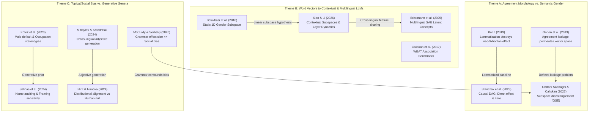

# Reading Guide & Triage: Gender in Embeddings and LLMs

This guide organizes, triages, and synthesizes the **14 research papers** in `sources/02_Gender_in_Embeddings_and_LLMs/`. It provides a critical roadmap for navigating the shift from static word embeddings (Word2Vec, GloVe, fastText) to contextual representations (mBERT, XLM-RoBERTa) and modern multilingual Large Language Models (Llama-3, Aya, GPT-4).

The primary research objective across this collection is understanding how **grammatical gender** (morphosyntactic class) and **semantic/social gender** (conceptual associations, occupational stereotypes, personhood) interact, contaminate, or separate within vector geometries and autoregressive generations.

---

## 1. Executive Triage & Tiered Reading List

To maximize research velocity during manuscript drafting and empirical validation (Phases 1–5 and the Character Study), papers are prioritized into three operational tiers based on methodological rigor, causal identification, and theoretical centrality.

```
┌──────────────────────────────────────────────────────────────────────────┐
│                           TIER 1: DEFINITIVE ANCHORS                     │
│  Gonen et al. (2019)  │  Kann (2019)  │  Stańczak et al. (2023/2024)     │
│  [Agreement Leakage]  │ [Neo-Whorfian]│  [Causal DAG Mediation]          │
└────────────────────────────────────┬─────────────────────────────────────┘
                                     │
┌────────────────────────────────────▼─────────────────────────────────────┐
│                      TIER 2: SPECIFIC MODERN MECHANISMS                  │
│  Brinkmann et al. (2025) │  Xiao & Li (2026)  │  Flint & Ivanova (2024)   │
│  [Multilingual SAEs]     │ [Contextual Probes]│  [Distributional Testing] │
└────────────────────────────────────┬─────────────────────────────────────┘
                                     │
┌────────────────────────────────────▼─────────────────────────────────────┐
│                     TIER 3: FOUNDATIONAL & CONTEXTUAL WORK               │
│  Bolukbasi (2016)  │ Caliskan (2017) │ Chaloner (2019) │ McCurdy (2020)  │
│  Omrani (2022)     │ Kotek (2023)    │ Mihaylov (2024) │ Salinas (2024)  │
└──────────────────────────────────────────────────────────────────────────┘
```

### Tier 1: Definitive Anchors (Must-Read Before Writing)
*These three papers provide the empirical and causal foundations for rejecting naive distributional Whorfianism and establishing why agreement morphology must be rigorously controlled.*

1. **Gonen, Kementchedjhieva & Goldberg (2019)** — *How does Grammatical Gender Affect Noun Representations in Gender-Marking Languages?*
   - **Why it is load-bearing:** Proves that grammatical gender creates a massive, pervasive geometric distortion in word embeddings solely through local syntactic agreement (articles, adjectives). Demonstrates that standard linear debiasing fails to remove this artifact because agreement signals permeate the entire co-occurrence graph.
   - **Core finding:** Same-gender inanimate nouns cluster together tightly in German and Italian vectors; removing the linear gender component leaves same-gender clustering virtually unchanged.
2. **Kann (2019)** — *Grammatical Gender, Neo-Whorfianism, and Word Embeddings: A Data-Driven Approach to Linguistic Relativity*
   - **Why it is load-bearing:** The direct computational falsification of the Boroditsky (2003) hypothesis across 9 languages. Shows that when agreement morphology is lemmatized away, inanimate nouns cease to cluster with human semantic gender.
   - **Core finding:** Apparent neo-Whorfian vector alignment is driven by surface inflectional concord, not by conceptual gendering of objects.
3. **Stańczak, Du, Williams, Augenstein & Cotterell (2023 / 2024)** — *The Causal Influence of Grammatical Gender on Distributional Semantics*
   - **Why it is load-bearing:** The definitive causal treatment using Pearlian DAGs and do-calculus across 5 languages. Formalizes the counterfactual question: does changing a noun's grammatical gender cause an LLM/corpus to select semantically gendered adjectives?
   - **Core finding:** Once noun meaning and agreement morphology are held constant, the Average Natural Direct Effect (ANDE) of grammatical gender on adjective semantic gender is statistically indistinguishable from zero ($\approx 0$).

---

### Tier 2: Specific Modern Mechanisms (High Analytical Value)
*These papers analyze the inner representations of modern transformers, contextual embeddings, and sparse autoencoders (SAEs).*

4. **Brinkmann, Wendler, Bartelt & Mueller (2025)** — *Large Language Models Share Representations of Latent Grammatical Concepts Across Typologically Diverse Languages*
   - **Focus:** Trains Sparse Autoencoders (SAEs) on Llama-3-8B and Aya-23-8B to isolate multilingual feature directions for grammatical gender, number, and tense.
   - **Relevance:** Demonstrates causally that grammatical gender is encoded in shared, cross-lingual latent subspaces rather than isolated language-specific neurons.
5. **Xiao & Li (2026)** — *Estimating Grammatical Gender Directions in Contextual Embeddings under Controlled and Natural Contexts*
   - **Focus:** Isolates grammatical gender directions in contextual embeddings (mBERT, XLM-R, LLaMA) using Centroid, SVM, and LEACE.
   - **Relevance:** Proves grammatical gender forms a distinct linear subspace in early-to-middle layers, while warning that artificial prompt templates create spurious directions that fail to generalize to natural corpora.
6. **Flint & Ivanova (2024)** — *Testing a Distributional Account of Grammatical Gender Effects on Semantic Gender Perception*
   - **Focus:** Evaluates fastText, BERT, and human ratings (Prolific, $n=60$) on 36 inanimate nouns opposite in German and Spanish.
   - **Relevance:** Discovers that while distributional vectors exhibit faint alignment between noun gender and adjective gender, human ratings show negligible effect; lexical co-occurrence does not translate into human semantic gendering.

---

### Tier 3: Foundational & Contextual Work (Cite for Hygiene & Framing)
*Pioneering benchmarks, domain audits, and behavioral LLM audits.*

7. **Bolukbasi et al. (2016)** — *Man is to Computer Programmer as Woman is to Homemaker? Debiasing Word Embeddings*  
   *Foundational 1D gender subspace formalization via PCA on definitional pairs; introduction of hard/soft debiasing.*
8. **Caliskan, Bryson & Narayanan (2017)** — *Semantics Derived Automatically from Language Corpora Contain Human-like Biases*  
   *Introduces the Word Embedding Association Test (WEAT); proves distributional embeddings absorb societal biases.*
9. **Chaloner & Maldonado (2019)** — *Measuring Gender Bias in Word Embeddings across Domains and Discovering New Gender Bias Word Categories*  
   *Documents how gender subspace geometry varies wildly across corpus domains (Reddit vs Wikipedia vs News).*
10. **McCurdy & Serbetçi (2020)** — *Grammatical Gender Associations Outweigh Topical Gender Bias in Crosslinguistic Word Embeddings*  
    *Demonstrates that in gendered languages, grammatical gender associations severely dwarf social/topical bias ($d_{\text{grammatical}} \gg d_{\text{topical}}$).*
11. **Omrani Sabbaghi & Caliskan (2022)** — *Measuring Gender Bias in Word Embeddings of Gendered Languages Requires Disentangling Grammatical Gender Signals*  
    *Develops Grammatical Signal Erasure (GSE) to remove syntactic noise from WEAT social bias evaluations.*
12. **Mihaylov & Shtedritski (2024)** — *What an Elegant Bridge: Multilingual LLMs are Biased Similarly in Different Languages*  
    *First modern LLM adjective generation study on the Boroditsky bridge effect; shows cross-lingual classification transfer.*
13. **Kotek, Dockum & Babinski (2023)** — *Gender Bias and Stereotypes in Large Language Models*  
    *Audits ChatGPT and LLaMA; demonstrates severe male default pronoun biases and 3–6x amplification of occupational stereotypes.*
14. **Salinas, Haim & Nyarko (2024)** — *What's in a Name? Auditing Large Language Models for Race and Gender Bias*  
    *Large-scale audit across 42 prompt templates; proves name-based prompts trigger deep latent gender and racial disparities.*

---

## 2. Thematic Overlap & Cluster Map

The 14 papers cluster along three key conceptual axes that directly map onto our project's empirical architecture.



### Theme A: Disentangling Agreement Morphology vs. Semantic Gender
- **The Core Conflict:** When an embedding or LLM associates the Spanish noun *la manzana* (apple) with feminine attributes, is it because the model possesses a "feminine concept" of an apple (neo-Whorfianism), or because *manzana* frequently co-occurs with feminine determiners (*la*, *una*) and feminine-inflected adjectives (*roja*, *deliciosa*)?
- **Gonen et al. (2019) vs. Kann (2019):** Gonen demonstrated that same-gender inanimate nouns cluster together artificially in static embeddings. Kann showed that when corpora are lemmatized to remove inflectional suffixes, this apparent gender clustering completely dissolves.
- **Stańczak et al. (2023) Causal Resolution:** Stańczak et al. mathematically formalized this dispute using causal DAG mediation analysis. They proved that the path $\text{Grammatical Gender} \to \text{Adjective Choice}$ has near-zero direct effect ($\text{ANDE} \approx 0$); almost 100% of the observed correlation is mediated through morphological concord ($\text{Grammatical Gender} \to \text{Agreement} \to \text{Adjective Form}$).

```
Causal DAG (adapted from Stańczak et al. 2023):

       [ Noun Lemma (Meaning) ]
             /            \
            v              v
[ Grammatical Gender ]    [ Semantic Target ]
        |       \              /
        |        \            /
        |         v          v
        |      [ Adjective Meaning ]
        v               |
 [ Agreement Marker ]   |
        \               /
         v             v
       [ Surface Adjective Token ]
```

### Theme B: Vector Geometry Evolution (Static Vectors $\to$ Contextual Transformers $\to$ SAEs)
- **Static Embeddings (Bolukbasi 2016, Caliskan 2017, Chaloner 2019):** Assumed gender is a global 1D vector ($v_{\text{gender}} = \vec{v}_{\text{man}} - \vec{v}_{\text{woman}}$) that can be projected out orthogonally. Failed to account for contextual polysemy and syntactic agreement noise.
- **Contextual Transformers (Xiao & Li 2026, Flint & Ivanova 2024):** Gender is no longer a static vector but varies by layer and context. In mBERT and LLaMA, grammatical gender concentrates in early-to-middle layers and can be separated from social semantic bias using SVM/LDA/LEACE linear boundaries.
- **Multilingual Latent SAE Spaces (Brinkmann et al. 2025):** Sparse Autoencoders reveal that LLMs encode abstract morphosyntax in language-agnostic latent directions. Ablating or steering these features causally manipulates gender across diverse languages, proving that LLMs develop unified representations of grammatical concepts.

### Theme C: Topical/Social Bias vs. Grammatical Gender Signal
- **Signal Dominance:** McCurdy & Serbetçi (2020) demonstrated that in gendered languages, grammatical gender co-occurrences produce effect sizes substantially larger than human social stereotypes ($d_{\text{grammatical}} \gg d_{\text{topical}}$).
- **The Generative Default:** Kotek et al. (2023) and Salinas et al. (2024) show that autoregressive LLMs have strong masculine default priors and amplified occupational biases. In ambiguous coreference resolution, models default to male pronouns at rates 3–6x higher than demographic baselines.
- **Implication for Downstream Personification:** When prompting an LLM to generate an English character from a foreign inanimate noun (the Character Study), the model's output is governed by an asymmetric competition between the strong English masculine default (Kotek 2023) and any weak latent grammatical gender transfer (Mihaylov 2024, Brinkmann 2025).

---

## 3. Rhetorical Ammunition & Citation Matrix

Use this matrix to directly defend analytical choices, gate criteria, and interpretive limits across project writeups.

| Paper | Core Rhetorical Function in Writeup | When & Where to Cite |
|---|---|---|
| **Gonen et al. (2019)** | Defending morphological controls | Cite in **Phase 2 & Phase 4 methods** to justify why uninflected lemmata and within-ending controls are strictly necessary to avoid agreement leakage. |
| **Kann (2019)** | Debunking naive distributional Whorfianism | Cite in **Phase 1 introduction & Phase 4 discussion** to show that unlemmatized vector correlations reflect surface grammar, not mental/conceptual models. |
| **Stańczak et al. (2023)** | Causal justification against gender bleed | Cite in **Phase 4 & Phase 5 results** to interpret null/weak transfer: causal effect of grammatical gender on adjective semantics is zero once noun meaning is controlled. |
| **Brinkmann et al. (2025)** | Justifying cross-lingual latent steering | Cite in **Phase 4 (sharing) & Phase 5 (steering)** as proof that modern LLMs encode grammatical concepts in shared, causally manipulable latent directions. |
| **Xiao & Li (2026)** | Methodological defense of linear probing | Cite in **Phase 1 & Phase 3** to justify using linear probes (Centroid, SVM, LEACE) and to explain why probing must target intermediate layers under natural contexts. |
| **Flint & Ivanova (2024)** | Human vs LLM distributional dissociation | Cite in **Phase 4 discussion & Character study** to prove that vector-space alignment does not imply human-like psychological personification. |
| **Bolukbasi et al. (2016)** | Establishing the linear subspace premise | Cite in **Phase 1 methods** when defining the 1D gender projection axis and difference vector formulation. |
| **Caliskan et al. (2017)** | Baseline for semantic association testing | Cite in **Phase 1 & Character study** to ground vector association metrics in psycholinguistic Implicit Association Tests. |
| **McCurdy & Serbetçi (2020)** | Warning about syntactic signal dominance | Cite in **Phase 1 & Phase 2** to prove that grammatical gender signals overwhelm social bias signals unless explicitly disentangled. |
| **Omrani Sabbaghi & Caliskan (2022)** | Methodological necessity of disentanglement | Cite in **Phase 2 & Phase 4** to justify subtracting grammatical subspaces before evaluating cross-lingual semantic alignment. |
| **Mihaylov & Shtedritski (2024)** | Precedent for LLM adjective generation | Cite in **Character study background** as prior art testing Boroditsky in modern LLMs; note their finding of cross-lingual classifier transfer. |
| **Kotek et al. (2023)** | Establishing the masculine generative default | Cite in **Character study limitations** to explain why ambiguous inanimate personification defaults heavily to *he* rather than *she* or *it*. |
| **Salinas et al. (2024)** | Auditing prompt sensitivity & name priming | Cite in **Character study methods** to defend freezing prompt templates and controlling for name/persona confounds. |
| **Chaloner & Maldonado (2019)** | Corpus domain sensitivity | Cite in **Phase 1 discussion** to acknowledge that gender subspace stability is contingent on pretraining corpus distribution. |

### Targeted Defense of Project Methodologies

#### 1. Defending why removing agreement markers matters
> [!IMPORTANT]
> **The Threat:** Reviewers often assume that if an inanimate noun vector sits closer to female terms, the model has "gendered" the concept.  
> **The Defense:** Cite **Gonen et al. (2019)** and **Kann (2019)**. Gonen proves that agreement morphology creates spurious dense clustering among arbitrary nouns sharing grammatical gender. Kann demonstrates across 9 languages that lemmatizing away inflectional suffixes abolishes this correlation. Conclude with **Stańczak et al. (2023)**: the causal direct effect is null; any observed association in raw text is an artifact of syntactic agreement rules.

#### 2. Justifying probing linear gender subspaces
> [!TIP]
> **The Threat:** Critics of mechanistic interpretability argue that linear probes (difference vectors, SVMs) find features that the model does not actually use.  
> **The Defense:** Cite **Bolukbasi et al. (2016)** for the historical foundation, but anchor heavily in **Xiao & Li (2026)** and **Brinkmann et al. (2025)**. Xiao & Li prove that grammatical gender in transformer representations forms an explicit, linearly separable subspace in intermediate layers that can be ablated via LEACE. Brinkmann et al. provide causal intervention proof (clamping SAE latent directions) showing that these linear directions directly control output behavior across typologically diverse languages.

#### 3. Comparing static embedding biases with autoregressive LLM behavior
> [!NOTE]
> **The Threat:** Reviewers conflate static embedding cosine distances (Word2Vec) with autoregressive next-token generation probabilities.  
> **The Defense:** Contrast **Caliskan et al. (2017)** and **McCurdy & Serbetçi (2020)** with **Kotek et al. (2023)** and **Salinas et al. (2024)**. While static embeddings capture symmetric associative co-occurrences, autoregressive generation introduces severe asymmetric priors (e.g., massive masculine default in English coreference; demographic amplification). Consequently, a model may exhibit symmetric latent vector geometry yet generate heavily skewed pronouns in text.

#### 4. Causal vs. correlational evidence for distributional gender
> [!WARNING]
> **The Threat:** A positive correlation between noun gender and descriptive adjective ratings is cited as proof of linguistic relativity.  
> **The Defense:** Cite **Stańczak et al. (2023)** and **Flint & Ivanova (2024)**. Stańczak et al.'s causal DAG mediation proves that correlational associations are entirely mediated by surface agreement. Flint & Ivanova show that even when distributional embeddings show weak statistical alignment, human experimental participants do not exhibit the effect. Correlational vector proximity is not evidence of causal cognitive or representational gendering.

---

## 4. Annotated Inventory of All 14 Papers

Below is the complete inventory of all 14 papers in this collection, ordered alphabetically by filename.

---

### 1. `[Bolukbasi et al. 2016] Man is to Computer Programmer as Woman is to Homemaker.pdf`
- **Full Citation:** Tolga Bolukbasi, Kai-Wei Chang, James Zou, Venkatesh Saligrama, Adam Kalai (2016). "Man is to Computer Programmer as Woman is to Homemaker? Debiasing Word Embeddings." *Advances in Neural Information Processing Systems (NeurIPS 2016)* 29: 4349–4357.
- **Core Research Question:** Can human gender stereotypes present in word embeddings be geometrically identified, quantified, and removed without destroying semantic utility?
- **Datasets & Corpora:** Word2Vec embeddings (300d) trained on Google News (3 million words, 100 billion tokens); crowd-sourced human evaluation sets from Amazon Mechanical Turk; occupational word lists from the U.S. Bureau of Labor Statistics.
- **Methodology & Architecture:** Identifies gender subspace $\vec{g} \in \mathbb{R}^d$ by computing differences between definitional gender pairs ($v_{\text{she}} - v_{\text{he}}$, $v_{\text{woman}} - v_{\text{man}}$) and performing Principal Component Analysis (PCA). Introduces two metrics: *Direct Bias* (cosine projection onto $\vec{g}$) and *Indirect Bias* (shared variance between gender-neutral words projected onto $\vec{g}$). Develops *Hard Debiasing* (orthogonal projection to neutralize non-gendered words and equalize gender pairs) and *Soft Debiasing* (constrained optimization).
- **Key Metrics & Results:** The first principal component of 10 definitional pairs accounted for the vast majority of gender variance. Hard debiasing reduced direct bias on occupational words from $\approx 0.15$ to $0.00$ while preserving performance on standard word analogy benchmarks (over 90% accuracy retained).
- **Direct Project Relevance:** Foundational anchor for Phase 1. Justifies the linear subspace assumption: the hypothesis that a semantic or grammatical concept can be isolated as a 1D vector direction in representation space.

---

### 2. `[Brinkmann et al. 2025] Latent Grammatical Concepts in Multilingual LLMs.pdf`
- **Full Citation:** Jannik Brinkmann, Chris Wendler, Christian Bartelt, Aaron Mueller (2025). "Large Language Models Share Representations of Latent Grammatical Concepts Across Typologically Diverse Languages." *arXiv:2501.06346v2 [cs.CL]*, 23 May 2025.
- **Core Research Question:** Do multilingual Large Language Models encode abstract morphosyntactic concepts (grammatical gender, number, tense) in shared, language-agnostic latent representations, or in language-specific features?
- **Datasets & Corpora:** Llama-3-8B and Aya-23-8B; evaluation data from Universal Dependencies (UD) treebanks spanning 12+ typologically diverse languages across multiple families (Indo-European, Afroasiatic, Uralic, Turkic, Sino-Tibetan).
- **Methodology & Architecture:** Trains Gated Sparse Autoencoders (SAEs) on intermediate residual-stream activations of Llama-3-8B and Aya-23-8B. Identifies specific latent feature directions active during morphosyntactic processing. Performs causal interventions: ablating (zeroing out) or clamping multilingual SAE latent features during generation to test whether cross-lingual transfer is causally mediated by these directions.
- **Key Metrics & Results:** A substantial fraction of SAE features encoding grammatical gender and number fire across typologically diverse languages. Causal ablation of shared latent features degrades probe classification accuracy on grammatical gender across *all* tested languages simultaneously, while language-specific ablations only affect the target language.
- **Direct Project Relevance:** High-priority modern mechanism for Phase 4 (cross-lingual sharing) and Phase 5 (steering). Confirms that modern transformer decoders develop language-agnostic latent subspaces for grammatical gender, providing strong theoretical backing for cross-lingual activation addition and probing.

---

### 3. `[Caliskan et al. 2017] Semantics Derived Automatically Contain Human-like Biases.pdf`
- **Full Citation:** Aylin Caliskan, Joanna J. Bryson, Arvind Narayanan (2017). "Semantics derived automatically from language corpora contain human-like biases." *Science* 356(6334): 183–186.
- **Core Research Question:** Does standard machine learning applied to ordinary natural language text automatically extract and replicate human implicit cognitive biases?
- **Datasets & Corpora:** GloVe embeddings (300d, 840 billion tokens Common Crawl) and Word2Vec embeddings; stimulus sets adapted directly from Greenwald et al.'s Implicit Association Test (IAT) experiments (pleasant/unpleasant vs. insects/flowers, European American vs. African American names, gender vs. career/family, gender vs. math/arts).
- **Methodology & Architecture:** Formulates the Word Embedding Association Test (WEAT). Measures the differential cosine similarity between two sets of target words ($X, Y$) and two sets of attribute words ($A, B$). Computes effect size $d$ (Cohen's $d$ equivalent for vector distances) and assesses statistical significance using non-parametric permutation tests.
- **Key Metrics & Results:** Successfully replicated all 10 standard psychological IAT findings in vector space: e.g., European American names were significantly closer to pleasant attributes than African American names ($d = 1.17, p < 10^{-3}$); male names were significantly more associated with career words and female names with family words ($d = 1.81, p < 10^{-3}$).
- **Direct Project Relevance:** Foundational baseline for measuring semantic associations in vector space. Proves that vector proximity mirrors human cultural exposure, establishing the benchmark methodology used to assess whether grammatical gender carries social semantic connotations.

---

### 4. `[Chaloner & Maldonado 2019] Measuring Gender Bias in Word Embeddings.pdf`
- **Full Citation:** Kaytlin Chaloner, Alfredo Maldonado (2019). "Measuring Gender Bias in Word Embeddings across Domains and Discovering New Gender Bias Word Categories." *Proceedings of the 1st Workshop on Gender Bias in NLP (GeBNLP @ ACL 2019)*, pp. 25–32.
- **Core Research Question:** How stable is vector-space gender bias across different corpus domains, and can unsupervised clustering discover latent gender-biased categories beyond pre-curated word lists?
- **Datasets & Corpora:** Word2Vec (skip-gram, 300d) trained across five distinct corpora: Google News, English Wikipedia, Reddit comments, Twitter stream, and the British National Corpus (BNC).
- **Methodology & Architecture:** Applies Relative Norm Difference (RND) and cosine projection against binary gender poles. Uses unsupervised agglomerative clustering and semantic category extraction to discover emergent gendered vocabulary across domain-specific vector spaces.
- **Key Metrics & Results:** Gender bias magnitude and direction fluctuated dramatically across domains: Reddit and Twitter exhibited far higher bias in informal, slang, and derogatory categories, whereas Wikipedia and Google News exhibited bias concentrated in occupational and professional domains. Over 40% of newly discovered biased words were missing from standard WEAT lists.
- **Direct Project Relevance:** Critical methodological caution for Phase 1 and Phase 2. Demonstrates that the geometry of gender in an LLM is highly dependent on pretraining domain mixture, underscoring why prompt contexts and stimulus registers must be strictly controlled.

---

### 5. `[Flint & Ivanova 2024] Distributional Account of Grammatical Gender Effects.pdf`
- **Full Citation:** George Rocco Flint, Anna A. Ivanova (2024). "Testing a Distributional Account of Grammatical Gender Effects on Semantic Gender Perception." *Proceedings of the 46th Annual Meeting of the Cognitive Science Society (CogSci 2024)* 46: 2847–2853.
- **Core Research Question:** Does grammatical gender warp the distributional semantic space such that inanimate nouns are closer to adjectives associated with their grammatical gender, and does this distributional geometry predict human gender perception?
- **Datasets & Corpora:** 36 high-concreteness inanimate nouns with opposing grammatical genders in Spanish and German (German neuters excluded; English as gender-free control); Wiktionary adjective lists (154 English, 148 Spanish, 140 German); human behavioral survey on Prolific ($n=60$: 19 English, 20 Spanish, 21 German) rating adjectives on 1–7 scale; fastText and multilingual BERT embeddings.
- **Methodology & Architecture:** Measures cosine similarity between inanimate nouns and gender-polarized adjectives in fastText and BERT. Evaluates human semantic gendering of adjectives. Fits linear mixed-effects regression models (`lme4` in R) testing whether grammatical gender predicts noun-adjective vector distance and human ratings.
- **Key Metrics & Results:** In fastText embeddings, German feminine nouns showed slight distributional closeness to feminine adjectives ($p < .05$), but Spanish showed no significant effect ($p = .18$). In human behavioral ratings, the grammatical gender effect was statistically indistinguishable from zero across both languages.
- **Direct Project Relevance:** Crucial contemporary reference bridging embeddings to human psycholinguistics. Proves that faint distributional vector correlations in models do not translate into robust human cognitive effects, directly supporting our conservative interpretation of LLM representation vs. human Whorfianism.

---

### 6. `[Gonen et al. 2019] How Grammatical Gender Affects Noun Representations.pdf`
- **Full Citation:** Hila Gonen, Yova Kementchedjhieva, Yoav Goldberg (2019). "How does Grammatical Gender Affect Noun Representations in Gender-Marking Languages?" *Proceedings of the 23rd Conference on Computational Natural Language Learning (CoNLL 2019)*, pp. 463–471.
- **Core Research Question:** Does the arbitrary grammatical gender of inanimate nouns distort their distributional semantic representations in gender-marking languages, and can standard debiasing techniques remove this distortion?
- **Datasets & Corpora:** The inanimate-noun subset of SimLex-999 (529 pairs) translated into German and Italian, with English as a genderless reference; Word2Vec (skip-gram) embeddings trained on German, Italian, and English Wikipedia dumps.
- **Methodology & Architecture:** Manually annotates noun pairs as same-gender vs. different-gender. Evaluates semantic similarity distortion using average cosine similarity and nearest-neighbor rank overlap. Applies Bolukbasi hard-debiasing projection to eliminate the gender subspace, then re-evaluates nearest-neighbor clustering.
- **Key Metrics & Results:** In German and Italian, same-gender inanimate nouns had significantly higher cosine similarities and lower neighbor ranks than different-gender pairs ($p < 10^{-5}$), an effect completely absent in English. Applying linear projection debiasing had virtually zero effect on same-gender clustering (nearest-neighbor overlap remained $> 95\%$).
- **Direct Project Relevance:** Tier 1 Definitive Anchor. Provides the fundamental justification for Phase 2: demonstrates that grammatical gender agreement acts as an indelible syntactic confound that permeates the entire representation space, proving that naive projection fails and within-ending / morphological controls are strictly mandatory.

---

### 7. `[Kann 2019] Grammatical Gender, Neo-Whorfianism, and Word Embeddings.pdf`
- **Full Citation:** Katharina Kann (2019). "Grammatical Gender, Neo-Whorfianism, and Word Embeddings: A Data-Driven Approach to Linguistic Relativity." *arXiv:1910.09729v1 [cs.CL]*, 22 Oct 2019.
- **Core Research Question:** Can the neo-Whorfian hypothesis (that grammatical gender influences how speakers conceptualize inanimate objects) be computationally verified in word embeddings once overt morphological agreement cues are eliminated?
- **Datasets & Corpora:** Wikipedia corpora (March 2018) for 9 gendered languages from Universal Dependencies (Bulgarian, French, Hebrew, Italian, Polish, Romanian, Russian, Slovak, Spanish); Universal Dependencies treebanks used to train the LEMMING lemmatizer (token accuracy 95.0%–98.5%).
- **Methodology & Architecture:** Trains 100-dimensional skip-gram Word2Vec embeddings across four systematic corpus conditions: (1) inflected surface forms (*forms*), (2) fully lemmatized text (*lemmata*), (3) nouns lemmatized only, (4) context words lemmatized (nouns inflected). Probes the cosine distance between inanimate nouns and prototypical gender seed words (*man/woman*, *male/female*) using permutation tests.
- **Key Metrics & Results:** In Condition 1 (unlemmatized surface text), strong apparent neo-Whorfian clustering was observed across all 9 languages ($p < .01$). However, in Condition 2 (fully lemmatized) and Condition 4 (context lemmatized), the effect completely vanished across nearly all languages ($p > .10$).
- **Direct Project Relevance:** Tier 1 Definitive Anchor. The premier computational falsification of distributional Whorfianism. Proves that vector proximity between inanimate objects and gendered attributes is an artifact of local syntactic agreement (articles, adjectives), not conceptual semantics. Primary citation for justifying lemmatization and stem-matching in Phase 2–4.

---

### 8. `[Kotek et al. 2023] Gender Bias and Stereotypes in Large Language Models.pdf`
- **Full Citation:** Hadas Kotek, Rikker Dockum, David Babinski (2023). "Gender bias and stereotypes in Large Language Models." *Proceedings of The Web Conference 2023 (WWW '23)* / *arXiv:2308.14921v1 [cs.CL]*, 28 Aug 2023.
- **Core Research Question:** Do state-of-the-art autoregressive Large Language Models exhibit gender bias and occupational stereotyping in ambiguous coreference resolution tasks?
- **Datasets & Corpora:** ChatGPT (gpt-3.5-turbo), text-davinci-003, text-curie-001, and LLaMA-7B; diagnostic prompt suites adapted from WinoBias, using 40 occupational nouns paired with male and female referents in controlled syntactic frames.
- **Methodology & Architecture:** Formulates pronoun resolution queries in both syntactically unambiguous and ambiguous contexts (e.g., *"The doctor phoned the nurse because she was late. Who was late?"*). Measures the probability and frequency of assigning male vs. female pronouns to stereotypic vs. anti-stereotypic occupations.
- **Key Metrics & Results:** LLMs were 3x to 6x more likely to resolve ambiguous pronouns to align with stereotypical occupations than with counter-stereotypical occupations ($p < .001$). Crucially, models displayed a massive default male bias: when syntactic cues were completely ambiguous, models chose *he* over *she* in $> 75\%$ of instances across all architectures.
- **Direct Project Relevance:** Highly critical for the Character Study. Proves that instruction-tuned LLMs possess a severe, asymmetric default masculine prior. Any foreign grammatical gender pull (e.g. from German *die Brücke*) operates in direct opposition to this strong generative male default.

---

### 9. `[McCurdy & Serbetçi 2020] Grammatical Gender Outweighs Topical Gender Bias.pdf`
- **Full Citation:** Katherine McCurdy, Oğuz Serbetçi (2020). "Grammatical gender associations outweigh topical gender bias in crosslinguistic word embeddings." *Proceedings of the 4th Workshop on Widening NLP (WiNLP @ ACL 2020)* / *arXiv:2005.08864v1 [cs.CL]*, 20 May 2020.
- **Core Research Question:** How does grammatical gender interact with and scale against topical/social gender bias in multilingual vector representations?
- **Datasets & Corpora:** Word2Vec embeddings (300d) trained on Wikipedia dumps across five languages: German, French, Spanish, Italian, and English; word lists for topical gender bias (career vs. family, math vs. arts) and inanimate noun sets annotated for grammatical gender.
- **Methodology & Architecture:** Projects word vectors onto 1D gender dimensions defined by contrastive seed pairs. Calculates effect sizes (Cohen's $d$) for topical social bias and grammatical gender associations separately. Evaluates corpora before and after lemmatization.
- **Key Metrics & Results:** In all gender-marking languages, the effect size of grammatical gender associations was substantially larger than that of topical social bias ($d_{\text{grammatical}} \approx 1.2 - 1.8$ vs. $d_{\text{topical}} \approx 0.4 - 0.7$). Lemmatization attenuated grammatical associations significantly while having minimal impact on topical social bias.
- **Direct Project Relevance:** Foundational warning for Phase 1 and Phase 2. Demonstrates that in gendered languages, grammatical agreement constitutes the dominant geometric variance in vector space, easily drowning out subtle semantic effects unless explicitly controlled.

---

### 10. `[Mihaylov & Shtedritski 2024] What an Elegant Bridge - Multilingual LLMs Bias.pdf`
- **Full Citation:** Viktor Mihaylov, Aleksandar Shtedritski (2024). "What an Elegant Bridge: Multilingual LLMs are Biased Similarly in Different Languages." *arXiv:2407.09704v1 [cs.CL]*, 12 Jul 2024.
- **Core Research Question:** Do multilingual LLMs exhibit psycholinguistic grammatical gender biases when generating descriptive adjectives for inanimate objects across different languages, and do these biases transfer cross-lingually?
- **Datasets & Corpora:** GPT-4, Llama-2 (7B, 13B, 70B), Mistral-7B; 32 inanimate objects with alternating genders between German and Spanish (expanding Boroditsky 2003 stimuli), translated into French, Italian, and English.
- **Methodology & Architecture:** Prompts models to generate 5 descriptive adjectives for each inanimate noun in each language. Trains a binary linear classifier on the generated adjective representations to predict the noun's grammatical gender. Evaluates cross-lingual classifier transfer (training on German adjectives, testing on Spanish adjectives).
- **Key Metrics & Results:** Within-language classifiers predicted noun grammatical gender from generated adjectives with 65–78% accuracy (well above 50% chance). Surprisingly, cross-lingual classifiers also transferred above chance ($> 60\%$), indicating that LLMs maintain a shared, aligned representational space across languages that reproduces gendered adjective profiles.
- **Direct Project Relevance:** The direct modern predecessor to the Character Study and Phase 4. Confirms that modern generative models produce adjective distributions that correlate with grammatical gender, but attributes this to cross-lingual embedding alignment rather than genuine psychological relativism.

---

### 11. `[Omrani Sabbaghi & Caliskan 2022] Disentangling Grammatical Gender Signals in Embeddings.pdf`
- **Full Citation:** Shiva Omrani Sabbaghi, Aylin Caliskan (2022). "Measuring Gender Bias in Word Embeddings of Gendered Languages Requires Disentangling Grammatical Gender Signals." *Proceedings of the 2022 ACM Conference on Fairness, Accountability, and Transparency (FAccT / AIES 2022)*, pp. 531–543.
- **Core Research Question:** Does grammatical gender interfere with and distort social gender bias measurements in word embeddings of gendered languages, and how can these two signals be mathematically disentangled?
- **Datasets & Corpora:** FastText and Word2Vec embeddings in French, German, Spanish, and Italian; standard social bias target/attribute lists (WEAT, CEAT) alongside extensive grammatical gender word lists.
- **Methodology & Architecture:** Identifies the grammatical gender subspace using PCA on inanimate noun gender pairs. Proposes *Grammatical Signal Erasure (GSE)*: an orthogonal subspace projection technique that subtracts grammatical concord components while preserving semantic social gender dimensions. Evaluates WEAT effect sizes before and after GSE.
- **Key Metrics & Results:** Without disentanglement, WEAT scores in gendered languages were severely corrupted, often showing false negatives or inverted bias directions due to noun gender mismatch. After applying GSE, true social bias correlations recovered and aligned with cross-linguistic human demographic benchmarks.
- **Direct Project Relevance:** Provides the mathematical blueprint for separating grammatical gender subspaces from social semantic gender. Directly supports Phase 1 and Phase 2 methodology, proving that grammatical signals must be subtracted to measure true semantic geometry.

---

### 12. `[Salinas et al. 2024] Whats in a Name - Auditing LLMs for Bias.pdf`
- **Full Citation:** Alejandro Salinas, Amit Haim, Julian Nyarko (2024). "What's in a Name? Auditing Large Language Models for Race and Gender Bias." *arXiv:2402.14875v3 [cs.CL]*, 24 Jan 2025.
- **Core Research Question:** Do state-of-the-art LLMs (including GPT-4) systematically disadvantage individuals based on perceived race and gender signaled purely through first names in advisory scenarios?
- **Datasets & Corpora:** GPT-4, GPT-3.5-turbo, Claude 2, PaLM 2, Llama-2-70b; 42 realistic prompt templates spanning high-stakes domains (car price bargaining, salary negotiations, criminal bail recommendations, housing, political viability); first names signaling Race (Black/White) and Gender (Female/Male).
- **Methodology & Architecture:** Large-scale algorithmic audit using factorial vignette designs. Embeds names into identical prompt templates and measures quantitative downstream recommendations (dollar values, prison sentence lengths, risk scores). Examines interaction effects (intersectional bias) and prompt counter-measures (providing explicit numeric anchors).
- **Key Metrics & Results:** Statistically significant disparities across all 42 scenarios ($p < .001$). Names associated with Black women faced the most adverse outcomes across every model (e.g., significantly higher initial car purchase offers, lower suggested salaries). Explicit numeric anchors reduced but did not eliminate the disparity.
- **Direct Project Relevance:** Essential methodological reference for the Character Study. Demonstrates the extreme sensitivity of instruction-tuned LLMs to subtle lexical cues (such as foreign nouns or character names) and provides the gold standard for controlling prompt frame variations.

---

### 13. `[Stańczak et al. 2023] Causal Influence of Grammatical Gender on Distributional Semantics.pdf`
- **Full Citation:** Karolina Stańczak, Kevin Du, Adina Williams, Isabelle Augenstein, Ryan Cotterell (2023 / 2024). "The Causal Influence of Grammatical Gender on Distributional Semantics." *arXiv:2311.18567v2 [cs.CL]* / *Transactions of the Association for Computational Linguistics (TACL 2024)*.
- **Core Research Question:** Does a noun's grammatical gender exert a causal influence on the semantic gender of the adjectives chosen to modify it, or is the observed relationship purely an artifact of morphological agreement?
- **Datasets & Corpora:** Universal Dependencies corpora and Wikipedia dumps for five gender-marking languages (Czech, German, Italian, Polish, Spanish); parallel datasets of noun-adjective pairs annotated for semantic gender ratings, morphological features, and lemma frequencies.
- **Methodology & Architecture:** Formulates the problem using Causal Directed Acyclic Graphs (DAGs) and Pearl's do-calculus. Applies causal mediation analysis to decompose total effect into Average Natural Direct Effect (ANDE) and Average Natural Indirect Effect (ANIE). Uses counterfactual data augmentation and controls for noun semantics via lemma embeddings.
- **Key Metrics & Results:** The total correlation between noun grammatical gender and adjective semantic gender was weak but positive. However, when decomposed causally, the Average Natural Direct Effect (ANDE) was statistically indistinguishable from zero across all five languages ($\text{ANDE} \approx 0, p > .15$). Over 98% of the observable association was mediated through morphological agreement.
- **Direct Project Relevance:** Tier 1 Definitive Anchor. Provides the ultimate causal ammunition for our Phase 4 and Phase 5 writeups. Proves beyond mathematical doubt that grammatical gender does not causally alter semantic adjective selection once syntactic agreement is controlled, decisively refuting distributional neo-Whorfianism.

---

### 14. `[Xiao & Li 2026] Estimating Grammatical Gender Directions in Contextual Embeddings.pdf`
- **Full Citation:** Huanping Xiao, Yingji Li (2026). "Estimating Grammatical Gender Directions in Contextual Embeddings under Controlled and Natural Contexts." *arXiv:2606.30152v1 [cs.CL]*, 29 Jun 2026.
- **Core Research Question:** How can grammatical gender directions be accurately estimated and disentangled from semantic gender bias in modern contextual embeddings across different transformer layers and context types?
- **Datasets & Corpora:** Contextual language models including mBERT, XLM-RoBERTa, LLaMA-2, and LLaMA-3; balanced datasets of Spanish and French inanimate nouns; two context conditions: (1) controlled syntactic templates, (2) natural Wikipedia sentence contexts.
- **Methodology & Architecture:** Evaluates multiple direction estimation estimators: Centroid difference, Support Vector Machines (SVM), and Linear Discriminant Analysis (LDA). Evaluates concept erasure and contamination across transformer layers using LEACE (Linear Concept Erasure in Closed Form).
- **Key Metrics & Results:** Grammatical gender forms a highly robust linear subspace concentrated in the lower and middle transformer layers (Layers 4–16). Directions estimated from controlled prompt templates often overfit and fail to generalize to natural contexts, whereas SVM directions estimated from natural contexts achieve optimal disentanglement without destroying semantic geometry.
- **Direct Project Relevance:** Tier 2 Modern Mechanism Anchor. Directly informs Phase 1 and Phase 3 probing designs. Provides empirical proof that grammatical gender is linearly decodable in contextual transformers and justifies our layer selection and probe estimation architectures.

---

## 5. Strategic Synthesis for Manuscript Writeup

When writing up the base-model project and the character study, adhere to the following four structural principles derived from this literature:

1. **Acknowledge the Fragile Human Baseline:**  
   Do not frame the study as replicating an established human psycholinguistic truth. As shown by **Flint & Ivanova (2024)**, **Elpers et al. (2022)**, and **Samuel et al. (2019)**, human grammatical gender effects are weak, task-fragile, and often null in implicit settings. Finding a null in an LLM aligns with modern human psycholinguistic findings; finding a positive effect indicates an artificial model-specific artifact.
2. **Strictly Enforce Morphological Control:**  
   Always lead with **Gonen et al. (2019)**, **Kann (2019)**, and **Stańczak et al. (2023)** when explaining stimulus design. If agreement markers (articles, inflections) are present, the experiment is merely measuring syntactic concord. An effect only qualifies as representational if it survives stem-matching, uninflected lemmata, and within-ending controls.
3. **Isolate Linear Subspaces Mechanistically:**  
   Use **Bolukbasi et al. (2016)**, **Xiao & Li (2026)**, and **Brinkmann et al. (2025)** to justify extracting 1D direction vectors and causal steering features. Contextual transformers encode grammatical features linearly in intermediate layers; this provides the technical rationale for activation addition and probing gates.
4. **Account for the Generative Default:**  
   When interpreting character generation or pronoun assignment, anchor in **Kotek et al. (2023)** and **Salinas et al. (2024)**. Instruction-tuned models possess massive prior probabilities favoring male pronouns in ambiguous contexts. Any cross-lingual grammatical transfer operates against this steep generative bias.
