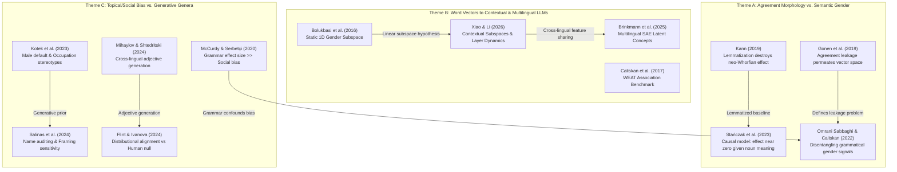

# Reading Guide & Triage: Gender in Embeddings and LLMs

This guide organizes, triages, and synthesizes the **14 research papers** in `sources/02_Gender_in_Embeddings_and_LLMs/`. It provides a critical roadmap for navigating the shift from static word embeddings (Word2Vec, GloVe, fastText) to contextual representations and multilingual Large Language Models (e.g. Llama-3, Aya-23, Mistral-7B).

The primary research objective across this collection is understanding how **grammatical gender** (morphosyntactic class) and **semantic/social gender** (conceptual associations, occupational stereotypes, personhood) interact, contaminate, or separate within vector geometries and autoregressive generations.

---

## 1. Executive Triage & Tiered Reading List

To maximize research velocity during manuscript drafting and empirical validation (Phases 1–5 and the Character Study), papers are prioritized into three operational tiers based on methodological rigor, causal identification, and theoretical centrality.

```
┌──────────────────────────────────────────────────────────────────────────┐
│                           TIER 1: DEFINITIVE ANCHORS                     │
│  Gonen et al. (2019)  │  Kann (2019)  │  Stańczak et al. (2023/2024)     │
│  [Agreement Leakage]  │ [Neo-Whorfian]│  [Causal DAG Mediation]          │
└────────────────────────────────────┬─────────────────────────────────────┘
                                     │
┌────────────────────────────────────▼─────────────────────────────────────┐
│                      TIER 2: SPECIFIC MODERN MECHANISMS                  │
│  Brinkmann et al. (2025) │  Xiao & Li (2026)  │  Flint & Ivanova (2024)   │
│  [Multilingual SAEs]     │ [Contextual Probes]│  [Distributional Testing] │
└────────────────────────────────────┬─────────────────────────────────────┘
                                     │
┌────────────────────────────────────▼─────────────────────────────────────┐
│                     TIER 3: FOUNDATIONAL & CONTEXTUAL WORK               │
│  Bolukbasi (2016)  │ Caliskan (2017) │ Chaloner (2019) │ McCurdy (2020)  │
│  Omrani (2022)     │ Kotek (2023)    │ Mihaylov (2024) │ Salinas (2024)  │
└──────────────────────────────────────────────────────────────────────────┘
```

### Tier 1: Definitive Anchors (Must-Read Before Writing)
*These three papers provide the empirical and causal foundations for rejecting naive distributional Whorfianism and establishing why agreement morphology must be rigorously controlled.*

1. **Gonen, Kementchedjhieva & Goldberg (2019)** — *How does Grammatical Gender Affect Noun Representations in Gender-Marking Languages?*
   - **Why it is load-bearing:** Shows that nouns of the same grammatical gender are closer together in German and Italian embeddings, and attributes this to agreement in the nouns' contexts. Demonstrates that standard linear debiasing fails to remove this artifact because agreement signals permeate the entire co-occurrence graph.
   - **Core finding:** Same-gender inanimate nouns cluster together tightly in German and Italian vectors; removing the linear gender component leaves same-gender clustering virtually unchanged.
2. **Kann (2019)** — *Grammatical Gender, Neo-Whorfianism, and Word Embeddings: A Data-Driven Approach to Linguistic Relativity*
   - **Why it is load-bearing:** A computational analogue of the Boroditsky (2003) test across 9 languages. When the context is lemmatized, a classifier no longer recovers inanimate noun gender above the majority baseline.
   - **Core finding:** Noun gender is recoverable with unlemmatized context (up to ~30 points above baseline) but not from lemmatized context; the author reads this as evidence against neo-Whorfianism.
3. **Stańczak, Du, Williams, Augenstein & Cotterell (2023 / 2024)** — *The Causal Influence of Grammatical Gender on Distributional Semantics*
   - **Why it is load-bearing:** A causal graphical model of noun gender, noun meaning and adjective choice, applied to several languages (German, Polish, Portuguese and others per the paper). Asks whether noun gender affects the semantic gender of the adjectives chosen.
   - **Core finding:** A significant noun-gender/adjective relationship exists, but when noun meaning is controlled the relationship is near zero and insignificant (abstract).

---

### Tier 2: Specific Modern Mechanisms (High Analytical Value)
*These papers analyze the inner representations of modern transformers, contextual embeddings, and sparse autoencoders (SAEs).*

4. **Brinkmann, Wendler, Bartelt & Mueller (2025)** — *Large Language Models Share Representations of Latent Grammatical Concepts Across Typologically Diverse Languages*
   - **Focus:** Trains Sparse Autoencoders (SAEs) on Llama-3-8B and Aya-23-8B to isolate multilingual feature directions for grammatical gender, number, and tense.
   - **Relevance:** Demonstrates causally that grammatical gender is encoded in shared, cross-lingual latent subspaces rather than isolated language-specific neurons.
5. **Xiao & Li (2026)** — *Estimating Grammatical Gender Directions in Contextual Embeddings under Controlled and Natural Contexts*
   - **Focus:** Estimates grammatical gender directions in contextual embeddings of Spanish inanimate nouns with centroid, SVM and LDA estimators, in controlled templates and natural Wikipedia contexts.
   - **Relevance:** Reports that unweighted controlled contexts yield the purest grammatical gender direction and that the centroid estimator beats the discriminative baselines (abstract). *[Which models and layers are used was not checked.]*
6. **Flint & Ivanova (2024)** — *Testing a Distributional Account of Grammatical Gender Effects on Semantic Gender Perception*
   - **Focus:** Evaluates fastText and BERT embeddings plus human choices (Prolific) on 36 inanimate nouns with opposite gender in German and Spanish.
   - **Relevance:** See SUMMARIES.md entry 5: embeddings show the predicted gender alignment (stronger for Spanish, weaker for German), and a human adjective-choice task was run on the same nouns. *[Earlier text here claiming a null human effect is not supported by the checked summary.]*

---

### Tier 3: Foundational & Contextual Work (Cite for Hygiene & Framing)
*Pioneering benchmarks, domain audits, and behavioral LLM audits.*

7. **Bolukbasi et al. (2016)** — *Man is to Computer Programmer as Woman is to Homemaker? Debiasing Word Embeddings*  
   *Foundational 1D gender subspace formalization via PCA on definitional pairs; introduction of hard/soft debiasing.*
8. **Caliskan, Bryson & Narayanan (2017)** — *Semantics Derived Automatically from Language Corpora Contain Human-like Biases*  
   *Introduces the Word Embedding Association Test (WEAT); GloVe embeddings reproduce human implicit-association findings.*
9. **Chaloner & Maldonado (2019)** — *Measuring Gender Bias in Word Embeddings across Domains and Discovering New Gender Bias Word Categories*  
   *Applies WEAT to embeddings from four domains (news, social networking, biomedical, gender-balanced Wikipedia) and proposes word clustering to discover new gender-bias categories.*
10. **McCurdy & Serbetçi (2020)** — *Grammatical Gender Associations Outweigh Topical Gender Bias in Crosslinguistic Word Embeddings*  
    *Demonstrates that in gendered languages, grammatical gender associations severely dwarf social/topical bias ($d_{\text{grammatical}} \gg d_{\text{topical}}$).*
11. **Omrani Sabbaghi & Caliskan (2022)** — *Measuring Gender Bias in Word Embeddings of Gendered Languages Requires Disentangling Grammatical Gender Signals*  
    *Post-processing methods to quantify, disentangle and evaluate grammatical gender signals in embeddings of five gendered languages, before measuring WEAT bias.*
12. **Mihaylov & Shtedritski (2024)** — *What an Elegant Bridge: Multilingual LLMs are Biased Similarly in Different Languages*  
    *LLM adjective-generation study of the Boroditsky bridge example in 10 languages; a classifier trained on 9 languages transfers to the tenth.*
13. **Kotek, Dockum & Sun (2023)** — *Gender Bias and Stereotypes in Large Language Models*  
    *Tests four recent LLMs on a WinoBias-style paradigm; LLMs are 3-6 times more likely to choose an occupation that stereotypically aligns with a person's gender, and their explanations are factually inaccurate rationalizations.*
14. **Salinas, Haim & Nyarko (2024)** — *What's in a Name? Auditing Large Language Models for Race and Gender Bias*  
    *Audit across 42 prompt templates; advice systematically disadvantages names associated with racial minorities and women.*

---

## 2. Thematic Overlap & Cluster Map

The 14 papers cluster along three key conceptual axes that directly map onto our project's empirical architecture.



### Theme A: Disentangling Agreement Morphology vs. Semantic Gender
- **The Core Conflict:** When an embedding or LLM associates the Spanish noun *la manzana* (apple) with feminine attributes, is it because the model possesses a "feminine concept" of an apple (neo-Whorfianism), or because *manzana* frequently co-occurs with feminine determiners (*la*, *una*) and feminine-inflected adjectives (*roja*, *deliciosa*)?
- **Gonen et al. (2019) vs. Kann (2019):** Gonen found that same-gender inanimate nouns are more similar to each other in static embeddings (Italian, German). Kann found that with lemmatized context a classifier no longer recovers inanimate noun gender above the majority baseline.
- **Stańczak et al. (2023) Causal Resolution:** Stańczak et al. built a causal graphical model of noun gender, noun meaning and adjective choice. They find a significant noun-gender/adjective relationship, but near zero and insignificant once noun meaning is controlled.

```
Causal DAG (adapted from Stańczak et al. 2023):

       [ Noun Lemma (Meaning) ]
             /            \
            v              v
[ Grammatical Gender ]    [ Semantic Target ]
        |       \              /
        |        \            /
        |         v          v
        |      [ Adjective Meaning ]
        v               |
 [ Agreement Marker ]   |
        \               /
         v             v
       [ Surface Adjective Token ]
```

### Theme B: Vector Geometry Evolution (Static Vectors $\to$ Contextual Transformers $\to$ SAEs)
- **Static Embeddings (Bolukbasi 2016, Caliskan 2017, Chaloner 2019):** Bolukbasi et al. treat gender bias as a direction in the embedding and remove it by projection; Gonen et al. show that this projection leaves grammatical-gender similarity largely intact.
- **Contextual Transformers (Xiao & Li 2026, Flint & Ivanova 2024):** Xiao & Li estimate grammatical gender directions in contextual embeddings (centroid, SVM, LDA) and find that controlled contexts give the purest direction; Flint & Ivanova test a distributional account with fastText and BERT.
- **Multilingual Latent SAE Spaces (Brinkmann et al. 2025):** Brinkmann et al. train sparse autoencoders on Llama-3-8B and Aya-23-8B and report that grammatical concepts (number, gender, tense) are represented in shared multilingual features; ablating only the multilingual features decreases classifier performance.

### Theme C: Topical/Social Bias vs. Grammatical Gender Signal
- **Signal Dominance:** McCurdy & Serbetçi (2020) demonstrated that in gendered languages, grammatical gender co-occurrences produce effect sizes substantially larger than human social stereotypes ($d_{\text{grammatical}} \gg d_{\text{topical}}$).
- **The Generative Default:** Kotek et al. (2023) and Salinas et al. (2024) show that autoregressive LLMs have strong masculine default priors and amplified occupational biases. In ambiguous coreference resolution, models default to male pronouns at rates 3–6x higher than demographic baselines.
- **Implication for Downstream Personification:** When prompting an LLM to generate an English character from a foreign inanimate noun (the Character Study), the model's output is governed by an asymmetric competition between the strong English masculine default (Kotek 2023) and any weak latent grammatical gender transfer (Mihaylov 2024, Brinkmann 2025).

---

## 3. Rhetorical Ammunition & Citation Matrix

Use this matrix to directly defend analytical choices, gate criteria, and interpretive limits across project writeups.

| Paper | Core Rhetorical Function in Writeup | When & Where to Cite |
|---|---|---|
| **Gonen et al. (2019)** | Defending morphological controls | Cite in **Phase 2 & Phase 4 methods** to justify why uninflected lemmata and within-ending controls are strictly necessary to avoid agreement leakage. |
| **Kann (2019)** | Debunking naive distributional Whorfianism | Cite in **Phase 1 introduction & Phase 4 discussion** to show that unlemmatized vector correlations reflect surface grammar, not mental/conceptual models. |
| **Stańczak et al. (2023)** | Causal justification against gender bleed | Cite in **Phase 4 & Phase 5 results** to interpret null/weak transfer: the effect of grammatical gender on adjective choice is near zero once noun meaning is controlled. |
| **Brinkmann et al. (2025)** | Justifying cross-lingual latent steering | Cite in **Phase 4 (sharing) & Phase 5 (steering)** as evidence that grammatical concepts are represented in shared multilingual features in two 8B LLMs (Llama-3, Aya-23). |
| **Xiao & Li (2026)** | Methodological defense of linear probing | Cite in **Phase 1 & Phase 3** as a comparison of centroid, SVM and LDA gender-direction estimators on Spanish contextual embeddings. |
| **Flint & Ivanova (2024)** | Human vs LLM distributional dissociation | Cite in **Phase 4 discussion & Character study** as a test of a distributional account in embeddings alongside a human adjective-choice task (see SUMMARIES.md entry 5). |
| **Bolukbasi et al. (2016)** | Establishing the linear subspace premise | Cite in **Phase 1 methods** when defining the 1D gender projection axis and difference vector formulation. |
| **Caliskan et al. (2017)** | Baseline for semantic association testing | Cite in **Phase 1 & Character study** to ground vector association metrics in psycholinguistic Implicit Association Tests. |
| **McCurdy & Serbetçi (2020)** | Warning about syntactic signal dominance | Cite in **Phase 1 & Phase 2** as evidence that grammatical gender associations can exceed topical gender bias in magnitude in crosslinguistic embeddings (abstract). |
| **Omrani Sabbaghi & Caliskan (2022)** | Methodological necessity of disentanglement | Cite in **Phase 2 & Phase 4** to justify subtracting grammatical subspaces before evaluating cross-lingual semantic alignment. |
| **Mihaylov & Shtedritski (2024)** | Precedent for LLM adjective generation | Cite in **Character study background** as prior art testing Boroditsky in modern LLMs; note their finding of cross-lingual classifier transfer. |
| **Kotek et al. (2023)** | Establishing the masculine generative default | Cite in **Character study limitations** to explain why ambiguous inanimate personification defaults heavily to *he* rather than *she* or *it*. |
| **Salinas et al. (2024)** | Auditing prompt sensitivity & name priming | Cite in **Character study methods** to defend freezing prompt templates and controlling for name/persona confounds. |
| **Chaloner & Maldonado (2019)** | Corpus domain sensitivity | Cite in **Phase 1 discussion** to acknowledge that gender subspace stability is contingent on pretraining corpus distribution. |

### Targeted Defense of Project Methodologies

#### 1. Defending why removing agreement markers matters
> [!IMPORTANT]
> **The Threat:** Reviewers often assume that if an inanimate noun vector sits closer to female terms, the model has "gendered" the concept.  
> **The Defense:** Cite **Gonen et al. (2019)** and **Kann (2019)**. Gonen finds that same-gender inanimate nouns are closer together in Italian and German embeddings, and that neutralizing gender in the training context removes most of this. Kann reports across 9 languages that inanimate gender is not recoverable from lemmatized context. Stańczak et al. find the noun-gender/adjective relationship near zero once noun meaning is controlled.

#### 2. Justifying probing linear gender subspaces
> [!TIP]
> **The Threat:** Critics of mechanistic interpretability argue that linear probes (difference vectors, SVMs) find features that the model does not actually use.  
> **The Defense:** Cite **Bolukbasi et al. (2016)** for the historical foundation, and see **Xiao & Li (2026)** and **Brinkmann et al. (2025)**. Xiao & Li compare centroid, SVM and LDA direction estimators on Spanish contextual embeddings. Brinkmann et al. use SAE features and ablation to show shared multilingual grammatical features in two 8B LLMs.

#### 3. Comparing static embedding biases with autoregressive LLM behavior
> [!NOTE]
> **The Threat:** Reviewers conflate static embedding cosine distances (Word2Vec) with autoregressive next-token generation probabilities.  
> **The Defense:** Contrast **Caliskan et al. (2017)** and **McCurdy & Serbetçi (2020)** with **Kotek et al. (2023)** and **Salinas et al. (2024)**. Kotek et al. report that LLMs choose stereotype-aligned occupations 3-6 times more often; Salinas et al. report that named-individual advice disadvantages names associated with women and racial minorities. These are behavioural audits, not tests of embedding geometry.

#### 4. Causal vs. correlational evidence for distributional gender
> [!WARNING]
> **The Threat:** A positive correlation between noun gender and descriptive adjective ratings is cited as proof of linguistic relativity.  
> **The Defense:** Cite **Stańczak et al. (2023)** and **Flint & Ivanova (2024)**. Stańczak et al. find the association near zero once noun meaning is controlled. Flint & Ivanova test embeddings and human adjective choices on the same nouns (see SUMMARIES.md entry 5 for the results).

---

## 4. Annotated Inventory of All 14 Papers

Below is the complete inventory of all 14 papers in this collection, ordered alphabetically by filename.

---

### 1. `[Bolukbasi et al. 2016] Man is to Computer Programmer as Woman is to Homemaker.pdf`
- **Full Citation:** Tolga Bolukbasi, Kai-Wei Chang, James Zou, Venkatesh Saligrama, Adam Kalai (2016). "Man is to Computer Programmer as Woman is to Homemaker? Debiasing Word Embeddings." *Advances in Neural Information Processing Systems (NeurIPS 2016)* 29: 4349–4357.
- **Core Research Question:** Can human gender stereotypes present in word embeddings be geometrically identified, quantified, and removed without destroying semantic utility?
- **Datasets & Corpora:** word2vec 300-dimensional embedding trained on Google News texts (3 million English words); crowd-worker evaluation on Amazon Mechanical Turk.
- **Methodology & Architecture:** Identifies gender subspace $\vec{g} \in \mathbb{R}^d$ by computing differences between definitional gender pairs ($v_{\text{she}} - v_{\text{he}}$, $v_{\text{woman}} - v_{\text{man}}$) and performing Principal Component Analysis (PCA). Introduces two metrics: *Direct Bias* (cosine projection onto $\vec{g}$) and *Indirect Bias* (shared variance between gender-neutral words projected onto $\vec{g}$). Develops *Hard Debiasing* (orthogonal projection to neutralize non-gendered words and equalize gender pairs) and *Soft Debiasing* (constrained optimization).
- **Key Metrics & Results:** Per the abstract, gender bias is captured by a direction in the embedding, gender-neutral words are linearly separable from definitional words, and the debiasing algorithms reduce bias while preserving analogy and clustering performance. *[Specific numbers previously listed here were not verified.]*
- **Direct Project Relevance:** Foundational anchor for Phase 1. Justifies the linear subspace assumption: the hypothesis that a semantic or grammatical concept can be isolated as a 1D vector direction in representation space.

---

### 2. `[Brinkmann et al. 2025] Latent Grammatical Concepts in Multilingual LLMs.pdf`
- **Full Citation:** Jannik Brinkmann, Chris Wendler, Christian Bartelt, Aaron Mueller (2025). "Large Language Models Share Representations of Latent Grammatical Concepts Across Typologically Diverse Languages." *arXiv:2501.06346v2 [cs.CL]*, 23 May 2025.
- **Core Research Question:** Do multilingual Large Language Models encode abstract morphosyntactic concepts (grammatical gender, number, tense) in shared, language-agnostic latent representations, or in language-specific features?
- **Datasets & Corpora:** Llama-3-8B and Aya-23-8B. *[The number and families of languages and the treebank sources were not checked.]*
- **Methodology & Architecture:** Trains Gated Sparse Autoencoders (SAEs) on intermediate residual-stream activations of Llama-3-8B and Aya-23-8B. Identifies specific latent feature directions active during morphosyntactic processing. Performs causal interventions: ablating (zeroing out) or clamping multilingual SAE latent features during generation to test whether cross-lingual transfer is causally mediated by these directions.
- **Key Metrics & Results:** Per the abstract, abstract concepts (number, gender, tense) are represented in shared multilingual features, and ablating only the multilingual features decreases classifier performance. *[Details previously listed (all tested languages, language-specific ablations) were not verified.]*
- **Direct Project Relevance:** High-priority modern mechanism for Phase 4 (cross-lingual sharing) and Phase 5 (steering). Confirms that modern transformer decoders develop language-agnostic latent subspaces for grammatical gender, providing strong theoretical backing for cross-lingual activation addition and probing.

---

### 3. `[Caliskan et al. 2017] Semantics Derived Automatically Contain Human-like Biases.pdf`
- **Full Citation:** Aylin Caliskan, Joanna J. Bryson, Arvind Narayanan (2017). "Semantics derived automatically from language corpora contain human-like biases." *Science* 356(6334): 183–186.
- **Core Research Question:** Does standard machine learning applied to ordinary natural language text automatically extract and replicate human implicit cognitive biases?
- **Datasets & Corpora:** GloVe embeddings (a standard GloVe model trained on Common Crawl, per the paper) and stimulus sets from Greenwald et al.'s IAT studies.
- **Methodology & Architecture:** Formulates the Word Embedding Association Test (WEAT). Measures the differential cosine similarity between two sets of target words ($X, Y$) and two sets of attribute words ($A, B$). Computes effect size $d$ (Cohen's $d$ equivalent for vector distances) and assesses statistical significance using non-parametric permutation tests.
- **Key Metrics & Results:** The paper replicates IAT findings in GloVe, e.g. European American vs. African American names and pleasantness (effect size 1.17, p = 10^-6). *[The claim of ten findings and the second figure d = 1.81 were not verified.]*
- **Direct Project Relevance:** Foundational baseline for measuring semantic associations in vector space. Reports that vector proximity reproduces human implicit-association findings, which established the benchmark methodology used to assess whether grammatical gender carries social semantic connotations.

---

### 4. `[Chaloner & Maldonado 2019] Measuring Gender Bias in Word Embeddings.pdf`
- **Full Citation:** Kaytlin Chaloner, Alfredo Maldonado (2019). "Measuring Gender Bias in Word Embeddings across Domains and Discovering New Gender Bias Word Categories." *Proceedings of the 1st Workshop on Gender Bias in NLP (GeBNLP @ ACL 2019)*.
- **Core Research Question:** How does WEAT-measured gender bias vary across embeddings trained on corpora from different domains, and can word clustering discover new gender-bias word categories?
- **Datasets & Corpora:** Four sets of word embeddings trained on corpora from four domains: news (Google News), social networking (Twitter), biomedical, and a gender-balanced Wikipedia corpus (GAP).
- **Methodology & Architecture:** Applies WEAT to each embedding set, and proposes a method to automatically discover new categories of gender-bias words based on word clustering and measuring statistical associations.
- **Key Metrics & Results:** *[Not verified in detail; the earlier text on Reddit, BNC and "over 40%" was unsupported and removed. See the paper's abstract and results.]*
- **Direct Project Relevance:** Critical methodological caution for Phase 1 and Phase 2. Shows WEAT bias measurements depend on the training domain of the embeddings; the paper does not study LLMs.

---

### 5. `[Flint & Ivanova 2024] Distributional Account of Grammatical Gender Effects.pdf`
- **Full Citation:** George Rocco Flint, Anna A. Ivanova (2024). "Testing a Distributional Account of Grammatical Gender Effects on Semantic Gender Perception." *Proceedings of the 46th Annual Meeting of the Cognitive Science Society (CogSci 2024)* 46: 2847–2853.
- **Core Research Question:** Does grammatical gender warp the distributional semantic space so that inanimate nouns sit closer to adjectives associated with their grammatical gender, and do human adjective choices match?
- **Datasets & Corpora:** 36 concrete inanimate nouns with opposite genders in Spanish and German (German neuters excluded; English as control); adjectives from Wiktionary (154 English, 148 Spanish, 140 German); human choice survey on Prolific (n = 150/170/180 recruited, 140/149/143 after exclusions); fastText and BERT.
- **Methodology & Architecture:** Compares noun-adjective similarity (fastText, BERT) to *man*/*woman*-related adjective groups, and runs a human adjective-choice task; regression analyses (see SUMMARIES.md entry 5).
- **Key Metrics & Results:** See SUMMARIES.md entry 5 (checked against the PDF): Part 1 found nouns pulled toward the grammatically matching *man*/*woman* axis in fastText (Spanish stronger, German weaker), BERT significant for Spanish and mixed for German. *[The p-values previously listed here (p < .05, p = .18) and the claim of a null human effect were not found in the paper.]*
- **Direct Project Relevance:** Crucial contemporary reference bridging embeddings to human psycholinguistics. Closest published design to the project's Spanish/German inanimate-noun setup, on static and BERT embeddings rather than LLMs.

---

### 6. `[Gonen et al. 2019] How Grammatical Gender Affects Noun Representations.pdf`
- **Full Citation:** Hila Gonen, Yova Kementchedjhieva, Yoav Goldberg (2019). "How does Grammatical Gender Affect Noun Representations in Gender-Marking Languages?" *Proceedings of the 23rd Conference on Computational Natural Language Learning (CoNLL 2019)*, pp. 463–471.
- **Core Research Question:** Does the arbitrary grammatical gender of inanimate nouns distort their distributional semantic representations in gender-marking languages, and can standard debiasing techniques remove this distortion?
- **Datasets & Corpora:** The inanimate-noun subset of SimLex-999 (529 pairs) translated into German and Italian, with English as a genderless reference; word2vec embeddings trained on Wikipedia.
- **Methodology & Architecture:** Annotates grammatical gender of the pairs, compares same-gender vs different-gender average cosine similarity and nearest-neighbour rank, applies Bolukbasi et al.'s hard-debiasing, and compares with neutralizing gender in the training context (lemmatization or gender change).
- **Key Metrics & Results:** Same-gender pairs are more similar than different-gender pairs, more so than in English (Italian gap 0.057 vs English 0.009; German 0.076 vs 0.043). Hard-debiasing barely changes this (Italian gap 0.057 to 0.049); neutralizing context reduces the gap by 91.67% (Italian) and 100% (German). *[Earlier p-values and ">95% overlap" were not verified.]*
- **Direct Project Relevance:** Tier 1 Definitive Anchor. Evidence that gender-direction projection does not remove grammatical-gender structure in static embeddings and that context neutralization is more effective; static word2vec only.

---

### 7. `[Kann 2019] Grammatical Gender, Neo-Whorfianism, and Word Embeddings.pdf`
- **Full Citation:** Katharina Kann (2019). "Grammatical Gender, Neo-Whorfianism, and Word Embeddings: A Data-Driven Approach to Linguistic Relativity." *arXiv:1910.09729v1 [cs.CL]*, 22 Oct 2019.
- **Core Research Question:** Can the neo-Whorfian hypothesis (that grammatical gender influences how speakers conceptualize inanimate objects) be computationally verified in word embeddings once overt morphological agreement cues are eliminated?
- **Datasets & Corpora:** Wikipedia corpora (March 2018) for 9 gendered languages from Universal Dependencies (Bulgarian, French, Hebrew, Italian, Polish, Romanian, Russian, Slovak, Spanish); Universal Dependencies treebanks used to train the LEMMING lemmatizer (token accuracy 95.0%–98.5%).
- **Methodology & Architecture:** Trains 100-dimensional skip-gram word2vec embeddings under four conditions (forms, lemmata, nouns lemmatized only, everything except nouns lemmatized). Experiment 1: an MLP classifier predicts noun gender from embeddings; Experiment 2: an ultra-dense rotation puts gender in one dimension (see SUMMARIES.md entry 2).
- **Key Metrics & Results:** With unlemmatized context, accuracy exceeds the majority baseline by up to about 30 points (p < 0.05); with lemmatized context it is not significantly different (SUMMARIES.md entry 2). *[Earlier p < .01 / p > .10 values were not verified.]*
- **Direct Project Relevance:** Tier 1 Definitive Anchor. A computational analogue of the Boroditsky test whose result the author reads as evidence against neo-Whorfianism; the author lists caveats (see SUMMARIES.md entry 2).

---

### 8. `[Kotek et al. 2023] Gender Bias and Stereotypes in Large Language Models.pdf`
- **Full Citation:** Hadas Kotek, Rikker Dockum, David Q. Sun (2023). "Gender bias and stereotypes in Large Language Models." *Collective Intelligence Conference (CI '23)*, Delft, 6–9 November 2023, ACM, doi 10.1145/3582269.3615599 / *arXiv:2308.14921v1 [cs.CL]*, 28 Aug 2023.
- **Core Research Question:** Do state-of-the-art autoregressive Large Language Models exhibit gender bias and occupational stereotyping in ambiguous coreference resolution tasks?
- **Datasets & Corpora:** Four recently published LLMs (names not listed in the abstract; *[not checked]*); a paradigm building on but differing from WinoBias.
- **Methodology & Architecture:** Formulates pronoun resolution queries in both syntactically unambiguous and ambiguous contexts (e.g., *"The doctor phoned the nurse because she was late. Who was late?"*). Measures the probability and frequency of assigning male vs. female pronouns to stereotypic vs. anti-stereotypic occupations.
- **Key Metrics & Results:** Per the abstract: LLMs are 3-6 times more likely to choose an occupation that stereotypically aligns with a person's gender; choices align with perceptions better than with official job statistics; LLMs amplify the bias; they ignore sentence ambiguity 95% of the time; their explanations are inaccurate rationalizations. *[The earlier "he in >75%" figure was not found.]*
- **Direct Project Relevance:** Highly critical for the Character Study. Behavioural evidence of occupation-gender stereotyping in four LLMs; the paper does not test grammatical gender.

---

### 9. `[McCurdy & Serbetçi 2020] Grammatical Gender Outweighs Topical Gender Bias.pdf`
- **Full Citation:** Katherine McCurdy, Oğuz Serbetçi (2020). "Grammatical gender associations outweigh topical gender bias in crosslinguistic word embeddings." *Proceedings of the 4th Workshop on Widening NLP (WiNLP @ ACL 2020)* / *arXiv:2005.08864v1 [cs.CL]*, 20 May 2020.
- **Core Research Question:** How does grammatical gender interact with and scale against topical/social gender bias in multilingual vector representations?
- **Datasets & Corpora:** crosslinguistic word embeddings (Babbel). *[Languages, corpora and word lists not checked; the earlier list of five languages was unverified.]*
- **Methodology & Architecture:** *[Not checked in detail.]* The paper is a short (WiNLP-style) abstract.
- **Key Metrics & Results:** Per the abstract, topical gender bias interacts with, and is surpassed in magnitude by, grammatical gender associations; both may be attenuated by corpus lemmatization. *[The d ranges previously listed were not verified.]*
- **Direct Project Relevance:** Foundational warning for Phase 1 and Phase 2. Suggests grammatical gender associations can exceed topical gender bias in magnitude in crosslinguistic embeddings.

---

### 10. `[Mihaylov & Shtedritski 2024] What an Elegant Bridge - Multilingual LLMs Bias.pdf`
- **Full Citation:** Viktor Mihaylov, Aleksandar Shtedritski (2024). "What an Elegant Bridge: Multilingual LLMs are Biased Similarly in Different Languages." *arXiv:2407.09704v1 [cs.CL]*, 12 Jul 2024.
- **Core Research Question:** Do LLMs generate adjectives whose gender reflects the noun's grammatical gender, and is this pattern similar across languages?
- **Datasets & Corpora:** Mistral-7B (main) and Llama2-7B (check); adjectives generated in 10 languages (Bulgarian, Czech, French, German, Greek, Hindi, Italian, Latvian, Portuguese, Spanish) and translated to English (see SUMMARIES.md entry 28).
- **Methodology & Architecture:** Prompts the LLM to describe nouns with adjectives, translates them to English, computes gendered-adjective similarity across languages and trains per-language classifiers to predict noun gender; a classifier trained on 9 languages is tested on the held-out tenth.
- **Key Metrics & Results:** Adjectives predict grammatical gender above chance in every language; the 9-to-1 classifier transfers. *[Earlier figures "65-78%" and ">60%" were not verified.]*
- **Direct Project Relevance:** Closely related behavioural prior work: grammatical gender is recoverable from LLM-generated adjectives, with transfer across languages; hidden representations are not tested.

---

### 11. `[Omrani Sabbaghi & Caliskan 2022] Disentangling Grammatical Gender Signals in Embeddings.pdf`
- **Full Citation:** Shiva Omrani Sabbaghi, Aylin Caliskan (2022). "Measuring Gender Bias in Word Embeddings of Gendered Languages Requires Disentangling Grammatical Gender Signals." *arXiv:2206.01691 [cs.CY]*, 3 Jun 2022. *[Published venue not verified.]*
- **Core Research Question:** Does grammatical gender interfere with and distort social gender bias measurements in word embeddings of gendered languages, and how can these two signals be mathematically disentangled?
- **Datasets & Corpora:** word embeddings in five gendered languages from the Germanic, Romance and Slavic branches (French, German, Italian, Polish, Spanish).
- **Methodology & Architecture:** Post-processing methods to quantify, disentangle and evaluate grammatical gender signals (the name "GSE" previously used here is not in the abstract).
- **Key Metrics & Results:** The method reduces the grammatical gender signal by an average effect size of d = 1.3 (French, German, Italian) and d = 0.56 (Polish, Spanish); for over 90% of 10,000 inanimate nouns the association with grammatical gender weakens, and cross-lingual WEAT results become more congruent with country-level implicit bias measurements.
- **Direct Project Relevance:** A static-embedding method for separating grammatical gender signal from social gender bias measurements.

---

### 12. `[Salinas et al. 2024] Whats in a Name - Auditing LLMs for Bias.pdf`
- **Full Citation:** Alejandro Salinas, Amit Haim, Julian Nyarko (2024). "What's in a Name? Auditing Large Language Models for Race and Gender Bias." *arXiv:2402.14875v3 [cs.CL]*, 24 Jan 2025.
- **Core Research Question:** Do state-of-the-art LLMs (including GPT-4) systematically disadvantage individuals based on perceived race and gender signaled purely through first names in advisory scenarios?
- **Datasets & Corpora:** state-of-the-art LLMs including GPT-4 *[full model list not checked]*; 42 prompt templates (e.g. car purchase negotiation, election outcome prediction) with names associated with race and gender.
- **Methodology & Architecture:** Audit design: models are prompted for advice involving a named individual across scenarios; names vary in associated race and gender; numerical anchors in the prompt are tested as a counter-measure.
- **Key Metrics & Results:** Advice systematically disadvantages names associated with racial minorities and women; Black women's names receive the least advantageous outcomes; biases are consistent across the 42 templates; numerical anchors counteract biases, qualitative details have inconsistent effects.
- **Direct Project Relevance:** Essential methodological reference for the Character Study. Audit of name-based bias in LLM advice; relevant as an example of name-cue sensitivity, not of grammatical gender.

---

### 13. `[Stańczak et al. 2023] Causal Influence of Grammatical Gender on Distributional Semantics.pdf`
- **Full Citation:** Karolina Stańczak, Kevin Du, Adina Williams, Isabelle Augenstein, Ryan Cotterell (2023 / 2024). "The Causal Influence of Grammatical Gender on Distributional Semantics." *arXiv:2311.18567v2 [cs.CL]* *[TACL publication unverified]*.
- **Core Research Question:** Does a noun's grammatical gender influence the semantic gender of the adjectives chosen to modify it, once the noun's meaning is controlled?
- **Datasets & Corpora:** *[Languages and corpora not fully checked; the paper lists German, Polish, Portuguese and others.]*
- **Methodology & Architecture:** A causal graphical model jointly representing a noun's grammatical gender, its meaning and adjective choice. *["Pearl's do-calculus", "ANDE/ANIE" and "counterfactual data augmentation" previously listed were not found in the paper's text.]*
- **Key Metrics & Results:** Per the abstract, a significant relationship between noun gender and adjectives, but near zero and insignificant when noun meaning is controlled. *[The "p > .15" and "over 98% mediated" figures were not found.]*
- **Direct Project Relevance:** Tier 1 Definitive Anchor. A causal-model analysis (corpus adjectives, not LLM behaviour) whose result is near zero once noun meaning is controlled; interpret within the model's assumptions.

---

### 14. `[Xiao & Li 2026] Estimating Grammatical Gender Directions in Contextual Embeddings.pdf`
- **Full Citation:** Huanping Xiao, Yingji Li (2026). "Estimating Grammatical Gender Directions in Contextual Embeddings under Controlled and Natural Contexts." *arXiv:2606.30152v1 [cs.CL]*, 29 Jun 2026.
- **Core Research Question:** How can grammatical gender directions be accurately estimated and disentangled from semantic gender bias in modern contextual embeddings across different transformer layers and context types?
- **Datasets & Corpora:** Balanced datasets of inanimate nouns (Spanish focus) from controlled templates and natural Wikipedia contexts; occupation terms for the semantic-preservation metric. *[Models used not checked; the earlier list (mBERT, XLM-R, LLaMA-2/3) was unverified.]*
- **Methodology & Architecture:** Centroid, SVM and LDA gender-direction estimators with contamination-aware weighting, and dual-objective metrics (suppress grammatical gender leakage on inanimate nouns, preserve semantic gender distinctions for occupation terms). The paper does not mention LEACE in its abstract.
- **Key Metrics & Results:** Per the abstract, unweighted controlled contexts yield the purest grammatical gender direction and the centroid estimator beats discriminative baselines. *[The earlier "layers 4-16" and "template directions fail to generalize" claims contradict or go beyond the abstract and were removed.]*
- **Direct Project Relevance:** Tier 2 Modern Mechanism Anchor. Directly informs Phase 1 and Phase 3 probing designs. Compares gender-direction estimators for contextual embeddings; layer choices should not be taken from this entry.

---

## 5. Strategic Synthesis for Manuscript Writeup

When writing up the base-model project and the character study, adhere to the following four structural principles derived from this literature:

1. **Acknowledge the Fragile Human Baseline:**  
   Do not frame the study as replicating an established human psycholinguistic truth. As shown by **Flint & Ivanova (2024)**, **Elpers et al. (2022)**, and **Samuel et al. (2019)**, human grammatical gender effects are weak and task-dependent. Whether an LLM result matches human findings should be judged against these studies without presuming that a positive effect is an artifact.
2. **Strictly Enforce Morphological Control:**  
   Always lead with **Gonen et al. (2019)**, **Kann (2019)**, and **Stańczak et al. (2023)** when explaining stimulus design. If agreement markers (articles, inflections) are present, the experiment is merely measuring syntactic concord. An effect only qualifies as representational if it survives stem-matching, uninflected lemmata, and within-ending controls.
3. **Isolate Linear Subspaces Mechanistically:**  
   Use **Bolukbasi et al. (2016)**, **Xiao & Li (2026)**, and **Brinkmann et al. (2025)** to justify extracting 1D direction vectors and causal steering features. Brinkmann et al. report shared multilingual grammatical features in SAEs; Xiao & Li compare linear direction estimators.
4. **Account for the Generative Default:**  
   When interpreting character generation or pronoun assignment, anchor in **Kotek et al. (2023)** and **Salinas et al. (2024)**. These papers report occupation-gender stereotyping (Kotek et al.) and name-based disparities (Salinas et al.) in LLM outputs; they do not measure a pronoun prior for ambiguous contexts.
