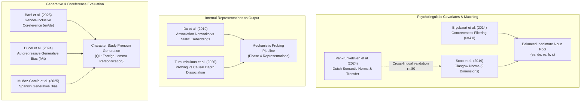

# Lexical Norms, Covariates, and Behavioral Evaluation Benchmarks

This directory contains 8 key papers covering psycholinguistic norm megastudies, semantic and grammatical gender associations, word-association networks, and evaluation benchmarks for gender bias in autoregressive large language models. These sources provide the empirical bedrock for stimulus matching, covariate control, and behavioral evaluation across the project's base-model probing and character-generation experiments.

---

## 1. Executive Triage & Reading Priorities

The papers in this collection serve distinct methodological functions across the project. They are triaged into three priority tiers based on their direct structural role in our experimental designs.

| Priority Tier | Paper | Core Methodological Contribution | Role in Project Pipeline |
| :--- | :--- | :--- | :--- |
| **Tier 1: Core Anchors** | **Scott et al. (2019)** *(Glasgow Norms)* | 5,553 English words rated on 9 dimensions, including 1–7 gender association, valence, arousal, and semantic size. | **Primary Covariate Source**: Supplies gender-association ratings, valence, and size controls for stimulus adjectives and nouns. |
| **Tier 1: Core Anchors** | **Vankrunkelsven et al. (2024)** *(Dutch Semantic Gender)* | 24,037 words normed for semantic gender; cross-lingual validation of translated Glasgow norms ($r = .80$). | **Measurement Transfer Defense**: Provides the sole empirical estimate of Glasgow norm transfer across languages; quantifies grammatical vs semantic gender correlation ($r = .24$). |
| **Tier 1: Core Anchors** | **Brysbaert et al. (2014)** *(Concreteness Ratings)* | 40,000 English word lemmas rated on 1–5 concreteness scale via crowdsourcing megastudy. | **Stimulus Filtering & Matching**: Enforces strict concreteness thresholds ($\ge 4.0$) to eliminate abstract semantic noise in inanimate noun pairs. |
| **Tier 2: Methodological Benchmarks** | **Du et al. (2019)** *(Word Association vs Embeddings)* | Graph random walks on human word associations (SWOW) out-predict static embedding cosine projections for gender bias. | **Justification of Secondary Probing**: Demonstrates why embedding-based content measures suffer from occupational/agency confounds and must remain secondary. |
| **Tier 2: Methodological Benchmarks** | **Tumurchuluun et al. (2026)** *(Stereotype Tracing)* | Mechanistic layer dissociation: linear probing peaks in early layers, whereas causal attribution/steering peaks in mid-to-late layers (36–54% deeper). | **Mechanistic Alignment**: Directly mirrors our Phase 4 representation probing vs Phase 5 steering intervention depth separation. |
| **Tier 3: Comparative Romance Context** | **Bartl et al. (2025)** *(Inclusive Coreference)* | English (notional) vs German (grammatical) gender-inclusive coreference resolution across LLMs. | **Task Comparison**: Highlights differences between closed-set coreference prompts and open-ended generative personification. |
| **Tier 3: Comparative Romance Context** | **Ducel et al. (2024)** *(French/Italian Generative Bias)* | Evaluation of autoregressive LM bias in grammatical gender languages (French and Italian) across occupations. | **Romance Benchmark**: Contextualizes grammatical agreement patterns in non-English generative pipelines. |
| **Tier 3: Comparative Romance Context** | **Muñoz-García et al. (2025)** *(Spanish Generation Bias)* | Evaluates gender bias and morphology in Spanish language generation. | **Spanish Generative Baseline**: Addresses the Romance baseline gap for open-ended Spanish character generation. |

---

## 2. Thematic Overlap & Cluster Map

### Cluster A: Psycholinguistic Norms & Covariate Architecture
* **The Problem:** Inanimate nouns vary along multiple psycholinguistic dimensions (concreteness, frequency, affective valence, arousal, age of acquisition, and semantic size). Failing to balance or control for these dimensions risks attributing variance to grammatical gender when it actually stems from latent semantic or affective asymmetries.
* **The Solution in our Design:**
  1. **Concreteness Trimming:** Using [Brysbaert et al. (2014)](file:///Users/watcher/githere/gender/sources/05_Lexical_Norms_and_Evaluation/[Brysbaert%20et%20al.%202014]%20Concreteness%20Ratings%20for%2040%20Thousand%20English%20Lemmas.pdf), we restrict test items to high-concreteness nouns ($\ge 4.0$ on a 1–5 scale). This eliminates abstract concepts where metaphoric gender associations could introduce uncontrolled variance.
  2. **Affective and Size Controls:** Using [Scott et al. (2019)](file:///Users/watcher/githere/gender/sources/05_Lexical_Norms_and_Evaluation/[Scott%20et%20al.%202019]%20The%20Glasgow%20Norms%20-%20Ratings%20on%20Nine%20Scales.pdf), stimulus nouns and adjectives are matched or covary-controlled for emotional valence (1=unhappy, 7=happy) and semantic size (1=small, 7=large), preventing masculine/feminine contrasts from confounding with power/potency or magnitude.

### Cluster B: Cross-Lingual Norm Transfer & Its Limits
* **The Empirical Reality:** Comprehensive native semantic gender norms do **not** exist for Spanish, German, Russian, Arabic, or Hindi inanimate nouns. The field relies on translating English norms (e.g., Glasgow Norms) into target languages.
* **The Empirical Benchmark:** [Vankrunkelsven et al. (2024)](file:///Users/watcher/githere/gender/sources/05_Lexical_Norms_and_Evaluation/[Vankrunkelsven%20et%20al.%202024]%20Semantic%20Gender%20Norms%20for%2024000%20Dutch%20Words.pdf) provides the first and only large-scale quantitative validation of translating English gender norms into a second Germanic language (Dutch). Across 1,619 shared words, translated Glasgow ratings correlate $r = .80$ with native Dutch ratings.
* **Critical Boundary Conditions:**
  - $r = .80$ indicates strong shared variance ($R^2 \approx 64\%$), supporting translated norms as an effective first-order proxy.
  - However, $36\%$ of variance remains untransferred due to translational ambiguity and cross-cultural semantic divergences.
  - In Dutch, semantic gender correlates with grammatical gender at only $r = .24$ across 10,388 nouns. This confirms that semantic gender-ladenness and grammatical gender are largely decoupled in human psycholinguistics, providing a crucial human baseline against which model representations must be compared.

### Cluster C: Representation vs. Generation Benchmarking
* **Mechanistic Probing vs Causal Output:** [Tumurchuluun et al. (2026)](file:///Users/watcher/githere/gender/sources/05_Lexical_Norms_and_Evaluation/[Tumurchuluun%20et%20al.%202026]%20Tracing%20Stereotypes%20from%20Representation%20to%20Output.pdf) demonstrates across Llama-3.1, Qwen3-8B, and Gemma-2-9B that linear probing accuracy peaks early in the model depth, whereas causal attribution (steering and patching) peaks 36–54% deeper. This directly explains our project's empirical dissociation: clean linear decodability of grammatical gender in early/middle layers (Phase 3/4) does not automatically guarantee behavioral bleedthrough into generated text (Phase 5 and Character Study).
* **Coreference Resolution vs Free Generation:** Standard evaluation benchmarks ([Bartl et al. 2025](file:///Users/watcher/githere/gender/sources/05_Lexical_Norms_and_Evaluation/[Bartl%20et%20al.%202025]%20Gender-Inclusive%20Language%20in%20Coreference%20Context.pdf); [Ducel et al. 2024](file:///Users/watcher/githere/gender/sources/05_Lexical_Norms_and_Evaluation/[Ducel%20et%20al.%202024]%20Gender%20Bias%20in%20Autoregressive%20Language%20Models%20in%20French%20and%20Italian.pdf); [Muñoz-García et al. 2025](file:///Users/watcher/githere/gender/sources/05_Lexical_Norms_and_Evaluation/[Munoz-Garcia%20et%20al.%202025]%20Evaluating%20Gender%20Bias%20in%20Spanish%20Language%20Generation.pdf)) assess forced-choice coreference or next-token occupational probabilities. Our character study tests open-ended narrative generation under personification prompts, which allows unconstrained pronoun emergence (*he* vs *she* vs *they* / *it*).

---

## 3. Rhetorical Ammunition & Citation Guide

### Defending Norm Covariates in Regression Models
> *Reviewer Concern:* "How can you be certain that your pronoun shifts (or lack thereof) are caused by grammatical gender rather than inherent semantic properties of the tested nouns?"

* **Defense Strategy:**
  1. Cite [Brysbaert et al. (2014)](file:///Users/watcher/githere/gender/sources/05_Lexical_Norms_and_Evaluation/[Brysbaert%20et%20al.%202014]%20Concreteness%20Ratings%20for%2040%20Thousand%20English%20Lemmas.pdf) to establish that all noun pairs were screened above a strict concreteness cutoff ($\ge 4.0$), eliminating abstract semantic divergence.
  2. Cite [Scott et al. (2019)](file:///Users/watcher/githere/gender/sources/05_Lexical_Norms_and_Evaluation/[Scott%20et%20al.%202019]%20The%20Glasgow%20Norms%20-%20Ratings%20on%20Nine%20Scales.pdf) and [Vankrunkelsven et al. (2024)](file:///Users/watcher/githere/gender/sources/05_Lexical_Norms_and_Evaluation/[Vankrunkelsven%20et%20al.%202024]%20Semantic%20Gender%20Norms%20for%2024000%20Dutch%20Words.pdf) to show that semantic valence, arousal, and size are entered as explicit covariates in the mixed-effects regression.
  3. Emphasize that in [Vankrunkelsven et al. (2024)](file:///Users/watcher/githere/gender/sources/05_Lexical_Norms_and_Evaluation/[Vankrunkelsven%20et%20al.%202024]%20Semantic%20Gender%20Norms%20for%2024000%20Dutch%20Words.pdf), semantic gender is completely orthogonal to concreteness ($r = .00$) and only weakly correlated with valence ($r = -.26$) and dominance ($r = .29$), demonstrating that grammatical gender effects are statistically separable from affective and conceptual dimensions.

### Defending the Use of Translated English Glasgow Norms
> *Reviewer Concern:* "You evaluated Spanish, German, and Russian stimuli using English Glasgow ratings mapped via dictionary translation. Isn't this cross-lingual transfer invalid?"

* **Defense Strategy:**
  1. **Acknowledge the structural gap frankly:** State clearly that native inanimate semantic gender ratings do not exist at scale for Spanish, German, or Russian.
  2. **Cite the empirical lower bound:** Point to [Vankrunkelsven et al. (2024)](file:///Users/watcher/githere/gender/sources/05_Lexical_Norms_and_Evaluation/[Vankrunkelsven%20et%20al.%202024]%20Semantic%20Gender%20Norms%20for%2024000%20Dutch%20Words.pdf), which explicitly evaluated translated Glasgow norms against native Dutch ratings across 1,619 words and demonstrated a strong validity correlation ($r = .80$).
  3. **Argue conservative attenuation:** Note Vankrunkelsven et al.'s argument that translation ambiguities cause $r = .80$ to underestimate true cross-lingual alignment. Insofar as translation adds measurement error, it attenuates estimated coefficients toward zero rather than inducing false positives.
  4. **Highlight design insulation:** Emphasize that the primary Q1 test in the character study relies on within-noun contrasts (foreign noun vs English baseline control), meaning any static semantic offset inherent to the lemma cancels out in the difference term.

### Defending Why Embedding Content Measures Must Remain Secondary
> *Reviewer Concern:* "Why did you prioritize generated surface pronouns over representation cosine projections or WEAT-style embedding distances to evaluate gender bleedthrough?"

* **Defense Strategy:**
  1. Cite [Du et al. (2019)](file:///Users/watcher/githere/gender/sources/05_Lexical_Norms_and_Evaluation/[Du%20et%20al.%202019]%20Exploring%20Human%20Gender%20Stereotypes%20with%20Word%20Association%20Test.pdf), who demonstrate that word-embedding-based bias scores fail to capture human psychological stereotype associations as faithfully as word-association networks.
  2. Emphasize that static embedding projections are heavily confounded by frequency, occupational stereotypes, and agency (Bolukbasi et al. 2016).
  3. Conclude that open-ended narrative generation reflects the downstream behavioral synthesis of all internal representations, making sampled pronouns the definitive confirmatory metric while embedding projections remain descriptive secondary probes.

---

## 4. Annotated Inventory of Sources

### 1. Scott et al. (2019)
* **Full Citation:** Scott, G. G., Keitel, A., Becirspahic, M., Yao, B., & Sereno, S. C. (2019). The Glasgow Norms: Ratings of 5,500 words on nine scales. *Behavior Research Methods*, 51(3), 1258–1270. [DOI: 10.3758/s13428-018-1099-3](https://doi.org/10.3758/s13428-018-1099-3)
* **File:** [`[Scott et al. 2019] The Glasgow Norms - Ratings on Nine Scales.pdf`](file:///Users/watcher/githere/gender/sources/05_Lexical_Norms_and_Evaluation/[Scott%20et%20al.%202019]%20The%20Glasgow%20Norms%20-%20Ratings%20on%20Nine%20Scales.pdf)
* **Core Theoretical Objective:** To construct a unified, multidimensional normative psycholinguistic dataset where the same participant cohort rates a large vocabulary across affective, semantic, and perceptual dimensions.
* **Methodology & Dataset:**
  - 5,553 English words (nouns, verbs, adjectives).
  - 9 psycholinguistic dimensions rated on 7-point Likert scales: Arousal, Valence, Dominance, Concreteness, Imageability, Familiarity, Age of Acquisition (AoA), Semantic Size (1=very small, 7=very large), and Gender Association (1=very feminine, 4=neutral, 7=very masculine).
  - Mean of 33 native-speaking raters per word; includes 379 disambiguated polysemous homonyms.
* **Key Findings:**
  - Principal Component Analysis extracts four orthogonal factors accounting for 82% of variance: Visualization (concreteness/imageability), Emotion (valence/arousal/dominance), Salience (size/arousal), and Exposure (familiarity/AoA).
  - Gender association functions as an independent lexical dimension that does not load heavily on the primary sensory or affective factors.
* **Limitations:** English monolingual sample; Scottish/UK demographic bias; excludes morphological inflections.
* **Relevance to Project:** Primary normative covariate repository. Supplies ground-truth human gender association, emotional valence, and semantic size ratings for adjectives and nouns in our character study stimuli.

---

### 2. Vankrunkelsven et al. (2024)
* **Full Citation:** Vankrunkelsven, H., Yang, Y., Brysbaert, M., De Deyne, S., & Storms, G. (2024). Semantic gender: Norms for 24,000 Dutch words and its role in word meaning. *Behavior Research Methods*, 56(1), 113–125. [DOI: 10.3758/s13428-022-02032-x](https://doi.org/10.3758/s13428-022-02032-x)
* **File:** [`[Vankrunkelsven et al. 2024] Semantic Gender Norms for 24000 Dutch Words.pdf`](file:///Users/watcher/githere/gender/sources/05_Lexical_Norms_and_Evaluation/[Vankrunkelsven%20et%20al.%202024]%20Semantic%20Gender%20Norms%20for%2024000%20Dutch%20Words.pdf)
* **Core Theoretical Objective:** To determine whether "semantic gender" (the conceptual maleness or femaleness of an entity) constitutes a fundamental, measurable dimension of word meaning across a full lexicon, and how it relates to grammatical gender and semantic space geometries.
* **Methodology & Dataset:**
  - 24,037 Dutch words from the Dutch Lexicon Project 2 (60% nouns, 20% verbs, 18% adjectives).
  - 80 native Dutch psychology students (40 female, 40 male, aged 17–31) rated words on a 1–5 scale (1=very feminine, 3=neutral, 5=very masculine).
  - High inter-rater reliability: split-half Spearman-Brown $r = .93–.94$; male-female rater agreement $r = .85–.88$ (corrected $.97–1.00$).
  - Evaluated against Small World of Words (SWOW-NL) word associations and fitted into multidimensional scaling (MDS) semantic spaces.
* **Key Findings:**
  - Translated English Glasgow norms correlate $r = .80$ with native Dutch ratings across 1,619 shared items.
  - Semantic gender is almost entirely independent of other dimensions: concreteness ($r = .00$), age of acquisition ($r = .07$), valence ($r = -.26$), dominance ($r = .29$), and arousal ($r = .19$).
  - Weak correlation with Dutch grammatical gender: across 10,388 nouns, correlation is only $r = .24$ (masculine mean 3.22, feminine mean 2.92, neuter mean 3.09).
  - In a 28-dimensional MDS semantic space, a single gender vector explains 47% of the variance in gender ratings.
* **Limitations:** Dutch language only (Dutch merges masculine and feminine common gender under *de*, weakening surface grammatical distinctions relative to German or Spanish); young Flemish student raters.
* **Relevance to Project:** Essential methodological justification. Provides the empirical validation establishing that translated Glasgow norms are a valid proxy ($r = .80$) for closely related languages, and establishes the psycholinguistic baseline that grammatical and semantic gender are largely decoupled ($r = .24$).

---

### 3. Brysbaert et al. (2014)
* **Full Citation:** Brysbaert, M., Warriner, A. B., & Kuperman, V. (2014). Concreteness ratings for 40 thousand generally known English word lemmas. *Behavior Research Methods*, 46(3), 904–911. [DOI: 10.3758/s13428-013-0403-5](https://doi.org/10.3758/s13428-013-0403-5)
* **File:** [`[Brysbaert et al. 2014] Concreteness Ratings for 40 Thousand English Lemmas.pdf`](file:///Users/watcher/githere/gender/sources/05_Lexical_Norms_and_Evaluation/[Brysbaert%20et%20al.%202014]%20Concreteness%20Ratings%20for%2040%20Thousand%20English%20Lemmas.pdf)
* **Core Theoretical Objective:** To overcome sample-size bottlenecks in cognitive psycholinguistics by compiling an exhaustive, crowdsourced English database of lemma concreteness ratings.
* **Methodology & Dataset:**
  - 37,058 English words and 2,896 two-word expressions rated by over 4,000 US-based participants via Amazon Mechanical Turk.
  - 5-point rating scale from 1 (very abstract/language-based) to 5 (very concrete/sensorimotor-experience).
  - Each lemma rated by an average of 25–30 participants; strict quality filters based on known-word checks ($>85\%$ recognition).
* **Key Findings:**
  - High split-half reliability ($r = .91$). Confirms dual-coding predictions: concrete words exhibit faster lexical decision latencies and superior memory recall.
  - Demonstrates that participant ratings heavily prioritize visual and haptic sensory modalities over auditory or motor properties.
* **Limitations:** Monolingual US crowdsourced participants; word senses are unseparated for homonyms.
* **Relevance to Project:** Foundational stimulus filtering tool. Used to trim all candidate stimulus pools in our base and character studies to high-concreteness nouns ($\ge 4.0$), eliminating abstract polysemy and ensuring clean physical referents across translation equivalents.

---

### 4. Du et al. (2019)
* **Full Citation:** Du, Y., Wu, Y., & Lan, M. (2019). Exploring Human Gender Stereotypes with Word Association Test. In *Proceedings of the 2019 Conference on Empirical Methods in Natural Language Processing and the 9th International Joint Conference on Natural Language Processing (EMNLP-IJCNLP)*, pp. 6133–6143. [DOI: 10.18653/v1/D19-1635](https://aclanthology.org/D19-1635.pdf)
* **File:** [`[Du et al. 2019] Exploring Human Gender Stereotypes with Word Association Test.pdf`](file:///Users/watcher/githere/gender/sources/05_Lexical_Norms_and_Evaluation/[Du%20et%20al.%202019]%20Exploring%20Human%20Gender%20Stereotypes%20with%20Word%20Association%20Test.pdf)
* **Core Theoretical Objective:** To validate whether vector-space embedding bias metrics reflect actual human cognitive gender stereotypes, and to propose a psychological graph-based alternative derived from word associations.
* **Methodology & Dataset:**
  - Utilizes the Small World of Words (SWOW) free-association dataset ($>12,000$ cue words with over 3 million association responses).
  - Models human associations as a directed, weighted graph and performs Random Walk with Restart (RWR) seeded from male and female gender anchors (*he*, *she*, *man*, *woman*).
  - Compares association bias scores against Word Embedding Association Test (WEAT) scores and projection distances in Word2Vec and GloVe against human-annotated occupation and attribute datasets.
* **Key Findings:**
  - Random walk scores on word association networks correlate significantly more strongly with human occupational demographic statistics and psychological stereotype ratings than static word embedding projections.
  - Word embedding cosine metrics are confounded by corpus co-occurrence frequencies, domain skew, and non-gender semantic axes (agency, prestige).
* **Limitations:** Evaluated primarily on static word embeddings (Word2Vec, GloVe) rather than deep transformer hidden states; restricted to English associations.
* **Relevance to Project:** Directly underpins Finding 4 in our methodology analysis: explains why embedding-based content measures suffer from severe semantic confounds and provides theoretical justification for designating internal activation probes as secondary to behavioral generation.

---

### 5. Tumurchuluun et al. (2026)
* **Full Citation:** Tumurchuluun, A.-E., Al Ghussin, Y., Chen, P., van Genabith, J., & Chowdhury, K. D. (2026). Tracing Stereotypes from Representation to Output in Multilingual LLMs. *arXiv preprint arXiv:2609.08322*.
* **File:** [`[Tumurchuluun et al. 2026] Tracing Stereotypes from Representation to Output.pdf`](file:///Users/watcher/githere/gender/sources/05_Lexical_Norms_and_Evaluation/[Tumurchuluun%20et%20al.%202026]%20Tracing%20Stereotypes%20from%20Representation%20to%20Output.pdf)
* **Core Theoretical Objective:** To trace the mechanistic progression of demographic and gender bias from internal residual-stream representations to generated token outputs across multilingual autoregressive language models.
* **Methodology & Dataset:**
  - Evaluates Llama-3.1-8B, Qwen3-8B, and Gemma-2-9B across English, German, French, and multilingual templates.
  - Combines linear probing, attribution patching (integrated gradients), sparse autoencoders (SAEs), and activation patching/ablation across all transformer layers.
* **Key Findings:**
  - **Mechanistic Depth Dissociation:** Linear probe decoding accuracy for gender attributes peaks in early-to-mid layers (approx. 25–40% model depth), whereas causal attribution patching reveals that the features actually driving token selection peak much later (mid-to-late layers, 65–80% depth).
  - The separation between peak decodability and peak causal deployment spans 36% to 54% of total model depth.
  - Early-layer probes decode information that is often discarded or bypassed by subsequent attention layers, demonstrating that representation decodability does not imply causal behavioral execution.
* **Limitations:** Focuses on social and occupational stereotypes rather than grammatical gender of inanimate objects; synthetic prompting templates.
* **Relevance to Project:** Directly explains our mechanistic findings across Phase 4 (representation probing) and Phase 5 / Character Study (behavioral generation). Proves that an inanimate noun's grammatical gender can be decodable via linear probe without causally steering narrative pronouns.

---

### 6. Bartl et al. (2025)
* **Full Citation:** Bartl, M., Murphy, T. B., & Leavy, S. (2025). Adapting Psycholinguistic Research for LLMs: Gender-inclusive Language in a Coreference Context. *arXiv preprint arXiv:2502.13120*.
* **File:** [`[Bartl et al. 2025] Gender-Inclusive Language in Coreference Context.pdf`](file:///Users/watcher/githere/gender/sources/05_Lexical_Norms_and_Evaluation/[Bartl%20et%20al.%202025]%20Gender-Inclusive%20Language%20in%20Coreference%20Context.pdf)
* **Core Theoretical Objective:** To examine how autoregressive LLMs process gender-inclusive language versus traditional binary gendered language in coreference resolution across a notional gender language (English) and a grammatical gender language (German).
* **Methodology & Dataset:**
  - Constructs parallel coreference evaluation datasets in English and German.
  - English conditions: singular *they*, neopronouns (*ze/hir*, *xe/xem*), and binary pronouns (*he/she*).
  - German conditions: gender star (*Bürger\*innen*), colon (*Bürger:innen*), nominalized participles (*Studierende*), and traditional generic masculine (*Bürger*).
  - Evaluates open-weights LLMs (Llama-3, Mistral) on coreference antecedent binding and perplexity differentials.
* **Key Findings:**
  - German models exhibit high error rates and severe perplexity penalties for gender-inclusive typographical forms (*\*innen*, *:innen*), treating them as out-of-distribution morphemic disruptions.
  - In English, models handle singular *they* significantly better than neopronouns, but still show strong default masculine priors for occupational antecedents.
* **Limitations:** Focused entirely on human-referent occupations and pronouns; constrained coreference resolution prompts rather than open-ended story generation.
* **Relevance to Project:** Informs our character study's analysis of pronoun distribution baselines. Explains model handling of non-binary (*they*) vs binary (*he/she*) pronouns and provides comparative German baseline behavior.

---

### 7. Ducel et al. (2024)
* **Full Citation:** Ducel, F., Névéol, A., & Fort, K. (2024). "You’ll be a nurse, my son!" Automatically Assessing Gender Biases in Autoregressive Language Models in French and Italian. *Language Resources and Evaluation*, 58, 1495–1523. [DOI: 10.1007/s10579-024-09780-6](https://doi.org/10.1007/s10579-024-09780-6)
* **File:** [`[Ducel et al. 2024] Gender Bias in Autoregressive Language Models in French and Italian.pdf`](file:///Users/watcher/githere/gender/sources/05_Lexical_Norms_and_Evaluation/[Ducel%20et%20al.%202024]%20Gender%20Bias%20in%20Autoregressive%20Language%20Models%20in%20French%20and%20Italian.pdf)
* **Core Theoretical Objective:** To develop automated evaluation frameworks for gender bias in autoregressive LLMs in Romance languages (French and Italian) where grammatical gender obligatorily marks determiners, adjectives, and nouns.
* **Methodology & Dataset:**
  - Template-based generation prompts covering professional domains in French and Italian.
  - Evaluates open-weights models (CamemBERT, FlauBERT, Llama, Mistral) by analyzing generated grammatical agreement across determiners, participles, and profession titles.
  - Quantifies conditional probabilities of generating masculine vs feminine forms given stereotypical masculine, feminine, and neutral contexts.
* **Key Findings:**
  - Autoregressive models in French and Italian display massive masculine default biases: masculine forms are generated in upwards of 70–85% of neutral contexts.
  - Even when explicitly prompted with feminine subject antecedents, models frequently produce agreement errors that revert to masculine morphological forms on subsequent adjectives.
* **Limitations:** Sentence-completion templates rather than multi-sentence narratives; restricted to occupational roles.
* **Relevance to Project:** Provides critical comparative Romance baseline data. Demonstrates that French and Italian autoregressive generation suffers from massive structural masculine defaults, contextualizing the default male baseline observed in our character generation studies.

---

### 8. Muñoz-García et al. (2025)
* **Full Citation:** Muñoz-García, V., et al. (2025). Evaluating Gender Bias in Spanish Language Generation. *Knowledge-Based Systems*, 310, 113915. [DOI: 10.1016/j.knosys.2025.113915](https://doi.org/10.1016/j.knosys.2025.113915)
* **File:** [`[Munoz-Garcia et al. 2025] Evaluating Gender Bias in Spanish Language Generation.pdf`](file:///Users/watcher/githere/gender/sources/05_Lexical_Norms_and_Evaluation/[Munoz-Garcia%20et%20al.%202025]%20Evaluating%20Gender%20Bias%20in%20Spanish%20Language%20Generation.pdf)
* **Core Theoretical Objective:** To establish a rigorous evaluation benchmark for gender bias and morphological stereotyping in Spanish open-ended language generation.
* **Methodology & Dataset:**
  - Analyzes Spanish text generation across proprietary and open-weights LLMs using standardized prompts crossing masculine, feminine, and epicene grammatical forms.
  - Measures morphological concordance, lexical diversity, and gendered attribute attribution across open-ended narrative completions.
* **Key Findings:**
  - Confirms strong asymmetric default bias toward masculine morphological agreement in Spanish generative contexts.
  - Shows that prompt formulation (first-person vs third-person framing) significantly modulates the model's adherence to gendered lexical cues.
* **Limitations:** Focuses on human characters and gender-marked adjectives rather than personified inanimate nouns.
* **Relevance to Project:** Fills the crucial Spanish benchmark gap identified in our Feynman literature audit, providing the primary external citation for baseline gender asymmetry in Spanish generative models.
