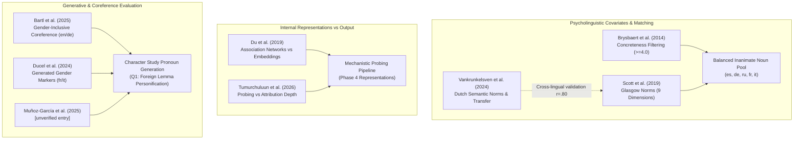

# Lexical Norms, Covariates, and Behavioral Evaluation Benchmarks

This directory contains 8 key papers covering psycholinguistic norm megastudies, semantic and grammatical gender associations, word-association networks, and evaluation benchmarks for gender bias in autoregressive large language models. These sources provide the empirical bedrock for stimulus matching, covariate control, and behavioral evaluation across the project's base-model probing and character-generation experiments.

---

## 1. Executive Triage & Reading Priorities

The papers in this collection serve distinct methodological functions across the project. They are triaged into three priority tiers based on their direct structural role in our experimental designs.

| Priority Tier | Paper | Core Methodological Contribution | Role in Project Pipeline |
| :--- | :--- | :--- | :--- |
| **Tier 1: Core Anchors** | **Scott et al. (2019)** *(Glasgow Norms)* | 5,553 English words rated on 9 dimensions, including 1–7 gender association, valence, arousal, and semantic size. | **Primary Covariate Source**: Supplies gender-association ratings, valence, and size controls for stimulus adjectives and nouns. |
| **Tier 1: Core Anchors** | **Vankrunkelsven et al. (2024)** *(Dutch Semantic Gender)* | 24,037 words normed for semantic gender; cross-lingual validation of translated Glasgow norms ($r = .80$). | **Measurement Transfer Defense**: Reports a comparison of its Dutch ratings with translated Glasgow norms ($r = .80$); reports $r = .24$ between semantic gender ratings and grammatical gender class (masculine/feminine). |
| **Tier 1: Core Anchors** | **Brysbaert et al. (2014)** *(Concreteness Ratings)* | 37,058 English words and 2,896 two-word expressions rated for concreteness (1–5) via crowdsourcing. | **Stimulus Filtering & Matching**: Project design choice (not from the paper): a concreteness threshold ($\ge 4.0$) to remove abstract nouns from inanimate noun pairs. |
| **Tier 2: Methodological Benchmarks** | **Du et al. (2019)** *(Word Association vs Embeddings)* | Random walk on a human word-association graph (SWOW-EN) yields gender bias scores that correlate with real-world measures and give a different perspective from embedding-based scores. | **Justification of Secondary Probing**: Background for treating embedding-based bias scores with caution; the paper's own claim is that association scores are an alternative with stronger correlations to human judgments than vanilla embedding scores. |
| **Tier 2: Methodological Benchmarks** | **Tumurchuluun et al. (2026)** *(Stereotype Tracing)* | Probe performance peaks earlier than attribution patching in all three models (separation of 36–53% of model depth); only 6–18% of residual-stream SAE features have language-agnostic effects, none category-agnostic. | **Mechanistic Alignment**: Conceptually related to separating decodability from causal use; the paper studies social stereotypes, not grammatical gender, so any parallel to our Phase 4/5 is our own interpretation *[unverified]*. |
| **Tier 3: Comparative Romance Context** | **Bartl et al. (2025)** *(Inclusive Coreference)* | Gender-inclusive vs gendered coreference in English (notional gender) and German (grammatical gender) LLMs, adapted from a French psycholinguistic study. | **Task Comparison**: Highlights differences between closed-set coreference prompts and open-ended generative personification. |
| **Tier 3: Comparative Romance Context** | **Ducel et al. (2024)** *(French/Italian Generative Bias)* | Automatic measurement of gender markers in LM-generated cover letters in French and Italian (seven autoregressive models). | **Romance Benchmark**: Related work on gender markers in non-English generation. |
| **Tier 3: Comparative Romance Context** | **Muñoz-García et al. (2025)** *(Spanish Generation Bias)* | *[unverified]* Cited title "Evaluating Gender Bias in Spanish Language Generation" could not be confirmed; the file in the folder is an unrelated reinforcement-learning paper, and the cited DOI appears to belong to a different Knowledge-Based Systems paper (BiasBloom corpus, vol. 325). | **Spanish Generative Baseline**: *[unverified]* Entry could not be verified; do not cite until the correct paper is identified. |

---

## 2. Thematic Overlap & Cluster Map

### Cluster A: Psycholinguistic Norms & Covariate Architecture
* **The Problem:** Inanimate nouns vary along multiple psycholinguistic dimensions (concreteness, frequency, affective valence, arousal, age of acquisition, and semantic size). Failing to balance or control for these dimensions risks attributing variance to grammatical gender when it actually stems from latent semantic or affective asymmetries.
* **The Solution in our Design:**
  1. **Concreteness Trimming:** Using [Brysbaert et al. (2014)](file:///Users/watcher/githere/gender/sources/05_Lexical_Norms_and_Evaluation/[Brysbaert%20et%20al.%202014]%20Concreteness%20Ratings%20for%2040%20Thousand%20English%20Lemmas.pdf), as a project design choice we restrict test items to high-concreteness nouns ($\ge 4.0$ on a 1–5 scale). This eliminates abstract concepts where metaphoric gender associations could introduce uncontrolled variance.
  2. **Affective and Size Controls:** Using [Scott et al. (2019)](file:///Users/watcher/githere/gender/sources/05_Lexical_Norms_and_Evaluation/[Scott%20et%20al.%202019]%20The%20Glasgow%20Norms%20-%20Ratings%20on%20Nine%20Scales.pdf), stimulus nouns and adjectives are matched or covary-controlled for valence and semantic size (project design; Glasgow ratings are on 1–9 scales for most dimensions *[unverified]*).

### Cluster B: Cross-Lingual Norm Transfer & Its Limits
* **The Empirical Reality:** Project assumption (not checked against these papers): no comprehensive native semantic gender norms exist for Spanish, German or Russian inanimate nouns, so English norms are translated.
* **The Empirical Benchmark:** [Vankrunkelsven et al. (2024)](file:///Users/watcher/githere/gender/sources/05_Lexical_Norms_and_Evaluation/[Vankrunkelsven%20et%20al.%202024]%20Semantic%20Gender%20Norms%20for%2024000%20Dutch%20Words.pdf) reports a comparison between its Dutch ratings and the English Glasgow norms, translated by Moors et al. (2012): $r = .80$ (the table lists n = 1.619; the text mentions 1669 overlapping words, which are overlaps for valence, arousal, dominance and AoA). Whether it is the only such validation is not something the paper claims.
* **Critical Boundary Conditions:**
  - $r = .80$ indicates strong shared variance ($R^2 \approx 64\%$), supporting translated norms as an effective first-order proxy.
  - However, $36\%$ of variance remains untransferred due to translational ambiguity and cross-cultural semantic divergences.
  - In Dutch, the paper reports a correlation of .24 between gender ratings and grammatical gender class (masculine/feminine), and concludes that semantic gender is not the same as grammatical gender. (The noun count of 10,388 that appeared here is not in the paper.)

### Cluster C: Representation vs. Generation Benchmarking
* **Mechanistic Probing vs Causal Output:** [Tumurchuluun et al. (2026)](file:///Users/watcher/githere/gender/sources/05_Lexical_Norms_and_Evaluation/[Tumurchuluun%20et%20al.%202026]%20Tracing%20Stereotypes%20from%20Representation%20to%20Output.pdf) reports for Llama-3.1-8B, Qwen3-8B and Gemma-2-9B that linear probe performance peaks substantially earlier than attribution patching (separation of 36–53% of model depth). The paper concerns social stereotypes (MBBQ categories in English, Spanish, Dutch, Turkish), not grammatical gender; whether this parallels our Phase 3/4 vs Phase 5 results is our own interpretation *[unverified]*.
* **Coreference Resolution vs Free Generation:** Related evaluations ([Bartl et al. 2025](file:///Users/watcher/githere/gender/sources/05_Lexical_Norms_and_Evaluation/[Bartl%20et%20al.%202025]%20Gender-Inclusive%20Language%20in%20Coreference%20Context.pdf); [Ducel et al. 2024](file:///Users/watcher/githere/gender/sources/05_Lexical_Norms_and_Evaluation/[Ducel%20et%20al.%202024]%20Gender%20Bias%20in%20Autoregressive%20Language%20Models%20in%20French%20and%20Italian.pdf); [Muñoz-García et al. 2025](file:///Users/watcher/githere/gender/sources/05_Lexical_Norms_and_Evaluation/[Munoz-Garcia%20et%20al.%202025]%20Evaluating%20Gender%20Bias%20in%20Spanish%20Language%20Generation.pdf); the Muñoz-García entry is unverified, see Section 4) differ in design from ours: Bartl et al. use coreference continuation probabilities and generation, Ducel et al. count gender markers in generated cover letters. Our character study tests open-ended narrative generation under personification prompts, which allows unconstrained pronoun emergence (*he* vs *she* vs *they* / *it*).

---

## 3. Rhetorical Ammunition & Citation Guide

### Defending Norm Covariates in Regression Models
> *Reviewer Concern:* "How can you be certain that your pronoun shifts (or lack thereof) are caused by grammatical gender rather than inherent semantic properties of the tested nouns?"

* **Defense Strategy:**
  1. Cite [Brysbaert et al. (2014)](file:///Users/watcher/githere/gender/sources/05_Lexical_Norms_and_Evaluation/[Brysbaert%20et%20al.%202014]%20Concreteness%20Ratings%20for%2040%20Thousand%20English%20Lemmas.pdf) as the source of the concreteness ratings used for our screening cutoff ($\ge 4.0$, a project choice).
  2. Cite [Scott et al. (2019)](file:///Users/watcher/githere/gender/sources/05_Lexical_Norms_and_Evaluation/[Scott%20et%20al.%202019]%20The%20Glasgow%20Norms%20-%20Ratings%20on%20Nine%20Scales.pdf) and [Vankrunkelsven et al. (2024)](file:///Users/watcher/githere/gender/sources/05_Lexical_Norms_and_Evaluation/[Vankrunkelsven%20et%20al.%202024]%20Semantic%20Gender%20Norms%20for%2024000%20Dutch%20Words.pdf) as sources of the valence, arousal and size ratings used as covariates (project design).
  3. Emphasize that in [Vankrunkelsven et al. (2024)](file:///Users/watcher/githere/gender/sources/05_Lexical_Norms_and_Evaluation/[Vankrunkelsven%20et%20al.%202024]%20Semantic%20Gender%20Norms%20for%2024000%20Dutch%20Words.pdf), semantic gender is uncorrelated with concreteness ($r = .00$) and only weakly correlated with valence ($r = -.26$), dominance ($r = .29$) and age of acquisition ($r = .07$); this concerns Dutch semantic gender ratings, not grammatical gender effects.

### Defending the Use of Translated English Glasgow Norms
> *Reviewer Concern:* "You evaluated Spanish, German, and Russian stimuli using English Glasgow ratings mapped via dictionary translation. Isn't this cross-lingual transfer invalid?"

* **Defense Strategy:**
  1. **Acknowledge the structural gap frankly:** State clearly that native inanimate semantic gender ratings do not exist at scale for Spanish, German, or Russian.
  2. **Cite the empirical lower bound:** Point to [Vankrunkelsven et al. (2024)](file:///Users/watcher/githere/gender/sources/05_Lexical_Norms_and_Evaluation/[Vankrunkelsven%20et%20al.%202024]%20Semantic%20Gender%20Norms%20for%2024000%20Dutch%20Words.pdf), which compared its Dutch ratings with Glasgow norms translated by Moors et al. (2012), reporting $r = .80$ (n = 1.619 in Table 3).
  3. **Argue conservative attenuation:** Vankrunkelsven et al. note that translation ambiguity means the Dutch-English correlation is likely underestimated. Insofar as translation adds measurement error, it attenuates estimated coefficients toward zero rather than inducing false positives.
  4. **Highlight design insulation:** Emphasize that the primary Q1 test in the character study relies on within-noun contrasts (foreign noun vs English baseline control), meaning any static semantic offset inherent to the lemma cancels out in the difference term.

### Defending Why Embedding Content Measures Must Remain Secondary
> *Reviewer Concern:* "Why did you prioritize generated surface pronouns over representation cosine projections or WEAT-style embedding distances to evaluate gender bleedthrough?"

* **Defense Strategy:**
  1. Cite [Du et al. (2019)](file:///Users/watcher/githere/gender/sources/05_Lexical_Norms_and_Evaluation/[Du%20et%20al.%202019]%20Exploring%20Human%20Gender%20Stereotypes%20with%20Word%20Association%20Test.pdf), who report that word-association-based bias scores correlate more strongly with human judgments than vanilla embedding-based scores and offer a different perspective on stereotypes.
  2. Du et al. also note that embedding-based scores are affected by word frequency effects (they discuss this in their analysis); the claim about agency confounds was not found in the paper and is removed.
  3. Conclude that open-ended narrative generation reflects the downstream behavioral synthesis of all internal representations, making sampled pronouns the definitive confirmatory metric while embedding projections remain descriptive secondary probes.

---

## 4. Annotated Inventory of Sources

### 1. Scott et al. (2019)
* **Full Citation:** Scott, G. G., Keitel, A., Becirspahic, M., Yao, B., & Sereno, S. C. (2019). The Glasgow Norms: Ratings of 5,500 words on nine scales. *Behavior Research Methods*, 51(3), 1258–1270. [DOI: 10.3758/s13428-018-1099-3](https://doi.org/10.3758/s13428-018-1099-3)
* **File:** [`[Scott et al. 2019] The Glasgow Norms - Ratings on Nine Scales.pdf`](file:///Users/watcher/githere/gender/sources/05_Lexical_Norms_and_Evaluation/[Scott%20et%20al.%202019]%20The%20Glasgow%20Norms%20-%20Ratings%20on%20Nine%20Scales.pdf)
* **Core Theoretical Objective:** To construct a unified, multidimensional normative psycholinguistic dataset where the same participant cohort rates a large vocabulary across affective, semantic, and perceptual dimensions.
* **Methodology & Dataset:**
  - 5,553 English words (nouns, verbs, adjectives).
  - 9 psycholinguistic dimensions: Arousal, Valence and Dominance on 1–9 scales; Concreteness, Imageability, Familiarity, Age of Acquisition (AoA), Semantic Size and Gender Association on 1–7 scales.
  - On average 33 participants per word (native English speakers; the same participants rated all nine dimensions for a given word subset); includes 379 ambiguous words presented alone or with a disambiguating sense.
* **Key Findings:**
  - A factor analysis extracts four factors accounting for 82% of variance: Visualization (concreteness/imageability), Emotion (valence/arousal/dominance), Salience (size, gender association, arousal), and Exposure (familiarity/AoA).
  - Gender association loads on the Salience factor together with size and arousal, and also moderately on Visualization (per the paper's text).
* **Limitations:** Participants were native English speakers, but whether they knew other languages (including grammatically gendered ones) was not recorded; the authors note this may have influenced gender association ratings.
* **Relevance to Project:** Primary normative covariate repository. Supplies ground-truth human gender association, emotional valence, and semantic size ratings for adjectives and nouns in our character study stimuli.

---

### 2. Vankrunkelsven et al. (2024)
* **Full Citation:** Vankrunkelsven, H., Yang, Y., Brysbaert, M., De Deyne, S., & Storms, G. (2024). Semantic gender: Norms for 24,000 Dutch words and its role in word meaning. *Behavior Research Methods*, 56(1), 113–125. [DOI: 10.3758/s13428-022-02032-x](https://doi.org/10.3758/s13428-022-02032-x)
* **File:** [`[Vankrunkelsven et al. 2024] Semantic Gender Norms for 24000 Dutch Words.pdf`](file:///Users/watcher/githere/gender/sources/05_Lexical_Norms_and_Evaluation/[Vankrunkelsven%20et%20al.%202024]%20Semantic%20Gender%20Norms%20for%2024000%20Dutch%20Words.pdf)
* **Core Theoretical Objective:** To determine whether "semantic gender" (the conceptual maleness or femaleness of an entity) constitutes a fundamental, measurable dimension of word meaning across a full lexicon, and how it relates to grammatical gender and semantic space geometries.
* **Methodology & Dataset:**
  - 24,037 Dutch words from the Dutch Lexicon Project 2 (60% nouns, 20% verbs, 18% adjectives).
  - 80 psychology students at the University of Leuven (40 female, 40 male, aged 17–31, Dutch as first language; each rated 6017 words, each word by ten male and ten female raters) rated words on a 1–5 scale (1=very feminine, 3=neutral, 5=very masculine).
  - Reported as highly reliable (split-half reliabilities up to .93–.94 in the paper's reliability table; male-female rater agreement figures in the paper were not re-checked *[unverified]*).
  - Predicted from a semantic space built from Dutch Small World of Words (SWOW-NL) word associations (MDS spaces).
* **Key Findings:**
  - Dutch ratings correlate .75 to .80 with English datasets; with the Glasgow norms (translations from Moors et al. 2012) $r = .80$ (Table 3, n = 1.619).
  - Semantic gender is distinct from other dimensions: concreteness ($r = .00$), age of acquisition ($r = .07$), valence ($r = -.26$), dominance ($r = .29$); arousal also correlates (arousal figure of .19 not re-checked *[unverified]*).
  - Weak correlation with Dutch grammatical gender class (masculine/feminine): $r = .24$ (mean ratings: masculine 3.22, feminine 2.92, neuter 3.09).
  - In a 28-dimensional MDS semantic space, a gender dimension explains 47% of the variance in the gender ratings.
* **Limitations:** Dutch language only (Dutch has a threefold grammatical gender system, but masculine and feminine nouns both take *de*); student raters from one university (Leuven).
* **Relevance to Project:** Essential methodological justification. Gives one data point on how English Glasgow norms translated into Dutch relate to native Dutch ratings ($r = .80$, with the paper noting translation ambiguity); and reports that Dutch semantic gender and grammatical gender class are only weakly related ($r = .24$). Extending this to Spanish or German is our own assumption.

---

### 3. Brysbaert et al. (2014)
* **Full Citation:** Brysbaert, M., Warriner, A. B., & Kuperman, V. (2014). Concreteness ratings for 40 thousand generally known English word lemmas. *Behavior Research Methods*, 46(3), 904–911. [DOI: 10.3758/s13428-013-0403-5](https://doi.org/10.3758/s13428-013-0403-5)
* **File:** [`[Brysbaert et al. 2014] Concreteness Ratings for 40 Thousand English Lemmas.pdf`](file:///Users/watcher/githere/gender/sources/05_Lexical_Norms_and_Evaluation/[Brysbaert%20et%20al.%202014]%20Concreteness%20Ratings%20for%2040%20Thousand%20English%20Lemmas.pdf)
* **Core Theoretical Objective:** To overcome sample-size bottlenecks in cognitive psycholinguistics by compiling an exhaustive, crowdsourced English database of lemma concreteness ratings.
* **Methodology & Dataset:**
  - 37,058 English words and 2,896 two-word expressions rated by over 4,000 participants recruited via Amazon Mechanical Turk (Internet crowdsourcing).
  - 5-point rating scale from abstract to concrete.
  - About 25 ratings per word on average; the list contains lemmas known by at least 85% of the raters.
* **Key Findings:**
  - Provides the ratings as a reference list of generally known English lemmas (the reliability figure of .91 that appeared here was not found in the abstract and is not confirmed *[unverified]*).
  - Compared with earlier norms, participants, as before, largely focused on visual and haptic experiences despite instructions to consider all senses.
* **Limitations:** Crowdsourced participants; one rating per word form (lemma), so word senses are not separated *[unverified]*.
* **Relevance to Project:** Foundational stimulus filtering tool. Used to trim all candidate stimulus pools in our base and character studies to high-concreteness nouns ($\ge 4.0$, a project threshold, not from the paper).

---

### 4. Du et al. (2019)
* **Full Citation:** Du, Y., Wu, Y., & Lan, M. (2019). Exploring Human Gender Stereotypes with Word Association Test. In *Proceedings of the 2019 Conference on Empirical Methods in Natural Language Processing and the 9th International Joint Conference on Natural Language Processing (EMNLP-IJCNLP)*, pp. 6133–6143. [DOI: 10.18653/v1/D19-1635](https://aclanthology.org/D19-1635.pdf)
* **File:** [`[Du et al. 2019] Exploring Human Gender Stereotypes with Word Association Test.pdf`](file:///Users/watcher/githere/gender/sources/05_Lexical_Norms_and_Evaluation/[Du%20et%20al.%202019]%20Exploring%20Human%20Gender%20Stereotypes%20with%20Word%20Association%20Test.pdf)
* **Core Theoretical Objective:** To validate whether vector-space embedding bias metrics reflect actual human cognitive gender stereotypes, and to propose a psychological graph-based alternative derived from word associations.
* **Methodology & Dataset:**
  - Utilizes the English Small World of Words (SWOW-EN, 2018) free-association dataset (more than 12,000 cue words).
  - Models associations as a graph and spreads gender information from a set of gender-specific word pairs (e.g. *brother/sister*, *man/woman*, *boy/girl*) by random walk ("stereotype propagation", after Zhou et al. 2003).
  - Compares the scores with embedding-based scores (we-cos, we-norm; word2vec, debiased variants such as Hard-Debias and Gn-GloVe) on US census occupation gender proportions, crowd-annotated profession stereotypes (Bolukbasi et al. 2016) and IAT concept pairs (career/family, math/arts, science/arts).
* **Key Findings:**
  - Association-based scores correlate with real-world occupation statistics and the IAT pairs; the paper reports stronger correlations than vanilla embedding-based scores and significantly higher correlation with human judgments.
  - The paper also discusses that embedding-based scores are affected by word frequency and gives the association scores as a complementary perspective.
* **Limitations:** Compared only with static word-embedding scores, not transformer hidden states; English associations only.
* **Relevance to Project:** Background on validating bias scores against human judgments; any use as justification for treating activation probes as secondary is our own reasoning *[unverified]*, not a claim of the paper.

---

### 5. Tumurchuluun et al. (2026)
* **Full Citation:** Tumurchuluun, A.-E., Al Ghussin, Y., Chen, P., van Genabith, J., & Chowdhury, K. D. (2026). Tracing Stereotypes from Representation to Output in Multilingual LLMs. *arXiv preprint arXiv:2609.08322 (September 2026)*.
* **File:** [`[Tumurchuluun et al. 2026] Tracing Stereotypes from Representation to Output.pdf`](file:///Users/watcher/githere/gender/sources/05_Lexical_Norms_and_Evaluation/[Tumurchuluun%20et%20al.%202026]%20Tracing%20Stereotypes%20from%20Representation%20to%20Output.pdf)
* **Core Theoretical Objective:** To determine where stereotype-related information is represented in multilingual LLMs and how it affects output, comparing linear probing, attribution patching, sparse autoencoders (SAEs) and feature ablation.
* **Methodology & Dataset:**
  - Evaluates Llama-3.1-8B, Qwen3-8B and Gemma-2-9B across four languages (English, Spanish, Dutch, Turkish, using the MBBQ resource) and six social categories (age, disability, gender, appearance, socio-economic status, sexual orientation); feature interventions are evaluated on a held-out SHADES set.
  - Combines layer-wise linear probing, attribution patching, sparse autoencoders and feature ablation.
* **Key Findings:**
  - **Depth dissociation:** probe performance peaks substantially earlier than attribution patching in all three models (the 25–40% / 65–80% depth figures that appeared here are not from the paper).
  - The separation between the two peaks is 36–53% of model depth.
  - Only 6–18% of evaluated residual-stream features have language-agnostic effects and none are category-agnostic; the authors conclude decodability, output influence and cross-lingual ablation effects must be measured separately.
* **Limitations:** Studies social stereotypes in a bias QA benchmark, not grammatical gender of inanimate nouns; four languages, three model families.
* **Relevance to Project:** Methodological parallel (decodability vs causal use); the paper does not address grammatical gender or our phases, so any link to our findings is our own interpretation *[unverified]*.

---

### 6. Bartl et al. (2025)
* **Full Citation:** Bartl, M., Murphy, T. B., & Leavy, S. (2025). Adapting Psycholinguistic Research for LLMs: Gender-inclusive Language in a Coreference Context. *arXiv preprint arXiv:2502.13120*.
* **File:** [`[Bartl et al. 2025] Gender-Inclusive Language in Coreference Context.pdf`](file:///Users/watcher/githere/gender/sources/05_Lexical_Norms_and_Evaluation/[Bartl%20et%20al.%202025]%20Gender-Inclusive%20Language%20in%20Coreference%20Context.pdf)
* **Core Theoretical Objective:** To examine whether LLM-generated coreferent terms follow the antecedent's gender expression or reflect model biases, comparing gendered and gender-inclusive language in English (notional gender) and German (grammatical gender), adapting a French psycholinguistic study (Tibblin et al. 2023).
* **Methodology & Dataset:**
  - Sentence pairs with an antecedent and a coreferent noun (men, women, or neutral/inclusive variants), in English and German.
  - English models: GPT-2, a gender-neutral fine-tuned GPT-2 (Bartl and Leavy 2024), OLMo 1B/7B/13B, Qwen2.5-32B; German models include LeoLM Mistral 7B (full German list not re-checked *[unverified]*).
  - Measures coreferent probabilities (ANOVA on antecedent and coreferent gender) and also generated continuations.
* **Key Findings:**
  - In English, LLMs generally maintain the antecedent's gender but exhibit an underlying masculine bias.
  - In German, the masculine bias is much stronger, overriding all tested gender-neutralization strategies.
* **Limitations:** Human referents; constrained sentence-pair design rather than open-ended story generation.
* **Relevance to Project:** Comparative evidence for a masculine default in English and German LLMs; no content on personified inanimate nouns.

---

### 7. Ducel et al. (2024)
* **Full Citation:** Ducel, F., Névéol, A., & Fort, K. (2024). "You’ll be a nurse, my son!" Automatically Assessing Gender Biases in Autoregressive Language Models in French and Italian. *Language Resources and Evaluation*, 2024, pp. 1495–1523. [DOI: 10.1007/s10579-024-09780-6](https://doi.org/10.1007/s10579-024-09780-6)
* **File:** [`[Ducel et al. 2024] Gender Bias in Autoregressive Language Models in French and Italian.pdf`](file:///Users/watcher/githere/gender/sources/05_Lexical_Norms_and_Evaluation/[Ducel%20et%20al.%202024]%20Gender%20Bias%20in%20Autoregressive%20Language%20Models%20in%20French%20and%20Italian.pdf)
* **Core Theoretical Objective:** To propose a framework for automatically measuring gender biases in text generated by LMs in inflected languages, with a system that identifies morpho-syntactic gender markers in text.
* **Methodology & Dataset:**
  - Seven autoregressive LMs (including xglm, gpt2-fr, vigogne-2-instruct, BLOOM and cerbero) generate more than 52,000 French cover letters (203 industry sectors) and over 4,100 Italian ones (55 sectors).
  - Gender markers in the text are identified automatically and associated with occupations; both neutral and gendered prompts are used.
* **Key Findings:**
  - All models are strongly biased toward masculine gender markers: twice as many masculine as feminine markers in French and eight times as many in Italian.
  - Models exacerbate stereotypes: feminine inflections are associated with care, children and physical appearance; physical, technical and manual occupations with masculine markers.
* **Limitations:** Cover-letter genre only; occupation focus; human referents.
* **Relevance to Project:** Comparative evidence of a masculine default in French and Italian generated text; no content on personified inanimate nouns.

---

### 8. Muñoz-García et al. (2025)
* **Full Citation:** *[unverified / likely hallucinated]* "Muñoz-García, V., et al. (2025). Evaluating Gender Bias in Spanish Language Generation. *Knowledge-Based Systems*, 310, 113915." The DOI 10.1016/j.knosys.2025.113915 resolves to *Knowledge-Based Systems* vol. 325, "Leading and non-leading prompts: Quantifying gender bias in Large Language Models through BiasBloom corpus" (a Spanish gender-bias paper, authors not retrieved); no paper with the cited title was found.
* **File:** [`[Munoz-Garcia et al. 2025] Evaluating Gender Bias in Spanish Language Generation.pdf`](file:///Users/watcher/githere/gender/sources/05_Lexical_Norms_and_Evaluation/[Munoz-Garcia%20et%20al.%202025]%20Evaluating%20Gender%20Bias%20in%20Spanish%20Language%20Generation.pdf)
* **Note:** The PDF in this folder under this name is an unrelated reinforcement-learning paper (vMFER, Von Mises-Fisher Experience Resampling, arXiv 2405.08638). The objective, methodology, findings and relevance text previously written here had no source and was removed. Identify the intended paper (possibly the BiasBloom paper above) and read it before citing.
