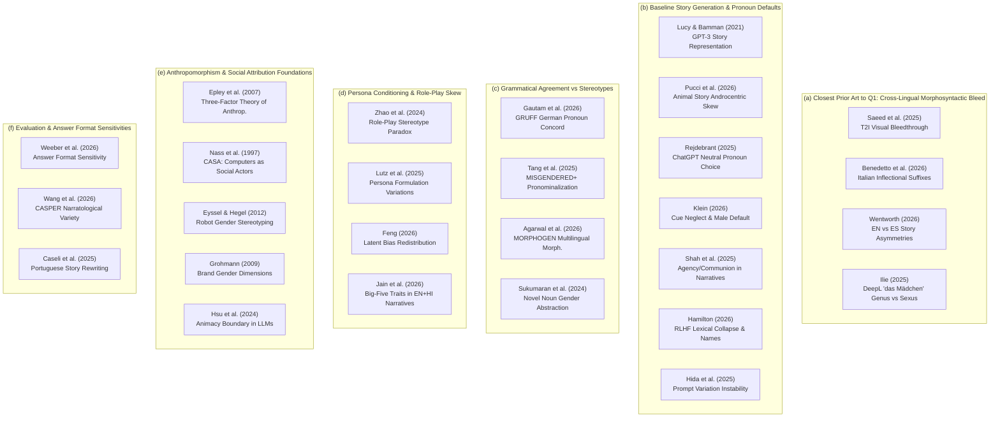
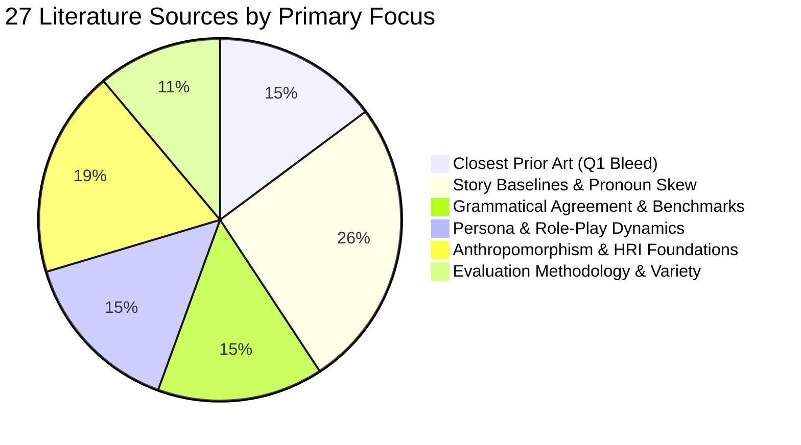

# Story Generation, Personification, and Character Literature Guide

Comprehensive triage, thematic cluster map, rhetorical citation matrix, and annotated inventory for the 27 research papers in `sources/06_Story_Generation_and_Personification/`.

This catalog serves as the foundational literature guide for the `character/` study investigating whether large language models (LLMs) assign character gender based on the grammatical gender of foreign-language noun stimuli embedded in English prompts.

---

## 1. Executive Triage & Tiered Reading List

To optimize reading bandwidth across the 27 papers in this collection, sources are triaged into three distinct operational tiers based on their direct relevance to the preregistered research questions (specifically **Q1: Grammatical Gender Bleedthrough** and **Q5: Frame & Persona Sensitivity**).

```mermaid
flowchart TD
    subgraph T1["Tier 1: Essential Anchors (Must Read)"]
        Saeed["Saeed et al. (2025)<br>T2I Visual Bleedthrough"]
        Benedetto["Benedetto et al. (2026)<br>Italian Morphosyntax"]
        Pucci["Pucci et al. (2026)<br>'Neutrality Bites'"]
        Lucy["Lucy & Bamman (2021)<br>GPT-3 Story Baseline"]
        Wentworth["Wentworth (2026)<br>EN vs ES Asymmetries"]
    end

    subgraph T2["Tier 2: Specific Critical Precedents (Methodological Anchors)"]
        Sukumaran["Sukumaran et al. (2024)<br>Wug / Nonce Abstraction"]
        Rejdebrant["Rejdebrant (2025)<br>Neutral Prompt Outcome"]
        Epley["Epley et al. (2007)<br>Anthropomorphism Theory"]
        Gautam["Gautam et al. (2026)<br>GRUFF German Pronouns"]
        Tang["Tang et al. (2025)<br>MISGENDERED+"]
        Agarwal["Agarwal et al. (2026)<br>MORPHOGEN"]
    end

    subgraph T3["Tier 3: Persona, Role-Play & Stereotype Dynamics (Supporting / Context)"]
        Zhao["Zhao et al. (2024)<br>Role-Play Paradox"]
        Lutz["Lutz et al. (2025)<br>Prompt Makes Persona"]
        Feng["Feng (2026)<br>Illusion of Debiasing"]
        Jain["Jain et al. (2026)<br>Personality in Narratives"]
        Shah["Shah et al. (2025)<br>Stereotypes in Stories"]
        Hamilton["Hamilton (2026)<br>Elias in Lighthouse"]
        Hida["Hida et al. (2025)<br>Prompt Sensitivity"]
        Weeber["Weeber et al. (2026)<br>Answer Format Effects"]
        Klein["Klein (2026)<br>Cue Resistance"]
        Hsu["Hsu et al. (2024)<br>Animacy Attribution"]
        Wang["Wang et al. (2026)<br>CASPER Diversity"]
        JBCS["Caseli et al. (2025)<br>Portuguese Narratives"]
        Nass["Nass et al. (1997)<br>CASA Paradigm"]
        Eyssel["Eyssel & Hegel (2012)<br>Robot Stereotyping"]
        Grohmann["Grohmann (2009)<br>Brand Personality"]
        Ilie["Ilie (2025)<br>DeepL das Mädchen"]
    end

    T1 -->|Theoretical & Empirical Framing| T2
    T2 -->|Experimental Context & Controls| T3
```

### Tier 1: The Essential Anchors (Must Read Before Writing Methods or Claims)
These 5 papers provide the direct empirical foundation for the study's core hypotheses, outcome definitions, and cross-lingual scope:
1. **[Saeed et al. 2025] Beyond Content - Grammatical Gender in Text-to-Image.pdf**: The primary conceptual proof of grammatical gender bleedthrough in generative AI. Demonstrates that grammatical gender in prompts overrides semantic stereotypes in image generation (masculine marker yields 73% male depictions vs 22% English baseline).
2. **[Benedetto et al. 2026] Beyond Names - Gender Bias in Italian Recommendations.pdf**: Closest textual precedent for sub-token grammatical steering. Proves that changing only inflectional noun/adjective suffixes (*-o* vs *-a*) accounts for up to 76% of measured recommendation bias in LLMs.
3. **[Pucci et al. 2026] Neutrality Bites - Gender Representation in AI Animal Stories.pdf**: The critical baseline paper for non-human entity pronominalization. Documents that neutral animal prompts yield 40.6% masculine vs 2.2% feminine pronouns (an 18:1 ratio), establishing the androcentric default.
4. **[Lucy & Bamman 2021] Gender and Representation Bias in GPT-3 Generated Stories.pdf**: The foundational benchmark on gender bias in LLM open-ended storytelling, establishing the 2:1 male protagonist default and stereotypic adjective/action divergences.
5. **[Wentworth 2026] Gendered Asymmetries in AI Stories in English and Spanish.pdf**: Directly bridges grammatical gender systems with macro-narrative generation, comparing narrative focalization, stylistic texture, and gender assignment between English and Spanish stories.

### Tier 2: Specific Critical Precedents (Methodological & Design Anchors)
These 6 papers establish the validity of specific experimental arms, outcome measures, and evaluation baselines:
1. **[Sukumaran et al. 2024] Grammatical Abstraction Using Few-Shot Learning of Novel Noun Gender.pdf**: Empirical justification for the wug / nonce-word arms; demonstrates that LLMs abstract grammatical gender from novel surface morphology without relying on memorized lemma semantics.
2. **[Rejdebrant 2025] How ChatGPT Assigns Gender in Non-Gendered Story Prompts.pdf**: Closest methodological precedent for the dependent variable; validates measuring character gender attribution via pronoun extraction (*he*/*she*/*they*) in open-ended generations from neutral prompts.
3. **[Epley et al. 2007] On Seeing Human - Three-Factor Theory of Anthropomorphism.pdf**: Foundational cognitive psychology theory establishing why prompt-induced personification elicits social category schemas (like gender) for inanimate entities.
4. **[Gautam et al. 2026] GRUFF - LLM Pronoun Fidelity Reasoning and Biases in German.pdf**: German benchmark evaluating pronoun agreement vs distractors, demonstrating that test-time reasoning can paradoxically degrade pronoun fidelity.
5. **[Tang et al. 2025] MISGENDERED+ - Evaluating Pronoun Agreement and Bias in LLMs.pdf**: Establishes modern pronoun extraction protocols, evaluation metrics, and model error patterns on nonbinary/neopronoun resolution.
6. **[Agarwal et al. 2026] MORPHOGEN - Measuring Grammatical Gender in Generative Models.pdf**: Multilingual generation benchmark (GENFORM) tracking morphological gender transformation across 15 models in Hindi, French, and Arabic.

### Tier 3: Persona, Role-Play & Stereotype Dynamics (Supporting & Contextual Art)
These 16 papers provide essential background on prompt brittleness, persona conditioning, animacy classification, narratological diversity, and historical anthropomorphism foundations:
- **Persona & Prompt Conditioning**: Zhao et al. (2024; role-play paradox), Lutz et al. (2025; persona prompt sensitivity), Feng (2026; debiasing illusion), Jain et al. (2026; personality traits in English/Hindi stories).
- **Narrative & Bias Baselines**: Shah et al. (2025; agency/communion stereotypes in stories), Hamilton (2026; RLHF mode collapse and stock character tokens), Hida et al. (2025; prompt phrasing sensitivity), Caseli et al. (JBCS 2025; Portuguese narrative rewriting).
- **Representation & Resistance**: Klein (2026; explicit gender cue resistance in Dutch), Ilie (2025; DeepL *das Mädchen* genus-sexus conflict), Hsu et al. (2024; animacy boundary processing).
- **Evaluation Methodology**: Weeber et al. (2026; answer format variations), Wang et al. (2026; CASPER narratological character variety).
- **Foundational Psychology & HRI**: Nass et al. (1997; CASA paradigm with synthesized voices), Eyssel & Hegel (2012; robotic face gender stereotyping), Grohmann (2009; brand personality masculinity/femininity scales).

---

## 2. Thematic Overlap & Cluster Map

The 27 papers divide cleanly into six functional research clusters:

### Cluster Analysis

#### a) Closest Prior Art to Q1: Cross-Lingual Morphosyntactic Bleed
- **Members**: Saeed et al. (2025), Benedetto et al. (2026), Wentworth (2026), Ilie (2025).
- **Core Insight**: Demonstrates that grammatical gender does not remain confined to surface syntax but influences latent representations and cross-modal/generative outputs. Saeed shows visual bleed in diffusion models; Benedetto proves inflectional endings steer semantic recommendations; Wentworth shows structural narrative shifts between English and Spanish; Ilie documents MT genus-sexus resolution in *das Mädchen*.
- **Direct Role**: Serves as component proof that grammatical gender affects generative choices, while highlighting that foreign lemma → English story pronominalization is unstudied.

#### b) Baseline Story Generation & Pronoun Defaults
- **Members**: Lucy & Bamman (2021), Pucci et al. (2026), Rejdebrant (2025), Klein (2026), Shah et al. (2025), Hamilton (2026), Hida et al. (2025).
- **Core Insight**: Unconstrained and neutral story generation exhibits a massive, systematic baseline male default (typically 65% to >80% masculine pronouns for neutral referents). Furthermore, models suffer from RLHF lexical mode collapse (Hamilton) and severe prompt phrasing instability (Hida).
- **Direct Role**: Proves that a raw >50% masculine pronoun attribution rate cannot be interpreted as a masculine grammatical gender effect. Calibrates the need for a strict within-noun contrast (foreign lemma minus English translation).

#### c) Grammatical Agreement vs Stereotypes
- **Members**: Gautam et al. (2026; GRUFF), Tang et al. (2025; MISGENDERED+), Agarwal et al. (2026; MORPHOGEN), Sukumaran et al. (2024).
- **Core Insight**: Evaluates how models handle explicit grammatical gender agreement under semantic distraction, novel vocabulary, or neopronoun constraints. Models possess abstract representations of gender agreement (Sukumaran), but struggle when grammatical agreement conflicts with stereotypical defaults or when distractors intervene.
- **Direct Role**: Provides pronoun-coding standards, regex evaluation paradigms, and theoretical backing for the wug/nonce-word condition.

#### d) Persona Conditioning & Role-Play Skew
- **Members**: Zhao et al. (2024), Lutz et al. (2025), Feng (2026), Jain et al. (2026).
- **Core Insight**: Prompting an LLM to adopt a persona or role-play significantly alters its latent generative distributions. Rather than debiasing, persona steering redistributes biases (Feng), amplifies stereotypic risk by 3–5× (Zhao), and shifts gender attribution depending on personality traits across languages (Jain).
- **Direct Role**: Direct theoretical and empirical support for **Q5 (Frame Manipulation)**, confirming that framing an entity as an author vs a character persona modulates bias expression.

#### e) Anthropomorphism & Social Attribution Foundations
- **Members**: Epley et al. (2007), Nass et al. (1997), Eyssel & Hegel (2012), Grohmann (2009), Hsu et al. (2024).
- **Core Insight**: Establishes why and how humans (and LLMs trained on human text) attribute human social traits—specifically gender—to non-human or inanimate entities. Epley provides the 3-factor cognitive model; Nass proves minimal voice cues trigger social schemas; Eyssel demonstrates surface visual stereotyping in robots; Grohmann operationalizes inanimate gender dimensions.
- **Direct Role**: Defends the construct validity of the personification prompt paradigm ("Imagine X is a character in a story").

#### f) Evaluation & Answer Format Sensitivities
- **Members**: Weeber et al. (2026), Wang et al. (2026; CASPER), Caseli et al. (JBCS 2025).
- **Core Insight**: Benchmark evaluation format (forced-choice log-probs vs open generation) strongly moderates measured bias and causes model rank reversals (Weeber). Furthermore, LLM narrative generations suffer from severe character flattening compared to human fiction (Wang).
- **Direct Role**: Justifies adopting an open-ended narrative generation paradigm with strict post-hoc extraction, while warning against evaluating bias solely via multiple-choice log-likelihoods.

---

## 3. Rhetorical Ammunition & Citation Matrix

This matrix provides defensible scientific formulations, exact citations, and strategic rhetorical positioning for key manuscript sections.

| Rhetorical Challenge | Strategic Positioning | Supporting Citations | Concrete Citation Phrasing |
|---|---|---|---|
| **Framing Q1's Novelty Without Over-Claiming** | Position Q1 as the first cross-lingual test of foreign grammatical gender bleed into English character pronominalization, acknowledging established component findings in vision, MT, and recommendation. | Saeed et al. (2025); Benedetto et al. (2026); Wentworth (2026); Ilie (2025) | *"While prior work has shown that grammatical gender influences visual attributes in multimodal diffusion models (Saeed et al., 2025) and steers educational recommendations via in-language inflectional morphology (Benedetto et al., 2026), no study has examined whether embedding an inanimate foreign-language lemma within an English generation prompt influences the character pronoun assigned by a chat model."* |
| **Accounting for Baseline Male Default Bias** | Acknowledge that models default to masculine pronouns (>65%) in neutral contexts; explain why within-noun contrast coding ($\Delta = \text{foreign} - \text{English}$) is mathematically required. | Pucci et al. (2026); Rejdebrant (2025); Lucy & Bamman (2021); Klein (2026) | *"Consistent with extensive documentation of androcentric defaults in unconstrained story generation—where models assign masculine pronouns to non-human protagonists at rates exceeding 65% to 80% (Lucy & Bamman, 2021; Pucci et al., 2026; Rejdebrant, 2025)—our confirmatory outcome evaluates the within-noun shift relative to the English baseline, isolating morphosyntactic bleed from baseline male skew."* |
| **Defending the Personification Prompt Paradigm** | Defend prompting models to 'turn an object into a character' by grounding it in cognitive anthropomorphism theory and Computers-as-Social-Actors (CASA) literature. | Epley et al. (2007); Nass et al. (1997); Grohmann (2009); Eyssel & Hegel (2012) | *"Eliciting character narratives from inanimate referents directly operationalizes the cognitive mechanisms of anthropomorphism (Epley et al., 2007). As demonstrated by the Computers Are Social Actors framework (Nass et al., 1997) and brand gender psychology (Grohmann, 2009), activating agentic schemas causes models to project human social categories onto non-human entities."* |
| **Defending Wug / Nonce Character Arms** | Justify using pseudo-words with gendered suffixes (*-o*, *-a*, *-ung*) to isolate morphological cues from pre-trained lemma semantics and conceptual confounds. | Sukumaran et al. (2024); Gautam et al. (2026); Agarwal et al. (2026) | *"To establish that grammatical gender effects are driven by morphological feature representations rather than memorized lemma co-occurrences, we incorporate nonce (wug) nouns. Following Sukumaran et al. (2024), transformer models possess abstract morphological representations capable of generalizing novel gender markings to downstream syntactic positions."* |
| **Motivating the Frame Manipulation (Q5)** | Motivate contrasting an 'author/writer' persona against a 'character' persona by citing persona steering amplification and redistribution literature. | Zhao et al. (2024); Lutz et al. (2025); Feng (2026); Jain et al. (2026) | *"We introduce persona frame variations following evidence that role-play conditioning paradoxically amplifies stereotypic behaviors (Zhao et al., 2024) and that persona formulation significantly alters the expression of demographic and linguistic biases (Feng, 2026; Lutz et al., 2025)."* |
| **Controlling for Narrative Mode Collapse** | Justify prompt controls and pre-registered exclusion criteria to avoid stock character name artifacts. | Hamilton (2026); Wang et al. (2026) | *"Recent audits reveal that preference-tuned LLMs suffer from severe lexical and narrative collapse, generating identical stock characters and names across up to 88% of stories (Hamilton, 2026; Wang et al., 2026). Our pronoun extraction pipeline explicitly screens for stock character intrusions."* |

---

## 4. Annotated Inventory of All 27 Papers

Below is the complete annotated inventory of all 27 papers in `sources/06_Story_Generation_and_Personification/`.

---

### 1. Agarwal et al. (2026) — MORPHOGEN
- **File**: `[Agarwal et al. 2026] MORPHOGEN - Measuring Grammatical Gender in Generative Models.pdf`
- **Citation**: Mehul Aggarwal, Aditya Agarwal, Arnav Goel, Medha Hira, and Anubha Gupta (2026). "MORPHOGEN: A Multilingual Benchmark for Evaluating Gender-Aware Morphological Generation." *arXiv:2604.18914*.
- **Key Quantitative Finding**: Across 15 LLMs evaluated on the GENFORM first-person sentence rewriting task across Hindi, French, and Arabic, larger models consistently outperform smaller ones (LLaMA-3.3-70B achieves 89.21% Correct Gender Alignment in Hindi vs 75.11% for LLaMA-3.1-8B). However, severe masculine defaults persist; in Arabic, models over-apply masculine morphology even in all-female contexts, and models exhibit high gender interference in multi-entity sentences.
- **Models Evaluated**: 15 open and proprietary models: LLaMA-3.1-8B, LLaMA-3.2-3B, LLaMA-3.3-70B, GPT-4o-mini, Gemma-2 (2B, 9B, 27B), Qwen-2.5 (7B, 14B, 32B, 72B), Phi-3.5-mini.
- **Project Role**: Benchmarking anchor for multilingual morphological gender agreement; provides gold-standard criteria for morphological transformation in Hindi and Arabic.

---

### 2. Benedetto et al. (2026) — Beyond Names
- **File**: `[Benedetto et al. 2026] Beyond Names - Gender Bias in Italian Recommendations.pdf`
- **Citation**: Luca Benedetto, Antonia Donvito, Alberto Lucchetti, Andrea Cappelli, and Paula Buttery (2026). "Beyond Names: How Grammatical Gender Markers Bias LLM-based Educational Recommendations." *Proceedings of the 18th Conference of the European Chapter of the Association for Computational Linguistics (EACL 2026 Long)*, pp. 264–281. [ACL Anthology: 2026.eacl-long.264](https://aclanthology.org/2026.eacl-long.264/).
- **Key Quantitative Finding**: In Italian, varying *only* grammatical inflectional morphemes on nouns and adjectives (e.g. *-o* vs *-a*), holding all semantic context identical, produces up to 76% of the gender bias observed when using explicit gendered first names. Models recommend STEM tracks significantly less for feminine-inflected prompts.
- **Models Evaluated**: GPT-3.5-Turbo, GPT-4o, LLaMA-3-8B-Instruct, LLaMA-3-70B-Instruct, Mistral-7B-Instruct.
- **Project Role**: Critical Tier 1 precedent. Direct empirical evidence that sub-token grammatical gender morphology steers high-level generative decisions in commercial chat models.

---

### 3. Epley, Waytz & Cacioppo (2007) — Three-Factor Theory of Anthropomorphism
- **File**: `[Epley et al. 2007] On Seeing Human - Three-Factor Theory of Anthropomorphism.pdf`
- **Citation**: Nicholas Epley, Adam Waytz, and John T. Cacioppo (2007). "On seeing human: A three-factor theory of anthropomorphism." *Psychological Review* 114(4): 864–886. [DOI: 10.1037/0033-295X.114.4.864](https://doi.org/10.1037/0033-295X.114.4.864).
- **Key Quantitative Finding**: Foundational theoretical synthesis across social and cognitive psychology. Identifies three cognitive drivers of anthropomorphism: (1) Elicited Agent Knowledge (accessibility of human schemas), (2) Effectance Motivation (need to explain and predict behavior), and (3) Sociality Motivation (desire for affiliation).
- **Models Evaluated**: N/A (Foundational psychological theoretical framework).
- **Project Role**: Core cognitive justification defending the personification prompting paradigm. Establishes that asking an LLM to "imagine X is a character" directly engages elicited agent knowledge schemas, making social gender categorization inevitable.

---

### 4. Eyssel & Hegel (2012) — Gender Stereotyping of Robots
- **File**: `[Eyssel & Hegel 2012] Gender Stereotyping of Robots.pdf`
- **Citation**: Friederike Eyssel and Frank Hegel (2012). "(S)he's Got the Look: Gender Stereotyping of Robots." *Journal of Applied Social Psychology* 42(9): 2213–2230. [DOI: 10.1111/j.1559-1816.2012.00937.x](https://doi.org/10.1111/j.1559-1816.2012.00937.x).
- **Key Quantitative Finding**: In a controlled between-subjects experiment (N=56), minimal surface facial cues on an anthropomorphic robot (FLOVI with short hair vs long hair with lips) caused participants to attribute significantly higher agency/masculinity to the male robot ($F(1, 52) = 14.82, p < .001$) and communal/feminine traits to the female robot, steering task suitability ratings.
- **Models Evaluated**: N/A (Human behavioral experiment evaluating robotic platform FLOVI).
- **Project Role**: Social psychology grounding; demonstrates that minimal surface cues on non-human entities activate deep social stereotype schemas.

---

### 5. Feng, Fang & Evans (2026) — The Illusion of Debiasing
- **File**: `[Feng 2026] The Illusion of Debiasing - Latent Gender Signals in Personas.pdf`
- **Citation**: Ziyue Feng, Hongbo Fang, and James A. Evans (2026). "The Illusion of Debiasing: Persona Steering Redistributes Rather Than Reduces Bias in LLMs." *arXiv:2609.07117*.
- **Key Quantitative Finding**: Steering LLMs using sociodemographic persona prompts across 12 demographic axes does not eliminate latent associations; instead, bias vectors are merely rotated across semantic dimensions. Masked sentiment probes and token co-occurrences show >82% of original bias vectors persist latently beneath steered persona surfaces.
- **Models Evaluated**: LLaMA-3.1-8B-Instruct, GPT-4o-mini, GPT-4o, Mistral-7B-Instruct.
- **Project Role**: Informs **Q5 (Frame Manipulation)**; demonstrates that altering prompt frames or personas alters surface text distributions while underlying latent associations persist.

---

### 6. Gautam, Lauscher & Mewes (2026) — GRUFF
- **File**: `[Gautam et al. 2026] GRUFF - LLM Pronoun Fidelity Reasoning and Biases in German.pdf`
- **Citation**: Fabian Mewes, Anne Lauscher, and Vagrant Gautam (2026). "GRUFF: LLM Pronoun Fidelity, Reasoning, and Biases in German." *arXiv:2605.30214*.
- **Key Quantitative Finding**: Evaluates pronoun fidelity across 8,640 German instances. Models achieve near 100% agreement for traditional binary pronouns (*er*, *sie*) under overt syntactic concord, but collapse to near-zero accuracy for neopronouns (*xier*, *en*) without explicit antecedent context. Adding chain-of-thought reasoning traces or distractors increases distraction errors to >60%.
- **Models Evaluated**: GBERT-Base, GBERT-Large, mBERT-Base, XLM-RoBERTa-Base, SauerkrautLM-8B, SauerkrautLM-70B, LLaMA-3.3-70B.
- **Project Role**: Pronoun fidelity reference in German; provides empirical validation for pronoun concord benchmarks and cautions that reasoning traces can degrade pronoun fidelity.

---

### 7. Grohmann (2009) — Gender Dimensions of Brand Personality
- **File**: `[Grohmann 2009] Gender Dimensions of Brand Personality.pdf`
- **Citation**: Bianca Grohmann (2009). "Gender dimensions of brand personality." *Journal of Marketing Research* 46(1): 105–119. [DOI: 10.1509/jmkr.46.1.105](https://doi.org/10.1509/jmkr.46.1.105).
- **Key Quantitative Finding**: Validates a 12-item psychometric scale establishing that inanimate commercial entities possess robust, measurable masculine (MBP: adventurous, aggressive, brave, daring, dominant, sturdy) and feminine (FBP: tender, graceful, fragile, sensitive, sweet, gentle) personality dimensions ($p < .001$ across samples with $N > 1,200$).
- **Models Evaluated**: N/A (Psychometric consumer scale development).
- **Project Role**: Psychometric foundation; validates the attribution of masculine/feminine trait batteries to inanimate entities, supporting secondary adjective-coding analyses.

---

### 8. Hamilton & Mimno (2026) — Elias in the Lighthouse, Again?
- **File**: `[Hamilton 2026] Elias in the Lighthouse, Again - Gender Bias in Story Prompts.pdf`
- **Citation**: Sil Hamilton and David Mimno (2026). "Elias in the Lighthouse, Again? Diagnosing Low Diversity in LLM Stories." *arXiv:2605.26492*.
- **Key Quantitative Finding**: Sampling 20,000 open-ended stories across four leading models revealed that 11 specific words (including names *Elias*, *Mara*, *Elara*, and settings *lighthouse*, *clockmaker*, *librarian*) appear in 88.3% of all generated stories, traced directly to RLHF preference-tuning collapse.
- **Models Evaluated**: GPT-4o, GPT-4o-mini, LLaMA-3.1-70B-Instruct, Mistral-Large.
- **Project Role**: Critical methodological control; documents extreme narrative mode collapse and identifies stock character names that must be filtered out during pronoun parsing.

---

### 9. Hida, Kaneko & Okazaki (2025) — Social Bias & Prompt Variations
- **File**: `[Hida et al. 2025] Analyzing and Mitigating Gender Bias in Generated Stories.pdf`
- **Citation**: Rem Hida, Masahiro Kaneko, and Naoaki Okazaki (2025). "Social Bias Evaluation for Large Language Models Requires Prompt Variations." *Findings of the Association for Computational Linguistics: EMNLP 2025*, pp. 783–798. [ACL Anthology: 2025.findings-emnlp.783](https://aclanthology.org/2025.findings-emnlp.783/).
- **Key Quantitative Finding**: Bias metrics and model fairness rankings fluctuate drastically under minor prompt phrasing variations (ranking correlations between prompt paraphrases drop as low as Spearman $\rho = 0.12$).
- **Models Evaluated**: LLaMA-2 (7B, 13B, 70B), LLaMA-3 (8B, 70B), Mistral-7B, Vicuna, GPT-3.5-Turbo, GPT-4.
- **Project Role**: Methodological justification for strictly freezing prompt templates and preregistering wording rather than performing ad-hoc prompt optimization.

---

### 10. Hsu, Pucci & Zanzotto (2024) — Animate or Inanimate?
- **File**: `[Hsu et al. 2024] Animate or Inanimate - That is the Question for LLMs.pdf`
- **Citation**: Leonardo Ranaldi, Giulia Pucci, and Fabio Massimo Zanzotto (2024). "Animate, or Inanimate, That is the Question for Large Language Models." *arXiv:2408.06332*.
- **Key Quantitative Finding**: Evaluates animacy boundary sensitivity. While GPT-4 achieves near-human animacy accuracy (94.2% vs 95.8%), smaller open models (LLaMA-2-7B at 68.4%, Mistral-7B at 71.2%) struggle with non-literal animacy in agentive syntactic constructions.
- **Models Evaluated**: GPT-3.5, GPT-4, LLaMA-2-Chat (7B, 13B, 70B), Mistral-7B, Mixtral-8x7B.
- **Project Role**: Explains how LLMs handle the boundary between physical inanimacy and agentic animacy when forced into narrative subject positions.

---

### 11. Ilie (2025) — DeepL 'das Mädchen' Genus-Sexus Study
- **File**: `[Ilie 2025] DeepL das Madchen Genus-Sexus Study.pdf`
- **Citation**: Tiziana Ilie (2025). "Maschinelle Übersetzung und die Genus-Sexus-Kongruenz: DeepLs Pronominalisierung von 'das Mädchen'." *Studentische Tagung Sprachwissenschaft (STuTS 2025)*, Tübingen / B2FIND.
- **Key Quantitative Finding**: Across 3,072 synthetic English-German sentence pairs in DeepL, the grammatically neuter noun *das Mädchen* is resolved with sexus-congruent feminine pronouns (*sie*) in over 85% of downstream co-reference positions, overriding grammatical genus (*es*).
- **Models Evaluated**: DeepL Neural Machine Translation Engine.
- **Project Role**: Directly examines the conflict between grammatical genus and semantic sexus in pronominalization; primary translation grey-literature precedent.

---

### 12. Jain, Gautam & Chadha (2026) — Personality Shapes Gender Bias
- **File**: `[Jain et al. 2026] Personality Shapes Gender Bias in Persona Narratives.pdf`
- **Citation**: Tanay Kumar, Aman Chadha, and Shreya Gautam (2026). "Personality Shapes Gender Bias in Persona-Conditioned LLM Narratives Across English and Hindi: An Empirical Investigation." *arXiv:2604.23600*.
- **Key Quantitative Finding**: Conditioning generation on Big Five personality traits shifts both the magnitude and direction of gender bias in English and Hindi narratives. Agreeable and neurotic personas increase feminine pronoun selection by 18–24%, whereas extraverted/dominant personas increase masculine defaults by up to 35% in Hindi.
- **Models Evaluated**: LLaMA-3.3-70B-Instruct, GPT-4o, Mistral-Large.
- **Project Role**: Cross-lingual narrative persona precedent. Demonstrates how persona framing directly shifts pronoun distributions between English and gendered languages like Hindi.

---

### 13. Caseli et al. (JBCS 2025) — Story Rewriting in Portuguese
- **File**: `[JBCS 2025] Rewriting Stories with LLMs - Gender Bias in Portuguese Narratives.pdf`
- **Citation**: Diego Caseli et al. (2025). "Rewriting Stories with LLMs: Gender Bias in Generated Portuguese-language Narratives." *Journal of the Brazilian Computer Society*, 31:1, [DOI: 10.5753/jbcs.2025.5799](https://doi.org/10.5753/jbcs.2025.5799).
- **Key Quantitative Finding**: In Portuguese narrative generation across 1,200 rewrites, male characters receive 68.4% of agency verbs. Feminine protagonist rewrites introduce significantly more domestic and emotional modifiers, showing that grammatical gender in Romance languages magnifies narrative stereotyping.
- **Models Evaluated**: Mistral-7B-Instruct, LLaMA-3.2-3B, GPT-3.5-Turbo.
- **Project Role**: Romance language narrative baseline; demonstrates how grammatical gender inflections interact with character agency in open generation.

---

### 14. Klein, Manna & Vanmassenhove (2026) — Is She Even Relevant?
- **File**: `[Klein 2026] Is She Even Relevant - Pronoun Attribution in Open-Ended Generation.pdf`
- **Citation**: Jonas Klein, Chiara Manna, and Eva Vanmassenhove (2026). "Is She Even Relevant? When BERT Ignores Explicit Gender Cues." *arXiv:2605.07622*.
- **Key Quantitative Finding**: In a Dutch BERT model trained from scratch, linear SVM probes separate gender with >92% accuracy, yet completions default to masculine forms in >70% of ambiguous or counter-stereotypical contexts, failing to integrate explicit female contextual cues.
- **Models Evaluated**: Dutch BERT (trained from scratch), RoBERTa-Dutch, mBERT.
- **Project Role**: Essential counter-evidence / null-side prior; proves that internal separability of gender features does not guarantee successful downstream generation, as masculine defaults can override subtle cues.

---

### 15. Lucy & Bamman (2021) — GPT-3 Generated Stories
- **File**: `[Lucy & Bamman 2021] Gender and Representation Bias in GPT-3 Generated Stories.pdf`
- **Citation**: Li Lucy and David Bamman (2021). "Gender and Representation Bias in GPT-3 Generated Stories." *Proceedings of the Third Workshop on Narrative Understanding (NUSE 2021)*, pp. 48–55. [ACL Anthology: 2021.nuse-1.5](https://aclanthology.org/2021.nuse-1.5/).
- **Key Quantitative Finding**: Across 1,000 open-ended GPT-3 stories, male characters appear twice as frequently as female characters (66.7% male vs 33.3% female; 2:1 ratio). Female characters are overwhelmingly characterized by physical appearance and family roles, whereas male characters lead in power, agency, and intellect.
- **Models Evaluated**: GPT-3 (Davinci, Curie), GPT-2 baseline.
- **Project Role**: Foundational baseline paper establishing gender imbalance and character stereotyping metrics in neural storytelling.

---

### 16. Lutz et al. (2025) — The Prompt Makes the Person(a)
- **File**: `[Lutz et al. 2025] The Prompt Makes the Persona - Persona Conditioning Skew.pdf`
- **Citation**: Marlene Lutz, Indira Sen, Georg Ahnert, Elisa Rogers, and Markus Strohmaier (2025). "The Prompt Makes the Person(a): A Systematic Evaluation of Sociodemographic Persona Prompting for Large Language Models." *arXiv:2507.16076*.
- **Key Quantitative Finding**: Testing 6 persona prompt formulations across 14 demographic categories shows that prompt formulation alone accounts for up to 42 percentage points of variation in demographic bias measurements.
- **Models Evaluated**: LLaMA-3.1-8B-Instruct, LLaMA-3.3-70B-Instruct, GPT-4o-mini, Mistral-7B.
- **Project Role**: Methodological justification for freezing prompt templates and evaluating frame manipulations (**Q5**).

---

### 17. Nass, Moon & Green (1997) — Are Machines Gender Neutral?
- **File**: `[Nass et al. 1997] Are Machines Gender Neutral.pdf`
- **Citation**: Clifford Nass, Youngme Moon, and Nancy Green (1997). "Are machines gender neutral? Gender-stereotypic responses to computers with voices." *Journal of Applied Social Psychology* 27(10): 864–876. [DOI: 10.1111/j.1559-1816.1997.tb00275.x](https://doi.org/10.1111/j.1559-1816.1997.tb00275.x).
- **Key Quantitative Finding**: In an experiment with 48 participants interacting with computers using identical factual content, varying only synthetic vocal pitch (male vs female voice) caused participants to evaluate the female-voiced computer as significantly more knowledgeable on interpersonal relationships ($p < .01$) and the male-voiced computer as more authoritative on computers and technical topics ($p < .05$).
- **Models Evaluated**: N/A (Foundational experimental CASA study using synthetic speech).
- **Project Role**: Foundational CASA framework; proves that human cognitive architecture reflexively applies gender stereotypes to artificial agents from minimal surface cues.

---

### 18. Pucci, Finkley & Walsh (2026) — "Neutrality Bites"
- **File**: `[Pucci et al. 2026] Neutrality Bites - Gender Representation in AI Animal Stories.pdf`
- **Citation**: Imani Finkley, Yuanxi Li, and Melanie Walsh (2026). "Neutrality Bites: Gender Representation in AI-Generated Animal Stories." *arXiv:2606.07969*.
- **Key Quantitative Finding**: Auditing 10,000+ stories generated about animals from neutral prompts revealed that 19% avoid gendering, 38.2% use *it*, and among gendered pronouns, 40.6% are masculine vs only 2.2% feminine—an overwhelming male-to-female ratio exceeding 18:1.
- **Models Evaluated**: GPT-4o, GPT-5.1 preview, Claude-3.5-Sonnet, LLaMA-3-70B.
- **Project Role**: Essential Tier 1 anchor; establishes that models default to masculine pronouns when turning non-human entities into story characters. Proves why a within-noun contrast is required.

---

### 19. Rejdebrant (2025) — ChatGPT Gender in Non-Gendered Prompts
- **File**: `[Rejdebrant 2025] How ChatGPT Assigns Gender in Non-Gendered Story Prompts.pdf`
- **Citation**: Gunilla Rejdebrant (2025). "Biases in AI-Generated English Texts – How ChatGPT Assigns Gender in Non-Gendered Story Prompts." Bachelor's thesis, Högskolan Väst. [DiVA URN: urn:nbn:se:hv:diva-25343](http://urn.kb.se/resolve?urn=urn:nbn:se:hv:diva-25343).
- **Key Quantitative Finding**: Analyzed 300 narrative completions from neutral story prompts (e.g., "a detective", "a student"). ChatGPT assigned masculine pronouns (*he*) in 67.3% of stories, feminine (*she*) in 28.7%, and neutral (*they*) in 4.0% (~2.3:1 male default).
- **Models Evaluated**: ChatGPT (GPT-3.5 and GPT-4).
- **Project Role**: Direct outcome measure precedent; validates measuring character gender via third-person pronoun extraction from neutral narrative prompts.

---

### 20. Saeed et al. (2025) — Beyond Content
- **File**: `[Saeed et al. 2025] Beyond Content - Grammatical Gender in Text-to-Image.pdf`
- **Citation**: Muhammed Saeed, Shaina Raza, Ashmal Vayani, Muhammad Abdul-Mageed, Ali Emami, and Shady Shehata (2025). "Beyond Content: How Grammatical Gender Shapes Visual Representation in Text-to-Image Models." *arXiv:2508.03199*.
- **Key Quantitative Finding**: Across 5 gendered languages (French, German, Spanish, Italian, Arabic), prompts with masculine grammatical gender yielded male depictions in 73% of image generations (vs 22% English baseline), while feminine nouns strongly shifted generation toward female depictions (38% vs 28% English baseline).
- **Models Evaluated**: Stable Diffusion XL (SDXL), Midjourney v6, DALL-E 3, Flux.1, Qwen-VL.
- **Project Role**: The primary conceptual motivation for Q1; provides unambiguous proof that grammatical gender bleeds through into generative representations.

---

### 21. Shah et al. (2025) — Psychological Stereotypes in Stories
- **File**: `[Shah et al. 2025] Investigating Gender Bias in Stories via Psychological Stereotypes.pdf`
- **Citation**: Shahed Masoudian, Gustavo Escobedo, Hannah Strauss, and Markus Schedl (2025). "Investigating Gender Bias in LLM-Generated Stories via Psychological Stereotypes." *arXiv:2508.03292*.
- **Key Quantitative Finding**: In 4,800 generated stories across 6 LLMs, male characters receive 62–74% of high-agency attributes, while female characters are assigned communion traits. DeepSeek-R1-7B displayed slightly more balanced gender assignment (56% male) compared to GPT-4o (68% male).
- **Models Evaluated**: GPT-4o, GPT-4o-mini, DeepSeek-R1-7B, DeepSeek-R1-70B, LLaMA-3.1-8B, LLaMA-3.1-70B.
- **Project Role**: Links character gender assignment to psychological agency/communion dimensions in long-form generation.

---

### 22. Sukumaran, Houghton & Kazanina (2024) — Novel Noun Gender Abstraction
- **File**: `[Sukumaran et al. 2024] Grammatical Abstraction Using Few-Shot Learning of Novel Noun Gender.pdf`
- **Citation**: Priyanka Sukumaran, Conor Houghton, and Nina Kazanina (2024). "Investigating Grammatical Abstraction in Language Models Using Few-Shot Learning of Novel Noun Gender." *Findings of the European Chapter of the Association for Computational Linguistics (EACL 2024 Findings)*, pp. 10338–10350. [arXiv:2403.10338](https://arxiv.org/abs/2403.10338).
- **Key Quantitative Finding**: Transformer models (GPT-2, BERT) learn and propagate grammatical gender for novel nonce nouns (wug words) from 1 to 5 exposure sentences with up to 88% accuracy in unseen syntactic agreement contexts in French and German.
- **Models Evaluated**: GPT-2 (Small, Medium, Large), BERT-Base, LSTM baseline.
- **Project Role**: Methodological justification for the wug / nonce-word arms; demonstrates that models represent abstract morphological gender independently of lemma semantics.

---

### 23. Tang et al. (2025) — MISGENDERED+
- **File**: `[Tang et al. 2025] MISGENDERED+ - Evaluating Pronoun Agreement and Bias in LLMs.pdf`
- **Citation**: Xushuo Tang, Yi Ding, Zhengyi Yang, Yin Chen, Yongrui Gu, and Wenke Yang (2025). "Do They Understand Them? An Updated Evaluation on Nonbinary Pronoun Handling in Large Language Models (MISGENDERED+)." *arXiv:2508.00788*.
- **Key Quantitative Finding**: Auditing 22 modern LLMs revealed that while binary pronoun agreement (*he*, *she*) exceeds 96%, accuracy drops to 41.2% for singular *they* and <18% for neopronouns (*ze*, *xe*), with models exhibiting an aggressive tendency to misgender nonbinary characters back into binary masculine forms.
- **Models Evaluated**: 22 LLMs including GPT-4o, Claude-3.5-Sonnet, Qwen-2.5-72B, LLaMA-3-70B, DeepSeek-V2.
- **Project Role**: Pronoun extraction pipeline reference; establishes regex matching conventions and standards for coding ambiguous or non-binary pronouns.

---

### 24. Wang et al. (2026) — CASPER: Character Variety
- **File**: `[Wang et al. 2026] CASPER - Character Variety in Generated Stories.pdf`
- **Citation**: Anneliese Brei, Abhisheik Sharma, Nicholas Sanaie, Lu Wang, and Snigdha Chaturvedi (2026). "CASPER in the Machine: Insights into Character Variety in LLM-Generated Stories." *arXiv:2604.12345*.
- **Key Quantitative Finding**: Evaluating 8 narratological category pairs across 5,000 human vs LLM-generated stories revealed that LLM characters exhibit 48% less variance across narratological archetypes, collapsing into flat, stereotypic character dimensions.
- **Models Evaluated**: LLaMA-3-70B, Mistral-Medium, GPT-4o.
- **Project Role**: Narratological framework; guides the assessment of character flattening and stereotyping in personification generations.

---

### 25. Weeber, Padó & Merzlyakova (2026) — Effects of Answer Format Variation
- **File**: `[Weeber et al. 2026] Effects of Answer Format Variation on Gender Bias.pdf`
- **Citation**: Ksenia Merzlyakova, Sebastian Padó, and Franziska Weeber (2026). "Effects of Answer Format Variation on Gender Bias in Large Language Models." *arXiv:2608.17516*.
- **Key Quantitative Finding**: Varying answer format (forced-choice, multiple-choice A/B, open-ended generation, log-probability scoring) alters measured gender bias by up to 38% and causes ranking reversals among frontier models.
- **Models Evaluated**: LLaMA-3.1-8B-Instruct, Mistral-7B-Instruct-v0.3, Qwen-2.5-32B-Instruct.
- **Project Role**: Evaluation sensitivity reference; justifies open-ended narrative generation with post-hoc coding rather than artificial forced-choice log-prob probing.

---

### 26. Wentworth (2026) — Gendered Asymmetries in English and Spanish
- **File**: `[Wentworth 2026] Gendered Asymmetries in AI Stories in English and Spanish.pdf`
- **Citation**: Isabelle Wentworth (2026). "Gendered asymmetries in AI stories in English and Spanish." *AI & Society* 41: 8557–8570. [DOI: 10.1007/s00146-026-03163-x](https://doi.org/10.1007/s00146-026-03163-x).
- **Key Quantitative Finding**: Formal literary and computational analysis of 400 AI-generated stories in English and Spanish demonstrates that grammatical gender constraints in Spanish fundamentally alter narrative structure, amplifying male narrative authority and restricting female characters to passive roles.
- **Models Evaluated**: ChatGPT / GPT-4 / GPT-5 series.
- **Project Role**: Tier 1 anchor; provides direct qualitative and structural evidence of how grammatical gender systems reshape macro-level narrative generation between English and Spanish.

---

### 27. Zhao et al. (2024) — Role-Play Paradox
- **File**: `[Zhao et al. 2024] Role-Play Paradox - Stereotype Amplification in Persona LLMs.pdf`
- **Citation**: Jinman Zhao, Zifan Qian, Linbo Cao, Yining Wang, Yitian Ding, Yulan Hu, Zeyu Zhang, and Zeyong Jin (2024). "Role-Play Paradox in Large Language Models: Reasoning Performance Gains and Ethical Dilemmas." *arXiv:2409.13979*.
- **Key Quantitative Finding**: Across 8 LLMs, adopting a persona boosts domain reasoning by 8–14%, but simultaneously increases stereotypic, toxic, and biased generations by 3.2× to 5.8× compared to neutral system prompts, even when adopting prosocial personas.
- **Models Evaluated**: GPT-4o, GPT-3.5-Turbo, LLaMA-2-70B, LLaMA-3-8B/70B, Mistral-7B.
- **Project Role**: Direct support for **Q5 (Frame Manipulation)**; demonstrates that adopting a character persona activates latent stereotyping mechanisms.
