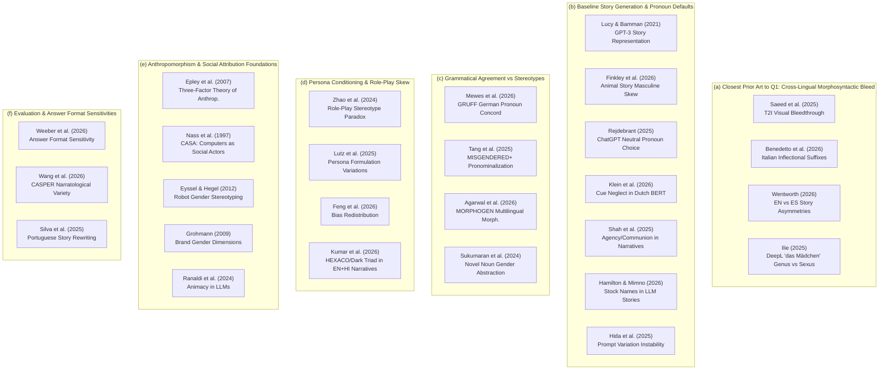
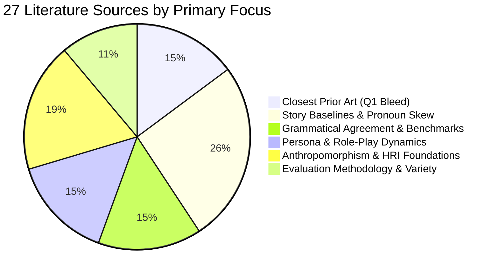

# Story Generation, Personification, and Character Literature Guide

Comprehensive triage, thematic cluster map, rhetorical citation matrix, and annotated inventory for the 27 research papers in `sources/06_Story_Generation_and_Personification/`.

This catalog serves as the foundational literature guide for the `character/` study investigating whether large language models (LLMs) assign character gender based on the grammatical gender of foreign-language noun stimuli embedded in English prompts.

---

## 1. Executive Triage & Tiered Reading List

To optimize reading bandwidth across the 27 papers in this collection, sources are triaged into three distinct operational tiers based on their direct relevance to the preregistered research questions (specifically **Q1: Grammatical Gender Bleedthrough** and **Q5: Frame & Persona Sensitivity**).

```mermaid
flowchart TD
    subgraph T1["Tier 1: Essential Anchors (Must Read)"]
        Saeed["Saeed et al. (2025)<br>T2I Visual Bleedthrough"]
        Benedetto["Benedetto et al. (2026)<br>Italian Morphosyntax"]
        Pucci["Finkley et al. (2026)<br>'Neutrality Bites'"]
        Lucy["Lucy & Bamman (2021)<br>GPT-3 Story Baseline"]
        Wentworth["Wentworth (2026)<br>EN vs ES Asymmetries"]
    end

    subgraph T2["Tier 2: Specific Critical Precedents (Methodological Anchors)"]
        Sukumaran["Sukumaran et al. (2024)<br>Wug / Nonce Abstraction"]
        Rejdebrant["Rejdebrant (2025)<br>Neutral Prompt Outcome"]
        Epley["Epley et al. (2007)<br>Anthropomorphism Theory"]
        Gautam["Mewes et al. (2026)<br>GRUFF German Pronouns"]
        Tang["Tang et al. (2025)<br>MISGENDERED+"]
        Agarwal["Agarwal et al. (2026)<br>MORPHOGEN"]
    end

    subgraph T3["Tier 3: Persona, Role-Play & Stereotype Dynamics (Supporting / Context)"]
        Zhao["Zhao et al. (2024)<br>Role-Play Paradox"]
        Lutz["Lutz et al. (2025)<br>Prompt Makes Persona"]
        Feng["Feng et al. (2026)<br>Illusion of Debiasing"]
        Jain["Kumar et al. (2026)<br>Personality in Narratives"]
        Shah["Shah et al. (2025)<br>Stereotypes in Stories"]
        Hamilton["Hamilton & Mimno (2026)<br>Elias in Lighthouse"]
        Hida["Hida et al. (2025)<br>Prompt Sensitivity"]
        Weeber["Weeber et al. (2026)<br>Answer Format Effects"]
        Klein["Klein et al. (2026)<br>Cue Resistance"]
        Hsu["Ranaldi et al. (2024)<br>Animacy Attribution"]
        Wang["Wang et al. (2026)<br>CASPER Diversity"]
        JBCS["Silva et al. (2025)<br>Portuguese Narratives"]
        Nass["Nass et al. (1997)<br>CASA Paradigm"]
        Eyssel["Eyssel & Hegel (2012)<br>Robot Stereotyping"]
        Grohmann["Grohmann (2009)<br>Brand Personality"]
        Ilie["Ilie (2025)<br>DeepL das Mädchen"]
    end

    T1 -->|Theoretical & Empirical Framing| T2
    T2 -->|Experimental Context & Controls| T3
```

### Tier 1: The Essential Anchors (Must Read Before Writing Methods or Claims)
These 5 papers provide the direct empirical foundation for the study's core hypotheses, outcome definitions, and cross-lingual scope:
1. **[Saeed et al. 2025] Beyond Content - Grammatical Gender in Text-to-Image.pdf**: The closest cross-modal precedent for grammatical gender affecting generation. Studies words where grammatical gender contradicts the stereotype, in text-to-image models (masculine markers: 73% male depictions on average vs 22% for English; feminine markers: 38% female vs 28%).
2. **[Benedetto et al. 2026] Beyond Names - Gender Bias in Italian Recommendations.pdf**: A textual precedent for grammatical gender markers steering LLM output. Changing only noun/adjective endings (*-o* vs *-a*) in Italian shifts educational recommendations; up to 76% of the bias seen with proper names is already present with grammatical gender markers alone.
3. **[Pucci et al. 2026] Neutrality Bites - Gender Representation in AI Animal Stories.pdf** (actual authors Finkley, Li & Walsh; the file name keeps the wrong author): Baseline for non-human characters. Across 23.8K stories about anthropomorphic animals, 19% avoid gendering and 38.2% use it/its; 40.6% of stories feature masculine characters vs 2.2% feminine.
4. **[Lucy & Bamman 2021] Gender and Representation Bias in GPT-3 Generated Stories.pdf**: An early study of gender bias in GPT-3 stories: more masculine than feminine characters (mirroring books), and feminine characters more tied to family and appearance and described as less powerful.
5. **[Wentworth 2026] Gendered Asymmetries in AI Stories in English and Spanish.pdf**: A literary (New Formalist) close reading of English and Spanish stories generated by ChatGPT-5, on gendered stylistic patterns such as voice and focalisation.

### Tier 2: Specific Critical Precedents (Methodological & Design Anchors)
These 6 papers establish the validity of specific experimental arms, outcome measures, and evaluation baselines:
1. **[Sukumaran et al. 2024] Grammatical Abstraction Using Few-Shot Learning of Novel Noun Gender.pdf**: Relevant to the wug / nonce-word arms: an LSTM and a decoder-only transformer learn the grammatical gender of a novel French noun from one to two examples (updating only the embedding), with a masculine bias. It does not study surface morphology of nonce suffixes in the way our arms do.
2. **[Rejdebrant 2025] How ChatGPT Assigns Gender in Non-Gendered Story Prompts.pdf**: A small study (40 short stories, four prompts about parents dropping a child off) of how ChatGPT assigns gender via names, pronouns and kinship terms; caregiving is strongly tied to female parents. A loose precedent for measuring character gender from generated text; it does not validate our measure.
3. **[Epley et al. 2007] On Seeing Human - Three-Factor Theory of Anthropomorphism.pdf**: Foundational cognitive psychology theory establishing why prompt-induced personification elicits social category schemas (like gender) for inanimate entities.
4. **[Gautam et al. 2026] GRUFF - LLM Pronoun Fidelity Reasoning and Biases in German.pdf**: German pronoun fidelity benchmark (four noun gender agreement systems, four pronoun sets); strong agreement for *er*/*sie* but not for neopronouns, and models are not robust to distractors.
5. **[Tang et al. 2025] MISGENDERED+ - Evaluating Pronoun Agreement and Bias in LLMs.pdf**: Updated benchmark of five LLMs on nonbinary pronoun handling (zero-shot, few-shot, gender identity inference); neopronouns remain inconsistent.
6. **[Agarwal et al. 2026] MORPHOGEN - Measuring Grammatical Gender in Generative Models.pdf**: Multilingual benchmark (GENFORM: rewrite a first-person sentence in the opposite gender) across 15 models in Hindi, French and Arabic.

### Tier 3: Persona, Role-Play & Stereotype Dynamics (Supporting & Contextual Art)
These 16 papers provide essential background on prompt brittleness, persona conditioning, animacy classification, narratological diversity, and historical anthropomorphism foundations:
- **Persona & Prompt Conditioning**: Zhao et al. (2024; role-play paradox), Lutz et al. (2025; persona prompt sensitivity), Feng et al. (2026; debiasing illusion), Kumar et al. (2026; personality traits in English/Hindi stories).
- **Narrative & Bias Baselines**: Shah et al. (2025; psychological stereotypes in stories), Hamilton & Mimno (2026; low diversity, stock names), Hida et al. (2025; prompt-variation sensitivity on BBQ), Silva et al. (JBCS 2025; Portuguese narrative continuations).
- **Representation & Resistance**: Klein et al. (2026; explicit gender cues in a Dutch BERT), Ilie (2025; DeepL *das Mädchen* genus-sexus conflict), Ranaldi et al. (2024; animacy processing).
- **Evaluation Methodology**: Weeber et al. (2026; answer format variations), Wang/Brei et al. (2026; CASPER character variety).
- **Foundational Psychology & HRI**: Nass et al. (1997; gender stereotypes toward computers with voices), Eyssel & Hegel (2012; robot facial gender cues), Grohmann (2009; masculine/feminine brand personality scales).

---

## 2. Thematic Overlap & Cluster Map

The 27 papers divide cleanly into six functional research clusters:

### Cluster Analysis

#### a) Closest Prior Art to Q1: Cross-Lingual Morphosyntactic Bleed
- **Members**: Saeed et al. (2025), Benedetto et al. (2026), Wentworth (2026), Ilie (2025).
- **Core Insight**: Demonstrates that grammatical gender does not remain confined to surface syntax but influences latent representations and cross-modal/generative outputs. Saeed reports grammatical gender effects on images from text-to-image models; Benedetto reports that Italian inflectional endings shift educational recommendations; Wentworth offers a close reading of gendered patterns in English and Spanish stories; Ilie reports that DeepL's pronominalisation of *das Mädchen* is not only grammatical.
- **Direct Role**: Related evidence that grammatical gender can affect generative choices. Whether a foreign lemma affects English story pronominalisation is not addressed in these papers (our reading of the gap; not checked against the wider literature *[unverified]*).

#### b) Baseline Story Generation & Pronoun Defaults
- **Members**: Lucy & Bamman (2021), Finkley et al. (2026), Rejdebrant (2025), Klein et al. (2026), Shah et al. (2025), Hamilton & Mimno (2026), Hida et al. (2025).
- **Core Insight**: These papers report masculine defaults in story generation (more masculine characters in GPT-3 stories, Lucy & Bamman; 40.6% masculine vs 2.2% feminine animal characters, Finkley et al.; male-biased unconditioned prompts, Shah et al.; masculine defaults in a Dutch BERT, Klein et al.), very low story diversity (Hamilton & Mimno) and prompt-format sensitivity of bias measures (Hida et al.). No single pronoun rate is reported across them.
- **Direct Role**: Suggests (our inference) that a raw masculine pronoun rate cannot be read as a grammatical gender effect, which motivates a within-noun contrast (foreign lemma minus English translation).

#### c) Grammatical Agreement vs Stereotypes
- **Members**: Mewes et al. (2026; GRUFF), Tang et al. (2025; MISGENDERED+), Aggarwal et al. (2026; MORPHOGEN), Sukumaran et al. (2024).
- **Core Insight**: Evaluates how models handle grammatical gender agreement and pronouns: German pronoun fidelity with distractors and neopronouns (GRUFF), pronoun handling (MISGENDERED+), gender-aware morphological rewriting in Hindi, French and Arabic (MORPHOGEN), and few-shot learning of a novel French noun's gender (Sukumaran).
- **Direct Role**: Background for pronoun-related evaluation and for the idea of novel (nonce) nouns; these papers do not themselves provide a pronoun-coding standard for our study *[unverified connection]*.

#### d) Persona Conditioning & Role-Play Skew
- **Members**: Zhao et al. (2024), Lutz et al. (2025), Feng et al. (2026), Kumar et al. (2026).
- **Core Insight**: Persona and role-play prompting change measured bias. Persona steering redistributes rather than reduces bias (Feng et al.), role-play amplifies the risk of biased outputs (Zhao et al.), prompt formulation matters for persona simulation (Lutz et al.), and personality traits (HEXACO, Dark Triad) are associated with gender bias in English and Hindi stories (Kumar et al.).
- **Direct Role**: Related evidence for **Q5 (Frame Manipulation)**: persona framing affects bias measures. None of these papers tests an author-vs-character frame specifically.

#### e) Anthropomorphism & Social Attribution Foundations
- **Members**: Epley et al. (2007), Nass et al. (1997), Eyssel & Hegel (2012), Grohmann (2009), Ranaldi et al. (2024).
- **Core Insight**: Establishes why and how humans (and LLMs trained on human text) attribute human social traits—specifically gender—to non-human or inanimate entities. Epley provides the 3-factor cognitive model; Nass reports that voice cues alone elicit gender-stereotypic responses to computers; Eyssel reports that facial gender cues on a robot elicit stereotypic trait and task ascriptions; Grohmann develops a scale of masculine and feminine brand personality.
- **Direct Role**: Background for the personification prompt paradigm ("Imagine X is a character in a story").

#### f) Evaluation & Answer Format Sensitivities
- **Members**: Weeber et al. (2026), Wang/Brei et al. (2026; CASPER), Silva et al. (JBCS 2025).
- **Core Insight**: Answer format (closed-ended, Likert-scaled, open-ended) substantially alters measured bias, including reversals in model order rankings (Weeber et al.). CASPER compares character variety in LLM-generated and human-written stories (Wang/Brei et al.). Silva et al. study Portuguese story continuations.
- **Direct Role**: Supports reporting results under more than one format; any argument for our open-ended design is our own *[unverified]*.

---

## 3. Rhetorical Ammunition & Citation Matrix

This matrix provides defensible scientific formulations, exact citations, and strategic rhetorical positioning for key manuscript sections.

| Rhetorical Challenge | Strategic Positioning | Supporting Citations | Concrete Citation Phrasing |
|---|---|---|---|
| **Framing Q1's Novelty Without Over-Claiming** | Position Q1 (own claim, not checked against the wider literature *[unverified]*) as a cross-lingual test of foreign grammatical gender bleed into English character pronominalization, acknowledging established component findings in vision, MT, and recommendation. | Saeed et al. (2025); Benedetto et al. (2026); Wentworth (2026); Ilie (2025) | *"While prior work has shown that grammatical gender influences visual attributes in multimodal diffusion models (Saeed et al., 2025) and steers educational recommendations via in-language inflectional morphology (Benedetto et al., 2026), no study has examined whether embedding an inanimate foreign-language lemma within an English generation prompt influences the character pronoun assigned by a chat model."* |
| **Accounting for Baseline Male Default Bias** | Acknowledge that models show masculine defaults in neutral story contexts; explain why within-noun contrast coding ($\Delta = \text{foreign} - \text{English}$) is mathematically required. | Finkley et al. (2026); Rejdebrant (2025); Lucy & Bamman (2021); Klein et al. (2026) | *"Consistent with extensive documentation of androcentric defaults in unconstrained story generation—where masculine characters outnumber feminine ones (Lucy & Bamman, 2021; Finkley et al., 2026; Rejdebrant, 2025)—our confirmatory outcome evaluates the within-noun shift relative to the English baseline, isolating morphosyntactic bleed from baseline male skew."* |
| **Defending the Personification Prompt Paradigm** | Defend prompting models to 'turn an object into a character' by grounding it in cognitive anthropomorphism theory and Computers-as-Social-Actors (CASA) literature. | Epley et al. (2007); Nass et al. (1997); Grohmann (2009); Eyssel & Hegel (2012) | *"Eliciting character narratives from inanimate referents draws on the mechanisms of anthropomorphism (Epley et al., 2007). Gender stereotypes have been shown to extend to computers with voices (Nass et al., 1997), robots with facial gender cues (Eyssel & Hegel, 2012) and brands (Grohmann, 2009)."* |
| **Defending Wug / Nonce Character Arms** | Justify using pseudo-words with gendered suffixes (*-o*, *-a*, *-ung*) to isolate morphological cues from pre-trained lemma semantics and conceptual confounds. | Sukumaran et al. (2024); Mewes et al. (2026); Aggarwal et al. (2026) | *"We incorporate nonce (wug) nouns to separate morphological cues from lemma-specific associations. Sukumaran et al. (2024) show that a transformer and an LSTM can learn the gender of a novel French noun embedding from one to two examples and apply it in unseen agreement contexts."* |
| **Motivating the Frame Manipulation (Q5)** | Motivate contrasting an 'author/writer' persona against a 'character' persona by citing persona steering amplification and redistribution literature. | Zhao et al. (2024); Lutz et al. (2025); Feng et al. (2026); Kumar et al. (2026) | *"We introduce persona frame variations following evidence that role-play can amplify the risk of biased outputs (Zhao et al., 2024), that persona prompt formulation affects simulation outcomes (Lutz et al., 2025), and that persona steering redistributes rather than reduces bias (Feng et al., 2026)."* |
| **Controlling for Narrative Mode Collapse** | Justify prompt controls and pre-registered exclusion criteria to avoid stock character name artifacts. | Hamilton & Mimno (2026) | *"Hamilton and Mimno (2026) find that 11 words, including names such as Elias and Mara, occur in 88.3% of stories sampled from four models. Our pipeline could screen for such stock names (design suggestion, not from the paper)."* |

---

## 4. Annotated Inventory of All 27 Papers

Below is the complete annotated inventory of all 27 papers in `sources/06_Story_Generation_and_Personification/`.

---

### 1. Aggarwal et al. (2026) — MORPHOGEN
- **File**: `[Agarwal et al. 2026] MORPHOGEN - Measuring Grammatical Gender in Generative Models.pdf` (file name keeps "Agarwal"; first author is Mehul Aggarwal)
- **Citation**: Mehul Aggarwal, Aditya Agarwal, Arnav Goel, Medha Hira, and Anubha Gupta (2026). "MORPHOGEN: A Multilingual Benchmark for Evaluating Gender-Aware Morphological Generation." *arXiv:2604.18914*.
- **Key Quantitative Finding**: 15 LLMs (2B–70B) rewrite a first-person sentence in the opposite gender (GENFORM task) in French, Arabic and Hindi. Larger models do better, especially in Arabic (Gemma3-27B 74.74% Correct Gender Alignment vs Gemma2-2B 14.10%); in Hindi smaller models remain viable (LLAMA-3.1-8B 89.21% vs LLAMA-3.3-70B 91.40%); in French Gemma2-2B 37.54% vs Phi4-14B 87.70%. Masculine bias appears in French and Arabic; Qwen models frequently show masculine bias; Gemma models do best on gender fairness; sentences with multiple entities show gender interference.
- **Models Evaluated**: LLaMA-3.1-8B, 3.2-3B, 3.3-70B; Qwen3-4B/8B/14B/27B; Gemma2-2B/9B; Gemma3-4B/12B/27B; Phi4-14B.
- **Project Role**: Multilingual benchmark of morphological gender agreement in generation (human-referent first-person sentences, not inanimate nouns).

---

### 2. Benedetto et al. (2026) — Beyond Names
- **File**: `[Benedetto et al. 2026] Beyond Names - Gender Bias in Italian Recommendations.pdf`
- **Citation**: Luca Benedetto, Antonia Donvito, Alberto Lucchetti, Andrea Cappelli, and Paula Buttery (2026). "Beyond Names: How Grammatical Gender Markers Bias LLM-based Educational Recommendations." *Proceedings of the 19th Conference of the European Chapter of the Association for Computational Linguistics (EACL 2026), Volume 1: Long Papers*, pp. 5648–5668. *[ACL Anthology ID not verified]*
- **Key Quantitative Finding**: In Italian, changing only noun and adjective endings (e.g. *-o* to *-a*) shifts recommendations: LLMs recommend STEM disciplines less for feminine prompts and narrow the set of disciplines for masculine prompts. Up to 76% of the bias seen with proper names is already present with grammatical gender markers alone.
- **Models Evaluated**: Commercial models only: OpenAI GPT-3.5, GPT-4o mini, GPT-4o, GPT-4.1 nano, GPT-4.1 mini; Anthropic Claude 3.5 Haiku, 3.5 Sonnet, 4 Sonnet; Google Gemini 1.5 Flash, 1.5 Flash 8B, 2.5 Flash Lite.
- **Project Role**: Related evidence that grammatical gender markers (on human-referring words) alone shift LLM output.

---

### 3. Epley, Waytz & Cacioppo (2007) — Three-Factor Theory of Anthropomorphism
- **File**: `[Epley et al. 2007] On Seeing Human - Three-Factor Theory of Anthropomorphism.pdf`
- **Citation**: Nicholas Epley, Adam Waytz, and John T. Cacioppo (2007). "On seeing human: A three-factor theory of anthropomorphism." *Psychological Review* 114(4): 864–886. [DOI: 10.1037/0033-295X.114.4.864](https://doi.org/10.1037/0033-295X.114.4.864).
- **Key Quantitative Finding**: Theoretical article. Three determinants of anthropomorphism: elicited agent knowledge (accessibility and applicability of anthropocentric knowledge), effectance motivation (motivation to explain and understand other agents), and sociality motivation (desire for social contact and affiliation).
- **Models Evaluated**: N/A (theory).
- **Project Role**: Background on why people attribute human characteristics to nonhuman agents. Applying it to LLM prompting is our own extension.

---

### 4. Eyssel & Hegel (2012) — Gender Stereotyping of Robots
- **File**: `[Eyssel & Hegel 2012] Gender Stereotyping of Robots.pdf`
- **Citation**: Friederike Eyssel and Frank Hegel (2012). "(S)he's Got the Look: Gender Stereotyping of Robots." *Journal of Applied Social Psychology* 42(9): 2213–2230. [DOI: 10.1111/j.1559-1816.2012.00937.x](https://doi.org/10.1111/j.1559-1816.2012.00937.x).
- **Key Quantitative Finding**: Experiment with 60 participants (30 male, 30 female; mostly German students at Bielefeld) rating the anthropomorphic robot FloBi with short hair (male) or long hair (female). The short-haired male robot was seen as more agentic and the female robot as more communal (Robot Type × Trait Type interaction F(1, 59) = 6.15, p = .02); stereotypically male tasks were seen as more suitable for the male robot and vice versa (F(1, 59) = 19.32, p < .001).
- **Models Evaluated**: N/A (human experiment).
- **Project Role**: Background: facial gender cues on a robot elicit stereotypic ascriptions.

---

### 5. Feng, Fang & Evans (2026) — The Illusion of Debiasing
- **File**: `[Feng 2026] The Illusion of Debiasing - Latent Gender Signals in Personas.pdf`
- **Citation**: Ziyue Feng, Hongbo Fang, and James A. Evans (2026). "The Illusion of Debiasing: Persona Steering Redistributes Rather Than Reduces Bias in LLMs." *arXiv:2609.07117*.
- **Key Quantitative Finding**: Studies whether HEXACO-based personality personas reproduce human personality structure and whether persona conditioning mitigates or relocates social bias, probed with BBQ (closed-form QA), BOLD (open-ended generation) and a word association test (WAT). The title states the conclusion: persona steering redistributes rather than reduces bias. (The "12 demographic axes" and ">82% persist" figures that were previously listed here are not supported.)
- **Models Evaluated**: GPT-4o-mini, LLaMA-3.1-8B-Instruct, DeepSeek-V3.2.
- **Project Role**: Related to **Q5 (Frame Manipulation)**: persona prompts change surface behaviour while underlying associations can remain.

---

### 6. Mewes, Lauscher & Gautam (2026) — GRUFF
- **File**: `[Gautam et al. 2026] GRUFF - LLM Pronoun Fidelity Reasoning and Biases in German.pdf` (file name keeps "Gautam"; first author is Fabian Mewes)
- **Citation**: Fabian Mewes, Anne Lauscher, and Vagrant Gautam (2026). "GRUFF: LLM Pronoun Fidelity, Reasoning, and Biases in German." *arXiv:2605.30214*.
- **Key Quantitative Finding**: German dataset covering four noun gender agreement systems and four pronoun sets (*er*, *sie*, *xier*, *en*), with 3 sets of 2,880 instances per setting. LLMs show strong grammatical agreement for masculine and feminine entities without explicit context, but not for neopronouns *xier* and *en*. Models are generally not robust to distractors, but encoder-only models are more robust in German than in English. Occupational stereotypes are poorly correlated across grammatical cases and most models. (The paper does not evaluate test-time reasoning traces; the earlier claim that reasoning degrades pronoun fidelity and the ">60%" figure are removed.)
- **Models Evaluated**: GBERT-base, GBERT-large, mBERT-base, XLM-RoBERTa-base, SauerkrautLM-8B, SauerkrautLM-70B, Llama-3.3-70B.
- **Project Role**: German pronoun fidelity reference (human referents).

---

### 7. Grohmann (2009) — Gender Dimensions of Brand Personality
- **File**: `[Grohmann 2009] Gender Dimensions of Brand Personality.pdf`
- **Citation**: Bianca Grohmann (2009). "Gender dimensions of brand personality." *Journal of Marketing Research* 46(1): 105–119. [DOI: 10.1509/jmkr.46.1.105](https://doi.org/10.1509/jmkr.46.1.105).
- **Key Quantitative Finding**: Develops a two-dimension scale of masculine and feminine brand personality, six items each (masculine: adventurous, aggressive, brave, daring, dominant, sturdy; feminine: expresses tender feelings, fragile, graceful, sensitive, sweet, tender). The scale is then applied to spokespeople in advertising, brand personality–self-concept congruence, and brand extension fit.
- **Models Evaluated**: N/A (consumer psychology).
- **Project Role**: Source of a masculine/feminine trait list for brands (not about grammatical gender of nouns); any use for adjective coding is a project decision.

---

### 8. Hamilton & Mimno (2026) — Elias in the Lighthouse, Again?
- **File**: `[Hamilton 2026] Elias in the Lighthouse, Again - Gender Bias in Story Prompts.pdf`
- **Citation**: Sil Hamilton and David Mimno (2026). "Elias in the Lighthouse, Again? Diagnosing Low Diversity in LLM Stories." *arXiv:2605.26492*.
- **Key Quantitative Finding**: 20,000 stories from four models with five prompts (1,000 samples each); 11 words (names Elias, Mara, Elara; settings such as lighthouses; professions clockmaker, librarian) occur in 88.3% of stories, with little difference between models. The words are rare in published literature and pre-training data but found in preference data likely used by all current models; only 3,053 of 78,958 stories in OLMo 3's post-training set contain them. The authors speculate about alignment against copyrighted or adult content and leave the question to future work.
- **Models Evaluated**: Claude Haiku 4.5, Gemini 3.1 Flash-Lite, GPT-5.4-Mini, OLMo 7b Thinking.
- **Project Role**: Shows that stock names recur in LLM stories; relevant if names are used to infer character gender.

---

### 9. Hida, Kaneko & Okazaki (2025) — Social Bias Evaluation Requires Prompt Variations
- **File**: `[Hida et al. 2025] Analyzing and Mitigating Gender Bias in Generated Stories.pdf` (file name does not match the paper's title)
- **Citation**: Rem Hida, Masahiro Kaneko, and Naoaki Okazaki (2025). "Social Bias Evaluation for Large Language Models Requires Prompt Variations." *Findings of the Association for Computational Linguistics: EMNLP 2025*, pp. 14507–14530. *[ACL Anthology ID not verified]*
- **Key Quantitative Finding**: On the BBQ dataset, 26 open LLMs from 7 families (Gemma2, Llama3, Llama2, Mistral, MPT, Falcon, OPT) are tested with 10 prompt formats (task instruction, few-shot examples, debias-prompt). LLM rankings fluctuate across prompts for both task performance and social bias; the impact of format changes differs by bias category; ambiguity of instances is a common factor in sensitivity. (The "Spearman 0.12" figure and the model list previously given are not supported.)
- **Models Evaluated**: 26 open LLMs from 7 families (see above).
- **Project Role**: Supports fixing prompt wording and reporting prompt sensitivity.

---

### 10. Ranaldi, Pucci & Zanzotto (2024) — Animate or Inanimate?
- **File**: `[Hsu et al. 2024] Animate or Inanimate - That is the Question for LLMs.pdf` (file name keeps "Hsu"; actual authors Ranaldi, Pucci, Zanzotto)
- **Citation**: Leonardo Ranaldi, Giulia Pucci, and Fabio Massimo Zanzotto (2024). "Animate, or Inanimate, That is the Question for Large Language Models." *arXiv:2408.06332*.
- **Key Quantitative Finding**: Probes LLMs by prompting with animate, inanimate, usual and stranger contexts. LLMs exhibit human-like behaviour for typical animate and inanimate entities and can adapt to unconventional situations by recognising oddities as animated. (The accuracy figures 94.2/95.8/68.4/71.2 previously listed were not found and are removed.)
- **Models Evaluated**: GPT-3.5, GPT-4, Llama2-chat 7B/13B/70B, Mixtral-8x7b, Mistral-7b.
- **Project Role**: Background on how LLMs treat animacy.

---

### 11. Ilie (2025) — DeepL 'das Mädchen' Genus-Sexus Study
- **File**: `[Ilie 2025] DeepL das Madchen Genus-Sexus Study.pdf`
- **Citation**: Ilie (2025). "Maschinelle Übersetzung und die Genus-Sexus-Kongruenz: DeepLs Pronominalisierung von 'das Mädchen'." Short German abstract only; the PDF gives no author first name, venue or date, so the venue (STuTS) is *[unverified]*.
- **Key Quantitative Finding**: English stimuli with all combinations of factors (pronoun type, definiteness, referent age, stereotypical adjectives) were translated into German with DeepL to see when *das Mädchen* is pronominalised by grammatical gender (*es*) or sex (*sie*). Pronominalisation of hybrid nouns depends on more than grammatical factors; referent age and the degree of negative and female connotation of adjectives are key. (The "3,072 sentence pairs" and ">85%" figures are not in the document and are removed.)
- **Models Evaluated**: DeepL (machine translation).
- **Project Role**: Genus–sexus conflict for a hybrid German noun in machine translation.

---

### 12. Kumar et al. (2026) — Personality Shapes Gender Bias
- **File**: `[Jain et al. 2026] Personality Shapes Gender Bias in Persona Narratives.pdf` (file name keeps "Jain"; authors Tanay Kumar, Aman Chadha, Shreya Gautam, Vinija Jain, Francesco Pierri)
- **Citation**: Tanay Kumar, Aman Chadha, Shreya Gautam, Vinija Jain, and Francesco Pierri (2026). "Personality Shapes Gender Bias in Persona-Conditioned LLM Narratives Across English and Hindi: An Empirical Investigation." *arXiv:2604.23600*.
- **Key Quantitative Finding**: 23,400 generated stories/artifacts about working professionals in India, across English and Hindi, varying persona gender, occupation and personality traits from the HEXACO and Dark Triad frameworks. Personality traits are significantly associated with the magnitude and direction of gender bias; Dark Triad traits are associated with higher gender-stereotypical representation than socially desirable HEXACO traits, with variation across models and languages. Bias is measured with a sentence-level embedding-based metric. (The percentage figures and "feminine pronoun selection" claims previously listed are removed.)
- **Models Evaluated**: GPT-5 nano, Llama-3.3-70B-Instruct, Gemma-3-1b-it, DeepSeek-R1, Falcon-Mamba-7B, Mixtral-8x7B.
- **Project Role**: Persona conditioning and gender bias in English and Hindi narratives.

---

### 13. Silva, Brandão & Moro (2025) — Story Rewriting in Portuguese
- **File**: `[JBCS 2025] Rewriting Stories with LLMs - Gender Bias in Portuguese Narratives.pdf`
- **Citation**: Mariana O. Silva, Michele A. Brandão, and Mirella M. Moro (2025). "Rewriting Stories with LLMs: Gender Bias in Generated Portuguese-language Narratives." *Journal of the Brazilian Computer Society*, 31:1, [DOI: 10.5753/jbcs.2025.5799](https://doi.org/10.5753/jbcs.2025.5799).
- **Key Quantitative Finding**: Instruction-tuned LLMs generate narrative continuations from masked sentences taken from 840 public-domain literary works. Both models perpetuate and in some cases amplify gender imbalances: male characters are overrepresented and associated with cognitive and professional domains; female characters are underrepresented and linked to emotional and domestic roles (word association tests on embeddings trained on the generated text). Prompt engineering increases gender-neutral descriptions but adds uncertainty in gender inference. (The "1,200 rewrites / 68.4%" figures are removed.)
- **Models Evaluated**: Mistral-7B-Instruct, LLaMA 3.2-3B.
- **Project Role**: Portuguese-language story generation baseline.

---

### 14. Klein, Manna & Vanmassenhove (2026) — Is She Even Relevant?
- **File**: `[Klein 2026] Is She Even Relevant - Pronoun Attribution in Open-Ended Generation.pdf`
- **Citation**: Jonas Klein, Chiara Manna, and Eva Vanmassenhove (2026). "Is She Even Relevant? When BERT Ignores Explicit Gender Cues." *arXiv:2605.07622*.
- **Key Quantitative Finding**: A probing study of a Dutch BERT trained from scratch (checkpoints extracted during training; dynamic gender subspaces from linear SVMs). Gender becomes linearly separable around epoch 20, yet the model struggles to update its gender representation given explicit cues in short templates (e.g. *Zij is een loodgieter*); stereotypical gender–profession pairings are predicted far more accurately than anti-stereotypical ones, and generic forms in Dutch default to a male interpretation even with an explicitly female referent. (This is not an open-ended generation study; the ">92%" and ">70%" figures are removed.)
- **Models Evaluated**: A Dutch BERT trained from scratch.
- **Project Role**: Example of a masculine default despite linearly decodable gender information in a small Dutch model; any link to our null results is our own interpretation *[unverified]*.

---

### 15. Lucy & Bamman (2021) — GPT-3 Generated Stories
- **File**: `[Lucy & Bamman 2021] Gender and Representation Bias in GPT-3 Generated Stories.pdf`
- **Citation**: Li Lucy and David Bamman (2021). "Gender and Representation Bias in GPT-3 Generated Stories." *Proceedings of the Third Workshop on Narrative Understanding*, pp. 48–55. [ACL Anthology: 2021.nuse-1.5](https://aclanthology.org/2021.nuse-1.5/).
- **Key Quantitative Finding**: Using topic modeling and lexicon-based word similarity on GPT-3 (davinci, 5 completions per prompt; 2154 characters with 10 prompts each), stories show known gender stereotypes: feminine characters are more associated with family and appearance and described as less powerful than masculine characters, even with high-power verbs in the prompt. GPT-3 stories include more masculine than feminine characters, mirroring books; topic distributions of generated stories follow those of books (Pearson r = 0.84). (The "1,000 stories", "66.7%/33.3%" and Curie/GPT-2 details previously listed are not in the paper.)
- **Models Evaluated**: GPT-3 (davinci).
- **Project Role**: Early baseline on gender and stereotypes in neural story generation.

---

### 16. Lutz et al. (2025) — The Prompt Makes the Person(a)
- **File**: `[Lutz et al. 2025] The Prompt Makes the Persona - Persona Conditioning Skew.pdf`
- **Citation**: Marlene Lutz, Indira Sen, Georg Ahnert, Elisa Rogers, and Markus Strohmaier (2025). "The Prompt Makes the Person(a): A Systematic Evaluation of Sociodemographic Persona Prompting for Large Language Models." *arXiv:2507.16076*.
- **Key Quantitative Finding**: Nine persona prompt types (role adoption × demographic priming) across 15 intersectional demographic groups, open- and closed-ended tasks. LLMs struggle to simulate marginalized groups; interview-style prompting and name-based priming help reduce stereotyping and improve alignment; smaller models such as OLMo-2-7B outperform larger ones such as Llama-3.3-70B.
- **Models Evaluated**: Llama-3.3-70B-Instruct, Llama-3.1-8B-Instruct, OLMo-2-0325-32B-Instruct, OLMo-2-1124-7B-Instruct, Gemma-3-27b-it.
- **Project Role**: Persona prompt formulation affects outcomes; relevant to **Q5**.

---

### 17. Nass, Moon & Green (1997) — Are Machines Gender Neutral?
- **File**: `[Nass et al. 1997] Are Machines Gender Neutral.pdf`
- **Citation**: Clifford Nass, Youngme Moon, and Nancy Green (1997). "Are machines gender neutral? Gender-stereotypic responses to computers with voices." *Journal of Applied Social Psychology* 27(10): 864–876. [DOI: 10.1111/j.1559-1816.1997.tb00275.x](https://doi.org/10.1111/j.1559-1816.1997.tb00275.x).
- **Key Quantitative Finding**: Experiment with N = 40 (undergraduate volunteers) on computers with voice output, where vocal cues were the only gender cue; 3 gender stereotypes were tested and gender-stereotypic responses were obtained in all 3. For example, a male-voiced tutor computer was seen as more informative about computers and a female-voiced one about love and relationships (F(1, 32) = 7.85, p < .01), though the authors note this two-way interaction is an artifact of a three-way interaction with evaluator voice.
- **Models Evaluated**: N/A (human experiment).
- **Project Role**: Background: minimal gender cues on machines elicit stereotypic responses.

---

### 18. Finkley, Li & Walsh (2026) — "Neutrality Bites"
- **File**: `[Pucci et al. 2026] Neutrality Bites - Gender Representation in AI Animal Stories.pdf` (file name keeps the wrong author "Pucci")
- **Citation**: Imani Finkley, Yuanxi Li, and Melanie Walsh (2026). "Neutrality Bites: Gender Representation in AI-Generated Animal Stories." *FAccT '26* (ACM Conference on Fairness, Accountability, and Transparency, June 25–28, 2026, Montreal). *arXiv:2606.07969*.
- **Key Quantitative Finding**: Six leading LLMs complete a story about seven anthropomorphic animal characters (gender unstated), across four narrative settings and a range of temperatures: 23.8K stories. Models avoid gendering the animal in 19% of stories on average and use it/its in 38.2%; when gender is assigned, 40.6% of stories feature masculine characters vs 2.2% feminine.
- **Models Evaluated**: Six leading LLMs (model names not recorded here *[unverified]*; earlier listing of GPT-4o, GPT-5.1, Claude-3.5, LLaMA-3-70B not confirmed).
- **Project Role**: Baseline for gender assignment to non-human story characters.

---

### 19. Rejdebrant (2025) — ChatGPT Gender in Non-Gendered Prompts
- **File**: `[Rejdebrant 2025] How ChatGPT Assigns Gender in Non-Gendered Story Prompts.pdf`
- **Citation**: Gunilla Rejdebrant (2025). "Biases in AI-Generated English Texts – How ChatGPT Assigns Gender in Non-Gendered Story Prompts." Research essay, 15 hp (EON200), Department of Social and Behavioural Studies, October 2025; supervisor Leona Johansson Bunting. *[institution and repository ID not verified]*
- **Key Quantitative Finding**: Four prompts generated 40 short stories about parents dropping their child off at activities; names, pronouns and kinship terms were analysed. Caregiving is strongly tied to female parents (36 of 40 parents female, 4 male); among children, 24 male and 16 female, with activity having a large impact. (The "300 completions", "67.3%/28.7%/4.0%", detective/student prompts and GPT-3.5/GPT-4 details previously listed are not in the paper.)
- **Models Evaluated**: ChatGPT.
- **Project Role**: A small student study of gender assignment in ChatGPT stories; weak evidence only.

---

### 20. Saeed et al. (2025) — Beyond Content
- **File**: `[Saeed et al. 2025] Beyond Content - Grammatical Gender in Text-to-Image.pdf`
- **Citation**: Muhammed Saeed, Shaina Raza, Ashmal Vayani, Muhammad Abdul-Mageed, Ali Emami, and Shady Shehata (2025). "Beyond Content: How Grammatical Gender Shapes Visual Representation in Text-to-Image Models." *arXiv:2508.03199* (v4, Feb 2026).
- **Key Quantitative Finding**: Benchmark of words where grammatical gender contradicts the stereotypical gender association (e.g. French *une sentinelle*), in five gendered languages (French, Spanish, German, Italian, Russian) and two gender-neutral controls (English, Chinese): 800 unique prompts, 28,800 images. Masculine grammatical markers increase male representation to 73% on average (22% for English); feminine markers increase female representation to 38% (28% in English). Effects are stronger for high-resource languages and vary by model.
- **Models Evaluated**: DALL-E 3, Ideogram v3, Flux Pro 1.1.
- **Project Role**: Cross-modal evidence that grammatical gender in prompts affects image outputs; not about LLM text.

---

### 21. Masoudian et al. (2025) — Psychological Stereotypes in Stories
- **File**: `[Shah et al. 2025] Investigating Gender Bias in Stories via Psychological Stereotypes.pdf` (file name keeps "Shah"; authors Shahed Masoudian, Gustavo Escobedo, Hannah Strauss, Markus Schedl)
- **Citation**: Shahed Masoudian, Gustavo Escobedo, Hannah Strauss, and Markus Schedl (2025). "Investigating Gender Bias in LLM-Generated Stories via Psychological Stereotypes." *arXiv:2508.03292*.
- **Key Quantitative Finding**: StereoBias-Stories (SBS): 148,082 stories from five LLMs, unconditioned or conditioned on one, two or six attributes from 25 psychological stereotypes. Models are highly male-biased on average in unconditioned prompts; gender-independent attributes mitigate this; combining attributes tied to the same gender stereotype intensifies behaviour (male attributes amplify, female alleviate); alignment with psychological ground truth grows with model size. (The "4,800 stories", "62–74%" and "56% vs 68%" figures previously listed are not in the paper.)
- **Models Evaluated**: GPT-4o-mini, GPT-4o, and DeepSeek-R1 distilled models R1-7B, R1-32B, R1-70B.
- **Project Role**: Gender bias in open-ended stories linked to psychological stereotypes.

---

### 22. Sukumaran, Houghton & Kazanina (2024) — Novel Noun Gender Abstraction
- **File**: `[Sukumaran et al. 2024] Grammatical Abstraction Using Few-Shot Learning of Novel Noun Gender.pdf`
- **Citation**: Priyanka Sukumaran, Conor Houghton, and Nina Kazanina (2024). "Investigating grammatical abstraction in language models using few-shot learning of novel noun gender." [arXiv:2403.10338](https://arxiv.org/abs/2403.10338). *[publication venue and page numbers not verified; the previously listed EACL Findings pages are unsupported]*
- **Key Quantitative Finding**: An LSTM and a decoder-only transformer learn the gender of a novel French noun embedding from one to two examples in one agreement context and apply it in another, unseen context, with a bias towards masculine; few-shot updates were applied only to the embedding layers. A one-shot experiment with native French speakers also showed a masculine bias.
- **Models Evaluated**: An LSTM and a decoder-only transformer (small models; French only).
- **Project Role**: Evidence that small LMs can generalise grammatical gender for novel nouns; it does not test nonce suffixes in English prompts.

---

### 23. Tang et al. (2025) — MISGENDERED+
- **File**: `[Tang et al. 2025] MISGENDERED+ - Evaluating Pronoun Agreement and Bias in LLMs.pdf`
- **Citation**: Xushuo Tang, Yi Ding, Zhengyi Yang, Yin Chen, Yongrui Gu, Wenke Yang, Mingchen Ju, Xin Cao, Yongfei Liu, and Wenjie Zhang (2025). "Do They Understand Them? An Updated Evaluation on Nonbinary Pronoun Handling in Large Language Models (MISGENDERED+)." *arXiv:2508.00788*.
- **Key Quantitative Finding**: Extended benchmark of five LLMs across zero-shot, few-shot and gender identity inference. Notable improvements over earlier studies, especially for binary and gender-neutral pronouns; accuracy on neopronouns and reverse inference remains inconsistent. (For the original MISGENDERED, the paper cites about 75.9% for binary, 31.0% for gender-neutral and 7.6% for neopronouns in zero-shot; the earlier "96% / 41.2% / <18%" and "22 LLMs" are not in the paper.)
- **Models Evaluated**: GPT-4o, Claude 4, DeepSeek-V3, Qwen Turbo, Qwen2.5.
- **Project Role**: Related evaluation of pronoun handling (human referents, nonbinary pronouns).

---

### 24. Brei et al. (2026) — CASPER: Character Variety
- **File**: `[Wang et al. 2026] CASPER - Character Variety in Generated Stories.pdf` (file name uses "Wang"; first author Anneliese Brei)
- **Citation**: Anneliese Brei, Abhisheik Sharma, Nicholas Sanaie, Lu Wang, and Snigdha Chaturvedi (2026). "CASPER in the Machine: Insights into Character Variety in LLM-Generated Stories." *arXiv:2606.22454*.
- **Key Quantitative Finding**: Using 8 narratological category-pairs (e.g. stylization, wholeness), characters in LLM-generated and human-written stories are inferred automatically and compared; the corpus holds 200 human-written and 4,400 LLM-generated stories. The abstract poses whether LLMs and humans write similar characters and whether LLMs produce a variety of characters. (The "5,000 stories" and "48% less variance" claims are not in the paper.)
- **Models Evaluated**: GPT-4o-mini, Llama-3B/8B/70B, Phi3-4B/14B, Mistral-7B/24B (Llama-70B also used as annotator/classifier).
- **Project Role**: Narratological framework for comparing LLM and human characters. It does not support a stock-name statistic.

---

### 25. Weeber, Merzlyakova & Padó (2026) — Effects of Answer Format Variation
- **File**: `[Weeber et al. 2026] Effects of Answer Format Variation on Gender Bias.pdf`
- **Citation**: Ksenia Merzlyakova, Sebastian Padó, and Franziska Weeber (2026), as listed on the PDF title page. "Effects of Answer Format Variation on Gender Bias in Large Language Models." *arXiv:2608.17516*.
- **Key Quantitative Finding**: Three instruction-tuned models are evaluated on BBQ and OpinionQA with closed-ended, Likert-scaled and open-ended answer formats. Answer format substantially alters measured outcomes, including reversals in order rankings. (The "up to 38%" figure is not in the paper.)
- **Models Evaluated**: Mistral-7B-Instruct-v0.3, Llama-3.1-8B-Instruct, Gemma-3-12B-IT.
- **Project Role**: Measured bias depends on answer format.

---

### 26. Wentworth (2026) — Gendered Asymmetries in English and Spanish
- **File**: `[Wentworth 2026] Gendered Asymmetries in AI Stories in English and Spanish.pdf`
- **Citation**: Isabelle Wentworth (2026). "Gendered asymmetries in AI stories in English and Spanish." *AI & Society* 41: 8557–8570 (Open Forum). [DOI: 10.1007/s00146-026-03163-x](https://doi.org/10.1007/s00146-026-03163-x).
- **Key Quantitative Finding**: Qualitative New Formalist close reading (not a computational analysis) of English- and Spanish-language short stories generated by ChatGPT-5 (for English, ChatGPT was asked four times for stories with a male and a female protagonist). Argues that distributional regularities in language modelling scale upward into gendered, culturally normative stylistic patterns (voice, focalisation, reliability, omission). In the English stories women appear as seamstress and housewife, men as engineer, novelist, boxer and soldier. (The "400 stories" figure and the "passive roles" and "narrative authority" wording are removed.)
- **Models Evaluated**: ChatGPT-5.
- **Project Role**: Literary-critical perspective on gendered patterns in English and Spanish AI stories; small sample.

---

### 27. Zhao et al. (2024) — Role-Play Paradox
- **File**: `[Zhao et al. 2024] Role-Play Paradox - Stereotype Amplification in Persona LLMs.pdf`
- **Citation**: Jinman Zhao, Zifan Qian, Linbo Cao, Yining Wang, Yitian Ding, Yulan Hu, Zeyu Zhang, and Zeyong Jin (2024). "Role-Play Paradox in Large Language Models: Reasoning Performance Gains and Ethical Dilemmas." *arXiv:2409.13979* (v2).
- **Key Quantitative Finding**: Autotuning (GPT-4 selects roles by question) can lead to harmful outputs even with neutral roles, and on benchmarks of stereotypical and harmful questions role-play consistently amplifies the risk of biased outputs. (The "8–14% reasoning gains" and "3.2×–5.8×" figures are not supported.)
- **Models Evaluated**: gpt-3.5-turbo-1106, gpt-4o, Mixtral 8x7B.
- **Project Role**: Related to **Q5**: role framing can change bias risk.
