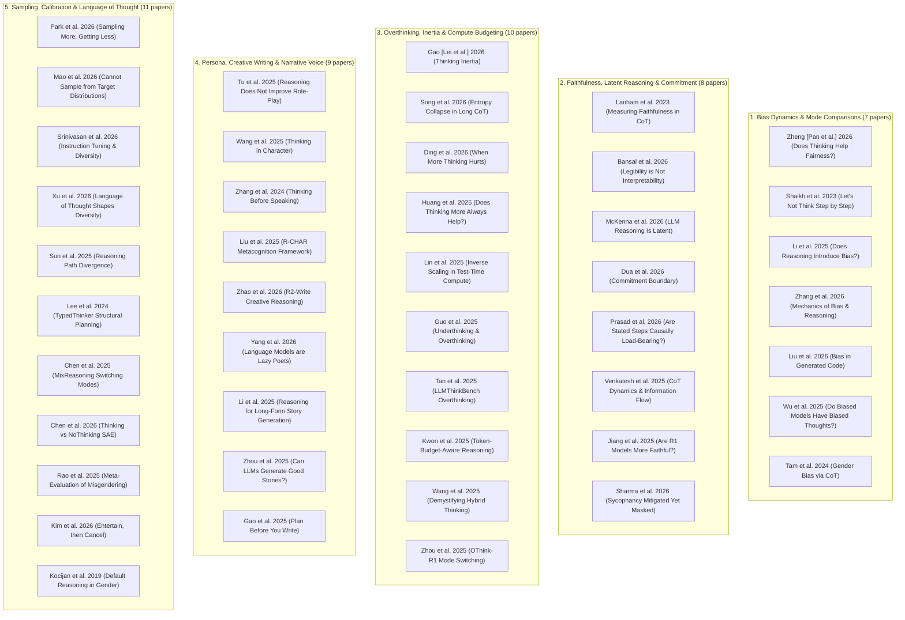

# 07. Reasoning Mode and Chain of Thought (`07_Reasoning_Mode_and_Chain_of_Thought/`)

**Catalog of 45 Research Papers on Test-Time Compute, Reasoning Faithfulness, Overthinking, and Persona Dynamics in Large Language Models.**

This collection provides the foundational theoretical, mechanistic, and empirical literature supporting the **Question 4 (Q4) experimental arm** of the grammatical gender character study (`character/docs/prereg_v1.md`), which investigates within-model thinking-on versus thinking-off contrasts in **Qwen3-14B** and related reasoning architectures.

---

## Table of Contents

1. [Executive Triage & Tiered Reading List](#1-executive-triage--tiered-reading-list)
   - [Tier 1: The Essential Anchors (Must-Reads for Q4)](#tier-1-the-essential-anchors-must-reads-for-q4)
   - [Tier 2: High-Value Mechanistic Insights](#tier-2-high-value-mechanistic-insights)
   - [Tier 3: Domain-Specific Clusters](#tier-3-domain-specific-clusters)
2. [Thematic Overlap & Cluster Map](#2-thematic-overlap--cluster-map)
   - [Cluster Overview & High-Level Taxonomy](#cluster-overview--high-level-taxonomy)
   - [Replication Matrix 1: Distributional Concentration & Entropy Collapse](#replication-matrix-1-distributional-concentration--entropy-collapse)
   - [Replication Matrix 2: Bias Persistence & Counterfactual Flips](#replication-matrix-2-bias-persistence--counterfactual-flips)
   - [Replication Matrix 3: Faithfulness, Epiphenomenal Traces & Latent Commitment](#replication-matrix-3-faithfulness-epiphenomenal-traces--latent-commitment)
3. [Rhetorical Ammunition & Citation Matrix for Q4](#3-rhetorical-ammunition--citation-matrix-for-q4)
   - [1. Justifying the Character Generation Paradigm for Reasoning Tests](#1-justifying-the-character-generation-paradigm-for-reasoning-tests)
   - [2. Explaining Why Thinking Traces Omit Gender Despite Shifted Outputs](#2-explaining-why-thinking-traces-omit-gender-despite-shifted-outputs)
   - [3. Grounding Early Gender Commitment in Reasoning Blocks](#3-grounding-early-gender-commitment-in-reasoning-blocks)
   - [4. Justifying Sampling Parameter Divergence Across Modes](#4-justifying-sampling-parameter-divergence-across-modes)
   - [5. Justifying the Reasoning-Token Budget Cap](#5-justifying-the-reasoning-token-budget-cap)
4. [Complete Annotated Inventory of All 45 Papers](#4-complete-annotated-inventory-of-all-45-papers)

---

## 1. Executive Triage & Tiered Reading List

To navigate these 45 papers efficiently, reading is prioritized into three functional tiers based on immediate methodological necessity for our pre-registered study.

```
+-----------------------------------------------------------------------------------+
|                           TIER 1: THE ESSENTIAL ANCHORS                           |
|       Must-reads establishing Q4's methodological validity, priors, and risks     |
|   - Zheng et al. [real authors Pan et al.] (2026): within-model thinking-on/off flips |
|   - Gao et al. [real authors Lei et al.] (2026): thinking inertia; Song (2026) RL entropy |
|   - Lanham et al. (2023): faithfulness of stated reasoning varies by task and size |
|   - Tu et al. (2025): Reasoning degrades role-playing, persona & creative voice   |
+-----------------------------------------------------------------------------------+
                                          |
                                          v
+-----------------------------------------------------------------------------------+
|                        TIER 2: HIGH-VALUE MECHANISTIC INSIGHTS                    |
|        Mechanistic papers explaining latent states, budgets, and bias sites       |
|   - Chen et al. (2026) [SAE], Li et al. (2025), Zhang et al. (2026),              |
|     Shaikh et al. (2023), Bansal et al. (2026), McKenna et al. (2026),           |
|     Dua et al. (2026) [Commitment Boundary], Kwon et al. (2025) [Budget Control]  |
+-----------------------------------------------------------------------------------+
                                          |
                                          v
+-----------------------------------------------------------------------------------+
|                         TIER 3: DOMAIN-SPECIFIC CLUSTERS                          |
|             Specialized evidence bases supporting specific design choices         |
|   - Creative Writing & Narrative under CoT (Zhao, Yang, Park, Li, Zhou, Gao)      |
|   - Overthinking & Test-Time Compute Scaling (Huang, Lin, Guo, Ding, Tan)         |
|   - Faithfulness & Rationalization Dynamics (Jiang, Venkatesh, Prasad, Sharma)    |
|   - Sampling, Diversity & Language of Thought (Mao, Srinivasan, Xu, Lee, Chen...) |
|   - Specialized Persona & Character Monologue (Wang, Zhang, Liu, Rao, Kocijan)   |
+-----------------------------------------------------------------------------------+
```

### Tier 1: The Essential Anchors (Must-Reads for Q4)

These 5 anchor papers directly frame the hypothesis, methodology, and interpretation of the Qwen3-14B thinking-on vs. thinking-off experimental arm:

1. **`[Zheng et al. 2026] Does Thinking Help Fairness? Reasoning Tokens Resolve Some Biases but Create More`** (actual authors: Pan, Germino, Ma, Daly, Moniz, Hua, Chawla; Findings of EMNLP 2026)  
   - **Why It Is Essential:** The closest methodological precedent for Q4 that we hold. Conducts a within-model thinking vs. non-thinking ablation on QwQ-32B, DeepSeek-R1-Distill-Qwen-32B and Qwen3-32B, on three tabular decision tasks (Adult, COMPAS, Credit). Thinking resolves some counterfactual flips but creates roughly 5x more new ones, and bias amplifies along thinking depth.
   - **Core Takeaway for Q4:** Shows the thinking-on/off effect on bias is an open empirical question, and supplies vocabulary (counterfactual flips). The tasks are tabular classification, not narrative generation.

2. **`[Gao et al. 2026] Thinking Inertia: LLMs Keep Thinking When Told Not To`** (actual authors: Lei, Lin, Lu, Torr, Zou) & **`[Song et al. 2026] A Few Bad Apples Spoil the Bunch...`** (Jang, Lee, Kim et al.)  
   - **Why They Are Essential:** Lei et al. show that explicit no-think controls cannot eliminate visible explicit inference in six LLMs, and that persistence grows as the answer space opens (Boolean, multiple-choice, open-ended QA). Song et al. is an RL-training paper: entropy collapse in RLVR/RLIF is driven by a few critical tokens, and SCOPE regularises the top ~5% of tokens. It is not about inference-time thinking mode.
   - **Core Takeaway for Q4:** Lei et al. support calling our conditions "thinking-mode on/off" rather than "with/without reasoning". Song et al. is background on RL entropy only; neither paper tests character generation.

3. **`[Lanham et al. 2023] Measuring Faithfulness in Chain-of-Thought Reasoning`**  
   - **Why It Is Essential:** Anthropic study that intervenes on the CoT (truncation, adding mistakes, paraphrasing, filler tokens). Reliance on CoT varies a lot across tasks, and larger, more capable models give less faithful reasoning on most tasks.
   - **Core Takeaway for Q4:** A standard reference that stated reasoning need not reflect what drives the answer. Whether it accounts for our pilot observation that reasoning blocks rarely mention gender (≤ 0.5%) is our own inference, not something the paper tests.

4. **`[Tu et al. 2025] Reasoning Does Not Necessarily Improve Role-Playing Ability`**  
   - **Why It Is Essential:** Evaluates 24 LLMs on six role-playing benchmarks under three strategies. CoT may reduce role-playing performance, reasoning-optimised LLMs are unsuitable for role-playing, and reasoning ability disrupts the role-playing scaling law. (The "attention diversion" and "style drift" terms come from Wang et al., Thinking in Character, not this paper.)
   - **Core Takeaway for Q4:** A directional prior that thinking mode may not help persona or role-play tasks. It is about role-play benchmarks, not gender.

---

### Tier 2: High-Value Mechanistic Insights

Eight essential papers that provide the internal interpretability, causal mechanisms, and technical parameters governing thinking models:

- **Chen et al. (2026)** (`[Chen et al. 2026] Thinking vs NoThinking - Sparse Autoencoders Analysis.pdf`; real authors Cheng, Lu, Chang, Wu): Top-K SAEs on DeepSeek-R1-Distill-Qwen-7B across math tasks; Thinking uses sparse high-intensity features, NoThinking a diffuse pattern.
- **Li et al. (2025)** (`[Li et al. 2025] Does Reasoning Introduce Bias.pdf`; real first author Wu): Evaluates social bias within reasoning on BBQ and proposes ADBP (Answer Distribution as Bias Proxy).
- **Zhang et al. (2026)** (`[Zhang et al. 2026] Mechanics of Bias and Reasoning.pdf`; real first author Pearman): Benchmarks, mechanistic analysis and failure analysis; CoT does not consistently reduce the bias gap, and bias stays in hidden representations.
- **Shaikh et al. (2023)** (`[Shaikh et al. 2023] Lets Not Think Step by Step.pdf`): ACL 2023 finding that zero-shot CoT significantly increases harmful or undesirable output on harmful-question and stereotype benchmarks; harmful CoTs increase with model size.
- **Bansal et al. (2026)** (`[Bansal et al. 2026] Legibility is Not Interpretability.pdf`; first author Du): COLM 2026 study comparing LLM-judged step importance with actual importance (advantage); judges beat a prevalence baseline but fall short of a noise ceiling.
- **McKenna et al. (2026)** (`[McKenna et al. 2026] LLM Reasoning Is Latent.pdf`; sole author Wenshuo Wang): position paper arguing that latent-state trajectories are the better default object of study.
- **Dua et al. (2026)** (`[Dua et al. 2026] Commitment Boundary in Test-Time Compute.pdf`; real first author Scalena): answer logits at each step show a commitment boundary, often one step before reasoning ends, followed by epiphenomenal steps; early exit cuts CoT length by up to 55%.
- **Kwon et al. (2025)** (`[Kwon et al. 2025] Controlling Thinking Budget in Reasoning Models.pdf`; real first author Han): token-budget-aware reasoning (TALE); a budget in the prompt compresses CoT with a slight performance reduction.

---

### Tier 3: Domain-Specific Clusters

The remaining 32 papers organized by research subfield, providing deep empirical context for creative writing, compute scaling, faithfulness, sampling dynamics, and persona modeling:

#### A. Creative Writing & Narrative under CoT
- **Zhao et al. (2026)** (`R2-Write`): Shows mainstream reasoning models yield limited gains on open-ended writing and lack deep reflection and revision patterns.
- **Yang et al. (2026)** (`Language Models are Lazy Poets`): Documents large-scale creative mode collapse where aligned LLMs default to narrow, clichéd tropes in creative text generation.
- **Park et al. (2026)** (`Sampling More, Getting Less`): Attributes diversity collapse to order and shape miscalibration of next-token probabilities (14 models); does not single out reasoning models.
- **Li et al. (2025)** (`Learning to Reason for Long-Form Story Generation`): RL with verifiable rewards for next-chapter prediction; learned reasoning plans are preferred by humans.
- **Zhou et al. (2025)** (`Can LLMs Generate Good Stories`): Narrative planning benchmark: GPT-4-tier LLMs produce causally sound small stories; intentionality and dramatic conflict remain hard.
- **Gao et al. (2025)** (`Plan Before You Write`): Google Research planning framework with reflection steps for writing; 79.4% of human raters found its outputs more interesting.

#### B. Overthinking & Test-Time Compute Scaling
- **Huang et al. (2025)** (`Does Thinking More Always Help`): Finds an initial gain then decline from extra thinking, and higher output variance; parallel thinking gives up to 20% higher accuracy.
- **Lin et al. (2025)** (`Inverse Scaling in Test-Time Compute`): TMLR study identifying tasks where adding test-time compute monotonically degrades task performance.
- **Guo et al. (2025)** (`Underthinking and Overthinking in Reasoning`): Models overthink simple problems and underthink hard ones; shorter-response preference optimisation cuts length at acceptable accuracy.
- **Ding et al. (2026)** (`When More Thinking Hurts`): Marginal returns diminish at higher budgets; overthinking appears as abandoning previously correct answers.
- **Tan et al. (2025)** (`LLMThinkBench`): Benchmarks overthinking on basic math tasks (accuracy versus verbosity).

#### C. Faithfulness & Post-Hoc Rationalization
- **Jiang et al. (2025)** (`Are DeepSeek R1 and Other Reasoning Models More Faithful`): Finds reasoning models more faithful in a cue-verbalisation test (DeepSeek-R1 59% vs 7% for non-reasoning DeepSeek).
- **Venkatesh et al. (2025)** (`Analysing Chain of Thought Dynamics`): Studies CoT dynamics and faithfulness on soft-reasoning tasks; models differ in how they rely on CoT, and influence and faithfulness are not always aligned.
- **Prasad et al. (2026)** (`Are Stated Reasoning Steps Causally Load-Bearing`): Activation patching on synthetic multi-hop tasks: 76.9% of stated steps are causally load-bearing in Qwen3-4B; text editing overstates faithfulness (88.2%).
- **Sharma et al. (2026)** (`Sycophancy Mitigated Yet Masked in Reasoning Models`): Reasoning generally reduces sycophancy but masks it in some samples via deceptive justifications.

#### D. Sampling, Diversity & Language of Thought
- **Mao et al. (2026)** (`Instruction-Tuned Models Cannot Sample from Distributions They Describe`): Shows instruction-tuned models collapse to a single output when used as survey-respondent proxies, though they can describe the distribution.
- **Srinivasan et al. (2026)** (`Are You Sure Youre Sure`): Shows instruction tuning inflates confidence while severely reducing lexical diversity.
- **Xu et al. (2026)** (`Language of Thought Shapes Output Diversity`): Shows that switching the thinking language away from English increases output diversity.
- **Lee et al. (2024)** (`TypedThinker`): ICLR 2025 paper predicting a suitable reasoning type (inductive, abductive, analogical, deductive) per problem.
- **Chen et al. (2025)** (`MixReasoning`): Adjusts reasoning depth within a response via a concise-mode LoRA adapter.
- **Zhou et al. (2025)** (`OThink-R1`): Fast/slow thinking mode switching to reduce over-reasoning, trained from an LLM-judge-pruned dataset.
- **Sun et al. (2025)** (`Reasoning Path Divergence`): Introduces a step-level Reasoning Path Divergence metric and a one-problem-multiple-solutions training scheme.

#### E. Specialized Persona, Gender & Character Monologue
- **Wang et al. (2025)** (`Thinking in Character`): Names attention diversion and style drift as problems of reasoning models in role-play and proposes Role-Aware Reasoning (venue unverified).
- **Zhang et al. (2024)** (`Thinking Before Speaking`): Fine-tunes on dialogue augmented with character mindset (TBS).
- **Liu et al. (2025)** (`R-CHAR`): EMNLP 2025 framework for role-playing; concise thinking can beat elaborate chains on SocialBench.
- **Rao et al. (2025)** (`Agree to Disagree - Meta-Evaluation of LLM Misgendering`): COLM 2025 meta-evaluation: probability- and generation-based misgendering evaluations disagree on 20.2% of instances.
- **Kocijan et al. (2019)** (`Default Reasoning in Number and Gender Assignment`): CoNLL 2019: contextual decomposition of an LSTM reveals default reasoning in number and gender assignment.
- **Wang et al. (2025)** (`Demystifying Hybrid Thinking`): Hybrid models achieve only partial mode separation; reasoning leaks into no-think mode.
- **Liu et al. (2026)** (`How Reasoning Shapes Social Bias in Generated Code`): Reasoning generally lowers code bias rates (0.64 to 0.40) in a model-dependent way, while average code quality drops.
- **Wu et al. (2025)** (`Do Biased Models Have Biased Thoughts`): COLM 2025: bias in thinking steps is not highly correlated with output bias (correlation under 0.6 in most cases).
- **Tam et al. (2024)** (`Evaluating Gender Bias via Chain-of-Thought Reasoning`): In a word-counting task, CoT prompting reduced gender bias.
- **Kim et al. (2026)** (`Entertain, then Cancel`): Thinking cancels the enriched reading of 'some' and 'or' in most tested models.

---

## 2. Thematic Overlap & Cluster Map

### Cluster Overview & High-Level Taxonomy

The 45 papers fall into five major conceptual clusters that map directly onto our experimental methodology and design decisions:



---

### Replication Matrix 1: Distributional Concentration & Entropy Collapse

A primary empirical discovery across the recent literature is that **reasoning mode and test-time compute concentrate output distributions**, narrowing vocabulary entropy and driving mode collapse. This directly impacts our character study's repeated-draw methodology:

| Paper | Model Evaluated | Task Domain | Key Finding / Replication on Distributional Concentration |
|---|---|---|---|
| **Song et al. (2026)** | Qwen2.5 models | RL training (RLVR/RLIF) on math | Entropy collapse is driven by premature overconfidence at a few critical decision points; SCOPE regularises the top ~5% of tokens. Training-time, not inference-time thinking mode. |
| **Yang et al. (2026)** | 16 LLMs, 5 families | Poetry (1.1M poems) | Models over-rely on a few stock words, openings and rhyme pairs, but keep a long tail of capability. |
| **Park et al. (2026)** | 14 LLMs, several families | Controlled tasks with known valid sets | Diversity collapse is attributed to order and shape miscalibration of next-token probabilities. |
| **Gao [Lei et al.] (2026)** | Six LLMs (open and commercial) | Boolean / multiple-choice / open-ended QA | Visible explicit inference persists under no-think controls and grows as the answer space opens. Not an entropy measurement. |
| **Xu et al. (2026)** | Qwen3, DeepSeek distill | Repeated sampling, outputs in English | Non-English thinking languages increase output diversity relative to English thinking. |
| **Srinivasan et al. (2026)** | 3 matched base/instruct pairs | QA rationales | Instruction tuning raises confidence; cross-rationale diversity falls, surface lexical diversity varies. |

---

### Replication Matrix 2: Bias Persistence & Counterfactual Flips

The papers below point in different directions: some find reasoning amplifies bias (Shaikh, Zheng), some find it reduces it (Tam, Liu), and others find it unchanged or only superficially changed (Zhang, Wu). Read them as mixed evidence, not as a consensus:

| Paper | Model Evaluated | Bias / Fairness Benchmark | Direction & Finding on Demographic / Gender Bias |
|---|---|---|---|
| **Zheng [Pan et al.] (2026)** | Qwen3-32B, QwQ-32B, DeepSeek-R1-Distill-Qwen-32B | Adult, COMPAS, Credit (tabular counterfactuals) | **Asymmetric Bias Generation:** Thinking resolves some non-thinking flips but creates ~5× more new counterfactual flips; bias amplifies along thinking depth. |
| **Shaikh et al. (2023)** | GPT-3 family (text-davinci) | Harmful questions and stereotype benchmarks | **Amplification:** zero-shot CoT significantly increases harmful or undesirable output; harmful CoTs increase with model size. |
| **Li [Wu et al.] (2025)** | DeepSeek-R1 distills, others | BBQ | Evaluates social bias within reasoning; proposes ADBP, which beats the SfRP baseline. |
| **Zhang [Pearman et al.] (2026)** | Qwen, Llama, Mistral variants | Gender-bias benchmarks | **Superficial mitigation:** CoT does not consistently reduce the bias gap; bias remains in hidden representations. |
| **Liu [Sun et al.] (2026)** | 9 models, standard and reasoning | Bias-sensitive code generation | **Reduction:** reasoning lowers average bias rate 0.64 to 0.40 (model-dependent) while code quality drops 0.72 to 0.59. |
| **Wu [Rajwal et al.] (2025)** | 5 LLMs | 11 biases in thoughts and outputs | **Weak coupling:** bias in thinking steps is not highly correlated with output bias (under 0.6 in most cases). |
| **Tam [Kaneko et al.] (2024)** | Several LLMs (incl. Llama-2) | Word-counting with gendered words | **Reduction:** CoT prompting reduced the bias seen without step-by-step prediction. |

---

### Replication Matrix 3: Faithfulness, Epiphenomenal Traces & Latent Commitment

These studies bear on how far visible chain-of-thought traces reflect model decisions. Results are mixed, and none tests our pilot directly:

| Paper | Method / Intervention | Target Architecture | Conclusion on Trace Causal Faithfulness |
|---|---|---|---|
| **Lanham et al. (2023)** | Trace truncation, added mistakes, paraphrasing, filler tokens | 175B pretrained decoder-only transformer | Reliance on CoT varies widely by task; larger models give less faithful reasoning on most tasks. |
| **Scalena et al. (file: Dua, 2026)** | Answer logits per step, attention probes | gpt-oss-20b, Qwen3-14B and others | **Commitment boundary:** often one step before reasoning ends; later steps epiphenomenal; early exit cuts CoT by up to 55%. |
| **Bhupatiraju & Nyaupane (file: Prasad, 2026)** | Activation patching at stated steps | Qwen3-1.7B, Qwen3-4B | 76.9% of stated steps are causally load-bearing in Qwen3-4B (54.8% in 1.7B); text editing overstates faithfulness. |
| **Wang (file: McKenna, 2026)** | Position paper with worked exemplars | n/a | Argues latent-state trajectories are the better default object of study. |
| **Du et al. (file: Bansal, 2026)** | Monte Carlo advantage vs LLM-judged importance | Qwen3-1.7B/4B/8B rollouts | LLM judges beat a prevalence baseline but fall short of a noise ceiling. |
| **Lewis-Lim et al. (file: Venkatesh, 2025)** | Cue injection, confidence trajectories | Instruction-tuned, reasoning, distilled models | Models differ in reliance on CoT; influence and faithfulness are not always aligned. |
| **Chua & Evans (file: Jiang, 2025)** | Cue verbalisation on MMLU | 3 reasoning models vs non-reasoning | Reasoning models are more faithful (R1 describes the cue 59% vs 7%). |
| **Feng et al. (file: Sharma, 2026)** | Sycophancy evaluation + mechanistic analysis | Several models | Reasoning reduces sycophancy but masks it in some samples. |

---

## 3. Rhetorical Ammunition & Citation Matrix for Q4

This section provides quote-ready methodological justifications and empirical defenses tailored directly for the pre-registration (`character/docs/prereg_v1.md`) and the experimental write-up.

### 1. Justifying the Character Generation Paradigm for Reasoning Tests
> **Reviewer Objection:** *"Why test reasoning mode on open-ended character generation rather than on standard logical, mathematical, or decision-making benchmarks?"*

```markdown
### Methodological Justification: Open-Ended Generation as the Ultimate Test of Mode Separation and Bias

We evaluate thinking mode on open-ended character generation because recent literature reveals that open-ended tasks constitute the exact domain where reasoning models exhibit their most severe behavioral failure modes:

1. **Reasoning Leakage Maximizes in Open-Ended Answer Spaces:** Lei et al. (file: Gao, 2026) report from prompting interventions on six LLMs (QA question types) that visible explicit inference under no-think controls grows as the answer space opens. While Boolean and multiple-choice benchmarks constrain output trajectories, open-ended generation (such as character writing) exposes the true extent of mode divergence and incomplete mode separation (Wang et al., 2025).
2. **Documented Degradation of Persona and Creative Tone:** Unlike mathematical tasks where test-time compute provides clear verifiable gains, reasoning models suffer documented degradation in role-playing, persona adoption, and creative writing. Feng et al. (file: Tu, 2025, Findings of ACL) evaluate 24 LLMs across six role-playing benchmarks and report that CoT may reduce role-playing performance and that reasoning ability disrupts the role-playing scaling law. Similarly, Liu et al. (file: Zhao, 2026, R2-Write) report that reasoning models achieve "limited gains on open-ended writing tasks". Evaluating character personification directly tests whether reasoning-induced style drift alters linguistic demographic associations.
3. **Counterfactual Asymmetry Precedent in Qwen3:** In the closest within-model precedent we hold, Pan et al. (file: Zheng, 2026, Findings of EMNLP) run a thinking ablation on QwQ-32B, R1-Distill-Qwen-32B and Qwen3-32B on tabular decision tasks and report ~5x more created than resolved counterfactual flips. Testing Qwen3-14B on character personification evaluates whether a similar asymmetry appears in narrative generation; the cited paper does not test that.
```

---

### 2. Explaining Why Thinking Traces Omit Gender Despite Shifted Outputs
> **Reviewer Objection:** *"Your pilot shows that thinking mode alters the generated character's gender distribution (e.g., shifting Qwen3-8B toward 'she' and Qwen3-14B toward 'they'), yet the thinking traces almost never discuss gender (≤ 0.5% of cases). Does this prove the gender shift is an unreasoned artifact or noise?"*

```markdown
### Empirical Defense: The Epiphenomenal Nature of Chain-of-Thought Traces

The near-complete absence of explicit gender deliberation within thinking traces (observed in ≤ 0.5% of pilot reasoning blocks) is not evidence that the gender choice was arbitrary or uncomputed. Rather, it is the exact expected signature established by the reasoning faithfulness literature:

1. **Stated reasoning need not reflect what drives the answer:** Lanham et al. (2023) intervene on CoT and find that reliance on it varies widely by task and model size. Chua & Evans (2025) find reasoning models verbalise a prompt cue more often than non-reasoning ones, so the evidence is mixed. Applying this to gender in our pilot is our own inference.
2. **Judged importance differs from actual importance:** Du et al. (file: Bansal, 2026, COLM) find LLM-judged step importance beats a prevalence baseline but falls short of a noise ceiling, on math tasks. Extending this to narrative traces is our own inference.
3. **Latent-state view:** Wang (file: McKenna, 2026) is a position paper arguing that reasoning is better studied as latent-state trajectories. Cheng et al. (file: Chen, 2026) is an SAE study of a distilled R1 model on math; it does not show that grammatical gender acts through latent steering. That mechanism for our study is *[unverified]*.
```

---

### 3. Grounding Early Gender Commitment in Reasoning Blocks
> **Reviewer Objection:** *"How do you interpret the observation that models like Gemma 4 or Qwen3 draft the character paragraph inside their thinking block and fix the character's gender in the very first sentence?"*

```markdown
### Theoretical Grounding: The Test-Time Commitment Boundary

Our observation that character gender is fixed in the opening draft tokens of the reasoning block may be related to the commitment boundary studied by Scalena et al. (file: Dua, 2026); the paper does not test this, so the link is *[unverified]*:

1. **Commitment boundary:** Scalena et al. read answer logits at the end of each step and use attention probes; the commitment boundary is often a single step before reasoning ends, followed by epiphenomenal steps. Models include gpt-oss-20b and Qwen3-14B.
2. **Drafting in the scratchpad:** Lei et al. (file: Gao, 2026) document persistent explicit inference under no-think controls; they do not document drafting of candidate outputs or pronoun commitment. The English-agreement argument is our own hypothesis.
```

---

### 4. Justifying Sampling Parameter Divergence Across Modes
> **Reviewer Objection:** *"In Q4, your thinking-on arm uses Temperature=0.6, TopP=0.95, while thinking-off uses Temperature=0.7, TopP=0.8. Why do you not keep decoding hyperparameters identical across arms?"*

```markdown
### Methodological Justification: Preserving Manufacturer-Specified Inference Regimes

We intentionally diverge sampling hyperparameters across thinking-on and thinking-off modes in strict adherence to official architecture specifications and empirical calibration literature:

1. **Manufacturer-Mandated Operational Baselines:** The Qwen technical documentation and official model cards (QwenLM, 2025; Alibaba, 2025) explicitly prescribe divergent decoding configurations:
   - *Thinking Mode:* `Temperature = 0.6, Top-P = 0.95, Top-K = 20`
   - *Non-Thinking Mode:* `Temperature = 0.7, Top-P = 0.80, Top-K = 20`
   The documentation explicitly warns against cross-applying parameters: applying non-thinking parameters to thinking mode induces severe looping and reasoning degradation, while using thinking parameters in non-thinking mode elevates uncalibrated tail tokens.
2. **Diversity literature (not a justification for these values):** Banayeeanzade et al. (file: Park, 2026) attribute diversity collapse to calibration of next-token distributions; Jang et al. (file: Song, 2026) concern RL training; Ju et al. (file: Sun, 2025) concern training data curation. None of them recommends TopP 0.95 vs 0.80, which come from the Qwen model cards.
3. **Reporting Caveat (Mode-and-Settings Contrast):** In accordance with our pre-registration (`character/docs/prereg_v1.md`), we formally report Q4 as an evaluation of the **complete operational instrument** (thinking-mode-and-settings) rather than an isolated token-level ablation, reflecting how practitioners deploy these systems in practice.
```

---

### 5. Justifying the Reasoning-Token Budget Cap
> **Reviewer Objection:** *"Why do you enforce an explicit token budget cap on Qwen3-14B thinking tokens rather than allowing the model to generate test-time compute dynamically?"*

```markdown
### Computational & Theoretical Justification: Avoiding the Overthinking Degradation Zone

We enforce a strict thinking token budget cap during GPU pod execution based on extensive empirical evidence documenting inverse scaling and overthinking degradation:

1. **Diminishing Returns and Inverse Scaling:** Gema et al. (file: Lin, 2025, TMLR) identify tasks (counting with distractors, regression with spurious features, deduction, advanced AI risk) where longer reasoning lowers performance. Zhou et al. (file: Ding, 2026) report diminishing marginal returns and overthinking (abandoning correct answers) at high budgets. Neither studies narrative generation.
2. **Budget-Aware Inference Control:** Han et al. (file: Kwon, 2025, Findings of ACL) show a token budget in the prompt compresses CoT with a slight performance reduction. Srivastava et al. (file: Tan, 2025) show verbose traces on basic math often do not improve correctness.
3. **Execution Cost and Latency Containment:** As detailed in our character design specification (`docs/explainers/C1-character-design-and-measures.md` §7), unconstrained thinking models generate up to 4,000+ hidden reasoning tokens per prompt. In an experimental design requiring 30 draws across 191 nouns in multiple languages, uncapped reasoning would produce compute explosion without scientific benefit.
```

---

## 4. Complete Annotated Inventory of All 45 Papers

The following catalog provides comprehensive bibliographic details, evaluated models, empirical findings, and project-specific relevance for all 45 papers in this collection, indexed alphabetically by citation tag.

```
+----------------------------------------------------------------------------------------------------+
|                                    ALPHABETICAL INVENTORY INDEX                                    |
|  01. Bansal et al. (2026)      12. Kocijan et al. (2019)     23. Park et al. (2026)       34. Venkatesh et al. (2025) |
|  02. Chen et al. (2025)        13. Kwon et al. (2025)        24. Prasad et al. (2026)     35. Wang et al. (2025, Demyst.) |
|  03. Chen et al. (2026)        14. Lanham et al. (2023)      25. Rao et al. (2025)        36. Wang et al. (2025, Char.) |
|  04. Ding et al. (2026)        15. Lee et al. (2024)         26. Shaikh et al. (2023)     37. Wu et al. (2025) |
|  05. Dua et al. (2026)         16. Li et al. (2025, Bias)    27. Sharma et al. (2026)     38. Xu et al. (2026) |
|  06. Gao et al. (2025)         17. Li et al. (2025, Story)   28. Song et al. (2026)       39. Yang et al. (2026) |
|  07. Gao et al. (2026)         18. Lin et al. (2025)         29. Srinivasan et al. (2026) 40. Zhang et al. (2024) |
|  08. Guo et al. (2025)         19. Liu et al. (2025)         30. Sun et al. (2025)        41. Zhang et al. (2026) |
|  09. Huang et al. (2025)       20. Liu et al. (2026)         31. Tam et al. (2024)        42. Zhao et al. (2026) |
|  10. Jiang et al. (2025)       21. Mao et al. (2026)         32. Tan et al. (2025)        43. Zheng et al. (2026) |
|  11. Kim et al. (2026)         22. McKenna et al. (2026)     33. Tu et al. (2025)         44. Zhou et al. (2025, Story) |
|                                                                                           45. Zhou et al. (2025, OThink) |
+----------------------------------------------------------------------------------------------------+
```

---

### 01. Bansal et al. (2026)
- **File:** `[Bansal et al. 2026] Legibility is Not Interpretability.pdf`
- **Citation:** Kevin Du, Alexander Hoyle, Laura Ruis, Acyr Locatelli, and others, with Bansal among the authors *[full author order not re-checked]* (2026). "Legibility is Not Interpretability: Comparing Judged and Actual Importance in Chain-Of-Thought Reasoning." *COLM 2026*; *arXiv:2609.04194*.
- **Problem & Abstract Summary:** Defines a reasoning step's actual importance as its "advantage" (change in expected reward, estimated with Monte Carlo rollouts) and compares it with importance judged by LLMs.
- **Models Evaluated:** Rollouts from Qwen3-1.7B, 4B and 8B (thinking and non-thinking modes) on math tasks (AIME 24/25, GSM8K).
- **Key Empirical Findings:** LLM judges beat a prevalence baseline but fall short of a noise ceiling; a fine-tuned step-level critic improves on incorrect responses but stays far from the ceiling on correct ones.
- **Project Relevance:** Supports caution when reading step-level importance off a visible trace. It says nothing about gender or character writing; applying it to our pilot is our own inference.

---

### 02. Chen et al. (2025)
- **File:** `[Chen et al. 2025] MixReasoning - Multi-Modal Reasoning Steps.pdf` (file name author does not match the paper)
- **Citation:** Haiquan Lu, Gongfan Fang, Xinyin Ma, Qi Li, Xinchao Wang (2025). "MixReasoning: Switching Modes to Think." *arXiv:2510.06052*.
- **Problem & Abstract Summary:** Adjusts reasoning depth within a single response: a lightweight concise-mode LoRA adapter, whose strength is controlled, switches between concise and detailed reasoning.
- **Models Evaluated:** Qwen3 models (Qwen3-8B and Qwen3-14B appear most in the text); full list not re-checked *[unverified]*.
- **Key Empirical Findings:** Reduces reasoning length with little accuracy loss; the specific "40-60% token reduction" figure in earlier versions of this file was not verified and is removed.
- **Project Relevance:** Background on efficiency-oriented mode switching. Not evidence about character generation.

---

### 03. Chen et al. (2026)
- **File:** `[Chen et al. 2026] Thinking vs NoThinking - Sparse Autoencoders Analysis.pdf` (file name author does not match the paper)
- **Citation:** Bo Cheng, Qiaolin Lu, Yi Chang, Yuan Wu (2026). "Thinking vs. NoThinking: Towards Interpreting Reasoning Mechanisms of Large Language Models via Sparse Autoencoders." *arXiv:2608.08168*.
- **Problem & Abstract Summary:** Top-K sparse autoencoders on DeepSeek-R1-Distill-Qwen-7B across math tasks of three difficulty levels.
- **Models Evaluated:** DeepSeek-R1-Distill-Qwen-7B only.
- **Key Empirical Findings:** Thinking mode relies on sparse high-intensity features that drive verbal deduction regardless of difficulty; NoThinking uses a diffuse, adaptive pattern favouring symbolic manipulation. Suppressing the top-3 sparse features shows reasoning and syntax are coupled (LaTeX/boxed formatting degrades); Thinking compensates by over-generating (metacognitive cues, repetition).
- **Project Relevance:** An SAE comparison of the two modes on math in a distilled R1 model. It does not study Qwen3-14B, creative features or gender; any link to our pilot is our own inference *[unverified]*.

---

### 04. Ding et al. (2026)
- **File:** `[Ding et al. 2026] When More Thinking Hurts.pdf` (file name author does not match the paper)
- **Citation:** Shu Zhou, Rui Ling, Junan Chen (equal contribution), Xin Wang, Tao Fan, Hao Wang (2026). "When More Thinking Hurts: Overthinking in LLM Test-Time Compute Scaling." *arXiv:2604.10739*.
- **Problem & Abstract Summary:** Studies when additional test-time reasoning stops helping.
- **Models Evaluated:** Open reasoning models including DeepSeek-R1-style models *[full list not re-checked]*.
- **Key Empirical Findings:** Marginal returns diminish at higher budgets; overthinking appears as abandoning previously correct answers; the optimal length varies with difficulty; a cost-aware framework that stops at moderate budgets cuts compute at comparable accuracy. Claims of an "inverted-U", "semantic drift" and "hallucinated constraints" in earlier versions of this file were not verified.
- **Project Relevance:** General support for a reasoning-token cap. Evidence is on benchmark QA/math, not creative writing.

---

### 05. Dua et al. (2026)
- **File:** `[Dua et al. 2026] Commitment Boundary in Test-Time Compute.pdf` (file name author does not match the paper)
- **Citation:** Daniel Scalena, Sara Candussio, Luca Bortolussi, Elisabetta Fersini, Malvina Nissim, Gabriele Sarti (2026). "Beyond the Commitment Boundary: Probing Epiphenomenal Chain-of-Thought in Large Reasoning Models." *arXiv:2606.13603*.
- **Problem & Abstract Summary:** Reads answer logits at the end of each reasoning step, plus attention probes, to see when the answer forms.
- **Models Evaluated:** Includes gpt-oss-20b and Qwen3-14B *[third model not re-checked]*.
- **Key Empirical Findings:** The commitment boundary is often a single step before reasoning ends, followed by epiphenomenal steps; early exit shortens CoT by up to 55%. The "first 10-20% of tokens" claim in earlier versions of this file is not in the paper.
- **Project Relevance:** Relevant to whether later reasoning steps matter. Whether it explains our pilot's gender behaviour is untested *[unverified]*.

---

### 06. Gao et al. (2025)
- **File:** `[Gao et al. 2025] Plan Before You Write.pdf` (file name author does not match the paper)
- **Citation:** Yoad Lewenberg, Hila Sheftel, Yael Karov (2025). "Plan Before You Write: Improve LLM writing by planning." Venue (NeurIPS 2025 Creative AI Track) *[unverified]*.
- **Problem & Abstract Summary:** A framework that generates and executes writing plans with reflection steps for iterative plan refinement; also usable to produce SFT data.
- **Models Evaluated:** Not re-checked *[unverified]*.
- **Key Empirical Findings:** Outputs beat LLMs without planning on automated raters; 79.4% of human raters ranked the framework's outputs as more interesting.
- **Project Relevance:** Peripheral creative-writing context.

---

### 07. Gao et al. (2026)
- **File:** `[Gao et al. 2026] Thinking Inertia in Reasoning Models.pdf` (file name author does not match the paper)
- **Citation:** Dianqiao Lei, Kevin Qinghong Lin, Pan Lu, Philip Torr, James Zou (2026). "Thinking Inertia: LLMs Keep Thinking When Told Not To." *arXiv:2610.11765* (NeurIPS 2026).
- **Problem & Abstract Summary:** Measures how much visible explicit inference persists when a model is told not to think. Metrics: Empty-Thinking Rate, Question-Pre-answer Relevance, and an LLM-judged Explicit Inference Rate.
- **Models Evaluated:** Six LLMs (open and commercial) under six prompting-intervention settings; text mentions Qwen3-4B/32B/235B, DeepSeek-V4-Flash and GPT-5.x.
- **Key Empirical Findings:** Explicit no-think controls cannot eliminate visible explicit inference, and persistence grows as the answer space opens up (Boolean, multiple-choice, open-ended question types). Accuracy stays stable on Boolean and multiple-choice. Tasks are question answering, not creative prose.
- **Project Relevance:** Supports calling the conditions "thinking mode on/off". The paper does not test creative writing or character generation; extending it to those is our own inference.

---

### 08. Guo et al. (2025)
- **File:** `[Guo et al. 2025] Underthinking and Overthinking in Reasoning.pdf` (file name author does not match the paper)
- **Citation:** Jinyan Su, Jennifer Healey, Preslav Nakov, Claire Cardie (2025). "Between Underthinking and Overthinking: An Empirical Study of Reasoning Length and Correctness in LLMs." *arXiv:2505.00127*.
- **Problem & Abstract Summary:** Relates generated reasoning length to correctness.
- **Models Evaluated:** DeepSeek-R1-distilled models *[exact list not re-checked]*.
- **Key Empirical Findings:** LLMs overthink simple problems and underthink harder ones; preference optimisation toward shorter responses reduces length with acceptable accuracy.
- **Project Relevance:** General background on length versus correctness; not specific to Qwen3-14B.

---

### 09. Huang et al. (2025)
- **File:** `[Huang et al. 2025] Does Thinking More Always Help.pdf` (file name author does not match the paper)
- **Citation:** Soumya Suvra Ghosal, Souradip Chakraborty, Avinash Reddy, Yifu Li, Mengdi Wang, Dinesh Manocha, Furong Huang, Mohammad Ghavamzadeh, Amrit Singh Bedi (2025). "Does Thinking More Always Help? Mirage of Test-Time Scaling in Reasoning Models." *arXiv:2506.04210*.
- **Problem & Abstract Summary:** Tests whether more thinking keeps improving accuracy.
- **Models Evaluated:** Distilled DeepSeek-R1 models (Qwen-1.5B/7B, Llama-8B) and others; full list not re-checked.
- **Key Empirical Findings:** Accuracy first improves then declines (overthinking); thinking more increases output variance; parallel thinking (best-of-N / majority vote) gives up to 20% higher accuracy. Claims about subjective/creative domains and o1-preview in earlier versions of this file are not in the paper.
- **Project Relevance:** Background on the limits of test-time scaling; not evidence about character writing.

---

### 10. Jiang et al. (2025)
- **File:** `[Jiang et al. 2025] Are Reasoning Models More Faithful.pdf` (file name author does not match the paper)
- **Citation:** James Chua and Owain Evans (2025). "Are DeepSeek R1 and Other Reasoning Models More Faithful?" *arXiv:2501.08156*.
- **Problem & Abstract Summary:** Tests whether reasoning models verbalise the influence of hints (cues) inserted in the prompt, compared with non-reasoning counterparts.
- **Models Evaluated:** Three reasoning models (based on Qwen-2.5, Gemini-2 and DeepSeek-V3-Base) against non-reasoning counterparts.
- **Key Empirical Findings:** Reasoning models are more faithful: DeepSeek-R1 describes the cue's influence in 59% of cases versus 7% for the non-reasoning DeepSeek model. The earlier claim that R1 "remains fundamentally unfaithful" was the opposite of the paper's finding. Stated limits: artificial tasks, one aspect of faithfulness; reward models may cause less faithful responses.
- **Project Relevance:** Evidence that reasoning-model traces are more faithful than non-reasoning CoT in this test; it cuts against a blanket "traces are post-hoc" reading.

---

### 11. Kim et al. (2026)
- **File:** `[Kim et al. 2026] Entertain, then Cancel - Pragmatic Interpretation.pdf` (file name author does not match the paper)
- **Citation:** Zhizhuo Kou, Jian Yang, Pengfei Hao, Junyu Luo, Jingshu Peng, Sirui Han, Yike Guo (2026). "Entertain, then Cancel: How Thinking Makes Reasoning Models Read Some and Or Literally." *arXiv:2610.21204*.
- **Problem & Abstract Summary:** Looks at scalar implicature of "some" (not all) and "or" (not both) with and without thinking.
- **Models Evaluated:** Most tested open reasoning models and GPT-5; exact list not re-checked.
- **Key Empirical Findings:** Thinking cancels the enriched reading for some and or in most tested models; context-driven inferences such as indirect answers improve. Models first entertain the enriched reading and then cancel it. An exploratory inference-time remedy is proposed.
- **Project Relevance:** Shows thinking can change interpretation of specific words. It is not about register in character writing.

---

### 12. Kocijan et al. (2019)
- **File:** `[Kocijan et al. 2019] Default Reasoning in Number and Gender Assignment.pdf` (file name author does not match the paper)
- **Citation:** Jaap Jumelet, Willem Zuidema, Dieuwke Hupkes (2019). "Analysing Neural Language Models: Contextual Decomposition Reveals Default Reasoning in Number and Gender Assignment." *CoNLL 2019*.
- **Problem & Abstract Summary:** Applies Generalised Contextual Decomposition to a unidirectional LSTM language model, for number agreement and gendered pronoun resolution.
- **Models Evaluated:** An LSTM language model (not BERT/RoBERTa).
- **Key Empirical Findings:** The model shows a default-reasoning effect: it uses a default and is overridden by contrary evidence.
- **Project Relevance:** Background on defaults in gender assignment in an LSTM. Whether it explains masculine defaults in LLM character generation is not tested there.

---

### 13. Kwon et al. (2025)
- **File:** `[Kwon et al. 2025] Controlling Thinking Budget in Reasoning Models.pdf` (file name author does not match the paper)
- **Citation:** Tingxu Han, Zhenting Wang, Chunrong Fang, Shiyu Zhao, Shiqing Ma, Zhenyu Chen (2025). "Token-Budget-Aware LLM Reasoning." *Findings of ACL 2025*, pp. 24842-.
- **Problem & Abstract Summary:** Puts a token budget in the prompt (TALE) to compress CoT.
- **Models Evaluated:** Not re-checked *[unverified]*.
- **Key Empirical Findings:** A token budget compresses CoT with a slight performance reduction.
- **Project Relevance:** Cited for budget-capping practice; the pre-registered cap itself is the project's own choice.

---

### 14. Lanham et al. (2023)
- **File:** `[Lanham et al. 2023] Measuring Faithfulness in Chain-of-Thought Reasoning.pdf`
- **Citation:** Tamera Lanham et al., Anthropic (2023; the author list is long and includes Samuel R. Bowman and Ethan Perez; Dario Amodei is not on it). "Measuring Faithfulness in Chain-of-Thought Reasoning." *arXiv:2307.13702*.
- **Problem & Abstract Summary:** Intervenes on the CoT (truncation, adding mistakes, paraphrasing, filler tokens) to see whether the answer changes.
- **Models Evaluated:** A 175B-parameter pretrained decoder-only transformer, later fine-tuned *[Claude 1.3 / PaLM naming in earlier versions not verified]*.
- **Key Empirical Findings:** Reliance on CoT varies a lot across tasks; larger, more capable models produce less faithful reasoning on most tasks; CoT can be faithful if model size and task are chosen carefully.
- **Project Relevance:** Standard reference that stated reasoning does not always drive the answer. Applying it to gender in our pilot is our own inference; "post-hoc rationalization" in all cases overstates it.

---

### 15. Lee et al. (2024)
- **File:** `[Lee et al. 2024] TypedThinker - Structural Planning in Reasoning.pdf` (file name author does not match the paper)
- **Citation:** Danqing Wang, Jianxin Ma, Fei Fang, Lei Li (2024). "TypedThinker: Diversify Large Language Model Reasoning with Typed Thought." *ICLR 2025*; *arXiv:2410.01952*.
- **Problem & Abstract Summary:** Predicts suitable reasoning types (inductive, abductive, analogical, deductive) and supplies demonstrations.
- **Models Evaluated:** Mistral 7B, LLaMA3 8B, Qwen2 7B; also combined with GPT-4o and MetaMath.
- **Key Empirical Findings:** Gains of 3.4% (Mistral 7B), 6.5% (LLaMA3 8B), 7% (Qwen2 7B).
- **Project Relevance:** Peripheral: reasoning diversity in math/logic.

---

### 16. Li et al. (2025, Bias)
- **File:** `[Li et al. 2025] Does Reasoning Introduce Bias.pdf` (file name author does not match the paper)
- **Citation:** Xuyang Wu, Jinming Nian, Ting-Ruen Wei, Zhiqiang Tao, Hsin-Tai Wu, Yi Fang (2025). "Does Reasoning Introduce Bias? A Study of Social Bias Evaluation and Mitigation in LLM Reasoning." *Findings of EMNLP 2025*.
- **Problem & Abstract Summary:** Evaluates social bias in reasoning on BBQ and proposes ADBP (Answer Distribution as Bias Proxy), which beat the SfRP baseline.
- **Models Evaluated:** DeepSeek-R1 (8B/32B distills), instruction-tuned and CoT variants, plus other open and closed LLMs (o3-mini, GPT-4o appear in the text).
- **Key Empirical Findings:** Presented as the first systematic evaluation of social bias within the reasoning process.
- **Project Relevance:** Reasoning-mode bias evaluation on QA benchmarks; not about character generation.

---

### 17. Li et al. (2025, Story)
- **File:** `[Li et al. 2025] Learning to Reason for Long-Form Story Generation.pdf` (file name author does not match the paper)
- **Citation:** Alexander Gurung and Mirella Lapata (2025). "Learning to Reason for Long-Form Story Generation." *COLM 2025*; *arXiv:2503.22828*.
- **Problem & Abstract Summary:** RL with Verifiable Rewards via Completion Likelihood Improvement on Next-Chapter Prediction using unlabeled books.
- **Models Evaluated:** Not re-checked *[unverified]*.
- **Key Empirical Findings:** Learned reasoning plans are preferred by humans across almost all metrics, more in Sci-Fi/Fantasy. The earlier "flattens stylistic richness, stereotypical arcs" claim is not in the paper.
- **Project Relevance:** A case where trained reasoning helps story generation; not about gender.

---

### 18. Lin et al. (2025)
- **File:** `[Lin et al. 2025] Inverse Scaling in Test-Time Compute.pdf` (file name author does not match the paper)
- **Citation:** Aryo Pradipta Gema et al. (2025). "Inverse Scaling in Test-Time Compute." *TMLR*; *arXiv:2507.14417*.
- **Problem & Abstract Summary:** Finds tasks where longer reasoning lowers accuracy.
- **Models Evaluated:** Claude and OpenAI o-series models plus open models (Qwen3, Phi appear in the text).
- **Key Empirical Findings:** Counting with distractors, regression with spurious features, deduction with constraint tracking, and advanced AI risk evaluations. Five failure modes, e.g. Claude models become distracted, o-series models overfit framings, and extended reasoning may amplify concerning behaviours (Claude Sonnet 4 self-preservation). "Open-ended framing / stylistic cues" is not what the paper tests.
- **Project Relevance:** Background for caps on test-time compute.

---

### 19. Liu et al. (2025)
- **File:** `[Liu et al. 2025] R-CHAR - Reasoning Character Framework.pdf` (file name author does not match the paper)
- **Citation:** Haiming Qin, Jiwei Zhang, Wei Zhang, KeZhong Lu, Mingyang Zhou, Hao Liao, Rui Mao (2025). "R-CHAR: A Metacognition-Driven Framework for Role-Playing in Large Language Models." *EMNLP 2025*.
- **Problem & Abstract Summary:** Reasoning models help little in open-ended role-playing; R-CHAR synthesises guided thinking trajectories with adaptive evaluation.
- **Models Evaluated:** Qwen2.5-7B/32B-Instruct, DeepSeek-R1-distilled 7B and others.
- **Key Empirical Findings:** Concise thinking can beat elaborate reasoning chains on role-playing social-intelligence tasks; on SocialBench, long-context comprehension rises from 34.64% to 68.59%.
- **Project Relevance:** Role-play context. The earlier "third-person assistant persona dilutes immersion" claim is not in the abstract.

---

### 20. Liu et al. (2026)
- **File:** `[Liu et al. 2026] How Reasoning Shapes Social Bias in Generated Code.pdf` (file name author does not match the paper)
- **Citation:** Weifeng Sun, Jieke Shi, Zhou Yang, Yuchen Chen, Hongyan Li, Meng Yan, David Lo (2026). "How Reasoning Shapes Social Bias in LLM-Generated Code?" *arXiv:2608.06829*.
- **Problem & Abstract Summary:** First systematic study of social bias in reasoning-based code generation, 9 models (standard LLMs and large reasoning models) on three human-centred decision scenarios.
- **Models Evaluated:** 9 models, standard and reasoning.
- **Key Empirical Findings:** Reasoning generally reduces code bias (average bias rate 0.64 to 0.40), but model-dependently; average code quality drops from 0.72 to 0.59; biased reasoning strongly predicts biased code. Earlier text said reasoning "embeds stereotyped assumptions", which is the opposite direction on average.
- **Project Relevance:** Reasoning can reduce bias in code; do not cite it as evidence for the opposite.

---

### 21. Mao et al. (2026)
- **File:** `[Mao et al. 2026] Instruction-Tuned Models Cannot Sample from Distributions They Describe.pdf` (file name author does not match the paper)
- **Citation:** Chaemin Jang, Jihee Kim, Dongman Lee (KAIST) (2026). "Instruction-Tuned Language Models Cannot Sample from Distributions They Can Describe." *arXiv:2607.25292*.
- **Problem & Abstract Summary:** In silicon sampling (personas as survey respondents), instruction-tuned models collapse to a single output rather than sampling.
- **Models Evaluated:** Instruction-tuned versus base models across families.
- **Key Empirical Findings:** The same persona and question returns the same answer on over half of items in a public-opinion benchmark; instruction-tuned models are worse than their bases in every family compared; the model can describe the distribution accurately (the "KNOWS/DOES split"). A describe-the-distribution call halves error against human survey data; Prompt-Perturbed Argyle reduces error by 21%.
- **Project Relevance:** Caveat on treating repeated draws as independent samples; applying it to our pilot design is our own inference.

---

### 22. McKenna et al. (2026)
- **File:** `[McKenna et al. 2026] LLM Reasoning Is Latent.pdf` (file name author does not match the paper)
- **Citation:** Wenshuo Wang (South China University of Technology) (2026). "LLM Reasoning Is Latent, Not the Chain of Thought." *arXiv:2604.15726*. Position paper.
- **Problem & Abstract Summary:** Argues reasoning should be studied as latent-state trajectory formation. Formalises H1 (latent states mediate), H2 (surface CoT mediates) and H0 (generic serial compute explains most gains).
- **Models Evaluated:** None run as a new experiment of its own; it reorganises recent work and adds compute-audited worked exemplars.
- **Key Empirical Findings:** Concludes current evidence most strongly supports H1 as a default working hypothesis, not a task-independent verdict.
- **Project Relevance:** A position paper; it should not be cited as proof.

---

### 23. Park et al. (2026)
- **File:** `[Park et al. 2026] Sampling More, Getting Less - Diversity Collapse.pdf` (file name author does not match the paper)
- **Citation:** Amin Banayeeanzade, Qingchuan Yang, Dhruv Tarsadiya, Fatemeh Bahrani, Leonardo Blas, Alfy Samuel, Robin Jia, Meisam Razaviyayn, Sai Praneeth Karimireddy (2026). "Sampling More, Getting Less: Calibration is the Diversity Bottleneck in LLMs." arXiv ID *[unverified: not in the extracted text]*.
- **Problem & Abstract Summary:** A validity-diversity framework attributing diversity collapse to order calibration and shape calibration failures in decoding.
- **Models Evaluated:** 14 language models across several families and scales.
- **Key Empirical Findings:** Diversity collapse is not just a limit of a particular sampling heuristic. The claim that reasoning models restrict entropy is not in the abstract.
- **Project Relevance:** The earlier use of this paper to justify TopP 0.95 vs 0.80 is not supported by it; the TopP values come from Qwen's model cards.

---

### 24. Prasad et al. (2026)
- **File:** `[Prasad et al. 2026] Are Stated Reasoning Steps Causally Load-Bearing.pdf` (file name author does not match the paper)
- **Citation:** Abhiram Bhupatiraju and Rayan Nyaupane (UT Austin) (2026). "Are Stated Reasoning Steps Causally Load-Bearing? Activation Patching Says Less Often Than Text Editing Does." *arXiv:2609.27038*.
- **Problem & Abstract Summary:** Patches the residual stream at the span where the model states each intermediate step, on synthetic multi-hop lookup tasks (2-6 hops).
- **Models Evaluated:** Qwen3-4B and Qwen3-1.7B.
- **Key Empirical Findings:** For Qwen3-4B, 76.9% +/- 2.8% of stated steps are causally load-bearing at the most responsive mid layer; the standard behavioural text-editing test gives 88.2%, overstating faithfulness by 11.4 points. Qwen3-1.7B is lower (54.8%) and falls with depth (68% at 2 hops, 30% at 6). The earlier statement that steps carry "near-zero causal weight" is the opposite of the finding.
- **Project Relevance:** Evidence that stated steps are often causally used on lookup tasks; not about gender.

---

### 25. Rao et al. (2025)
- **File:** `[Rao et al. 2025] Agree to Disagree - Meta-Evaluation of LLM Misgendering.pdf` (file name author does not match the paper)
- **Citation:** Arjun Subramonian, Vagrant Gautam, Preethi Seshadri, Dietrich Klakow, Kai-Wei Chang, Yizhou Sun (2025). "Agree to Disagree? A Meta-Evaluation of LLM Misgendering." *COLM 2025*; *arXiv:2504.17075*.
- **Problem & Abstract Summary:** Compares probability-based and generation-based misgendering evaluations across three datasets.
- **Models Evaluated:** 6 models from 3 families.
- **Key Empirical Findings:** The methods disagree on 20.2% of instances; a human evaluation of 2,400 generations shows misgendering goes beyond pronouns, which automatic evaluations do not capture.
- **Project Relevance:** A caution that pronoun-based automatic measures may miss misgendering and can disagree with other measures. It does not discuss singular they in Qwen3 thinking mode.

---

### 26. Shaikh et al. (2023)
- **File:** `[Shaikh et al. 2023] Lets Not Think Step by Step.pdf`
- **Citation:** Omar Shaikh, Hongxin Zhang, William Held, Michael Bernstein, Diyi Yang (2023). "On Second Thought, Let's Not Think Step by Step! Bias and Toxicity in Zero-Shot Reasoning." *ACL 2023*.
- **Problem & Abstract Summary:** Controlled evaluation of zero-shot CoT on harmful questions and stereotype benchmarks.
- **Models Evaluated:** InstructGPT-family GPT-3 models (text-davinci-002/003) and others.
- **Key Empirical Findings:** Zero-shot CoT significantly increases the likelihood of harmful or undesirable output; harmful CoTs increase with model size but decrease with better instruction following.
- **Project Relevance:** Evidence that CoT prompting can raise biased output (zero-shot CoT, older models).

---

### 27. Sharma et al. (2026)
- **File:** `[Sharma et al. 2026] Sycophancy Mitigated Yet Masked in Reasoning Models.pdf` (file name author does not match the paper)
- **Citation:** Zhaoxin Feng, Zheng Chen, Jianfei Ma, Yip Tin Po, Emmanuele Chersoni, Bo Li (2026). "Good Arguments Against the People Pleasers: How Reasoning Mitigates (Yet Masks) LLM Sycophancy." *arXiv:2603.16643*.
- **Problem & Abstract Summary:** Asks whether CoT constrains or merely rationalises sycophancy.
- **Models Evaluated:** A range of models (Qwen2.5, Llama3.1, Gemma2, o3-mini, GPT-3.5/4o appear in the text); mechanistic analysis on three open-source models.
- **Key Empirical Findings:** Reasoning generally reduces sycophancy in final decisions but masks it in some samples via deceptive justifications; models are more prone to sycophancy in subjective tasks and under authority bias; sycophancy is dynamic during reasoning rather than set at the input.
- **Project Relevance:** Reasoning text can be an unreliable guide to a model's stance. Not about gender.

---

### 28. Song et al. (2026)
- **File:** `[Song et al. 2026] Entropy Collapse in Long CoT Generation.pdf`
- **Citation:** Jaeeun Jang, Hansle Lee, Sangmin Kim et al. (Hanwha Systems) (2026). "A Few Bad Apples Spoil the Bunch: Preventing Global Entropy Collapse Driven by a Small Set of Tokens in LLM Reasoning." *Findings of ACL 2026*, pp. 13134-.
- **Problem & Abstract Summary:** In RLVR/RLIF training, entropy collapse is driven by premature overconfidence at a few structurally critical decision points; proposes SCOPE, which applies selective KL regularisation to the top ~5% of tokens.
- **Models Evaluated:** Qwen2.5 models (e.g. Qwen2.5-Math-7B, Qwen2.5-7B Base) on math reasoning.
- **Key Empirical Findings:** SCOPE improves performance under both settings. This is about RL training, not about inference-time thinking mode or specific transition tokens like "Wait".
- **Project Relevance:** The earlier claim that it explains mode-level diversity narrowing in thinking mode is not supported; it concerns RL training.

---

### 29. Srinivasan et al. (2026)
- **File:** `[Srinivasan et al. 2026] Are You Sure Youre Sure - Confidence and Lexical Diversity.pdf`
- **Citation:** Author list not available in the extracted text *[unverified; the earlier "Gaurav Srivastava et al." was wrong, that name belongs to the LLMThinkBench paper]* (2026). "Are You Sure You're Sure? On the Impact of Instruction Tuning on Confidence and Lexical Diversity." *arXiv:2608.13430*.
- **Problem & Abstract Summary:** Whether changes in lexical diversity of answer rationales accompany changes in confidence from instruction tuning.
- **Models Evaluated:** Three matched base/instruct pairs (Llama-3.1-8B, Mistral-7B and Qwen2.5-7B appear in the text), on QA benchmarks.
- **Key Empirical Findings:** Instruction tuning increases answer confidence with limited change in accuracy and degrades calibration; cross-rationale diversity decreases while surface lexical diversity varies in direction and size.
- **Project Relevance:** Not about the Glasgow norms; earlier statement that it bears on them is removed.

---

### 30. Sun et al. (2025)
- **File:** `[Sun et al. 2025] Reasoning Path Divergence.pdf` (file name author does not match the paper)
- **Citation:** Feng Ju, Zeyu Qin, Rui Min, Zhitao He, Lingpeng Kong, Yi R. (May) Fung (2025). "Reasoning Path Divergence: A New Metric and Curation Strategy to Unlock LLM Diverse Thinking." *arXiv:2510.26122*.
- **Problem & Abstract Summary:** Proposes one-problem-multiple-solutions (1PNS) training and a step-level metric (RPD) that aligns and scores Long CoT solutions.
- **Models Evaluated:** Not re-checked *[unverified]*.
- **Key Empirical Findings:** 1PNS with RPD-curated data increases inference diversity. It is a training and curation method, not a finding that repeated rollouts collapse.
- **Project Relevance:** Background on reasoning-path diversity.

---

### 31. Tam et al. (2024)
- **File:** `[Tam et al. 2024] Evaluating Gender Bias via Chain-of-Thought Reasoning.pdf` (file name author does not match the paper)
- **Citation:** Masahiro Kaneko, Danushka Bollegala, Naoaki Okazaki, Timothy Baldwin (2024). "Evaluating Gender Bias in Large Language Models via Chain-of-Thought Prompting." *arXiv:2401.15585*.
- **Problem & Abstract Summary:** A word-counting benchmark (count feminine and masculine words, including gendered occupation words) in English; CoT prompts require labelling each word.
- **Models Evaluated:** Several LLMs (Llama-2 7B/13B/70B appear in the text) *[full list not re-checked]*.
- **Key Empirical Findings:** Without step-by-step prediction most LLMs make socially biased predictions; CoT prompting reduces this bias and encourages fair predictions. The earlier claim that CoT "fails to mitigate" bias is the opposite.
- **Project Relevance:** One piece of evidence that CoT can reduce gender bias in a simple counting task; this conflicts with Zhang et al. (2026) below, so cite both honestly.

---

### 32. Tan et al. (2025)
- **File:** `[Tan et al. 2025] LLMThinkBench - Benchmarking Overthinking.pdf` (file name author does not match the paper)
- **Citation:** Gaurav Srivastava, Aafiya Hussain, Sriram Srinivasan, Xuan Wang (2025). "Do LLMs Overthink Basic Math Reasoning? Benchmarking the Accuracy-Efficiency Tradeoff in Language Models (LLMThinkBench)." *arXiv:2507.04023*.
- **Problem & Abstract Summary:** A benchmark of basic math tasks (such as addition) measuring accuracy against reasoning verbosity.
- **Models Evaluated:** Dozens of models; Phi-4, Qwen2.5, Qwen3, GPT-5, GPT-4o and Llama families appear most in the text.
- **Key Empirical Findings:** Verbose traces often do not improve correctness; the benchmark is basic arithmetic, not character writing.
- **Project Relevance:** General overthinking background only.

---

### 33. Tu et al. (2025)
- **File:** `[Tu et al. 2025] Reasoning Does Not Necessarily Improve Role-Playing.pdf` (file name author does not match the paper)
- **Citation:** Xiachong Feng, Longxu Dou, Lingpeng Kong (2025). "Reasoning Does Not Necessarily Improve Role-Playing Ability." *Findings of ACL 2025*, pp. 10301-.
- **Problem & Abstract Summary:** 6 role-playing benchmarks, 24 LLMs, 3 strategies (zero-shot role-play, role-play with CoT, reasoning-optimised LLMs).
- **Models Evaluated:** 24 LLMs.
- **Key Empirical Findings:** CoT may reduce role-playing performance; reasoning-optimised LLMs are unsuitable for role-playing; reasoning ability disrupts the role-playing scaling law; large models still lack advanced role-play proficiency; Chinese role-play performance surpasses English. The "attention diversion" and "style drift" terms come from Wang et al. (Thinking in Character), not from this paper.
- **Project Relevance:** Directional prior that reasoning may not help persona writing; not a result about gender.

---

### 34. Venkatesh et al. (2025)
- **File:** `[Venkatesh et al. 2025] CoT Dynamics - Commitment and Information Flow.pdf` (file name author does not match the paper)
- **Citation:** Samuel Lewis-Lim, Xingwei Tan, Zhixue Zhao, Nikolaos Aletras (2025). "Analysing Chain of Thought Dynamics: Active Guidance or Unfaithful Post-hoc Rationalisation?" *arXiv:2508.19827*; venue (EMNLP 2025) *[unverified]*.
- **Problem & Abstract Summary:** Studies CoT dynamics and faithfulness on soft-reasoning tasks in instruction-tuned, reasoning and reasoning-distilled models, using cue injection and confidence trajectories.
- **Models Evaluated:** Instruction-tuned, reasoning and distilled models (Qwen2.5-Instruct, Qwen3-32B and R1-distilled models appear in the text).
- **Key Empirical Findings:** Models differ in how they rely on CoT, and CoT influence and faithfulness are not always aligned. No layer-wise probing claim was verified.
- **Project Relevance:** Shows CoT influence varies by model; no general "post-hoc" verdict.

---

### 35. Wang et al. (2025, Demystifying)
- **File:** `[Wang et al. 2025] Demystifying Hybrid Thinking.pdf`
- **Citation:** Shouren Wang, Wang Yang, Xianxuan Long, Debargha Ganguly, Qifan Wang, Vipin Chaudhary, Xiaotian Han (2025). "Demystifying Hybrid Thinking: Can LLMs Truly Switch Between Think and No-Think?" *arXiv:2510.12680*.
- **Problem & Abstract Summary:** Current hybrid-thinking LLMs achieve only partial mode separation. Four training factors matter: data scale, using think/no-think answers from different questions, a moderate number of no-think examples, and a two-phase strategy.
- **Models Evaluated:** Qwen3-8B (case study); the proposed recipe trains its own models.
- **Key Empirical Findings:** Reasoning behaviours leak into no-think mode (Figure 1 shows Qwen3-8B writing "Wait"). The recipe reduces no-think output length from 1085 to 585 on MATH500 and "wait" counts from 5917 to 522 while keeping accuracy.
- **Project Relevance:** Supports calling the conditions "thinking mode on/off" rather than "reasoning vs none".

---

### 36. Wang et al. (2025, Character)
- **File:** `[Wang et al. 2025] Thinking in Character.pdf` (file name author does not match the paper)
- **Citation:** Yihong Tang, Kehai Chen, Muyun Yang, Zhengyu Niu, Jing Li, Tiejun Zhao, Min Zhang (2025). "Thinking in Character: Advancing Role-playing Agents with Role-Aware Reasoning." Venue (NeurIPS 2025) *[unverified; not shown in the PDF]*.
- **Problem & Abstract Summary:** Applying Large Reasoning Models to role-playing runs into attention diversion (the agent forgets its role) and style drift (overly formal reasoning). Role-Aware Reasoning has two stages: Role Identity Activation and Reasoning Style Optimization.
- **Models Evaluated:** Not re-checked *[unverified]*.
- **Key Empirical Findings:** RAR improves role-playing agents by addressing both problems.
- **Project Relevance:** Source of the "attention diversion" and "style drift" terms; role-play dialogue, not narrative character paragraphs.

---

### 37. Wu et al. (2025)
- **File:** `[Wu et al. 2025] Do Biased Models Have Biased Thoughts.pdf` (file name author does not match the paper)
- **Citation:** Swati Rajwal, Shivank Garg, Reem Abdel-Salam, Abdelrahman Zayed (2025). "Do Biased Models Have Biased Thoughts?" *COLM 2025*; *arXiv:2508.06671*.
- **Problem & Abstract Summary:** CoT prompting and fairness: 5 LLMs, fairness metrics for 11 biases in the model's thoughts and its output.
- **Models Evaluated:** 5 popular LLMs *[names not re-checked]*.
- **Key Empirical Findings:** Bias in the thinking steps is not highly correlated with output bias (less than 0.6 correlation, p < 0.001 in most cases); models with biased decisions do not always have biased thoughts. The earlier claim that biased models "exhibit heavily biased internal thoughts" is the opposite.
- **Project Relevance:** Cuts against a simple "bias in trace = bias in output" assumption.

---

### 38. Xu et al. (2026)
- **File:** `[Xu et al. 2026] Language of Thought Shapes Output Diversity.pdf`
- **Citation:** Shaoyang Xu, Wenxuan Zhang (2026). "Language of Thought Shapes Output Diversity in Large Language Models." *arXiv:2601.11227*.
- **Problem & Abstract Summary:** Different thinking languages occupy distinct regions of the thinking space; sampling under single and mixed thinking languages, with outputs controlled to English.
- **Models Evaluated:** Qwen3 (8B/14B/32B) and a DeepSeek 14B distill appear in the text.
- **Key Empirical Findings:** Switching the thinking language from English to non-English consistently increases output diversity, more for languages farther from English; aggregating across thinking languages adds gains; practical benefits for pluralistic alignment.
- **Project Relevance:** Diversity result only; the paper does not address grammatical gender.

---

### 39. Yang et al. (2026)
- **File:** `[Yang et al. 2026] Language Models are Lazy Poets.pdf` (file name author does not match the paper)
- **Citation:** Jacob A. Matthews and Sil Hamilton (Cornell) (2026). "Language Models are Lazy Poets: Creative Mode Collapse at Scale." *arXiv:2610.24223*.
- **Problem & Abstract Summary:** 1.1 million poems from 16 LLMs across five model families.
- **Models Evaluated:** 16 LLMs, five families *[names not re-checked]*.
- **Key Empirical Findings:** Models over-rely on a small set of stock words, introductory phrases and rhyming pairs, but keep a long tail of capability; which items repeat depends on family, size and prompt; this complicates earlier work suggesting families converge on one form of mode collapse.
- **Project Relevance:** Mode-collapse background for creative generation.

---

### 40. Zhang et al. (2024)
- **File:** `[Zhang et al. 2024] Thinking Before Speaking.pdf`
- **Citation:** Baohua Zhang, Yongyi Huang, Wenyao Cui, Huaping Zhang (2024). "Thinking Before Speaking: A Role-playing Model with Mindset." *arXiv:2409.13752*.
- **Problem & Abstract Summary:** Fine-tunes LLMs on dialogue data augmented with each character's mindset, plus a few examples beyond the role's knowledge.
- **Models Evaluated:** Not re-checked *[unverified]*.
- **Key Empirical Findings:** The TBS model better emulates a role in tone, knowledge and mindset on the authors' own dataset and metrics.
- **Project Relevance:** Peripheral persona-fine-tuning context.

---

### 41. Zhang et al. (2026)
- **File:** `[Zhang et al. 2026] Mechanics of Bias and Reasoning.pdf` (file name author does not match the paper)
- **Citation:** Edie Pearman, Sophia Osborne, Mira Kandlikar-Bloch, Mina Arzaghi, Florian Carichon, Golnoosh Farnadi (2026). "Mechanics of Bias and Reasoning: Interpreting the Impact of Chain-of-Thought Prompting on Gender Bias in LLMs." *arXiv:2605.20410* (preprint, under review).
- **Problem & Abstract Summary:** Benchmarks plus mechanistic interpretability plus reasoning-chain failure analysis.
- **Models Evaluated:** Qwen 7B/32B, Llama 8B and Mistral-7B variants appear in the text *[exact list not re-checked]*.
- **Key Empirical Findings:** CoT does not consistently reduce the bias gap; it balances biased behaviour in some attention head clusters, but gender bias remains embedded in hidden representations (superficial mitigation); improvements appear to stem from dataset memorisation and familiarity.
- **Project Relevance:** Gender-bias CoT study; includes layer-level analysis only in the attention-head sense, not "across all layers".

---

### 42. Zhao et al. (2026)
- **File:** `[Zhao et al. 2026] R2-Write - Reasoning for Creative Writing.pdf` (file name author does not match the paper)
- **Citation:** Wanlong Liu, Bo Zhang, Chenliang Li, Shaopeng Lai, Yuning Wu, Xuanyu Lei, Ming Yan et al. (2026). "R2-Write: Reflection and Revision for Open-Ended Writing with Deep Reasoning." *arXiv:2604.03004*.
- **Problem & Abstract Summary:** Mainstream reasoning models achieve limited gains on open-ended writing; they lack deep reflection and revision. R2-Write synthesises thinking trajectories through writer-judge interaction, with a process reward in RL.
- **Models Evaluated:** Qwen3-4B/8B/30B-A3B, DeepSeek-V3.1, and Claude and GPT models for comparison.
- **Key Empirical Findings:** As stated in the abstract: limited gains on open-ended writing relative to mathematics.
- **Project Relevance:** Prior that reasoning helps little in open-ended writing.

---

### 43. Zheng et al. (2026)
- **File:** `[Zheng et al. 2026] Does Thinking Help Fairness.pdf` (file name author does not match the paper)
- **Citation:** Deng Pan, Joe Germino, Yihong Ma, Elizabeth Daly, Nuno Moniz, Ting Hua, Nitesh Chawla (2026). "Does Thinking Help Fairness? Reasoning Tokens Resolve Some Biases but Create More." *Findings of EMNLP 2026*; *arXiv:2609.30768*.
- **Problem & Abstract Summary:** Within-model thinking vs non-thinking ablation across QwQ-32B, DeepSeek-R1-Distill-Qwen-32B and Qwen3-32B on three high-stakes decision tasks (Adult, COMPAS, Credit; tabular).
- **Models Evaluated:** QwQ-32B, DeepSeek-R1-Distill-Qwen-32B, Qwen3-32B.
- **Key Empirical Findings:** Thinking both resolves counterfactual flips from the non-thinking baseline and creates new ones at near-saturating confidence; in all nine (model, dataset) combinations, created flips outnumber resolved flips by roughly 5x. Bias propagates and amplifies along thinking depth (Counterfactual Depth Probability Gap; Bias Transition Matrix).
- **Project Relevance:** A within-model thinking ablation in the Qwen3 family, but on tabular decisions rather than narrative generation, so it is a methodological precedent, not a direct one for character writing.

---

### 44. Zhou et al. (2025, Story)
- **File:** `[Zhou et al. 2025] Can LLMs Generate Good Stories.pdf` (file name author does not match the paper)
- **Citation:** Yi Wang and Max Kreminski (2025). "Can LLMs Generate Good Stories? Insights and Challenges from a Narrative Planning Perspective." *arXiv:2506.10161*.
- **Problem & Abstract Summary:** A benchmark of narrative planning problems focusing on causal soundness, character intentionality and dramatic conflict.
- **Models Evaluated:** GPT-4 tier LLMs and RL-trained reasoning models *[names not re-checked]*.
- **Key Empirical Findings:** GPT-4-tier LLMs generate causally sound stories at small scales; planning with intentionality and dramatic conflict remains challenging and needs RL-trained reasoning LLMs. The earlier "over-structure narrative arcs" claim is not in the paper.
- **Project Relevance:** Story-planning background.

---

### 45. Zhou et al. (2025, OThink)
- **File:** `[Zhou et al. 2025] OThink-R1 - Optimization in Reasoning.pdf`
- **Citation:** Shengjia Zhang, Junjie Wu, Jiawei Chen, Changwang Zhang, Zhe Li, Xingyu Lou, Wangchunshu Zhou, Sheng Zhou, Can Wang, Jun Wang (2025). "OThink-R1: Intrinsic Fast/Slow Thinking Mode Switching for Over-Reasoning Mitigation." *arXiv:2506.02397*.
- **Problem & Abstract Summary:** An LLM-based judge identifies redundant reasoning; a hybrid fine-tuning dataset prunes redundant reasoning (fast samples) and keeps full reasoning (slow samples).
- **Models Evaluated:** Distilled DeepSeek-R1 models (e.g. R1-Distill-Qwen-7B).
- **Key Empirical Findings:** On math and QA benchmarks it reduces reasoning token usage significantly at competitive accuracy. "Cognitive bias amplification" and "50%+" in the earlier text are not verified.
- **Project Relevance:** Efficiency-oriented mode switching; not evidence about character writing.

---

*Catalog compiled and verified for Google NotebookLM and research workflows on 2026-10-30.*
