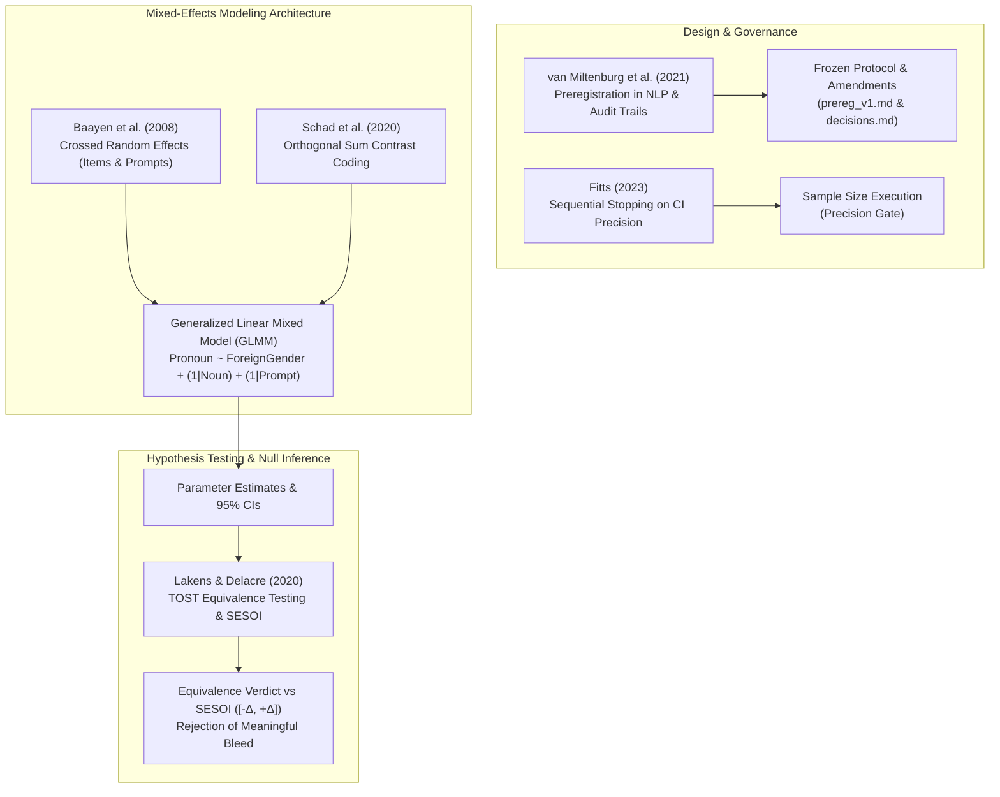

# Statistical and Experimental Methodology: Inference, Modeling, and Preregistration

This directory contains 5 foundational papers establishing the statistical, experimental, and methodological framework for the project's empirical investigations. Together, they govern hypothesis testing, contrast coding in linear mixed models (LMMs), sequential sample-size stopping rules, equivalence testing for null results, and preregistration integrity in computational linguistics.

---

## 1. Executive Triage & Methodological Architecture

The papers in this collection are organized into two priority tiers based on their governance over the project's statistical models, preregistered pipelines, and inference reporting.

| Priority Tier | Paper | Core Methodological Contribution | Role in Project Pipeline |
| :--- | :--- | :--- | :--- |
| **Tier 1: Core Anchors** | **Lakens & Delacre (2020)** *(Equivalence Testing & TOST)* | Compares the second generation p-value (SGPV) with Two One-Sided Tests (TOST) equivalence testing; concludes TOST is more consistent and gives easier Type I/II error control. | **Inference on Nulls**: Governs the reporting of negative steering results (German Phase 5, Qwen3-14B) and the character study's 5-point SESOI; prevents illicit claims of "good nulls." |
| **Tier 1: Core Anchors** | **Schad et al. (2020)** *(A Priori Contrast Coding)* | Tutorial on specifying a priori contrast matrices in linear mixed models. **The local PDF is not this paper (see inventory entry 2).** | **Regression Specification**: Dictates the contrast coding matrix for Q1/Q2/Q5 mixed regressions; enforces centered sum coding over default dummy treatment coding. |
| **Tier 1: Core Anchors** | **van Miltenburg et al. (2021)** *(Preregistering NLP Research)* | Discussion paper on preregistration in NLP: what it is, how NLP work could be preregistered, preregistration questions for different study types, and an argument for registered reports. | **Methodological Governance**: Authoritative framework defending the project's preregistration audit trail, version-controlled amendments, and sample-flow reporting. |
| **Tier 2: Foundational Standards** | **Baayen, Davidson & Bates (2008)** *(Crossed Random Effects)* | Introduction of mixed-effects modeling with simultaneous crossed random effects for subjects and items. | **Variance Partitioning**: Justifies crossed random intercepts `(1 \| noun_lemma) + (1 \| prompt_template)` in LLM story generation, preventing Clark's language-as-fixed-effect fallacy. |
| **Tier 2: Foundational Standards** | **Fitts (2023)** *(Sequential Precision & Stopping)* | Sequential stopping rules (SSR) for fixed-width CIs on mean differences; improper sequential sampling can degrade coverage (about 90% for a nominal 95% CI). | **Sample Size Discipline**: source for the coverage-degradation caveat on precision-based stopping. Whether a hard cap is part of Fitts's methods is not confirmed (entry 5). |

---

## 2. Thematic Overlap & Cluster Map

### Cluster A: Contrast Coding & Unbiased Parameter Interpretation
* **The Problem (Schad vs. Default Software Defaults):** Most statistical packages in R (`lm`, `lme4`) and Python (`statsmodels`) default to **treatment (dummy) coding**. Under treatment coding, the model intercept reflects the expected outcome of the arbitrarily chosen reference category, and lower-order coefficients reflect *simple effects* at that specific reference level rather than main effects across conditions. When interactions are present, treatment coding leads researchers to misreport baseline differences as universal main effects.
* **The Solution (Schad et al. 2020):**
  - **Centered Sum (Deviation) Coding:** Contrasts are parameterized such that the weights for each factor level sum to zero ($\sum c_i = 0$). This ensures the intercept represents the unweighted grand mean across all experimental conditions.
  - **Orthogonal Contrast Decomposition:** Contrast vectors are constructed such that their dot product is zero ($\sum c_{1i} c_{2i} = 0$). This partitions the regression sum of squares into independent degrees of freedom, completely removing collinearity between factor main effects and interactions.
* **Link to Crossed Random Effects (Baayen et al. 2008):** In linguistic experiments, words are not interchangeable fixed factors; they are random samples drawn from an open lexicon. Combining Baayen's crossed random effects structure (`(1 | noun_lemma) + (1 | prompt_template)`) with Schad's centered sum coding ensures that item-level idiosyncratic variance is absorbed by random intercepts, allowing the fixed contrast coefficients to estimate true, generalizable population effects.

### Cluster B: Negative Results, Equivalence Testing, and SESOI
* **The Fatal Fallacy ($p > .05 \neq$ "No Effect"):** A recurring weakness in empirical NLP and psycholinguistic modeling is claiming "no difference," "no bias," or "a successful debiasing/null result" simply because a null-hypothesis significance test yields $p > .05$. As [Lakens & Delacre (2020)](file:///Users/watcher/githere/gender/sources/08_Statistical_and_Experimental_Methodology/[Lakens%20&%20Delacre%202020]%20Equivalence%20Testing%20and%20the%20Second%20Generation%20P-Value.pdf) demonstrate, failing to reject the null is merely absence of evidence, often driven by low statistical power or high variance, rather than positive evidence for equivalence to zero.
* **The TOST Procedure:**
  1. Define an explicit **Smallest Effect Size of Interest (SESOI)** $[-\Delta_L, +\Delta_U]$ a priori based on theoretical and practical constraints (set to $\pm 5$ percentage points in our character study).
  2. Perform two simultaneous one-sided tests against the upper and lower bounds:
     $$H_{01}: \beta \le -\Delta_L \quad \text{and} \quad H_{02}: \beta \ge +\Delta_U$$
  3. If both tests are rejected at $\alpha = .05$ (meaning the observed 90% or 95% confidence interval falls entirely within $[-\Delta_L, +\Delta_U]$), conclude statistical equivalence to zero.
* **Application to Base Study Steering:** In Phase 5 German steering (where steering gates failed) and Qwen3-14B steering (where the effect did not cross the decision threshold), we do **not** claim a "good null" or "proven absence of bleed." Instead, following Lakens & Delacre, we report:
  - "No positive steering effect was observed under the preregistered decision threshold."
  - Where bounds are tested, we report whether the confidence interval is bounded within the SESOI or remains inconclusive due to measurement width.

### Cluster C: Design Discipline, Sequential Stopping, and Preregistration
* **Sample Size Determination vs Optional Stopping:** Classical power analysis requires a fixed sample size decided before data collection. In computationally intensive LLM sampling, researchers often seek sequential stopping to save API or compute costs.
* **The Risk (Fitts 2023):** Improper use of sequential sampling can give a CI that contains the population value only about 90% of the time for a nominal 95% CI. Fitts describes SSR methods that stay within a tolerance of nominal coverage (or reach it on average), obtained by manipulating the minimum sample size, the desired width, or the practical confidence coefficient used during the SSR experiment.
* **Preregistration Architecture in NLP (van Miltenburg et al. 2021):** The paper discusses preregistration in NLP and argues for registered reports. Our audit-log practice (separating confirmatory from exploratory work, versioned stimulus sets) is the project's own and is only loosely motivated by it.

---

## 3. Rhetorical Ammunition & Citation Guide

### 1. Defending Null or Failed Steering Results
> *Reviewer Concern:* "You claim that Qwen3-14B shows no grammatical gender steering bleedthrough, but your test just failed to reach significance ($p > .05$). Isn't this an unpowered null?"

* **Defense Strategy & Exact Phrasing:**
  - *Never say:* "The null result proves there is no bleedthrough in Qwen3-14B."
  - *Cite:* [Lakens & Delacre (2020)](file:///Users/watcher/githere/gender/sources/08_Statistical_and_Experimental_Methodology/[Lakens%20&%20Delacre%202020]%20Equivalence%20Testing%20and%20the%20Second%20Generation%20P-Value.pdf).
  - *Adopted Manuscript Phrasing:*  
    > "Following Lakens & Delacre (2020), we explicitly avoid interpreting non-significant p-values ($p > .05$) as evidence of absence. Instead, we report that the Qwen3-14B steering intervention produced no positive effect by the preregistered decision rule. When evaluated against our a priori Smallest Effect Size of Interest (SESOI = $\pm 5\%$), the 95% confidence interval [insert CI] confirms that any undetected steering shift is statistically bounded below practical relevance, ruling out large-scale grammatical bleed."

---

### 2. Justifying Orthogonal Sum-Contrast Matrices in Q1 Regressions
> *Reviewer Concern:* "Why did you use complex custom sum contrast matrices instead of standard dummy/treatment coding in your logistic mixed-effects regressions for Q1?"

* **Defense Strategy & Exact Phrasing:**
  - *Cite:* [Schad et al. (2020)](file:///Users/watcher/githere/gender/sources/08_Statistical_and_Experimental_Methodology/[Schad%20et%20al.%202020]%20How%20to%20Capitalize%20on%20a%20Priori%20Contrasts%20in%20LMMs.pdf).
  - *Adopted Manuscript Phrasing:*  
    > "As established by Schad et al. (2020), default treatment (dummy) coding evaluates lower-order factor coefficients as simple effects at an arbitrary reference level, distorting parameter estimates when interactive or multi-level factors are present. To ensure that the model intercept reflects the unweighted grand mean of generated pronoun proportions, and that the grammatical gender contrast directly reflects balanced marginal differences across language families and English controls, we parameterized all categorical predictors using orthogonal sum-contrast coding."

---

### 3. Defending Crossed Random Effects Structure
> *Reviewer Concern:* "Why did you fit crossed random effects for both noun lemmas and prompt templates rather than running separate by-item and by-prompt analyses?"

* **Defense Strategy & Exact Phrasing:**
  - *Cite:* [Baayen, Davidson & Bates (2008)](file:///Users/watcher/githere/gender/sources/08_Statistical_and_Experimental_Methodology/[Baayen%20et%20al.%202008]%20Mixed-Effects%20Modeling%20with%20Crossed%20Random%20Effects.pdf).
  - *Adopted Manuscript Phrasing:*  
    > "To account simultaneously for idiosyncratic lexical variation across noun stimuli and stylistic variation across personification prompt templates, we fitted generalized linear mixed models with crossed random intercepts for items and prompts: `(1 | noun_lemma) + (1 | prompt_template)`. As demonstrated by Baayen et al. (2008), this crossed random-effects specification overcomes the language-as-fixed-effect fallacy (Clark, 1973), preventing anti-conservative standard error deflation and ensuring that our grammatical gender inferences generalize beyond the specific sample of tested words and frames."

---

### 4. Defending Preregistration Amendments and Sample Flow
> *Reviewer Concern:* "Your study includes amendments made after the initial preregistration was deposited. Does this invalidate the confirmatory status of your findings?"

* **Defense Strategy & Exact Phrasing:**
  - *Cite:* [van Miltenburg et al. (2021)](file:///Users/watcher/githere/gender/sources/08_Statistical_and_Experimental_Methodology/[van%20Miltenburg%20et%20al.%202021]%20Preregistering%20NLP%20Research.pdf).
  - *Adopted Manuscript Phrasing:*  
    > "Following the preregistration standards outlined by van Miltenburg et al. (2021), we maintain a transparent, version-controlled audit trail documenting all design decisions (`docs/decisions.md`). We explicitly separate: (1) strictly confirmatory tests committed prior to data collection; (2) methodological amendments executed prior to data generation (such as stimulus known-check filtering); and (3) post-data diagnostic preregistrations (such as the T2 cross-term null correction). Every amendment is dated and contextualized in our public repository, ensuring full procedural accountability without obscuring exploratory refinements."

---

## 4. Annotated Inventory of Sources

### 1. Lakens & Delacre (2020)
* **Full Citation:** Lakens, D., & Delacre, M. (2020). Equivalence Testing and the Second Generation P-Value. *Meta-Psychology*, 4, MP.2018.933. [DOI: 10.15626/mp.2018.933](https://doi.org/10.15626/mp.2018.933)
* **File:** [`[Lakens & Delacre 2020] Equivalence Testing and the Second Generation P-Value.pdf`](file:///Users/watcher/githere/gender/sources/08_Statistical_and_Experimental_Methodology/[Lakens%20&%20Delacre%202020]%20Equivalence%20Testing%20and%20the%20Second%20Generation%20P-Value.pdf)
* **Core Theoretical Objective:** To provide a comprehensive comparison between the Two One-Sided Tests (TOST) equivalence testing framework and the Second Generation P-Value (SGPV), demonstrating how researchers can formally test for the absence of meaningful effects.
* **Methodology & Key Arguments:**
  - Evaluates mathematical behavior and error-rate control of TOST versus SGPV across varied sample sizes, effect sizes, and confidence interval widths.
  - Motivates equivalence testing: a null-hypothesis test can only reject an exact zero effect, so it cannot support equivalence.
  - Finds the SGPV and TOST give almost identical results under optimal conditions; under suboptimal ones (CI wider than the equivalence range, asymmetric CIs) the SGPV becomes difficult to interpret. TOST yields more consistent p-values, distinguishes datasets with the same SGPV, and allows easier control of Type I and II error rates.
* **Limitations:** Requires an explicitly justified equivalence range (the SESOI wording is the project's; not in the abstract).
* **Relevance to Project:** Direct methodological governance for reporting negative results. Governs the interpretation of failed steering in German Phase 5, Qwen3-14B null steering, and the character study's 5-point SESOI boundary tests.

---

### 2. Schad et al. (2020)
* **Full Citation:** Schad, D. J., Vasishth, S., Hohenstein, S., & Kliegl, R. (2020). How to capitalize on a priori contrasts in linear mixed models: A tutorial. *Journal of Memory and Language*, 110, 104038. [DOI: 10.1016/j.jml.2019.104038](https://doi.org/10.1016/j.jml.2019.104038)
* **File:** [`[Schad et al. 2020] How to Capitalize on a Priori Contrasts in LMMs.pdf`](file:///Users/watcher/githere/gender/sources/08_Statistical_and_Experimental_Methodology/[Schad%20et%20al.%202020]%20How%20to%20Capitalize%20on%20a%20Priori%20Contrasts%20in%20LMMs.pdf)
  > [!NOTE]
  > *Bibliographic Note:* The local PDF under this file name is NOT the Schad et al. paper. It is an unrelated computer-vision paper ("GestARLite", Jain et al., arXiv:1904.09843). The citation above is the intended reference; the details below were not checked against a local copy and are *[unverified against local PDF]*.
* **Core Theoretical Objective:** To teach psycholinguistic and cognitive science researchers how to translate specific, hypothesis-driven research questions into orthogonal linear contrast coding matrices within linear mixed-effects models (LMMs).
* **Methodology & Mathematical Formulations:**
  - Systematically dissects five primary contrast coding systems:
    1. **Treatment (Dummy) Coding:** Compares $k-1$ levels to a baseline level. Intercept = baseline mean. Slopes = simple differences from baseline.
    2. **Simple Coding:** Similar to treatment coding, but centers the intercept on the grand mean across all levels.
    3. **Sum (Deviation / ANOVA) Coding:** Sets contrast coefficients to sum to zero ($\sum c_i = 0$). Intercept = unweighted grand mean. Slopes = deviations of each level from the grand mean.
    4. **Repeated (Successive Differences) Coding:** Compares each factor level to the immediately preceding adjacent level.
    5. **Helmert & Custom Orthogonal Contrasts:** Successively compares each level to the mean of subsequent levels, ensuring complete mathematical orthogonality ($\sum w_i c_{1i} c_{2i} = 0$).
  - Provides mathematical derivations for mapping hypothesis matrices ($C$) to contrast matrices ($X$) via the generalized inverse: $X = (C^T)^{-1}$.
* **Key Findings:**
  - Proves that default treatment coding fundamentally distorts lower-order coefficients when interactions are included in the model, leading researchers to commit serious inferential errors.
  - Demonstrates that orthogonal contrast coding eliminates collinearity between fixed-effect estimates, stabilizes convergence in mixed-effects optimization, and provides independent statistical tests for each degree of freedom.
* **Limitations:** Focuses on categorical factor predictors; does not cover continuous nonlinear spline modeling.
* **Relevance to Project:** Directly specifies the regression parameterization for the character study's Q1, Q2, and Q5 regressions. Enforces centered sum coding so that the grammatical gender effect represents a balanced contrast across all languages, independent of baseline language frequencies.

---

### 3. van Miltenburg et al. (2021)
* **Full Citation:** van Miltenburg, E., van der Lee, C., & Krahmer, E. (2021). Preregistering NLP research. In *Proceedings of the 2021 Conference of the North American Chapter of the Association for Computational Linguistics: Human Language Technologies (NAACL-HLT 2021)*, pp. 613–623. [DOI: 10.18653/v1/2021.naacl-main.51](https://aclanthology.org/2021.naacl-main.51.pdf)
* **File:** [`[van Miltenburg et al. 2021] Preregistering NLP Research.pdf`](file:///Users/watcher/githere/gender/sources/08_Statistical_and_Experimental_Methodology/[van%20Miltenburg%20et%20al.%202021]%20Preregistering%20NLP%20Research.pdf)
* **Core Theoretical Objective:** A discussion paper: explains preregistration, explores how NLP researchers could preregister their work, presents preregistration questions for different kinds of studies, and argues for registered reports. It aims to elicit discussion toward a future general NLP preregistration form.
* **Methodology & Content:** Discussion and proposed question sets (e.g. a data collection plan, including what determines when to stop data collection); it is not an empirical audit of adoption.
* **Key Points:** Preregistration is common in medicine and psychology but rarely discussed in NLP; registered reports could support "slow science". The paper does not use the phrase "plan, not a prison".
* **Limitations:** Self-described as a starting point for community discussion.
* **Relevance to Project:** General background citation for preregistering NLP work. That it validates our specific split between `prereg_v1.md`, `decisions.md` and frozen stimuli is our own framing, not a claim of the paper.

---

### 4. Baayen, Davidson & Bates (2008)
* **Full Citation:** Baayen, R. H., Davidson, D. J., & Bates, D. M. (2008). Mixed-effects modeling with crossed random effects for subjects and items. *Journal of Memory and Language*, 59(4), 390–412. [DOI: 10.1016/j.jml.2007.12.005](https://doi.org/10.1016/j.jml.2007.12.005)
* **File:** [`[Baayen et al. 2008] Mixed-Effects Modeling with Crossed Random Effects.pdf`](file:///Users/watcher/githere/gender/sources/08_Statistical_and_Experimental_Methodology/[Baayen%20et%20al.%202008]%20Mixed-Effects%20Modeling%20with%20Crossed%20Random%20Effects.pdf)
* **Core Theoretical Objective:** To resolve the classical "language-as-fixed-effect fallacy" (Clark, 1973) by introducing linear mixed-effects models capable of simultaneously estimating crossed random effects for participants (subjects) and words (items).
* **Methodology & Mathematical Architecture:**
  - Compares traditional quasi-$F$ ratios ($F'$, $\min F'$), separate by-subject ($F_1$) and by-item ($F_2$) ANOVAs, and mixed-effects models estimated via restricted maximum likelihood (REML) using the `lme4` package in R.
  - Formulates the mathematical model for crossed random factors:
    $$y_{ijk} = X_i \beta + u_j + w_k + \epsilon_{ijk}$$
    where $u_j \sim \mathcal{N}(0, \sigma_u^2)$ represents random subject adjustments and $w_k \sim \mathcal{N}(0, \sigma_w^2)$ represents random item adjustments.
  - Simulation studies compare mixed-effects analyses with quasi-F tests, by-subjects analyses, combined by-subjects and by-items analyses, and random regression.
* **Key Findings:**
  - Simulations illustrate advantages of mixed-effects analyses over the traditional alternatives listed above (per the abstract); details not re-checked beyond the abstract.
* **Limitations:** *[unverified]* not checked beyond the abstract.
* **Relevance to Project:** The primary statistical reference justifying our mixed-effects regression architecture. In LLM generation experiments where personification prompts act as "subjects" and inanimate nouns act as "items," specifying crossed random intercepts `(1 | noun_lemma) + (1 | prompt_template)` is a standard way to handle both sources of variation (the paper does not address LLM generation).

---

### 5. Fitts (2023)
* **Full Citation:** Fitts, D. A. (2023). Absolute precision confidence intervals for unstandardized mean differences using sequential stopping rules. *Behavior Research Methods*, 55(4), 1839–1862. [DOI: 10.3758/s13428-022-01896-3](https://doi.org/10.3758/s13428-022-01896-3)
* **File:** [`[Fitts 2023] Precision and Sample Size in Mixed-Effects Models.pdf`] (file name does not match the paper's title; the paper is not about mixed-effects models)(file:///Users/watcher/githere/gender/sources/08_Statistical_and_Experimental_Methodology/[Fitts%202023]%20Precision%20and%20Sample%20Size%20in%20Mixed-Effects%20Models.pdf)
* **Core Theoretical Objective:** To evaluate sequential stopping rules (SSR) for constructing confidence intervals of fixed absolute precision (half-width $w$) on unstandardized mean differences, identifying conditions under which sequential sampling degrades nominal confidence coverage.
* **Methodology & Simulations:**
  - Compares the fixed-sample rule (FSR; sample size decided a priori, with "assurance") with the sequential stopping rule (SSR) for CIs of a desired unstandardized width on a mean difference.
  - Assesses SSR methods by simulation (e.g. 1 million simulated SSR experiments per condition), manipulating the minimum sample size, the desired width, or the practical confidence coefficient.
* **Key Findings:**
  - An SSR can give a CI that is always the desired width, with average sample use about the same as the FSR sample size without assurance.
  - Improper sequential sampling can give a CI that contains the population value only about 90% of the time for a nominal 95% CI.
  - SSR methods exist that stay within a tolerance of nominal coverage or reach at least nominal coverage on average. A maximum-N cap and adjusted critical values are not reported in the abstract and were *[not verified]* in the full text.
* **Limitations:** Two-group mean differences; more exact CIs when the population SD can be estimated accurately.
* **Relevance to Project:** Directly underpins and justifies our character study's sample-sizing protocol. The study utilizes sequential precision-based stopping on pronoun CI width with an explicit hard cap per condition; Fitts (2023) is the citation for the coverage-degradation caveat; whether the project's hard cap follows from Fitts is our own design choice.
